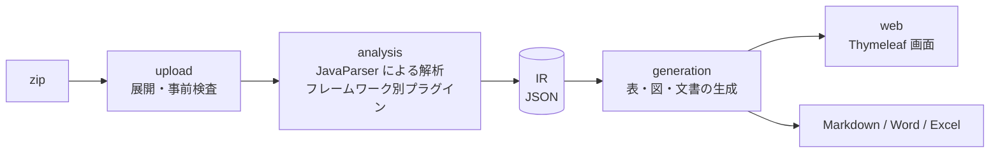

# Java システム解析支援ツール V1（java-system-analyzer）

Spring Boot で作られた Java プロジェクトの zip をアップロードすると、ソースコードを**静的に**解析し、
アーキテクチャ図・API 一覧・ER 図・クラス別概要などの設計資料と、**基本設計書**（Word）を自動生成する Web アプリケーションです。

既存システムの設計書が未整備・陳腐化している現場で、ドキュメント整備の工数を減らし、
新規参画者がシステムを短時間で理解できるようにすることを目的としています。

- アップロードされたコードは**実行しません**（静的解析のみ）
- 出力はソースコードから抽出した**事実のみ**で、推測を含めません（Lombok の暗黙メソッドはアノテーションの仕様に基づく確定的な補完として扱います）
- V1 は AI（LLM）を使いません

## できること

| 機能 | 内容 |
|---|---|
| アップロード・事前検査 | zip を隔離領域に展開し、`pom.xml` の有無・Spring Boot 構成・単一モジュールかを判定 |
| コード構造解析 | JavaParser による AST 解析。Spring のステレオタイプ／DI、**Lombok の暗黙メソッド・コンストラクタ**（`@RequiredArgsConstructor` による注入を含む）、JPA（`@Entity`・`@OneToMany` 等の関連と多重度）。`javax.*` / `jakarta.*` の両方に対応 |
| アーキテクチャ図・依存関係図 | レイヤー構成、コンポーネント間の DI 依存、パッケージ依存（Mermaid） |
| API 一覧 | Controller / メソッド / HTTP メソッド / パス / Request DTO / Response DTO |
| ER 図 | エンティティ・カラム・関連（多重度、結合カラム、継承） |
| クラス別概要 | Controller / Service / Repository / Entity の 4 種のテンプレートによる説明文 |
| MyBatis / MyBatis-Plus | Mapper のメソッドシグネチャと、対応する XML・注解の SQL 原文（SQL の意味解析はしない） |
| Spring Configuration | `@Configuration` / `@Bean` / `@ConfigurationProperties` の一覧 |
| 画面（View）層 | JSP / Thymeleaf の画面一覧、Controller との対応、画面遷移 |
| 簡易 Call Graph | DI で注入されたフィールドに対するメソッド呼び出しの検出（ヒューリスティック方式） |
| プロジェクト統計 | クラス数・インタフェース数・API 数・パッケージ数等 |
| 解析エラーレポート | 構文エラー、未解決 import、循環依存 |
| エクスポート | Markdown、Word（.docx）、Excel（.xlsx）、**基本設計書（Word）**、IR（JSON） |

### V1 の対象範囲

| 対象 | 対象外（将来の版） |
|---|---|
| Java / Spring Boot（Spring MVC）/ Spring Data JPA / Lombok / MyBatis | Struts・Seasar2・TERASOLUNA、Spring Security の解析 |
| Maven・単一モジュール | Gradle、マルチモジュール |
| 基本設計書の生成 | 詳細設計書（処理フロー・内部ロジック）、テスト書 |
| 簡易 Call Graph（注入フィールドへの呼び出しのみ） | 正式な Method Call Graph（シンボル解決による完全な呼び出し関係） |

対象規模は数百ファイル程度の中小規模プロジェクトです。

## 使い方

### 必要なもの

- JDK 21（Eclipse Temurin 21 で確認）
- Maven は不要です（同梱の Maven Wrapper を使います）
- 画面と図の描画にはモダンブラウザ（Mermaid.js を同梱しており、外部 CDN には接続しません）

### 起動

```bash
./mvnw spring-boot:run      # Windows の場合は mvnw.cmd spring-boot:run
```

ブラウザで http://localhost:8080/ を開きます。

### 操作の流れ

1. 解析したいプロジェクト（`pom.xml` を含むフォルダ）を zip にしてアップロードする（上限 50MB、展開後 200MB）
2. 事前検査と解析が自動で実行され、解析総覧の画面に移る
3. 左のナビゲーションから各画面を確認する

| 画面 | 内容 |
|---|---|
| 解析総覧 | 事前検査の結果、統計 |
| アーキテクチャ・依存関係 | レイヤー構成図、コンポーネント依存図、パッケージ依存図 |
| API 一覧 / ER 図 / クラス一覧・詳細 | 各成果物（クラス詳細には概要と呼び出し関係） |
| 解析エラーレポート | 構文エラー・未解決 import・循環依存 |
| MyBatis / Configuration / 画面（View）一覧 | 各解析結果 |
| エクスポート | 基本設計書・成果物一式のダウンロード |

試しに使う場合は、`src/test/resources/sample-projects/` のサンプル（Lombok + JPA、MyBatis、JSP、Thymeleaf 等）を zip にしてアップロードしてください。

解析結果は `workspace/{id}/` に保存されます（Git 管理外）。設定は `src/main/resources/application.properties` の `analyzer.upload.*` で変更できます。

## 仕組み



- **IR（中間表現）による分離**：解析層はフレームワークに依存しない IR（JSON）を出力し、生成層は IR のみを参照します。
  生成層がソースコードや AST を直接参照することはありません（将来の AI 連携の入り口を IR に一本化するため）
- **プラグイン化**：フレームワーク別の解析は `analysis.plugin.springboot` / `mybatis` / `view` の独立したプラグインです
- **意味的手がかりの保持**：IR にはコメント・Javadoc も保持しています
- **分割保存**：IR は `project.json`（索引・依存関係・問題）と `packages/<パッケージ>.json` に分けて保存します

| パッケージ（`com.example.javaanalyzer`） | 役割 |
|---|---|
| `upload` | zip の受け付け・展開・事前検査 |
| `analysis`、`analysis.plugin.*` | 構造解析、依存関係の解決、循環依存・Call Graph の検出 |
| `ir`、`ir.io` | IR のモデル（record）と JSON の読み書き |
| `generation`、`generation.diagram`、`generation.export` | 表・Mermaid 図・文書（Apache POI）の生成。`ir` のみに依存 |
| `web` | 画面（Thymeleaf） |

## 技術スタック

Spring Boot 4.1 / Thymeleaf / JavaParser 3.28 / Apache POI 5.5 / Mermaid.js 11.4（同梱）/ Maven / JUnit 5 / Spotless（google-java-format）

すべて無料・OSS です。

## 開発

```bash
./mvnw spotless:apply       # 整形
./mvnw spotless:check       # 整形の確認
./mvnw test                 # 単体テスト
java .claude/hooks/ArchitectureCheck.java --all   # アーキテクチャ規則（IR 分離等）の全体検査
bash .claude/hooks/test/run-tests.sh              # 上記検査のテスト
```

本プロジェクトは Claude Code を使って開発しました。開発時の規約・タスク定義は [`CLAUDE.md`](CLAUDE.md)、
Claude Code 用の Skill・Hook は `.claude/` にあります（ツールの実行時には使いません）。

## ドキュメント

| 文書 | 内容 |
|---|---|
| [CLAUDE.md](CLAUDE.md) | 要件（機能・非機能）、スコープ、設計方針、タスクごとの設計判断 |
| [docs/screen-design.md](docs/screen-design.md) | 画面設計書 |
| [docs/claude-md-verification.md](docs/claude-md-verification.md) | CLAUDE.md の適用効果の検証 |
| [docs/hooks-verification.md](docs/hooks-verification.md) | アーキテクチャ規則の自動検査（Hooks）の検証 |
| [docs/no14/comparison.md](docs/no14/comparison.md) | 生成品質の改善前後の比較 |
| [docs/no15-regression.md](docs/no15-regression.md) | 回帰確認の結果 |
| [docs/no16-code-review.md](docs/no16-code-review.md) | コードレビュー結果と修正内容 |

## 既知の制約

- 静的解析のため、実行時にのみ確定する設定（プロファイル、`@Qualifier` / `@Primary` による Bean の絞り込み等）は反映しません
- テーブル名・カラム名は、アノテーションに明記された値のみ表示します（命名戦略による既定名は推測しません）
- 個々の解析の制約は、各クラスの Javadoc と `CLAUDE.md` の「設計判断」に記載しています

## ライセンス

[MIT License](LICENSE)。同梱の Mermaid.js は MIT License です（`src/main/resources/static/js/mermaid/LICENSE`）。
