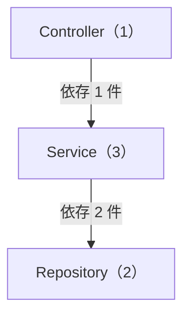
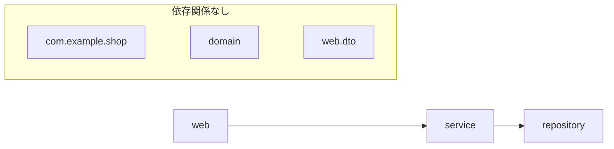
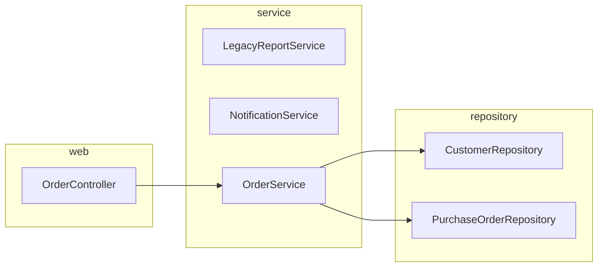
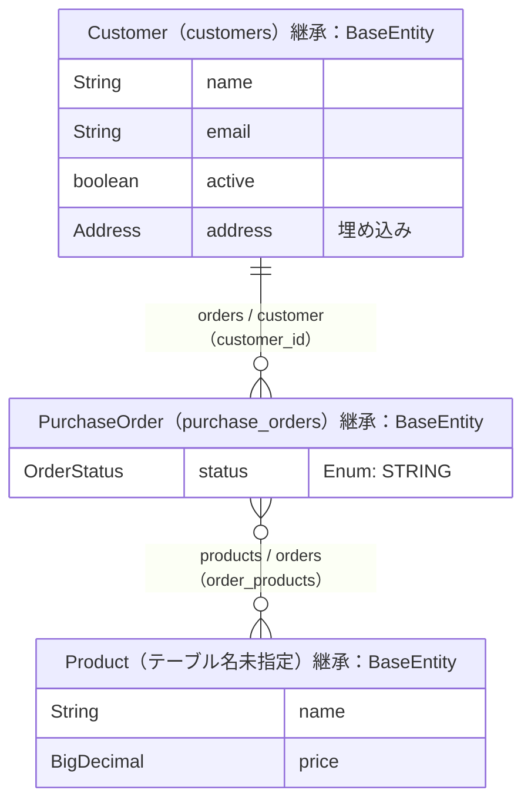

# 成果物一式（com.example.shop）

## 解析総覧

| 項目 | 内容 |
| --- | --- |
| ルートパッケージ | com.example.shop |
| Spring Boot | 3.3.4 |
| pom.xml | pom.xml |
| 文字コード | UTF-8 |

### プロジェクト統計

| 項目 | 件数 |
| --- | --- |
| パッケージ | 6 |
| クラス | 12 |
| インタフェース | 2 |
| Enum | 1 |
| Controller | 1 |
| Service | 3 |
| Repository | 2 |
| API | 2 |
| エンティティ | 5 |
| 依存関係 | 4 |
| 解析エラー（エラー / 警告） | 2 / 0 |

## アーキテクチャ・依存関係

### レイヤー構成

**レイヤー構成**

### パッケージ依存

**パッケージ依存**

### コンポーネント依存

**コンポーネント依存**

> 実線＝直接解決 / 点線＝単一実装から解決（@Bean や @Profile による別実装の可能性がある） / 赤枠＝循環依存

### 依存関係一覧

| 依存元 | メンバー | 注入方式 | 宣言型 | 解決先 | 解決方法 |
| --- | --- | --- | --- | --- | --- |
| NotificationService | mailSender | フィールド | JavaMailSender | - | 外部ライブラリ |
| OrderService | customerRepository | コンストラクタ | CustomerRepository | CustomerRepository | 直接解決 |
| OrderService | purchaseOrderRepository | コンストラクタ | PurchaseOrderRepository | PurchaseOrderRepository | 直接解決 |
| OrderController | orderService | コンストラクタ | OrderService | OrderService | 直接解決 |

### 解決できなかった依存

| 依存元 | メンバー | 宣言型 | 理由 |
| --- | --- | --- | --- |
| NotificationService | mailSender | JavaMailSender | 外部ライブラリ |

## API一覧

| Controller | Method | HTTP | Path | Request DTO | Response DTO |
| --- | --- | --- | --- | --- | --- |
| OrderController | create | POST | /api/orders | CreateOrderRequest | OrderResponse |
| OrderController | get | GET | /api/orders/{id} | - | OrderResponse |

## ER図

**ER図**

> 図はエンティティ（@Entity）のみ。親クラスのカラムは子エンティティに展開しない。テーブル名・カラム名の既定名は推測しない。

### エンティティ一覧

| エンティティ | 種類 | エンティティ名 | テーブル名 | スキーマ | 親クラス |
| --- | --- | --- | --- | --- | --- |
| Address | Embeddable | - | - | - | - |
| BaseEntity | MappedSuperclass | - | - | - | - |
| Customer | エンティティ | 未指定 | customers | 未指定 | BaseEntity |
| Product | エンティティ | 未指定 | 未指定 | 未指定 | BaseEntity |
| PurchaseOrder | エンティティ | 未指定 | purchase_orders | 未指定 | BaseEntity |

### Address（Embeddable）

カラム

| フィールド | 型 | カラム名 | PK | 生成戦略 | NULL可 | 長さ | 一意 | Enum型 | 埋め込み |
| --- | --- | --- | --- | --- | --- | --- | --- | --- | --- |
| street | String | 未指定 | - | - | - | - | - | - | - |
| city | String | 未指定 | - | - | - | - | - | - | - |

関連

検出されませんでした

### BaseEntity（MappedSuperclass）

カラム

| フィールド | 型 | カラム名 | PK | 生成戦略 | NULL可 | 長さ | 一意 | Enum型 | 埋め込み |
| --- | --- | --- | --- | --- | --- | --- | --- | --- | --- |
| id | Long | 未指定 | ○ | IDENTITY | - | - | - | - | - |
| createdAt | LocalDateTime | created_at | - | - | × | - | - | - | - |

関連

検出されませんでした

### Customer（エンティティ）

カラム

| フィールド | 型 | カラム名 | PK | 生成戦略 | NULL可 | 長さ | 一意 | Enum型 | 埋め込み |
| --- | --- | --- | --- | --- | --- | --- | --- | --- | --- |
| name | String | 未指定 | - | - | × | 100 | - | - | - |
| email | String | 未指定 | - | - | - | - | ○ | - | - |
| active | boolean | 未指定 | - | - | - | - | - | - | - |
| address | Address | 未指定 | - | - | - | - | - | - | ○ |

関連

| フィールド | 種類 | 相手 | 所有側 | mappedBy | 結合カラム | 結合テーブル | optional | fetch | cascade |
| --- | --- | --- | --- | --- | --- | --- | --- | --- | --- |
| orders | OneToMany | PurchaseOrder | × | customer | - | - | - | - | ALL |

### Product（エンティティ）

カラム

| フィールド | 型 | カラム名 | PK | 生成戦略 | NULL可 | 長さ | 一意 | Enum型 | 埋め込み |
| --- | --- | --- | --- | --- | --- | --- | --- | --- | --- |
| name | String | 未指定 | - | - | - | - | - | - | - |
| price | BigDecimal | 未指定 | - | - | - | - | - | - | - |

関連

| フィールド | 種類 | 相手 | 所有側 | mappedBy | 結合カラム | 結合テーブル | optional | fetch | cascade |
| --- | --- | --- | --- | --- | --- | --- | --- | --- | --- |
| orders | ManyToMany | PurchaseOrder | × | products | - | - | - | - | - |

### PurchaseOrder（エンティティ）

カラム

| フィールド | 型 | カラム名 | PK | 生成戦略 | NULL可 | 長さ | 一意 | Enum型 | 埋め込み |
| --- | --- | --- | --- | --- | --- | --- | --- | --- | --- |
| status | OrderStatus | 未指定 | - | - | - | - | - | STRING | - |

関連

| フィールド | 種類 | 相手 | 所有側 | mappedBy | 結合カラム | 結合テーブル | optional | fetch | cascade |
| --- | --- | --- | --- | --- | --- | --- | --- | --- | --- |
| customer | ManyToOne | Customer | ○ | - | customer_id | - | × | LAZY | - |
| products | ManyToMany | Product | ○ | - | - | order_products（order_id / 逆側 product_id） | - | - | - |

## クラス別概要

> 呼び出し関係（簡易）：既知の DI 依存先フィールドに対する呼び出しのみをヒューリスティックに検出したもので、オーバーロードと多態を解決しない。

> 呼び出し関係（簡易）：外部ライブラリの呼び出し、List<Foo>・Optional<Foo> のフィールドに対する呼び出し、コンストラクタ内の呼び出しは含まない。

| クラス名 | 種類 | 役割 | パッケージ | 概要 |
| --- | --- | --- | --- | --- |
| ShopApplication | クラス | - | com.example.shop | Sample shop application used to verify the analyzer. |
| Address | クラス | Entity | com.example.shop.domain | - |
| BaseEntity | クラス | Entity | com.example.shop.domain | Common columns of all entities. |
| Customer | クラス | Entity | com.example.shop.domain | A customer who places orders. |
| OrderStatus | Enum | - | com.example.shop.domain | - |
| Product | クラス | Entity | com.example.shop.domain | - |
| PurchaseOrder | クラス | Entity | com.example.shop.domain | - |
| CustomerRepository | インタフェース | Repository | com.example.shop.repository | - |
| PurchaseOrderRepository | インタフェース | Repository | com.example.shop.repository | - |
| LegacyReportService | クラス | Service | com.example.shop.service | - |
| NotificationService | クラス | Service | com.example.shop.service | - |
| OrderService | クラス | Service | com.example.shop.service | Places and looks up orders. |
| OrderController | クラス | Controller | com.example.shop.web | - |
| CreateOrderRequest | クラス | - | com.example.shop.web.dto | - |
| OrderResponse | クラス | - | com.example.shop.web.dto | - |

### ShopApplication（クラス）

ShopApplication は com.example.shop パッケージのクラスです。

#### 基本情報

| 項目 | 内容 |
| --- | --- |
| 完全修飾名 | com.example.shop.ShopApplication |
| 種類 | クラス |
| 役割 | - |
| パッケージ | com.example.shop |
| ソースファイル | src/main/java/com/example/shop/ShopApplication.java |
| 修飾子 | public |
| アノテーション | @SpringBootApplication |
| 親クラス | - |
| インタフェース | - |
| Javadoc | Sample shop application used to verify the analyzer. |
| コメント | - |

#### メソッド

| 名前 | 引数 | 戻り値 | 由来 |
| --- | --- | --- | --- |
| main | String[] args | void | ソース |

### Address（Embeddable）

Address は com.example.shop.domain パッケージの Embeddable です。カラム 2 件。関連：なし。

カラムと関連は「ER図」の章の Address（Embeddable）を参照。

#### 基本情報

| 項目 | 内容 |
| --- | --- |
| 完全修飾名 | com.example.shop.domain.Address |
| 種類 | クラス |
| 役割 | Entity |
| パッケージ | com.example.shop.domain |
| ソースファイル | src/main/java/com/example/shop/domain/Address.java |
| 修飾子 | public |
| アノテーション | @Embeddable, @Data |
| 親クラス | - |
| インタフェース | - |
| Javadoc | - |
| コメント | - |

#### テーブル

| 項目 | 内容 |
| --- | --- |
| 種類 | Embeddable |
| エンティティ名 | 未指定 |
| テーブル名 | 未指定 |
| スキーマ | 未指定 |

#### 対応するリポジトリ

検出されませんでした

#### フィールド

| 名前 | 型 | 修飾子 | アノテーション |
| --- | --- | --- | --- |
| street | String | private | - |
| city | String | private | - |

#### コンストラクタ

| 引数 | 修飾子 | 由来 |
| --- | --- | --- |
| - | public | Lombok（@Data） |

#### メソッド

| 名前 | 引数 | 戻り値 | 由来 |
| --- | --- | --- | --- |
| getStreet | - | String | Lombok（@Data） |
| setStreet | String street | void | Lombok（@Data） |
| getCity | - | String | Lombok（@Data） |
| setCity | String city | void | Lombok（@Data） |
| toString | - | String | Lombok（@Data） |
| equals | Object o | boolean | Lombok（@Data） |
| hashCode | - | int | Lombok（@Data） |

### BaseEntity（MappedSuperclass）

BaseEntity は com.example.shop.domain パッケージの MappedSuperclass です。カラム 2 件。関連：なし。

カラムと関連は「ER図」の章の BaseEntity（MappedSuperclass）を参照。

#### 基本情報

| 項目 | 内容 |
| --- | --- |
| 完全修飾名 | com.example.shop.domain.BaseEntity |
| 種類 | クラス |
| 役割 | Entity |
| パッケージ | com.example.shop.domain |
| ソースファイル | src/main/java/com/example/shop/domain/BaseEntity.java |
| 修飾子 | public, abstract |
| アノテーション | @MappedSuperclass, @Getter |
| 親クラス | - |
| インタフェース | - |
| Javadoc | Common columns of all entities. |
| コメント | - |

#### テーブル

| 項目 | 内容 |
| --- | --- |
| 種類 | MappedSuperclass |
| エンティティ名 | 未指定 |
| テーブル名 | 未指定 |
| スキーマ | 未指定 |

#### 対応するリポジトリ

検出されませんでした

#### フィールド

| 名前 | 型 | 修飾子 | アノテーション |
| --- | --- | --- | --- |
| id | Long | private | @Id, @GeneratedValue |
| createdAt | LocalDateTime | private | @Column |

#### メソッド

| 名前 | 引数 | 戻り値 | 由来 |
| --- | --- | --- | --- |
| getId | - | Long | Lombok（@Getter） |
| getCreatedAt | - | LocalDateTime | Lombok（@Getter） |

### Customer（Entity）

Customer は com.example.shop.domain パッケージのエンティティです（テーブル：customers）。カラム 4 件。関連：PurchaseOrder（1 対多）。

カラムと関連は「ER図」の章の Customer（エンティティ）を参照。

#### 基本情報

| 項目 | 内容 |
| --- | --- |
| 完全修飾名 | com.example.shop.domain.Customer |
| 種類 | クラス |
| 役割 | Entity |
| パッケージ | com.example.shop.domain |
| ソースファイル | src/main/java/com/example/shop/domain/Customer.java |
| 修飾子 | public |
| アノテーション | @Entity, @Table, @Getter, @Setter, @NoArgsConstructor |
| 親クラス | BaseEntity |
| インタフェース | - |
| Javadoc | A customer who places orders. |
| コメント | - |

#### テーブル

| 項目 | 内容 |
| --- | --- |
| 種類 | エンティティ |
| エンティティ名 | 未指定 |
| テーブル名 | customers |
| スキーマ | 未指定 |

#### 対応するリポジトリ

| リポジトリ | ID型 |
| --- | --- |
| CustomerRepository | Long |

#### フィールド

| 名前 | 型 | 修飾子 | アノテーション |
| --- | --- | --- | --- |
| name | String | private | @Column |
| email | String | private | @Column |
| active | boolean | private | - |
| address | Address | private | @Embedded |
| orders | List<PurchaseOrder> | private | @OneToMany |
| displayName | String | private | @Transient |

#### コンストラクタ

| 引数 | 修飾子 | 由来 |
| --- | --- | --- |
| - | public | Lombok（@NoArgsConstructor） |

#### メソッド

| 名前 | 引数 | 戻り値 | 由来 |
| --- | --- | --- | --- |
| getName | - | String | Lombok（@Getter） |
| setName | String name | void | Lombok（@Setter） |
| getEmail | - | String | Lombok（@Getter） |
| setEmail | String email | void | Lombok（@Setter） |
| isActive | - | boolean | Lombok（@Getter） |
| setActive | boolean active | void | Lombok（@Setter） |
| getAddress | - | Address | Lombok（@Getter） |
| setAddress | Address address | void | Lombok（@Setter） |
| getOrders | - | List<PurchaseOrder> | Lombok（@Getter） |
| setOrders | List<PurchaseOrder> orders | void | Lombok（@Setter） |
| getDisplayName | - | String | Lombok（@Getter） |
| setDisplayName | String displayName | void | Lombok（@Setter） |

### OrderStatus（Enum）

OrderStatus は com.example.shop.domain パッケージの Enum です。

#### 基本情報

| 項目 | 内容 |
| --- | --- |
| 完全修飾名 | com.example.shop.domain.OrderStatus |
| 種類 | Enum |
| 役割 | - |
| パッケージ | com.example.shop.domain |
| ソースファイル | src/main/java/com/example/shop/domain/OrderStatus.java |
| 修飾子 | public |
| アノテーション | - |
| 親クラス | - |
| インタフェース | - |
| Javadoc | - |
| コメント | - |

### Product（Entity）

Product は com.example.shop.domain パッケージのエンティティです（テーブル：未指定）。カラム 2 件。関連：PurchaseOrder（多対多）。

カラムと関連は「ER図」の章の Product（エンティティ）を参照。

#### 基本情報

| 項目 | 内容 |
| --- | --- |
| 完全修飾名 | com.example.shop.domain.Product |
| 種類 | クラス |
| 役割 | Entity |
| パッケージ | com.example.shop.domain |
| ソースファイル | src/main/java/com/example/shop/domain/Product.java |
| 修飾子 | public |
| アノテーション | @Entity, @Getter |
| 親クラス | BaseEntity |
| インタフェース | - |
| Javadoc | - |
| コメント | - |

#### テーブル

| 項目 | 内容 |
| --- | --- |
| 種類 | エンティティ |
| エンティティ名 | 未指定 |
| テーブル名 | 未指定 |
| スキーマ | 未指定 |

#### 対応するリポジトリ

検出されませんでした

#### フィールド

| 名前 | 型 | 修飾子 | アノテーション |
| --- | --- | --- | --- |
| name | String | private | - |
| price | BigDecimal | private | - |
| orders | Set<PurchaseOrder> | private | @ManyToMany |

#### メソッド

| 名前 | 引数 | 戻り値 | 由来 |
| --- | --- | --- | --- |
| getName | - | String | Lombok（@Getter） |
| getPrice | - | BigDecimal | Lombok（@Getter） |
| getOrders | - | Set<PurchaseOrder> | Lombok（@Getter） |

### PurchaseOrder（Entity）

PurchaseOrder は com.example.shop.domain パッケージのエンティティです（テーブル：purchase_orders）。カラム 1 件。関連：Customer（多対 1）、Product（多対多）。

カラムと関連は「ER図」の章の PurchaseOrder（エンティティ）を参照。

#### 基本情報

| 項目 | 内容 |
| --- | --- |
| 完全修飾名 | com.example.shop.domain.PurchaseOrder |
| 種類 | クラス |
| 役割 | Entity |
| パッケージ | com.example.shop.domain |
| ソースファイル | src/main/java/com/example/shop/domain/PurchaseOrder.java |
| 修飾子 | public |
| アノテーション | @Entity, @Table, @Data, @EqualsAndHashCode |
| 親クラス | BaseEntity |
| インタフェース | - |
| Javadoc | - |
| コメント | - |

#### テーブル

| 項目 | 内容 |
| --- | --- |
| 種類 | エンティティ |
| エンティティ名 | 未指定 |
| テーブル名 | purchase_orders |
| スキーマ | 未指定 |

#### 対応するリポジトリ

| リポジトリ | ID型 |
| --- | --- |
| PurchaseOrderRepository | Long |

#### フィールド

| 名前 | 型 | 修飾子 | アノテーション |
| --- | --- | --- | --- |
| customer | Customer | private | @ManyToOne, @JoinColumn |
| products | Set<Product> | private | @ManyToMany, @JoinTable |
| status | OrderStatus | private | @Enumerated |

#### コンストラクタ

| 引数 | 修飾子 | 由来 |
| --- | --- | --- |
| - | public | Lombok（@Data） |

#### メソッド

| 名前 | 引数 | 戻り値 | 由来 |
| --- | --- | --- | --- |
| getCustomer | - | Customer | Lombok（@Data） |
| setCustomer | Customer customer | void | Lombok（@Data） |
| getProducts | - | Set<Product> | Lombok（@Data） |
| setProducts | Set<Product> products | void | Lombok（@Data） |
| getStatus | - | OrderStatus | Lombok（@Data） |
| setStatus | OrderStatus status | void | Lombok（@Data） |
| toString | - | String | Lombok（@Data） |
| equals | Object o | boolean | Lombok（@EqualsAndHashCode） |
| hashCode | - | int | Lombok（@EqualsAndHashCode） |

### CustomerRepository（Repository）

CustomerRepository は com.example.shop.repository パッケージの Repository です。エンティティ Customer（ID 型 Long）を扱う。利用元：OrderService。

#### 基本情報

| 項目 | 内容 |
| --- | --- |
| 完全修飾名 | com.example.shop.repository.CustomerRepository |
| 種類 | インタフェース |
| 役割 | Repository |
| パッケージ | com.example.shop.repository |
| ソースファイル | src/main/java/com/example/shop/repository/CustomerRepository.java |
| 修飾子 | public |
| アノテーション | - |
| 親クラス | - |
| インタフェース | JpaRepository<Customer, Long> |
| Javadoc | - |
| コメント | - |

#### リポジトリ

| 項目 | 内容 |
| --- | --- |
| 対象エンティティ | Customer |
| ID型 | Long |
| 基底型 | JpaRepository<Customer, Long> |

#### 被依存

| 依存元 | メンバー |
| --- | --- |
| OrderService | customerRepository |

#### 呼び出し関係（簡易）

検出されませんでした

### PurchaseOrderRepository（Repository）

PurchaseOrderRepository は com.example.shop.repository パッケージの Repository です。エンティティ PurchaseOrder（ID 型 Long）を扱う。利用元：OrderService。

#### 基本情報

| 項目 | 内容 |
| --- | --- |
| 完全修飾名 | com.example.shop.repository.PurchaseOrderRepository |
| 種類 | インタフェース |
| 役割 | Repository |
| パッケージ | com.example.shop.repository |
| ソースファイル | src/main/java/com/example/shop/repository/PurchaseOrderRepository.java |
| 修飾子 | public |
| アノテーション | - |
| 親クラス | - |
| インタフェース | JpaRepository<PurchaseOrder, Long> |
| Javadoc | - |
| コメント | - |

#### リポジトリ

| 項目 | 内容 |
| --- | --- |
| 対象エンティティ | PurchaseOrder |
| ID型 | Long |
| 基底型 | JpaRepository<PurchaseOrder, Long> |

#### 被依存

| 依存元 | メンバー |
| --- | --- |
| OrderService | purchaseOrderRepository |

#### 呼び出し関係（簡易）

検出されませんでした

### LegacyReportService（Service）

LegacyReportService は com.example.shop.service パッケージの Service です。公開メソッド 0 件。利用元：なし。依存先：なし。

#### 基本情報

| 項目 | 内容 |
| --- | --- |
| 完全修飾名 | com.example.shop.service.LegacyReportService |
| 種類 | クラス |
| 役割 | Service |
| パッケージ | com.example.shop.service |
| ソースファイル | src/main/java/com/example/shop/service/LegacyReportService.java |
| 修飾子 | public |
| アノテーション | @Service |
| 親クラス | - |
| インタフェース | - |
| Javadoc | - |
| コメント | - |

#### 公開メソッド

検出されませんでした

#### 依存先

検出されませんでした

#### 被依存

検出されませんでした

#### 呼び出し関係（簡易）

検出されませんでした

#### フィールド

| 名前 | 型 | 修飾子 | アノテーション |
| --- | --- | --- | --- |
| formatter | ReportFormatter | private | - |

### NotificationService（Service）

NotificationService は com.example.shop.service パッケージの Service です。公開メソッド 0 件。利用元：なし。依存先：JavaMailSender（外部ライブラリ）。

#### 基本情報

| 項目 | 内容 |
| --- | --- |
| 完全修飾名 | com.example.shop.service.NotificationService |
| 種類 | クラス |
| 役割 | Service |
| パッケージ | com.example.shop.service |
| ソースファイル | src/main/java/com/example/shop/service/NotificationService.java |
| 修飾子 | public |
| アノテーション | @Service |
| 親クラス | - |
| インタフェース | - |
| Javadoc | - |
| コメント | - |

#### 公開メソッド

検出されませんでした

#### 依存先

| メンバー | 宣言型 | 解決先 | 解決方法 | 注入方式 | 由来 |
| --- | --- | --- | --- | --- | --- |
| mailSender | JavaMailSender | - | 外部ライブラリ | フィールド | ソース |

#### 被依存

検出されませんでした

#### 呼び出し関係（簡易）

検出されませんでした

#### フィールド

| 名前 | 型 | 修飾子 | アノテーション |
| --- | --- | --- | --- |
| mailSender | JavaMailSender | private | @Autowired |

### OrderService（Service）

OrderService は com.example.shop.service パッケージの Service です。公開メソッド 2 件。利用元：OrderController。依存先：PurchaseOrderRepository、CustomerRepository。

#### 基本情報

| 項目 | 内容 |
| --- | --- |
| 完全修飾名 | com.example.shop.service.OrderService |
| 種類 | クラス |
| 役割 | Service |
| パッケージ | com.example.shop.service |
| ソースファイル | src/main/java/com/example/shop/service/OrderService.java |
| 修飾子 | public |
| アノテーション | @Service, @RequiredArgsConstructor |
| 親クラス | - |
| インタフェース | - |
| Javadoc | Places and looks up orders. |
| コメント | - |

#### 公開メソッド

| 名前 | 引数 | 戻り値 | 由来 |
| --- | --- | --- | --- |
| placeOrder | CreateOrderRequest request | PurchaseOrder | ソース |
| find | Long id | PurchaseOrder | ソース |

#### 依存先

| メンバー | 宣言型 | 解決先 | 解決方法 | 注入方式 | 由来 |
| --- | --- | --- | --- | --- | --- |
| purchaseOrderRepository | PurchaseOrderRepository | PurchaseOrderRepository | 直接解決 | コンストラクタ | Lombok（@RequiredArgsConstructor） |
| customerRepository | CustomerRepository | CustomerRepository | 直接解決 | コンストラクタ | Lombok（@RequiredArgsConstructor） |

#### 被依存

| 依存元 | メンバー |
| --- | --- |
| OrderController | orderService |

#### 呼び出し関係（簡易）

| 呼び出し元メソッド | 依存先フィールド | 呼び出し先 | 実引数の数 | 行 |
| --- | --- | --- | --- | --- |
| find(Long) | purchaseOrderRepository: PurchaseOrderRepository | PurchaseOrderRepository.findById | 1 | 22 |

#### フィールド

| 名前 | 型 | 修飾子 | アノテーション |
| --- | --- | --- | --- |
| purchaseOrderRepository | PurchaseOrderRepository | private, final | - |
| customerRepository | CustomerRepository | private, final | - |

#### コンストラクタ

| 引数 | 修飾子 | 由来 |
| --- | --- | --- |
| PurchaseOrderRepository purchaseOrderRepository, CustomerRepository customerRepository | public | Lombok（@RequiredArgsConstructor） |

### OrderController（Controller）

OrderController は com.example.shop.web パッケージの Controller です。エンドポイント 2 件（GET 1・POST 1）を提供する。依存先：OrderService。

#### 基本情報

| 項目 | 内容 |
| --- | --- |
| 完全修飾名 | com.example.shop.web.OrderController |
| 種類 | クラス |
| 役割 | Controller |
| パッケージ | com.example.shop.web |
| ソースファイル | src/main/java/com/example/shop/web/OrderController.java |
| 修飾子 | public |
| アノテーション | @RestController, @RequestMapping, @RequiredArgsConstructor |
| 親クラス | - |
| インタフェース | - |
| Javadoc | - |
| コメント | - |

#### エンドポイント

| Method | HTTP | Path | Request DTO | Response DTO |
| --- | --- | --- | --- | --- |
| get | GET | /api/orders/{id} | - | OrderResponse |
| create | POST | /api/orders | CreateOrderRequest | OrderResponse |

#### 依存先

| メンバー | 宣言型 | 解決先 | 解決方法 | 注入方式 | 由来 |
| --- | --- | --- | --- | --- | --- |
| orderService | OrderService | OrderService | 直接解決 | コンストラクタ | Lombok（@RequiredArgsConstructor） |

#### 呼び出し関係（簡易）

検出されませんでした

#### フィールド

| 名前 | 型 | 修飾子 | アノテーション |
| --- | --- | --- | --- |
| orderService | OrderService | private, final | - |

#### コンストラクタ

| 引数 | 修飾子 | 由来 |
| --- | --- | --- |
| OrderService orderService | public | Lombok（@RequiredArgsConstructor） |

#### メソッド

| 名前 | 引数 | 戻り値 | 由来 |
| --- | --- | --- | --- |
| get | Long id | ResponseEntity<OrderResponse> | ソース |
| create | CreateOrderRequest request | OrderResponse | ソース |

### CreateOrderRequest（クラス）

CreateOrderRequest は com.example.shop.web.dto パッケージのクラスです。

#### 基本情報

| 項目 | 内容 |
| --- | --- |
| 完全修飾名 | com.example.shop.web.dto.CreateOrderRequest |
| 種類 | クラス |
| 役割 | - |
| パッケージ | com.example.shop.web.dto |
| ソースファイル | src/main/java/com/example/shop/web/dto/CreateOrderRequest.java |
| 修飾子 | public |
| アノテーション | @Data |
| 親クラス | - |
| インタフェース | - |
| Javadoc | - |
| コメント | - |

#### フィールド

| 名前 | 型 | 修飾子 | アノテーション |
| --- | --- | --- | --- |
| customerId | Long | private | - |
| productIds | List<Long> | private | - |

#### コンストラクタ

| 引数 | 修飾子 | 由来 |
| --- | --- | --- |
| - | public | Lombok（@Data） |

#### メソッド

| 名前 | 引数 | 戻り値 | 由来 |
| --- | --- | --- | --- |
| getCustomerId | - | Long | Lombok（@Data） |
| setCustomerId | Long customerId | void | Lombok（@Data） |
| getProductIds | - | List<Long> | Lombok（@Data） |
| setProductIds | List<Long> productIds | void | Lombok（@Data） |
| toString | - | String | Lombok（@Data） |
| equals | Object o | boolean | Lombok（@Data） |
| hashCode | - | int | Lombok（@Data） |

### OrderResponse（クラス）

OrderResponse は com.example.shop.web.dto パッケージのクラスです。

#### 基本情報

| 項目 | 内容 |
| --- | --- |
| 完全修飾名 | com.example.shop.web.dto.OrderResponse |
| 種類 | クラス |
| 役割 | - |
| パッケージ | com.example.shop.web.dto |
| ソースファイル | src/main/java/com/example/shop/web/dto/OrderResponse.java |
| 修飾子 | public |
| アノテーション | @Value |
| 親クラス | - |
| インタフェース | - |
| Javadoc | - |
| コメント | - |

#### フィールド

| 名前 | 型 | 修飾子 | アノテーション |
| --- | --- | --- | --- |
| id | Long | - | - |
| status | String | - | - |

#### コンストラクタ

| 引数 | 修飾子 | 由来 |
| --- | --- | --- |
| Long id, String status | public | Lombok（@Value） |

#### メソッド

| 名前 | 引数 | 戻り値 | 由来 |
| --- | --- | --- | --- |
| getId | - | Long | Lombok（@Value） |
| getStatus | - | String | Lombok（@Value） |
| toString | - | String | Lombok（@Value） |
| equals | Object o | boolean | Lombok（@Value） |
| hashCode | - | int | Lombok（@Value） |

## 解析エラーレポート

| 重要度 | 種類 | ファイル | 行 | メッセージ |
| --- | --- | --- | --- | --- |
| エラー | 構文エラー | src/main/java/com/example/shop/util/BrokenUtil.java | 4 | 構文解析に失敗しました。 Parse error. Found "{", expected one of  ")" "," "@" "[" |
| エラー | 未解決 import | src/main/java/com/example/shop/service/LegacyReportService.java | 3 | import com.example.shop.report.ReportFormatter を解決できません（プロジェクト内に該当するクラス/パッケージがありません）。 |

> コンパイル失敗を完全には検出しない。

## MyBatis

> <include> は展開せず、記述どおりに表示する。SQL の意味解析はしない。

検出されませんでした

## Configuration

### @Bean 定義

検出されませんでした

> Bean 名は明記されたもののみ表示し、既定名は推測しない。Bean の内容は解釈しない。

### @ConfigurationProperties

検出されませんでした

### 設定クラス（@Configuration）

検出されませんでした

## 画面一覧

### 画面

検出されませんでした

### 画面ごとの遷移先

検出されませんでした

### Controller と対応付けできなかった View 名

検出されませんでした

