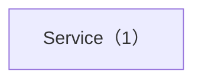
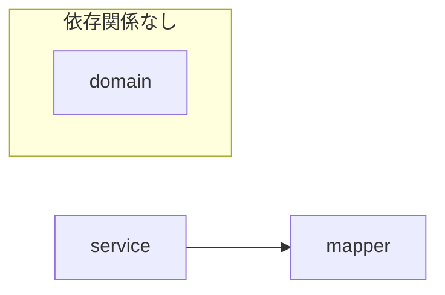
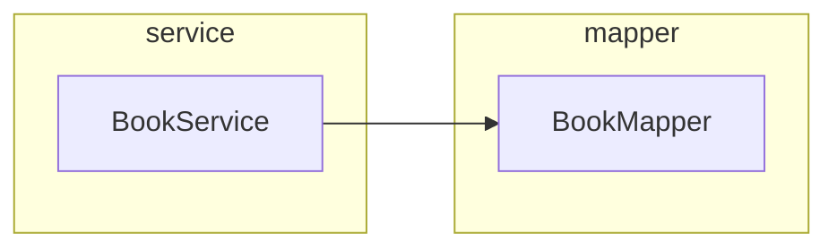

# 成果物一式（com.example.library）

## 解析総覧

| 項目 | 内容 |
| --- | --- |
| ルートパッケージ | com.example.library |
| Spring Boot | 3.2.5 |
| pom.xml | pom.xml |
| 文字コード | UTF-8 |

### プロジェクト統計

| 項目 | 件数 |
| --- | --- |
| パッケージ | 3 |
| クラス | 3 |
| インタフェース | 2 |
| Enum | 0 |
| Controller | 0 |
| Service | 1 |
| Repository | 0 |
| API | 0 |
| エンティティ | 0 |
| 依存関係 | 1 |
| 解析エラー（エラー / 警告） | 0 / 0 |

## アーキテクチャ・依存関係

### レイヤー構成

**レイヤー構成**



### パッケージ依存

**パッケージ依存**



### コンポーネント依存

**コンポーネント依存**



> 実線＝直接解決 / 点線＝単一実装から解決（@Bean や @Profile による別実装の可能性がある） / 赤枠＝循環依存

### 依存関係一覧

| 依存元 | メンバー | 注入方式 | 宣言型 | 解決先 | 解決方法 |
| --- | --- | --- | --- | --- | --- |
| BookService | bookMapper | コンストラクタ | BookMapper | BookMapper | 直接解決 |

### 解決できなかった依存

検出されませんでした

## API一覧

検出されませんでした

## ER図

> 図はエンティティ（@Entity）のみ。親クラスのカラムは子エンティティに展開しない。テーブル名・カラム名の既定名は推測しない。

### エンティティ一覧

検出されませんでした

## クラス別概要

> 呼び出し関係（簡易）：既知の DI 依存先フィールドに対する呼び出しのみをヒューリスティックに検出したもので、オーバーロードと多態を解決しない。

> 呼び出し関係（簡易）：外部ライブラリの呼び出し、List<Foo>・Optional<Foo> のフィールドに対する呼び出し、コンストラクタ内の呼び出しは含まない。

| クラス名 | 種類 | 役割 | パッケージ | 概要 |
| --- | --- | --- | --- | --- |
| Author | クラス | - | com.example.library.domain | - |
| Book | クラス | - | com.example.library.domain | - |
| AuthorMapper | インタフェース | - | com.example.library.mapper | MyBatis-Plus の BaseMapper を継承するだけの Mapper。 |
| BookMapper | インタフェース | - | com.example.library.mapper | 書籍の Mapper。XML と注解の SQL が混在する。 |
| BookService | クラス | Service | com.example.library.service | - |

### Author（クラス）

Author は com.example.library.domain パッケージのクラスです。

#### 基本情報

| 項目 | 内容 |
| --- | --- |
| 完全修飾名 | com.example.library.domain.Author |
| 種類 | クラス |
| 役割 | - |
| パッケージ | com.example.library.domain |
| ソースファイル | src/main/java/com/example/library/domain/Author.java |
| 修飾子 | public |
| アノテーション | - |
| 親クラス | - |
| インタフェース | - |
| Javadoc | - |
| コメント | - |

#### フィールド

| 名前 | 型 | 修飾子 | アノテーション |
| --- | --- | --- | --- |
| id | Long | private | - |

### Book（クラス）

Book は com.example.library.domain パッケージのクラスです。

#### 基本情報

| 項目 | 内容 |
| --- | --- |
| 完全修飾名 | com.example.library.domain.Book |
| 種類 | クラス |
| 役割 | - |
| パッケージ | com.example.library.domain |
| ソースファイル | src/main/java/com/example/library/domain/Book.java |
| 修飾子 | public |
| アノテーション | - |
| 親クラス | - |
| インタフェース | - |
| Javadoc | - |
| コメント | - |

#### フィールド

| 名前 | 型 | 修飾子 | アノテーション |
| --- | --- | --- | --- |
| id | Long | private | - |
| title | String | private | - |

### AuthorMapper（インタフェース）

AuthorMapper は com.example.library.mapper パッケージのインタフェースです。

#### 基本情報

| 項目 | 内容 |
| --- | --- |
| 完全修飾名 | com.example.library.mapper.AuthorMapper |
| 種類 | インタフェース |
| 役割 | - |
| パッケージ | com.example.library.mapper |
| ソースファイル | src/main/java/com/example/library/mapper/AuthorMapper.java |
| 修飾子 | public |
| アノテーション | - |
| 親クラス | - |
| インタフェース | BaseMapper<Author> |
| Javadoc | MyBatis-Plus の BaseMapper を継承するだけの Mapper。 |
| コメント | - |

### BookMapper（インタフェース）

BookMapper は com.example.library.mapper パッケージのインタフェースです。

#### 基本情報

| 項目 | 内容 |
| --- | --- |
| 完全修飾名 | com.example.library.mapper.BookMapper |
| 種類 | インタフェース |
| 役割 | - |
| パッケージ | com.example.library.mapper |
| ソースファイル | src/main/java/com/example/library/mapper/BookMapper.java |
| 修飾子 | public |
| アノテーション | @Mapper |
| 親クラス | - |
| インタフェース | - |
| Javadoc | 書籍の Mapper。XML と注解の SQL が混在する。 |
| コメント | - |

#### メソッド

| 名前 | 引数 | 戻り値 | 由来 |
| --- | --- | --- | --- |
| findById | long id | Book | ソース |
| search | String title, List<Long> ids | List<Book> | ソース |
| deleteById | long id | int | ソース |
| countAll | - | int | ソース |

### BookService（Service）

BookService は com.example.library.service パッケージの Service です。公開メソッド 1 件。利用元：なし。依存先：BookMapper。

#### 基本情報

| 項目 | 内容 |
| --- | --- |
| 完全修飾名 | com.example.library.service.BookService |
| 種類 | クラス |
| 役割 | Service |
| パッケージ | com.example.library.service |
| ソースファイル | src/main/java/com/example/library/service/BookService.java |
| 修飾子 | public |
| アノテーション | @Service |
| 親クラス | - |
| インタフェース | - |
| Javadoc | - |
| コメント | - |

#### 公開メソッド

| 名前 | 引数 | 戻り値 | 由来 |
| --- | --- | --- | --- |
| find | long id | Book | ソース |

#### 依存先

| メンバー | 宣言型 | 解決先 | 解決方法 | 注入方式 | 由来 |
| --- | --- | --- | --- | --- | --- |
| bookMapper | BookMapper | BookMapper | 直接解決 | コンストラクタ | ソース |

#### 被依存

検出されませんでした

#### 呼び出し関係（簡易）

| 呼び出し元メソッド | 依存先フィールド | 呼び出し先 | 実引数の数 | 行 |
| --- | --- | --- | --- | --- |
| find(long) | bookMapper: BookMapper | BookMapper.findById | 1 | 17 |

#### フィールド

| 名前 | 型 | 修飾子 | アノテーション |
| --- | --- | --- | --- |
| bookMapper | BookMapper | private, final | - |

#### コンストラクタ

| 引数 | 修飾子 | 由来 |
| --- | --- | --- |
| BookMapper bookMapper | public | ソース |

## 解析エラーレポート

検出されませんでした

> コンパイル失敗を完全には検出しない。

## MyBatis

> <include> は展開せず、記述どおりに表示する。SQL の意味解析はしない。

### AuthorMapper

| 項目 | 内容 |
| --- | --- |
| namespace | - |
| XML ファイル | - |
| 基底インタフェース | BaseMapper<Author> |

> 基底インタフェースの自動生成メソッドは表示しない。

検出されませんでした

### BookMapper

| 項目 | 内容 |
| --- | --- |
| namespace | com.example.library.mapper.BookMapper |
| XML ファイル | src/main/resources/mapper/BookMapper.xml |
| 基底インタフェース | - |

| メソッド | 引数 | 戻り値 | SQL |
| --- | --- | --- | --- |
| findById | long id | Book | select findById |
| search | String title, List<Long> ids | List<Book> | select search |
| deleteById | long id | int | delete deleteById |
| countAll | - | int | SQL なし |

文：sql columns（XML）

> 対応メソッドなし

```
id, title
```

文：select findById（XML）

```
SELECT <include refid="columns"/> FROM books WHERE id = #{id}
```

文：select search（XML）

```
SELECT <include refid="columns"/> FROM books
    <where>
      <if test='title != null and title != ""'>AND title LIKE #{title}</if>
      <foreach collection="ids" item="id" open="AND id IN (" separator="," close=")">#{id}</foreach>
      <![CDATA[ AND price < 1000 ]]>
    </where>
```

文：select findByLegacyName（XML）

> 対応メソッドなし

```
SELECT * FROM books WHERE legacy_name = #{name}
```

文：delete deleteById（注解）

```
DELETE FROM books WHERE id = #{id}
```

### com.example.library.mapper.RemovedMapper（インタフェースのない namespace）

| 項目 | 内容 |
| --- | --- |
| namespace | com.example.library.mapper.RemovedMapper |
| XML ファイル | src/main/resources/mapper/Orphan.xml |

文：select findAll（XML）

> 対応メソッドなし

```
SELECT * FROM removed
```

## Configuration

### @Bean 定義

検出されませんでした

> Bean 名は明記されたもののみ表示し、既定名は推測しない。Bean の内容は解釈しない。

### @ConfigurationProperties

検出されませんでした

### 設定クラス（@Configuration）

検出されませんでした

## 画面一覧

### 画面

検出されませんでした

### 画面ごとの遷移先

検出されませんでした

### Controller と対応付けできなかった View 名

検出されませんでした

