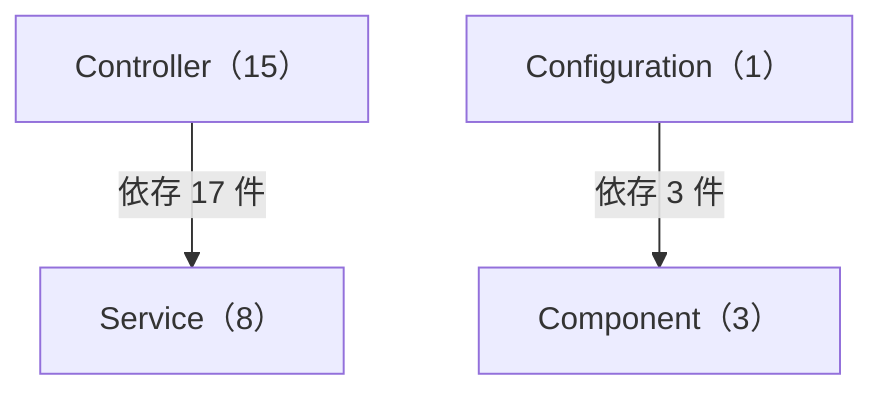
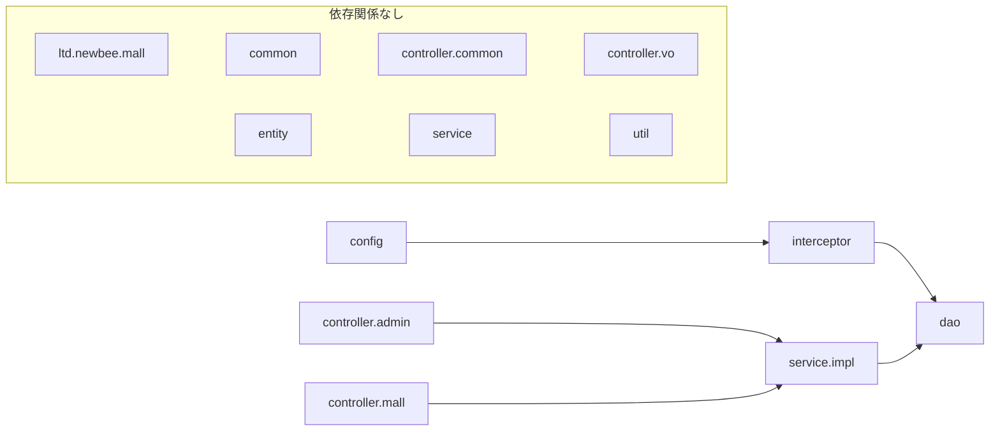
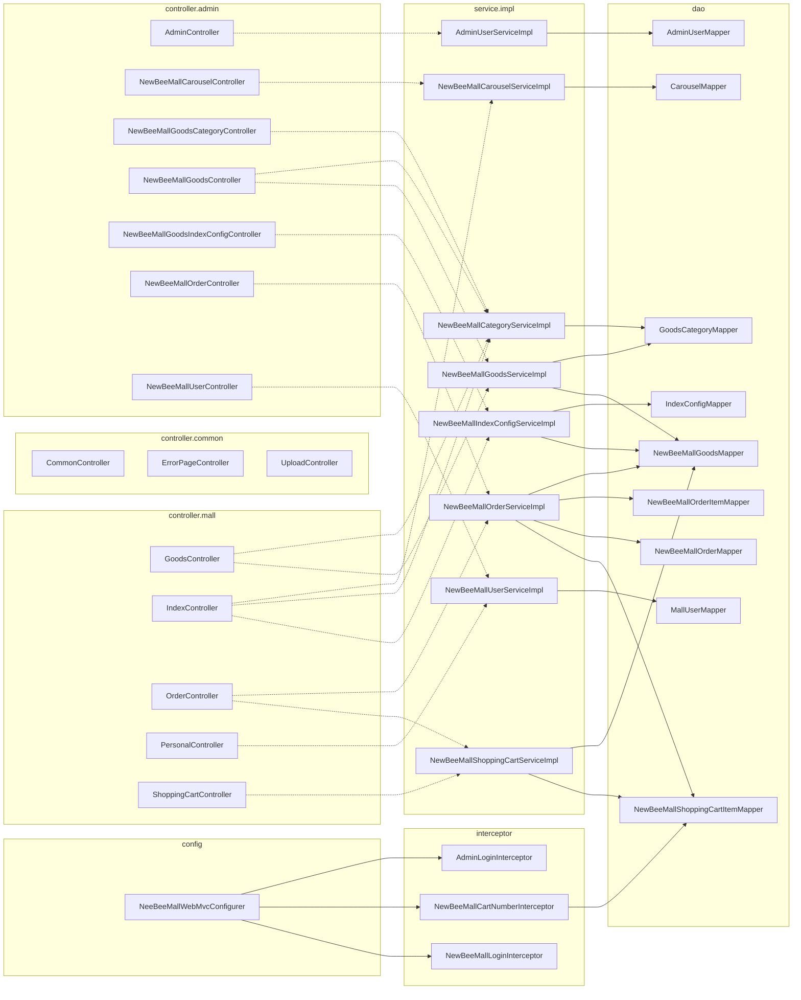
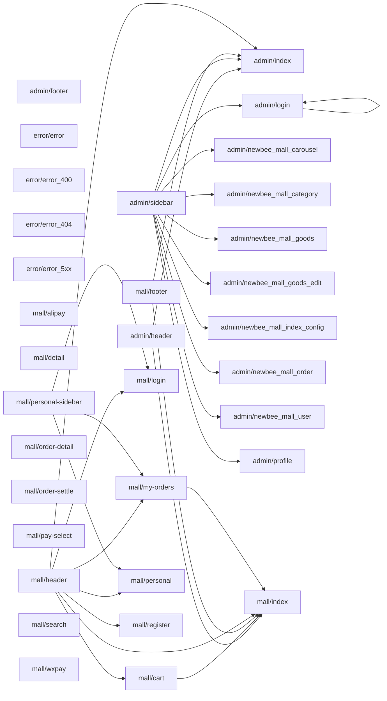

# 成果物一式（ltd.newbee.mall）

## 解析総覧

| 項目 | 内容 |
| --- | --- |
| ルートパッケージ | ltd.newbee.mall |
| Spring Boot | 2.7.5 |
| pom.xml | newbee-mall-master/pom.xml |
| 文字コード | UTF-8 |

### プロジェクト統計

| 項目 | 件数 |
| --- | --- |
| パッケージ | 13 |
| クラス | 65 |
| インタフェース | 18 |
| Enum | 6 |
| Controller | 15 |
| Service | 8 |
| Repository | 0 |
| API | 73 |
| エンティティ | 0 |
| 依存関係 | 37 |
| 解析エラー（エラー / 警告） | 0 / 0 |

## アーキテクチャ・依存関係

### レイヤー構成

**レイヤー構成**



### パッケージ依存

**パッケージ依存**



### コンポーネント依存

**コンポーネント依存**



> 実線＝直接解決 / 点線＝単一実装から解決（@Bean や @Profile による別実装の可能性がある） / 赤枠＝循環依存

### 依存関係一覧

| 依存元 | メンバー | 注入方式 | 宣言型 | 解決先 | 解決方法 |
| --- | --- | --- | --- | --- | --- |
| NeeBeeMallWebMvcConfigurer | adminLoginInterceptor | フィールド | AdminLoginInterceptor | AdminLoginInterceptor | 直接解決 |
| NeeBeeMallWebMvcConfigurer | newBeeMallCartNumberInterceptor | フィールド | NewBeeMallCartNumberInterceptor | NewBeeMallCartNumberInterceptor | 直接解決 |
| NeeBeeMallWebMvcConfigurer | newBeeMallLoginInterceptor | フィールド | NewBeeMallLoginInterceptor | NewBeeMallLoginInterceptor | 直接解決 |
| AdminController | adminUserService | フィールド | AdminUserService | AdminUserServiceImpl | 単一実装から解決 |
| NewBeeMallCarouselController | newBeeMallCarouselService | フィールド | NewBeeMallCarouselService | NewBeeMallCarouselServiceImpl | 単一実装から解決 |
| NewBeeMallGoodsCategoryController | newBeeMallCategoryService | フィールド | NewBeeMallCategoryService | NewBeeMallCategoryServiceImpl | 単一実装から解決 |
| NewBeeMallGoodsController | newBeeMallCategoryService | フィールド | NewBeeMallCategoryService | NewBeeMallCategoryServiceImpl | 単一実装から解決 |
| NewBeeMallGoodsController | newBeeMallGoodsService | フィールド | NewBeeMallGoodsService | NewBeeMallGoodsServiceImpl | 単一実装から解決 |
| NewBeeMallGoodsIndexConfigController | newBeeMallIndexConfigService | フィールド | NewBeeMallIndexConfigService | NewBeeMallIndexConfigServiceImpl | 単一実装から解決 |
| NewBeeMallOrderController | newBeeMallOrderService | フィールド | NewBeeMallOrderService | NewBeeMallOrderServiceImpl | 単一実装から解決 |
| NewBeeMallUserController | newBeeMallUserService | フィールド | NewBeeMallUserService | NewBeeMallUserServiceImpl | 単一実装から解決 |
| ErrorPageController | errorAttributes | フィールド | ErrorAttributes | - | 外部ライブラリ |
| UploadController | standardServletMultipartResolver | フィールド | StandardServletMultipartResolver | - | 外部ライブラリ |
| GoodsController | newBeeMallCategoryService | フィールド | NewBeeMallCategoryService | NewBeeMallCategoryServiceImpl | 単一実装から解決 |
| GoodsController | newBeeMallGoodsService | フィールド | NewBeeMallGoodsService | NewBeeMallGoodsServiceImpl | 単一実装から解決 |
| IndexController | newBeeMallCarouselService | フィールド | NewBeeMallCarouselService | NewBeeMallCarouselServiceImpl | 単一実装から解決 |
| IndexController | newBeeMallCategoryService | フィールド | NewBeeMallCategoryService | NewBeeMallCategoryServiceImpl | 単一実装から解決 |
| IndexController | newBeeMallIndexConfigService | フィールド | NewBeeMallIndexConfigService | NewBeeMallIndexConfigServiceImpl | 単一実装から解決 |
| OrderController | newBeeMallOrderService | フィールド | NewBeeMallOrderService | NewBeeMallOrderServiceImpl | 単一実装から解決 |
| OrderController | newBeeMallShoppingCartService | フィールド | NewBeeMallShoppingCartService | NewBeeMallShoppingCartServiceImpl | 単一実装から解決 |
| PersonalController | newBeeMallUserService | フィールド | NewBeeMallUserService | NewBeeMallUserServiceImpl | 単一実装から解決 |
| ShoppingCartController | newBeeMallShoppingCartService | フィールド | NewBeeMallShoppingCartService | NewBeeMallShoppingCartServiceImpl | 単一実装から解決 |
| NewBeeMallCartNumberInterceptor | newBeeMallShoppingCartItemMapper | フィールド | NewBeeMallShoppingCartItemMapper | NewBeeMallShoppingCartItemMapper | 直接解決 |
| AdminUserServiceImpl | adminUserMapper | フィールド | AdminUserMapper | AdminUserMapper | 直接解決 |
| NewBeeMallCarouselServiceImpl | carouselMapper | フィールド | CarouselMapper | CarouselMapper | 直接解決 |
| NewBeeMallCategoryServiceImpl | goodsCategoryMapper | フィールド | GoodsCategoryMapper | GoodsCategoryMapper | 直接解決 |
| NewBeeMallGoodsServiceImpl | goodsCategoryMapper | フィールド | GoodsCategoryMapper | GoodsCategoryMapper | 直接解決 |
| NewBeeMallGoodsServiceImpl | goodsMapper | フィールド | NewBeeMallGoodsMapper | NewBeeMallGoodsMapper | 直接解決 |
| NewBeeMallIndexConfigServiceImpl | goodsMapper | フィールド | NewBeeMallGoodsMapper | NewBeeMallGoodsMapper | 直接解決 |
| NewBeeMallIndexConfigServiceImpl | indexConfigMapper | フィールド | IndexConfigMapper | IndexConfigMapper | 直接解決 |
| NewBeeMallOrderServiceImpl | newBeeMallGoodsMapper | フィールド | NewBeeMallGoodsMapper | NewBeeMallGoodsMapper | 直接解決 |
| NewBeeMallOrderServiceImpl | newBeeMallOrderItemMapper | フィールド | NewBeeMallOrderItemMapper | NewBeeMallOrderItemMapper | 直接解決 |
| NewBeeMallOrderServiceImpl | newBeeMallOrderMapper | フィールド | NewBeeMallOrderMapper | NewBeeMallOrderMapper | 直接解決 |
| NewBeeMallOrderServiceImpl | newBeeMallShoppingCartItemMapper | フィールド | NewBeeMallShoppingCartItemMapper | NewBeeMallShoppingCartItemMapper | 直接解決 |
| NewBeeMallShoppingCartServiceImpl | newBeeMallGoodsMapper | フィールド | NewBeeMallGoodsMapper | NewBeeMallGoodsMapper | 直接解決 |
| NewBeeMallShoppingCartServiceImpl | newBeeMallShoppingCartItemMapper | フィールド | NewBeeMallShoppingCartItemMapper | NewBeeMallShoppingCartItemMapper | 直接解決 |
| NewBeeMallUserServiceImpl | mallUserMapper | フィールド | MallUserMapper | MallUserMapper | 直接解決 |

### 解決できなかった依存

| 依存元 | メンバー | 宣言型 | 理由 |
| --- | --- | --- | --- |
| ErrorPageController | errorAttributes | ErrorAttributes | 外部ライブラリ |
| UploadController | standardServletMultipartResolver | StandardServletMultipartResolver | 外部ライブラリ |

## API一覧

| Controller | Method | HTTP | Path | Request DTO | Response DTO |
| --- | --- | --- | --- | --- | --- |
| AdminController | index | GET | /admin | - | String |
| AdminController | index | GET | /admin/ | - | String |
| AdminController | index | GET | /admin/index | - | String |
| AdminController | index | GET | /admin/index.html | - | String |
| AdminController | login | GET | /admin/login | - | String |
| AdminController | login | POST | /admin/login | - | String |
| AdminController | logout | GET | /admin/logout | - | String |
| AdminController | profile | GET | /admin/profile | - | String |
| AdminController | nameUpdate | POST | /admin/profile/name | - | String |
| AdminController | passwordUpdate | POST | /admin/profile/password | - | String |
| AdminController | test | GET | /admin/test | - | String |
| NewBeeMallCarouselController | carouselPage | GET | /admin/carousels | - | String |
| NewBeeMallCarouselController | delete | POST | /admin/carousels/delete | Integer[] | Result |
| NewBeeMallCarouselController | info | GET | /admin/carousels/info/{id} | - | Result |
| NewBeeMallCarouselController | list | GET | /admin/carousels/list | - | Result |
| NewBeeMallCarouselController | save | POST | /admin/carousels/save | Carousel | Result |
| NewBeeMallCarouselController | update | POST | /admin/carousels/update | Carousel | Result |
| NewBeeMallGoodsCategoryController | categoriesPage | GET | /admin/categories | - | String |
| NewBeeMallGoodsCategoryController | delete | POST | /admin/categories/delete | Integer[] | Result |
| NewBeeMallGoodsCategoryController | info | GET | /admin/categories/info/{id} | - | Result |
| NewBeeMallGoodsCategoryController | list | GET | /admin/categories/list | - | Result |
| NewBeeMallGoodsCategoryController | listForSelect | GET | /admin/categories/listForSelect | - | Result |
| NewBeeMallGoodsCategoryController | save | POST | /admin/categories/save | GoodsCategory | Result |
| NewBeeMallGoodsCategoryController | update | POST | /admin/categories/update | GoodsCategory | Result |
| NewBeeMallGoodsController | goodsPage | GET | /admin/goods | - | String |
| NewBeeMallGoodsController | edit | GET | /admin/goods/edit | - | String |
| NewBeeMallGoodsController | edit | GET | /admin/goods/edit/{goodsId} | - | String |
| NewBeeMallGoodsController | info | GET | /admin/goods/info/{id} | - | Result |
| NewBeeMallGoodsController | list | GET | /admin/goods/list | - | Result |
| NewBeeMallGoodsController | save | POST | /admin/goods/save | NewBeeMallGoods | Result |
| NewBeeMallGoodsController | delete | PUT | /admin/goods/status/{sellStatus} | Long[] | Result |
| NewBeeMallGoodsController | update | POST | /admin/goods/update | NewBeeMallGoods | Result |
| NewBeeMallGoodsIndexConfigController | indexConfigsPage | GET | /admin/indexConfigs | - | String |
| NewBeeMallGoodsIndexConfigController | delete | POST | /admin/indexConfigs/delete | Long[] | Result |
| NewBeeMallGoodsIndexConfigController | info | GET | /admin/indexConfigs/info/{id} | - | Result |
| NewBeeMallGoodsIndexConfigController | list | GET | /admin/indexConfigs/list | - | Result |
| NewBeeMallGoodsIndexConfigController | save | POST | /admin/indexConfigs/save | IndexConfig | Result |
| NewBeeMallGoodsIndexConfigController | update | POST | /admin/indexConfigs/update | IndexConfig | Result |
| NewBeeMallOrderController | info | GET | /admin/order-items/{id} | - | Result |
| NewBeeMallOrderController | ordersPage | GET | /admin/orders | - | String |
| NewBeeMallOrderController | checkDone | POST | /admin/orders/checkDone | Long[] | Result |
| NewBeeMallOrderController | checkOut | POST | /admin/orders/checkOut | Long[] | Result |
| NewBeeMallOrderController | closeOrder | POST | /admin/orders/close | Long[] | Result |
| NewBeeMallOrderController | list | GET | /admin/orders/list | - | Result |
| NewBeeMallOrderController | update | POST | /admin/orders/update | NewBeeMallOrder | Result |
| NewBeeMallUserController | usersPage | GET | /admin/users | - | String |
| NewBeeMallUserController | list | GET | /admin/users/list | - | Result |
| NewBeeMallUserController | delete | POST | /admin/users/lock/{lockStatus} | Integer[] | Result |
| CommonController | defaultKaptcha | GET | /common/kaptcha | - | void |
| CommonController | mallKaptcha | GET | /common/mall/kaptcha | - | void |
| UploadController | upload | POST | /admin/upload/file | - | Result |
| UploadController | uploadV2 | POST | /admin/upload/files | - | Result |
| GoodsController | detailPage | GET | /goods/detail/{goodsId} | - | String |
| GoodsController | searchPage | GET | /search | - | String |
| GoodsController | searchPage | GET | /search.html | - | String |
| IndexController | indexPage | GET | / | - | String |
| IndexController | indexPage | GET | /index | - | String |
| IndexController | indexPage | GET | /index.html | - | String |
| OrderController | orderListPage | GET | /orders | - | String |
| OrderController | orderDetailPage | GET | /orders/{orderNo} | - | String |
| OrderController | cancelOrder | PUT | /orders/{orderNo}/cancel | - | Result |
| OrderController | finishOrder | PUT | /orders/{orderNo}/finish | - | Result |
| OrderController | payOrder | GET | /payPage | - | String |
| OrderController | paySuccess | GET | /paySuccess | - | Result |
| OrderController | saveOrder | GET | /saveOrder | - | String |
| OrderController | selectPayType | GET | /selectPayType | - | String |
| PersonalController | login | POST | /login | - | Result |
| PersonalController | loginPage | GET | /login | - | String |
| PersonalController | loginPage | GET | /login.html | - | String |
| PersonalController | logout | GET | /logout | - | String |
| PersonalController | personalPage | GET | /personal | - | String |
| PersonalController | addressesPage | GET | /personal/addresses | - | String |
| PersonalController | updateInfo | POST | /personal/updateInfo | MallUser | Result |
| PersonalController | register | POST | /register | - | Result |
| PersonalController | registerPage | GET | /register | - | String |
| PersonalController | registerPage | GET | /register.html | - | String |
| ShoppingCartController | cartListPage | GET | /shop-cart | - | String |
| ShoppingCartController | saveNewBeeMallShoppingCartItem | POST | /shop-cart | NewBeeMallShoppingCartItem | Result |
| ShoppingCartController | updateNewBeeMallShoppingCartItem | PUT | /shop-cart | NewBeeMallShoppingCartItem | Result |
| ShoppingCartController | settlePage | GET | /shop-cart/settle | - | String |
| ShoppingCartController | updateNewBeeMallShoppingCartItem | DELETE | /shop-cart/{newBeeMallShoppingCartItemId} | - | Result |

## ER図

> 図はエンティティ（@Entity）のみ。親クラスのカラムは子エンティティに展開しない。テーブル名・カラム名の既定名は推測しない。

### エンティティ一覧

検出されませんでした

## クラス別概要

> 呼び出し関係（簡易）：既知の DI 依存先フィールドに対する呼び出しのみをヒューリスティックに検出したもので、オーバーロードと多態を解決しない。

> 呼び出し関係（簡易）：外部ライブラリの呼び出し、List<Foo>・Optional<Foo> のフィールドに対する呼び出し、コンストラクタ内の呼び出しは含まない。

| クラス名 | 種類 | 役割 | パッケージ | 概要 |
| --- | --- | --- | --- | --- |
| NewBeeMallApplication | クラス | - | ltd.newbee.mall | @author 13 |
| Constants | クラス | - | ltd.newbee.mall.common | @author 13 |
| IndexConfigTypeEnum | Enum | - | ltd.newbee.mall.common | @author 13 |
| NewBeeMallCategoryLevelEnum | Enum | - | ltd.newbee.mall.common | @author 13 |
| NewBeeMallException | クラス | - | ltd.newbee.mall.common | - |
| NewBeeMallOrderStatusEnum | Enum | - | ltd.newbee.mall.common | @author 13 |
| PayStatusEnum | Enum | - | ltd.newbee.mall.common | @author 13 |
| PayTypeEnum | Enum | - | ltd.newbee.mall.common | @author 13 |
| ServiceResultEnum | Enum | - | ltd.newbee.mall.common | @author 13 |
| NeeBeeMallWebMvcConfigurer | クラス | Configuration | ltd.newbee.mall.config | - |
| AdminController | クラス | Controller | ltd.newbee.mall.controller.admin | @author 13 |
| NewBeeMallCarouselController | クラス | Controller | ltd.newbee.mall.controller.admin | @author 13 |
| NewBeeMallGoodsCategoryController | クラス | Controller | ltd.newbee.mall.controller.admin | @author 13 |
| NewBeeMallGoodsController | クラス | Controller | ltd.newbee.mall.controller.admin | @author 13 |
| NewBeeMallGoodsIndexConfigController | クラス | Controller | ltd.newbee.mall.controller.admin | @author 13 |
| NewBeeMallOrderController | クラス | Controller | ltd.newbee.mall.controller.admin | @author 13 |
| NewBeeMallUserController | クラス | Controller | ltd.newbee.mall.controller.admin | @author 13 |
| CommonController | クラス | Controller | ltd.newbee.mall.controller.common | @author 13 |
| ErrorPageController | クラス | Controller | ltd.newbee.mall.controller.common | - |
| NewBeeMallExceptionHandler | クラス | - | ltd.newbee.mall.controller.common | newbee-mall全局异常处理 |
| UploadController | クラス | Controller | ltd.newbee.mall.controller.common | @author 13 |
| GoodsController | クラス | Controller | ltd.newbee.mall.controller.mall | - |
| IndexController | クラス | Controller | ltd.newbee.mall.controller.mall | - |
| OrderController | クラス | Controller | ltd.newbee.mall.controller.mall | - |
| PersonalController | クラス | Controller | ltd.newbee.mall.controller.mall | - |
| ShoppingCartController | クラス | Controller | ltd.newbee.mall.controller.mall | - |
| NewBeeMallGoodsDetailVO | クラス | - | ltd.newbee.mall.controller.vo | 商品详情页VO |
| NewBeeMallIndexCarouselVO | クラス | - | ltd.newbee.mall.controller.vo | 首页轮播图VO |
| NewBeeMallIndexCategoryVO | クラス | - | ltd.newbee.mall.controller.vo | 首页分类数据VO |
| NewBeeMallIndexConfigGoodsVO | クラス | - | ltd.newbee.mall.controller.vo | 首页配置商品VO |
| NewBeeMallOrderDetailVO | クラス | - | ltd.newbee.mall.controller.vo | 订单详情页页面VO |
| NewBeeMallOrderItemVO | クラス | - | ltd.newbee.mall.controller.vo | 订单详情页页面订单项VO |
| NewBeeMallOrderListVO | クラス | - | ltd.newbee.mall.controller.vo | 订单列表页面VO |
| NewBeeMallSearchGoodsVO | クラス | - | ltd.newbee.mall.controller.vo | 搜索列表页商品VO |
| NewBeeMallShoppingCartItemVO | クラス | - | ltd.newbee.mall.controller.vo | 购物车页面购物项VO |
| NewBeeMallUserVO | クラス | - | ltd.newbee.mall.controller.vo | - |
| SearchPageCategoryVO | クラス | - | ltd.newbee.mall.controller.vo | 搜索页面分类数据VO |
| SecondLevelCategoryVO | クラス | - | ltd.newbee.mall.controller.vo | 首页分类数据VO(第二级) |
| ThirdLevelCategoryVO | クラス | - | ltd.newbee.mall.controller.vo | 首页分类数据VO(第三级) |
| AdminUserMapper | インタフェース | - | ltd.newbee.mall.dao | - |
| CarouselMapper | インタフェース | - | ltd.newbee.mall.dao | - |
| GoodsCategoryMapper | インタフェース | - | ltd.newbee.mall.dao | - |
| IndexConfigMapper | インタフェース | - | ltd.newbee.mall.dao | - |
| MallUserMapper | インタフェース | - | ltd.newbee.mall.dao | - |
| NewBeeMallGoodsMapper | インタフェース | - | ltd.newbee.mall.dao | - |
| NewBeeMallOrderItemMapper | インタフェース | - | ltd.newbee.mall.dao | - |
| NewBeeMallOrderMapper | インタフェース | - | ltd.newbee.mall.dao | - |
| NewBeeMallShoppingCartItemMapper | インタフェース | - | ltd.newbee.mall.dao | - |
| AdminUser | クラス | - | ltd.newbee.mall.entity | - |
| Carousel | クラス | - | ltd.newbee.mall.entity | - |
| GoodsCategory | クラス | - | ltd.newbee.mall.entity | - |
| IndexConfig | クラス | - | ltd.newbee.mall.entity | - |
| MallUser | クラス | - | ltd.newbee.mall.entity | - |
| NewBeeMallGoods | クラス | - | ltd.newbee.mall.entity | - |
| NewBeeMallOrder | クラス | - | ltd.newbee.mall.entity | - |
| NewBeeMallOrderItem | クラス | - | ltd.newbee.mall.entity | - |
| NewBeeMallShoppingCartItem | クラス | - | ltd.newbee.mall.entity | - |
| StockNumDTO | クラス | - | ltd.newbee.mall.entity | 库存修改所需实体 |
| AdminLoginInterceptor | クラス | Component | ltd.newbee.mall.interceptor | 后台系统身份验证拦截器 |
| NewBeeMallCartNumberInterceptor | クラス | Component | ltd.newbee.mall.interceptor | newbee-mall购物车数量处理 |
| NewBeeMallLoginInterceptor | クラス | Component | ltd.newbee.mall.interceptor | newbee-mall系统身份验证拦截器 |
| AdminUserService | インタフェース | - | ltd.newbee.mall.service | - |
| NewBeeMallCarouselService | インタフェース | - | ltd.newbee.mall.service | - |
| NewBeeMallCategoryService | インタフェース | - | ltd.newbee.mall.service | - |
| NewBeeMallGoodsService | インタフェース | - | ltd.newbee.mall.service | - |
| NewBeeMallIndexConfigService | インタフェース | - | ltd.newbee.mall.service | - |
| NewBeeMallOrderService | インタフェース | - | ltd.newbee.mall.service | - |
| NewBeeMallShoppingCartService | インタフェース | - | ltd.newbee.mall.service | - |
| NewBeeMallUserService | インタフェース | - | ltd.newbee.mall.service | - |
| AdminUserServiceImpl | クラス | Service | ltd.newbee.mall.service.impl | - |
| NewBeeMallCarouselServiceImpl | クラス | Service | ltd.newbee.mall.service.impl | - |
| NewBeeMallCategoryServiceImpl | クラス | Service | ltd.newbee.mall.service.impl | - |
| NewBeeMallGoodsServiceImpl | クラス | Service | ltd.newbee.mall.service.impl | - |
| NewBeeMallIndexConfigServiceImpl | クラス | Service | ltd.newbee.mall.service.impl | - |
| NewBeeMallOrderServiceImpl | クラス | Service | ltd.newbee.mall.service.impl | - |
| NewBeeMallShoppingCartServiceImpl | クラス | Service | ltd.newbee.mall.service.impl | - |
| NewBeeMallUserServiceImpl | クラス | Service | ltd.newbee.mall.service.impl | - |
| BeanUtil | クラス | - | ltd.newbee.mall.util | - |
| Callback | インタフェース | - | ltd.newbee.mall.util | - |
| JsonUtil | クラス | - | ltd.newbee.mall.util | 操作json的封装方法 |
| MD5Util | クラス | - | ltd.newbee.mall.util | @author 13 |
| NewBeeMallUtils | クラス | - | ltd.newbee.mall.util | @author 13 |
| NumberUtil | クラス | - | ltd.newbee.mall.util | @author 13 |
| PageQueryUtil | クラス | - | ltd.newbee.mall.util | 分页查询参数 |
| PageResult | クラス | - | ltd.newbee.mall.util | 分页工具类 |
| PatternUtil | クラス | - | ltd.newbee.mall.util | 正则工具类 |
| Result | クラス | - | ltd.newbee.mall.util | @author 13 |
| ResultGenerator | クラス | - | ltd.newbee.mall.util | 响应结果生成工具 |
| SystemUtil | クラス | - | ltd.newbee.mall.util | @author 13 |

### NewBeeMallApplication（クラス）

NewBeeMallApplication は ltd.newbee.mall パッケージのクラスです。

#### 基本情報

| 項目 | 内容 |
| --- | --- |
| 完全修飾名 | ltd.newbee.mall.NewBeeMallApplication |
| 種類 | クラス |
| 役割 | - |
| パッケージ | ltd.newbee.mall |
| ソースファイル | src/main/java/ltd/newbee/mall/NewBeeMallApplication.java |
| 修飾子 | public |
| アノテーション | @MapperScan, @SpringBootApplication |
| 親クラス | - |
| インタフェース | - |
| Javadoc | @author 13<br>@qq交流群 796794009<br>@email 2449207463@qq.com<br>@link https://github.com/newbee-ltd |
| コメント | - |

#### メソッド

| 名前 | 引数 | 戻り値 | 由来 |
| --- | --- | --- | --- |
| main | String[] args | void | ソース |

### Constants（クラス）

Constants は ltd.newbee.mall.common パッケージのクラスです。

#### 基本情報

| 項目 | 内容 |
| --- | --- |
| 完全修飾名 | ltd.newbee.mall.common.Constants |
| 種類 | クラス |
| 役割 | - |
| パッケージ | ltd.newbee.mall.common |
| ソースファイル | src/main/java/ltd/newbee/mall/common/Constants.java |
| 修飾子 | public |
| アノテーション | - |
| 親クラス | - |
| インタフェース | - |
| Javadoc | @author 13<br>@qq交流群 796794009<br>@email 2449207463@qq.com<br>@link https://github.com/newbee-ltd<br>@apiNote 常量配置 |
| コメント | - |

#### フィールド

| 名前 | 型 | 修飾子 | アノテーション |
| --- | --- | --- | --- |
| FILE_UPLOAD_DIC | String | public, final, static | - |
| INDEX_CAROUSEL_NUMBER | int | public, final, static | - |
| INDEX_CATEGORY_NUMBER | int | public, final, static | - |
| SEARCH_CATEGORY_NUMBER | int | public, final, static | - |
| INDEX_GOODS_HOT_NUMBER | int | public, final, static | - |
| INDEX_GOODS_NEW_NUMBER | int | public, final, static | - |
| INDEX_GOODS_RECOMMOND_NUMBER | int | public, final, static | - |
| SHOPPING_CART_ITEM_TOTAL_NUMBER | int | public, final, static | - |
| SHOPPING_CART_ITEM_LIMIT_NUMBER | int | public, final, static | - |
| MALL_VERIFY_CODE_KEY | String | public, final, static | - |
| MALL_USER_SESSION_KEY | String | public, final, static | - |
| GOODS_SEARCH_PAGE_LIMIT | int | public, final, static | - |
| ORDER_SEARCH_PAGE_LIMIT | int | public, final, static | - |
| SELL_STATUS_UP | int | public, final, static | - |
| SELL_STATUS_DOWN | int | public, final, static | - |

### IndexConfigTypeEnum（Enum）

IndexConfigTypeEnum は ltd.newbee.mall.common パッケージの Enum です。

#### 基本情報

| 項目 | 内容 |
| --- | --- |
| 完全修飾名 | ltd.newbee.mall.common.IndexConfigTypeEnum |
| 種類 | Enum |
| 役割 | - |
| パッケージ | ltd.newbee.mall.common |
| ソースファイル | src/main/java/ltd/newbee/mall/common/IndexConfigTypeEnum.java |
| 修飾子 | public |
| アノテーション | - |
| 親クラス | - |
| インタフェース | - |
| Javadoc | @author 13<br>@qq交流群 796794009<br>@email 2449207463@qq.com<br>@link https://github.com/newbee-ltd<br>@apiNote 首页配置项 1-搜索框热搜 2-搜索下拉框热搜 3-(首页)热销商品 4-(首页)新品上线 5-(首页)为你推荐 |
| コメント | - |

#### フィールド

| 名前 | 型 | 修飾子 | アノテーション |
| --- | --- | --- | --- |
| type | int | private | - |
| name | String | private | - |

#### コンストラクタ

| 引数 | 修飾子 | 由来 |
| --- | --- | --- |
| int type, String name | - | ソース |

#### メソッド

| 名前 | 引数 | 戻り値 | 由来 |
| --- | --- | --- | --- |
| getIndexConfigTypeEnumByType | int type | IndexConfigTypeEnum | ソース |
| getType | - | int | ソース |
| setType | int type | void | ソース |
| getName | - | String | ソース |
| setName | String name | void | ソース |

### NewBeeMallCategoryLevelEnum（Enum）

NewBeeMallCategoryLevelEnum は ltd.newbee.mall.common パッケージの Enum です。

#### 基本情報

| 項目 | 内容 |
| --- | --- |
| 完全修飾名 | ltd.newbee.mall.common.NewBeeMallCategoryLevelEnum |
| 種類 | Enum |
| 役割 | - |
| パッケージ | ltd.newbee.mall.common |
| ソースファイル | src/main/java/ltd/newbee/mall/common/NewBeeMallCategoryLevelEnum.java |
| 修飾子 | public |
| アノテーション | - |
| 親クラス | - |
| インタフェース | - |
| Javadoc | @author 13<br>@qq交流群 796794009<br>@email 2449207463@qq.com<br>@link https://github.com/newbee-ltd<br>@apiNote 分类级别 |
| コメント | - |

#### フィールド

| 名前 | 型 | 修飾子 | アノテーション |
| --- | --- | --- | --- |
| level | int | private | - |
| name | String | private | - |

#### コンストラクタ

| 引数 | 修飾子 | 由来 |
| --- | --- | --- |
| int level, String name | - | ソース |

#### メソッド

| 名前 | 引数 | 戻り値 | 由来 |
| --- | --- | --- | --- |
| getNewBeeMallOrderStatusEnumByLevel | int level | NewBeeMallCategoryLevelEnum | ソース |
| getLevel | - | int | ソース |
| setLevel | int level | void | ソース |
| getName | - | String | ソース |
| setName | String name | void | ソース |

### NewBeeMallException（クラス）

NewBeeMallException は ltd.newbee.mall.common パッケージのクラスです。

#### 基本情報

| 項目 | 内容 |
| --- | --- |
| 完全修飾名 | ltd.newbee.mall.common.NewBeeMallException |
| 種類 | クラス |
| 役割 | - |
| パッケージ | ltd.newbee.mall.common |
| ソースファイル | src/main/java/ltd/newbee/mall/common/NewBeeMallException.java |
| 修飾子 | public |
| アノテーション | - |
| 親クラス | RuntimeException |
| インタフェース | - |
| Javadoc | - |
| コメント | - |

#### コンストラクタ

| 引数 | 修飾子 | 由来 |
| --- | --- | --- |
| - | public | ソース |
| String message | public | ソース |

#### メソッド

| 名前 | 引数 | 戻り値 | 由来 |
| --- | --- | --- | --- |
| fail | String message | void | ソース |

### NewBeeMallOrderStatusEnum（Enum）

NewBeeMallOrderStatusEnum は ltd.newbee.mall.common パッケージの Enum です。

#### 基本情報

| 項目 | 内容 |
| --- | --- |
| 完全修飾名 | ltd.newbee.mall.common.NewBeeMallOrderStatusEnum |
| 種類 | Enum |
| 役割 | - |
| パッケージ | ltd.newbee.mall.common |
| ソースファイル | src/main/java/ltd/newbee/mall/common/NewBeeMallOrderStatusEnum.java |
| 修飾子 | public |
| アノテーション | - |
| 親クラス | - |
| インタフェース | - |
| Javadoc | @author 13<br>@qq交流群 796794009<br>@email 2449207463@qq.com<br>@link https://github.com/newbee-ltd<br>@apiNote 订单状态:0.待支付 1.已支付 2.配货完成 3:出库成功 4.交易成功 -1.手动关闭 -2.超时关闭 -3.商家关闭 |
| コメント | - |

#### フィールド

| 名前 | 型 | 修飾子 | アノテーション |
| --- | --- | --- | --- |
| orderStatus | int | private | - |
| name | String | private | - |

#### コンストラクタ

| 引数 | 修飾子 | 由来 |
| --- | --- | --- |
| int orderStatus, String name | - | ソース |

#### メソッド

| 名前 | 引数 | 戻り値 | 由来 |
| --- | --- | --- | --- |
| getNewBeeMallOrderStatusEnumByStatus | int orderStatus | NewBeeMallOrderStatusEnum | ソース |
| getOrderStatus | - | int | ソース |
| setOrderStatus | int orderStatus | void | ソース |
| getName | - | String | ソース |
| setName | String name | void | ソース |

### PayStatusEnum（Enum）

PayStatusEnum は ltd.newbee.mall.common パッケージの Enum です。

#### 基本情報

| 項目 | 内容 |
| --- | --- |
| 完全修飾名 | ltd.newbee.mall.common.PayStatusEnum |
| 種類 | Enum |
| 役割 | - |
| パッケージ | ltd.newbee.mall.common |
| ソースファイル | src/main/java/ltd/newbee/mall/common/PayStatusEnum.java |
| 修飾子 | public |
| アノテーション | - |
| 親クラス | - |
| インタフェース | - |
| Javadoc | @author 13<br>@qq交流群 796794009<br>@email 2449207463@qq.com<br>@link https://github.com/newbee-ltd<br>@apiNote 订单状态:0.支付中 1.支付成功 -1.支付失败 |
| コメント | - |

#### フィールド

| 名前 | 型 | 修飾子 | アノテーション |
| --- | --- | --- | --- |
| payStatus | int | private | - |
| name | String | private | - |

#### コンストラクタ

| 引数 | 修飾子 | 由来 |
| --- | --- | --- |
| int payStatus, String name | - | ソース |

#### メソッド

| 名前 | 引数 | 戻り値 | 由来 |
| --- | --- | --- | --- |
| getPayStatusEnumByStatus | int payStatus | PayStatusEnum | ソース |
| getPayStatus | - | int | ソース |
| setPayStatus | int payStatus | void | ソース |
| getName | - | String | ソース |
| setName | String name | void | ソース |

### PayTypeEnum（Enum）

PayTypeEnum は ltd.newbee.mall.common パッケージの Enum です。

#### 基本情報

| 項目 | 内容 |
| --- | --- |
| 完全修飾名 | ltd.newbee.mall.common.PayTypeEnum |
| 種類 | Enum |
| 役割 | - |
| パッケージ | ltd.newbee.mall.common |
| ソースファイル | src/main/java/ltd/newbee/mall/common/PayTypeEnum.java |
| 修飾子 | public |
| アノテーション | - |
| 親クラス | - |
| インタフェース | - |
| Javadoc | @author 13<br>@qq交流群 796794009<br>@email 2449207463@qq.com<br>@link https://github.com/newbee-ltd<br>@apiNote 订单状态:0.无 1.支付宝 2.微信支付 |
| コメント | - |

#### フィールド

| 名前 | 型 | 修飾子 | アノテーション |
| --- | --- | --- | --- |
| payType | int | private | - |
| name | String | private | - |

#### コンストラクタ

| 引数 | 修飾子 | 由来 |
| --- | --- | --- |
| int payType, String name | - | ソース |

#### メソッド

| 名前 | 引数 | 戻り値 | 由来 |
| --- | --- | --- | --- |
| getPayTypeEnumByType | int payType | PayTypeEnum | ソース |
| getPayType | - | int | ソース |
| setPayType | int payType | void | ソース |
| getName | - | String | ソース |
| setName | String name | void | ソース |

### ServiceResultEnum（Enum）

ServiceResultEnum は ltd.newbee.mall.common パッケージの Enum です。

#### 基本情報

| 項目 | 内容 |
| --- | --- |
| 完全修飾名 | ltd.newbee.mall.common.ServiceResultEnum |
| 種類 | Enum |
| 役割 | - |
| パッケージ | ltd.newbee.mall.common |
| ソースファイル | src/main/java/ltd/newbee/mall/common/ServiceResultEnum.java |
| 修飾子 | public |
| アノテーション | - |
| 親クラス | - |
| インタフェース | - |
| Javadoc | @author 13<br>@qq交流群 796794009<br>@email 2449207463@qq.com<br>@link https://github.com/newbee-ltd |
| コメント | - |

#### フィールド

| 名前 | 型 | 修飾子 | アノテーション |
| --- | --- | --- | --- |
| result | String | private | - |

#### コンストラクタ

| 引数 | 修飾子 | 由来 |
| --- | --- | --- |
| String result | - | ソース |

#### メソッド

| 名前 | 引数 | 戻り値 | 由来 |
| --- | --- | --- | --- |
| getResult | - | String | ソース |
| setResult | String result | void | ソース |

### NeeBeeMallWebMvcConfigurer（Configuration）

NeeBeeMallWebMvcConfigurer は ltd.newbee.mall.config パッケージの Configuration です。利用元：なし。依存先：AdminLoginInterceptor、NewBeeMallLoginInterceptor、NewBeeMallCartNumberInterceptor。

#### 基本情報

| 項目 | 内容 |
| --- | --- |
| 完全修飾名 | ltd.newbee.mall.config.NeeBeeMallWebMvcConfigurer |
| 種類 | クラス |
| 役割 | Configuration |
| パッケージ | ltd.newbee.mall.config |
| ソースファイル | src/main/java/ltd/newbee/mall/config/NeeBeeMallWebMvcConfigurer.java |
| 修飾子 | public |
| アノテーション | @Configuration |
| 親クラス | - |
| インタフェース | WebMvcConfigurer |
| Javadoc | - |
| コメント | - |

#### 依存先

| メンバー | 宣言型 | 解決先 | 解決方法 | 注入方式 | 由来 |
| --- | --- | --- | --- | --- | --- |
| adminLoginInterceptor | AdminLoginInterceptor | AdminLoginInterceptor | 直接解決 | フィールド | ソース |
| newBeeMallLoginInterceptor | NewBeeMallLoginInterceptor | NewBeeMallLoginInterceptor | 直接解決 | フィールド | ソース |
| newBeeMallCartNumberInterceptor | NewBeeMallCartNumberInterceptor | NewBeeMallCartNumberInterceptor | 直接解決 | フィールド | ソース |

#### 被依存

検出されませんでした

#### 呼び出し関係（簡易）

検出されませんでした

#### フィールド

| 名前 | 型 | 修飾子 | アノテーション |
| --- | --- | --- | --- |
| adminLoginInterceptor | AdminLoginInterceptor | private | @Autowired |
| newBeeMallLoginInterceptor | NewBeeMallLoginInterceptor | private | @Autowired |
| newBeeMallCartNumberInterceptor | NewBeeMallCartNumberInterceptor | private | @Autowired |

#### メソッド

| 名前 | 引数 | 戻り値 | 由来 |
| --- | --- | --- | --- |
| addInterceptors | InterceptorRegistry registry | void | ソース |
| addResourceHandlers | ResourceHandlerRegistry registry | void | ソース |

### AdminController（Controller）

AdminController は ltd.newbee.mall.controller.admin パッケージの Controller です。エンドポイント 8 件（GET 5・POST 3）を提供する。依存先：AdminUserServiceImpl（単一実装から解決）。

#### 基本情報

| 項目 | 内容 |
| --- | --- |
| 完全修飾名 | ltd.newbee.mall.controller.admin.AdminController |
| 種類 | クラス |
| 役割 | Controller |
| パッケージ | ltd.newbee.mall.controller.admin |
| ソースファイル | src/main/java/ltd/newbee/mall/controller/admin/AdminController.java |
| 修飾子 | public |
| アノテーション | @Controller, @RequestMapping |
| 親クラス | - |
| インタフェース | - |
| Javadoc | @author 13<br>@qq交流群 796794009<br>@email 2449207463@qq.com<br>@link https://github.com/newbee-ltd |
| コメント | - |

#### エンドポイント

| Method | HTTP | Path | Request DTO | Response DTO |
| --- | --- | --- | --- | --- |
| login | GET | /admin/login | - | String |
| test | GET | /admin/test | - | String |
| index | GET | /admin | - | String |
| index | GET | /admin/ | - | String |
| index | GET | /admin/index | - | String |
| index | GET | /admin/index.html | - | String |
| login | POST | /admin/login | - | String |
| profile | GET | /admin/profile | - | String |
| passwordUpdate | POST | /admin/profile/password | - | String |
| nameUpdate | POST | /admin/profile/name | - | String |
| logout | GET | /admin/logout | - | String |

#### 依存先

| メンバー | 宣言型 | 解決先 | 解決方法 | 注入方式 | 由来 |
| --- | --- | --- | --- | --- | --- |
| adminUserService | AdminUserService | AdminUserServiceImpl | 単一実装から解決 | フィールド | ソース |

#### 呼び出し関係（簡易）

| 呼び出し元メソッド | 依存先フィールド | 呼び出し先 | 実引数の数 | 行 |
| --- | --- | --- | --- | --- |
| login(String, String, String, HttpSession) | adminUserService: AdminUserService | AdminUserServiceImpl.login | 2 | 72 |
| profile(HttpServletRequest) | adminUserService: AdminUserService | AdminUserServiceImpl.getUserDetailById | 1 | 88 |
| passwordUpdate(HttpServletRequest, String, String) | adminUserService: AdminUserService | AdminUserServiceImpl.updatePassword | 3 | 106 |
| nameUpdate(HttpServletRequest, String, String) | adminUserService: AdminUserService | AdminUserServiceImpl.updateName | 3 | 125 |

#### フィールド

| 名前 | 型 | 修飾子 | アノテーション |
| --- | --- | --- | --- |
| adminUserService | AdminUserService | private | @Resource |

#### メソッド

| 名前 | 引数 | 戻り値 | 由来 |
| --- | --- | --- | --- |
| login | - | String | ソース |
| test | - | String | ソース |
| index | HttpServletRequest request | String | ソース |
| login | String userName, String password, String verifyCode, HttpSession session | String | ソース |
| profile | HttpServletRequest request | String | ソース |
| passwordUpdate | HttpServletRequest request, String originalPassword, String newPassword | String | ソース |
| nameUpdate | HttpServletRequest request, String loginUserName, String nickName | String | ソース |
| logout | HttpServletRequest request | String | ソース |

### NewBeeMallCarouselController（Controller）

NewBeeMallCarouselController は ltd.newbee.mall.controller.admin パッケージの Controller です。エンドポイント 6 件（GET 3・POST 3）を提供する。依存先：NewBeeMallCarouselServiceImpl（単一実装から解決）。

#### 基本情報

| 項目 | 内容 |
| --- | --- |
| 完全修飾名 | ltd.newbee.mall.controller.admin.NewBeeMallCarouselController |
| 種類 | クラス |
| 役割 | Controller |
| パッケージ | ltd.newbee.mall.controller.admin |
| ソースファイル | src/main/java/ltd/newbee/mall/controller/admin/NewBeeMallCarouselController.java |
| 修飾子 | public |
| アノテーション | @Controller, @RequestMapping |
| 親クラス | - |
| インタフェース | - |
| Javadoc | @author 13<br>@qq交流群 796794009<br>@email 2449207463@qq.com<br>@link https://github.com/newbee-ltd |
| コメント | - |

#### エンドポイント

| Method | HTTP | Path | Request DTO | Response DTO |
| --- | --- | --- | --- | --- |
| carouselPage | GET | /admin/carousels | - | String |
| list | GET | /admin/carousels/list | - | Result |
| save | POST | /admin/carousels/save | Carousel | Result |
| update | POST | /admin/carousels/update | Carousel | Result |
| info | GET | /admin/carousels/info/{id} | - | Result |
| delete | POST | /admin/carousels/delete | Integer[] | Result |

#### 依存先

| メンバー | 宣言型 | 解決先 | 解決方法 | 注入方式 | 由来 |
| --- | --- | --- | --- | --- | --- |
| newBeeMallCarouselService | NewBeeMallCarouselService | NewBeeMallCarouselServiceImpl | 単一実装から解決 | フィールド | ソース |

#### 呼び出し関係（簡易）

| 呼び出し元メソッド | 依存先フィールド | 呼び出し先 | 実引数の数 | 行 |
| --- | --- | --- | --- | --- |
| list(Map<String, Object>) | newBeeMallCarouselService: NewBeeMallCarouselService | NewBeeMallCarouselServiceImpl.getCarouselPage | 1 | 56 |
| save(Carousel) | newBeeMallCarouselService: NewBeeMallCarouselService | NewBeeMallCarouselServiceImpl.saveCarousel | 1 | 69 |
| update(Carousel) | newBeeMallCarouselService: NewBeeMallCarouselService | NewBeeMallCarouselServiceImpl.updateCarousel | 1 | 89 |
| info(Integer) | newBeeMallCarouselService: NewBeeMallCarouselService | NewBeeMallCarouselServiceImpl.getCarouselById | 1 | 103 |
| delete(Integer[]) | newBeeMallCarouselService: NewBeeMallCarouselService | NewBeeMallCarouselServiceImpl.deleteBatch | 1 | 119 |

#### フィールド

| 名前 | 型 | 修飾子 | アノテーション |
| --- | --- | --- | --- |
| newBeeMallCarouselService | NewBeeMallCarouselService | - | @Resource |

#### メソッド

| 名前 | 引数 | 戻り値 | 由来 |
| --- | --- | --- | --- |
| carouselPage | HttpServletRequest request | String | ソース |
| list | Map<String, Object> params | Result | ソース |
| save | Carousel carousel | Result | ソース |
| update | Carousel carousel | Result | ソース |
| info | Integer id | Result | ソース |
| delete | Integer[] ids | Result | ソース |

### NewBeeMallGoodsCategoryController（Controller）

NewBeeMallGoodsCategoryController は ltd.newbee.mall.controller.admin パッケージの Controller です。エンドポイント 7 件（GET 4・POST 3）を提供する。依存先：NewBeeMallCategoryServiceImpl（単一実装から解決）。

#### 基本情報

| 項目 | 内容 |
| --- | --- |
| 完全修飾名 | ltd.newbee.mall.controller.admin.NewBeeMallGoodsCategoryController |
| 種類 | クラス |
| 役割 | Controller |
| パッケージ | ltd.newbee.mall.controller.admin |
| ソースファイル | src/main/java/ltd/newbee/mall/controller/admin/NewBeeMallGoodsCategoryController.java |
| 修飾子 | public |
| アノテーション | @Controller, @RequestMapping |
| 親クラス | - |
| インタフェース | - |
| Javadoc | @author 13<br>@qq交流群 796794009<br>@email 2449207463@qq.com<br>@link https://github.com/newbee-ltd |
| コメント | - |

#### エンドポイント

| Method | HTTP | Path | Request DTO | Response DTO |
| --- | --- | --- | --- | --- |
| categoriesPage | GET | /admin/categories | - | String |
| list | GET | /admin/categories/list | - | Result |
| listForSelect | GET | /admin/categories/listForSelect | - | Result |
| save | POST | /admin/categories/save | GoodsCategory | Result |
| update | POST | /admin/categories/update | GoodsCategory | Result |
| info | GET | /admin/categories/info/{id} | - | Result |
| delete | POST | /admin/categories/delete | Integer[] | Result |

#### 依存先

| メンバー | 宣言型 | 解決先 | 解決方法 | 注入方式 | 由来 |
| --- | --- | --- | --- | --- | --- |
| newBeeMallCategoryService | NewBeeMallCategoryService | NewBeeMallCategoryServiceImpl | 単一実装から解決 | フィールド | ソース |

#### 呼び出し関係（簡易）

| 呼び出し元メソッド | 依存先フィールド | 呼び出し先 | 実引数の数 | 行 |
| --- | --- | --- | --- | --- |
| list(Map<String, Object>) | newBeeMallCategoryService: NewBeeMallCategoryService | NewBeeMallCategoryServiceImpl.getCategorisPage | 1 | 64 |
| listForSelect(Long) | newBeeMallCategoryService: NewBeeMallCategoryService | NewBeeMallCategoryServiceImpl.getGoodsCategoryById | 1 | 76 |
| listForSelect(Long) | newBeeMallCategoryService: NewBeeMallCategoryService | NewBeeMallCategoryServiceImpl.selectByLevelAndParentIdsAndNumber | 2 | 85 |
| listForSelect(Long) | newBeeMallCategoryService: NewBeeMallCategoryService | NewBeeMallCategoryServiceImpl.selectByLevelAndParentIdsAndNumber | 2 | 88 |
| listForSelect(Long) | newBeeMallCategoryService: NewBeeMallCategoryService | NewBeeMallCategoryServiceImpl.selectByLevelAndParentIdsAndNumber | 2 | 95 |
| save(GoodsCategory) | newBeeMallCategoryService: NewBeeMallCategoryService | NewBeeMallCategoryServiceImpl.saveCategory | 1 | 113 |
| update(GoodsCategory) | newBeeMallCategoryService: NewBeeMallCategoryService | NewBeeMallCategoryServiceImpl.updateGoodsCategory | 1 | 135 |
| info(Long) | newBeeMallCategoryService: NewBeeMallCategoryService | NewBeeMallCategoryServiceImpl.getGoodsCategoryById | 1 | 149 |
| delete(Integer[]) | newBeeMallCategoryService: NewBeeMallCategoryService | NewBeeMallCategoryServiceImpl.deleteBatch | 1 | 165 |

#### フィールド

| 名前 | 型 | 修飾子 | アノテーション |
| --- | --- | --- | --- |
| newBeeMallCategoryService | NewBeeMallCategoryService | private | @Resource |

#### メソッド

| 名前 | 引数 | 戻り値 | 由来 |
| --- | --- | --- | --- |
| categoriesPage | HttpServletRequest request, Byte categoryLevel, Long parentId, Long backParentId | String | ソース |
| list | Map<String, Object> params | Result | ソース |
| listForSelect | Long categoryId | Result | ソース |
| save | GoodsCategory goodsCategory | Result | ソース |
| update | GoodsCategory goodsCategory | Result | ソース |
| info | Long id | Result | ソース |
| delete | Integer[] ids | Result | ソース |

### NewBeeMallGoodsController（Controller）

NewBeeMallGoodsController は ltd.newbee.mall.controller.admin パッケージの Controller です。エンドポイント 8 件（GET 5・POST 2・PUT 1）を提供する。依存先：NewBeeMallGoodsServiceImpl（単一実装から解決）、NewBeeMallCategoryServiceImpl（単一実装から解決）。

#### 基本情報

| 項目 | 内容 |
| --- | --- |
| 完全修飾名 | ltd.newbee.mall.controller.admin.NewBeeMallGoodsController |
| 種類 | クラス |
| 役割 | Controller |
| パッケージ | ltd.newbee.mall.controller.admin |
| ソースファイル | src/main/java/ltd/newbee/mall/controller/admin/NewBeeMallGoodsController.java |
| 修飾子 | public |
| アノテーション | @Controller, @RequestMapping |
| 親クラス | - |
| インタフェース | - |
| Javadoc | @author 13<br>@qq交流群 796794009<br>@email 2449207463@qq.com<br>@link https://github.com/newbee-ltd |
| コメント | - |

#### エンドポイント

| Method | HTTP | Path | Request DTO | Response DTO |
| --- | --- | --- | --- | --- |
| goodsPage | GET | /admin/goods | - | String |
| edit | GET | /admin/goods/edit | - | String |
| edit | GET | /admin/goods/edit/{goodsId} | - | String |
| list | GET | /admin/goods/list | - | Result |
| save | POST | /admin/goods/save | NewBeeMallGoods | Result |
| update | POST | /admin/goods/update | NewBeeMallGoods | Result |
| info | GET | /admin/goods/info/{id} | - | Result |
| delete | PUT | /admin/goods/status/{sellStatus} | Long[] | Result |

#### 依存先

| メンバー | 宣言型 | 解決先 | 解決方法 | 注入方式 | 由来 |
| --- | --- | --- | --- | --- | --- |
| newBeeMallGoodsService | NewBeeMallGoodsService | NewBeeMallGoodsServiceImpl | 単一実装から解決 | フィールド | ソース |
| newBeeMallCategoryService | NewBeeMallCategoryService | NewBeeMallCategoryServiceImpl | 単一実装から解決 | フィールド | ソース |

#### 呼び出し関係（簡易）

| 呼び出し元メソッド | 依存先フィールド | 呼び出し先 | 実引数の数 | 行 |
| --- | --- | --- | --- | --- |
| edit(HttpServletRequest) | newBeeMallCategoryService: NewBeeMallCategoryService | NewBeeMallCategoryServiceImpl.selectByLevelAndParentIdsAndNumber | 2 | 60 |
| edit(HttpServletRequest) | newBeeMallCategoryService: NewBeeMallCategoryService | NewBeeMallCategoryServiceImpl.selectByLevelAndParentIdsAndNumber | 2 | 63 |
| edit(HttpServletRequest) | newBeeMallCategoryService: NewBeeMallCategoryService | NewBeeMallCategoryServiceImpl.selectByLevelAndParentIdsAndNumber | 2 | 66 |
| edit(HttpServletRequest, Long) | newBeeMallGoodsService: NewBeeMallGoodsService | NewBeeMallGoodsServiceImpl.getNewBeeMallGoodsById | 1 | 81 |
| edit(HttpServletRequest, Long) | newBeeMallCategoryService: NewBeeMallCategoryService | NewBeeMallCategoryServiceImpl.getGoodsCategoryById | 1 | 85 |
| edit(HttpServletRequest, Long) | newBeeMallCategoryService: NewBeeMallCategoryService | NewBeeMallCategoryServiceImpl.selectByLevelAndParentIdsAndNumber | 2 | 89 |
| edit(HttpServletRequest, Long) | newBeeMallCategoryService: NewBeeMallCategoryService | NewBeeMallCategoryServiceImpl.selectByLevelAndParentIdsAndNumber | 2 | 91 |
| edit(HttpServletRequest, Long) | newBeeMallCategoryService: NewBeeMallCategoryService | NewBeeMallCategoryServiceImpl.getGoodsCategoryById | 1 | 93 |
| edit(HttpServletRequest, Long) | newBeeMallCategoryService: NewBeeMallCategoryService | NewBeeMallCategoryServiceImpl.selectByLevelAndParentIdsAndNumber | 2 | 96 |
| edit(HttpServletRequest, Long) | newBeeMallCategoryService: NewBeeMallCategoryService | NewBeeMallCategoryServiceImpl.getGoodsCategoryById | 1 | 98 |
| edit(HttpServletRequest, Long) | newBeeMallCategoryService: NewBeeMallCategoryService | NewBeeMallCategoryServiceImpl.selectByLevelAndParentIdsAndNumber | 2 | 114 |
| edit(HttpServletRequest, Long) | newBeeMallCategoryService: NewBeeMallCategoryService | NewBeeMallCategoryServiceImpl.selectByLevelAndParentIdsAndNumber | 2 | 117 |
| edit(HttpServletRequest, Long) | newBeeMallCategoryService: NewBeeMallCategoryService | NewBeeMallCategoryServiceImpl.selectByLevelAndParentIdsAndNumber | 2 | 120 |
| list(Map<String, Object>) | newBeeMallGoodsService: NewBeeMallGoodsService | NewBeeMallGoodsServiceImpl.getNewBeeMallGoodsPage | 1 | 142 |
| save(NewBeeMallGoods) | newBeeMallGoodsService: NewBeeMallGoodsService | NewBeeMallGoodsServiceImpl.saveNewBeeMallGoods | 1 | 163 |
| update(NewBeeMallGoods) | newBeeMallGoodsService: NewBeeMallGoodsService | NewBeeMallGoodsServiceImpl.updateNewBeeMallGoods | 1 | 191 |
| info(Long) | newBeeMallGoodsService: NewBeeMallGoodsService | NewBeeMallGoodsServiceImpl.getNewBeeMallGoodsById | 1 | 205 |
| delete(Long[], int) | newBeeMallGoodsService: NewBeeMallGoodsService | NewBeeMallGoodsServiceImpl.batchUpdateSellStatus | 2 | 221 |

#### フィールド

| 名前 | 型 | 修飾子 | アノテーション |
| --- | --- | --- | --- |
| newBeeMallGoodsService | NewBeeMallGoodsService | private | @Resource |
| newBeeMallCategoryService | NewBeeMallCategoryService | private | @Resource |

#### メソッド

| 名前 | 引数 | 戻り値 | 由来 |
| --- | --- | --- | --- |
| goodsPage | HttpServletRequest request | String | ソース |
| edit | HttpServletRequest request | String | ソース |
| edit | HttpServletRequest request, Long goodsId | String | ソース |
| list | Map<String, Object> params | Result | ソース |
| save | NewBeeMallGoods newBeeMallGoods | Result | ソース |
| update | NewBeeMallGoods newBeeMallGoods | Result | ソース |
| info | Long id | Result | ソース |
| delete | Long[] ids, int sellStatus | Result | ソース |

### NewBeeMallGoodsIndexConfigController（Controller）

NewBeeMallGoodsIndexConfigController は ltd.newbee.mall.controller.admin パッケージの Controller です。エンドポイント 6 件（GET 3・POST 3）を提供する。依存先：NewBeeMallIndexConfigServiceImpl（単一実装から解決）。

#### 基本情報

| 項目 | 内容 |
| --- | --- |
| 完全修飾名 | ltd.newbee.mall.controller.admin.NewBeeMallGoodsIndexConfigController |
| 種類 | クラス |
| 役割 | Controller |
| パッケージ | ltd.newbee.mall.controller.admin |
| ソースファイル | src/main/java/ltd/newbee/mall/controller/admin/NewBeeMallGoodsIndexConfigController.java |
| 修飾子 | public |
| アノテーション | @Controller, @RequestMapping |
| 親クラス | - |
| インタフェース | - |
| Javadoc | @author 13<br>@qq交流群 796794009<br>@email 2449207463@qq.com<br>@link https://github.com/newbee-ltd |
| コメント | - |

#### エンドポイント

| Method | HTTP | Path | Request DTO | Response DTO |
| --- | --- | --- | --- | --- |
| indexConfigsPage | GET | /admin/indexConfigs | - | String |
| list | GET | /admin/indexConfigs/list | - | Result |
| save | POST | /admin/indexConfigs/save | IndexConfig | Result |
| update | POST | /admin/indexConfigs/update | IndexConfig | Result |
| info | GET | /admin/indexConfigs/info/{id} | - | Result |
| delete | POST | /admin/indexConfigs/delete | Long[] | Result |

#### 依存先

| メンバー | 宣言型 | 解決先 | 解決方法 | 注入方式 | 由来 |
| --- | --- | --- | --- | --- | --- |
| newBeeMallIndexConfigService | NewBeeMallIndexConfigService | NewBeeMallIndexConfigServiceImpl | 単一実装から解決 | フィールド | ソース |

#### 呼び出し関係（簡易）

| 呼び出し元メソッド | 依存先フィールド | 呼び出し先 | 実引数の数 | 行 |
| --- | --- | --- | --- | --- |
| list(Map<String, Object>) | newBeeMallIndexConfigService: NewBeeMallIndexConfigService | NewBeeMallIndexConfigServiceImpl.getConfigsPage | 1 | 64 |
| save(IndexConfig) | newBeeMallIndexConfigService: NewBeeMallIndexConfigService | NewBeeMallIndexConfigServiceImpl.saveIndexConfig | 1 | 78 |
| update(IndexConfig) | newBeeMallIndexConfigService: NewBeeMallIndexConfigService | NewBeeMallIndexConfigServiceImpl.updateIndexConfig | 1 | 99 |
| info(Long) | newBeeMallIndexConfigService: NewBeeMallIndexConfigService | NewBeeMallIndexConfigServiceImpl.getIndexConfigById | 1 | 113 |
| delete(Long[]) | newBeeMallIndexConfigService: NewBeeMallIndexConfigService | NewBeeMallIndexConfigServiceImpl.deleteBatch | 1 | 129 |

#### フィールド

| 名前 | 型 | 修飾子 | アノテーション |
| --- | --- | --- | --- |
| newBeeMallIndexConfigService | NewBeeMallIndexConfigService | private | @Resource |

#### メソッド

| 名前 | 引数 | 戻り値 | 由来 |
| --- | --- | --- | --- |
| indexConfigsPage | HttpServletRequest request, int configType | String | ソース |
| list | Map<String, Object> params | Result | ソース |
| save | IndexConfig indexConfig | Result | ソース |
| update | IndexConfig indexConfig | Result | ソース |
| info | Long id | Result | ソース |
| delete | Long[] ids | Result | ソース |

### NewBeeMallOrderController（Controller）

NewBeeMallOrderController は ltd.newbee.mall.controller.admin パッケージの Controller です。エンドポイント 7 件（GET 3・POST 4）を提供する。依存先：NewBeeMallOrderServiceImpl（単一実装から解決）。

#### 基本情報

| 項目 | 内容 |
| --- | --- |
| 完全修飾名 | ltd.newbee.mall.controller.admin.NewBeeMallOrderController |
| 種類 | クラス |
| 役割 | Controller |
| パッケージ | ltd.newbee.mall.controller.admin |
| ソースファイル | src/main/java/ltd/newbee/mall/controller/admin/NewBeeMallOrderController.java |
| 修飾子 | public |
| アノテーション | @Controller, @RequestMapping |
| 親クラス | - |
| インタフェース | - |
| Javadoc | @author 13<br>@qq交流群 796794009<br>@email 2449207463@qq.com<br>@link https://github.com/newbee-ltd |
| コメント | - |

#### エンドポイント

| Method | HTTP | Path | Request DTO | Response DTO |
| --- | --- | --- | --- | --- |
| ordersPage | GET | /admin/orders | - | String |
| list | GET | /admin/orders/list | - | Result |
| update | POST | /admin/orders/update | NewBeeMallOrder | Result |
| info | GET | /admin/order-items/{id} | - | Result |
| checkDone | POST | /admin/orders/checkDone | Long[] | Result |
| checkOut | POST | /admin/orders/checkOut | Long[] | Result |
| closeOrder | POST | /admin/orders/close | Long[] | Result |

#### 依存先

| メンバー | 宣言型 | 解決先 | 解決方法 | 注入方式 | 由来 |
| --- | --- | --- | --- | --- | --- |
| newBeeMallOrderService | NewBeeMallOrderService | NewBeeMallOrderServiceImpl | 単一実装から解決 | フィールド | ソース |

#### 呼び出し関係（簡易）

| 呼び出し元メソッド | 依存先フィールド | 呼び出し先 | 実引数の数 | 行 |
| --- | --- | --- | --- | --- |
| list(Map<String, Object>) | newBeeMallOrderService: NewBeeMallOrderService | NewBeeMallOrderServiceImpl.getNewBeeMallOrdersPage | 1 | 59 |
| update(NewBeeMallOrder) | newBeeMallOrderService: NewBeeMallOrderService | NewBeeMallOrderServiceImpl.updateOrderInfo | 1 | 75 |
| info(Long) | newBeeMallOrderService: NewBeeMallOrderService | NewBeeMallOrderServiceImpl.getOrderItems | 1 | 89 |
| checkDone(Long[]) | newBeeMallOrderService: NewBeeMallOrderService | NewBeeMallOrderServiceImpl.checkDone | 1 | 105 |
| checkOut(Long[]) | newBeeMallOrderService: NewBeeMallOrderService | NewBeeMallOrderServiceImpl.checkOut | 1 | 122 |
| closeOrder(Long[]) | newBeeMallOrderService: NewBeeMallOrderService | NewBeeMallOrderServiceImpl.closeOrder | 1 | 139 |

#### フィールド

| 名前 | 型 | 修飾子 | アノテーション |
| --- | --- | --- | --- |
| newBeeMallOrderService | NewBeeMallOrderService | private | @Resource |

#### メソッド

| 名前 | 引数 | 戻り値 | 由来 |
| --- | --- | --- | --- |
| ordersPage | HttpServletRequest request | String | ソース |
| list | Map<String, Object> params | Result | ソース |
| update | NewBeeMallOrder newBeeMallOrder | Result | ソース |
| info | Long id | Result | ソース |
| checkDone | Long[] ids | Result | ソース |
| checkOut | Long[] ids | Result | ソース |
| closeOrder | Long[] ids | Result | ソース |

### NewBeeMallUserController（Controller）

NewBeeMallUserController は ltd.newbee.mall.controller.admin パッケージの Controller です。エンドポイント 3 件（GET 2・POST 1）を提供する。依存先：NewBeeMallUserServiceImpl（単一実装から解決）。

#### 基本情報

| 項目 | 内容 |
| --- | --- |
| 完全修飾名 | ltd.newbee.mall.controller.admin.NewBeeMallUserController |
| 種類 | クラス |
| 役割 | Controller |
| パッケージ | ltd.newbee.mall.controller.admin |
| ソースファイル | src/main/java/ltd/newbee/mall/controller/admin/NewBeeMallUserController.java |
| 修飾子 | public |
| アノテーション | @Controller, @RequestMapping |
| 親クラス | - |
| インタフェース | - |
| Javadoc | @author 13<br>@qq交流群 796794009<br>@email 2449207463@qq.com<br>@link https://github.com/newbee-ltd |
| コメント | - |

#### エンドポイント

| Method | HTTP | Path | Request DTO | Response DTO |
| --- | --- | --- | --- | --- |
| usersPage | GET | /admin/users | - | String |
| list | GET | /admin/users/list | - | Result |
| delete | POST | /admin/users/lock/{lockStatus} | Integer[] | Result |

#### 依存先

| メンバー | 宣言型 | 解決先 | 解決方法 | 注入方式 | 由来 |
| --- | --- | --- | --- | --- | --- |
| newBeeMallUserService | NewBeeMallUserService | NewBeeMallUserServiceImpl | 単一実装から解決 | フィールド | ソース |

#### 呼び出し関係（簡易）

| 呼び出し元メソッド | 依存先フィールド | 呼び出し先 | 実引数の数 | 行 |
| --- | --- | --- | --- | --- |
| list(Map<String, Object>) | newBeeMallUserService: NewBeeMallUserService | NewBeeMallUserServiceImpl.getNewBeeMallUsersPage | 1 | 53 |
| delete(Integer[], int) | newBeeMallUserService: NewBeeMallUserService | NewBeeMallUserServiceImpl.lockUsers | 2 | 68 |

#### フィールド

| 名前 | 型 | 修飾子 | アノテーション |
| --- | --- | --- | --- |
| newBeeMallUserService | NewBeeMallUserService | private | @Resource |

#### メソッド

| 名前 | 引数 | 戻り値 | 由来 |
| --- | --- | --- | --- |
| usersPage | HttpServletRequest request | String | ソース |
| list | Map<String, Object> params | Result | ソース |
| delete | Integer[] ids, int lockStatus | Result | ソース |

### CommonController（Controller）

CommonController は ltd.newbee.mall.controller.common パッケージの Controller です。エンドポイント 2 件（GET 2）を提供する。依存先：なし。

#### 基本情報

| 項目 | 内容 |
| --- | --- |
| 完全修飾名 | ltd.newbee.mall.controller.common.CommonController |
| 種類 | クラス |
| 役割 | Controller |
| パッケージ | ltd.newbee.mall.controller.common |
| ソースファイル | src/main/java/ltd/newbee/mall/controller/common/CommonController.java |
| 修飾子 | public |
| アノテーション | @Controller |
| 親クラス | - |
| インタフェース | - |
| Javadoc | @author 13<br>@qq交流群 796794009<br>@email 2449207463@qq.com<br>@link https://github.com/newbee-ltd |
| コメント | - |

#### エンドポイント

| Method | HTTP | Path | Request DTO | Response DTO |
| --- | --- | --- | --- | --- |
| defaultKaptcha | GET | /common/kaptcha | - | void |
| mallKaptcha | GET | /common/mall/kaptcha | - | void |

#### 依存先

検出されませんでした

#### 呼び出し関係（簡易）

検出されませんでした

#### メソッド

| 名前 | 引数 | 戻り値 | 由来 |
| --- | --- | --- | --- |
| defaultKaptcha | HttpServletRequest httpServletRequest, HttpServletResponse httpServletResponse | void | ソース |
| mallKaptcha | HttpServletRequest httpServletRequest, HttpServletResponse httpServletResponse | void | ソース |

### ErrorPageController（Controller）

ErrorPageController は ltd.newbee.mall.controller.common パッケージの Controller です。エンドポイント 0 件を提供する。依存先：ErrorAttributes（外部ライブラリ）。

#### 基本情報

| 項目 | 内容 |
| --- | --- |
| 完全修飾名 | ltd.newbee.mall.controller.common.ErrorPageController |
| 種類 | クラス |
| 役割 | Controller |
| パッケージ | ltd.newbee.mall.controller.common |
| ソースファイル | src/main/java/ltd/newbee/mall/controller/common/ErrorPageController.java |
| 修飾子 | public |
| アノテーション | @Controller |
| 親クラス | - |
| インタフェース | ErrorViewResolver |
| Javadoc | - |
| コメント | - |

#### エンドポイント

検出されませんでした

#### 依存先

| メンバー | 宣言型 | 解決先 | 解決方法 | 注入方式 | 由来 |
| --- | --- | --- | --- | --- | --- |
| errorAttributes | ErrorAttributes | - | 外部ライブラリ | フィールド | ソース |

#### 呼び出し関係（簡易）

検出されませんでした

#### フィールド

| 名前 | 型 | 修飾子 | アノテーション |
| --- | --- | --- | --- |
| errorPageController | ErrorPageController | private, static | - |
| errorAttributes | ErrorAttributes | private | @Autowired |

#### コンストラクタ

| 引数 | 修飾子 | 由来 |
| --- | --- | --- |
| ErrorAttributes errorAttributes | public | ソース |
| - | public | ソース |

#### メソッド

| 名前 | 引数 | 戻り値 | 由来 |
| --- | --- | --- | --- |
| resolveErrorView | HttpServletRequest request, HttpStatus status, Map<String, Object> model | ModelAndView | ソース |

### NewBeeMallExceptionHandler（クラス）

NewBeeMallExceptionHandler は ltd.newbee.mall.controller.common パッケージのクラスです。

#### 基本情報

| 項目 | 内容 |
| --- | --- |
| 完全修飾名 | ltd.newbee.mall.controller.common.NewBeeMallExceptionHandler |
| 種類 | クラス |
| 役割 | - |
| パッケージ | ltd.newbee.mall.controller.common |
| ソースファイル | src/main/java/ltd/newbee/mall/controller/common/NewBeeMallExceptionHandler.java |
| 修飾子 | public |
| アノテーション | @RestControllerAdvice |
| 親クラス | - |
| インタフェース | - |
| Javadoc | newbee-mall全局异常处理 |
| コメント | - |

#### メソッド

| 名前 | 引数 | 戻り値 | 由来 |
| --- | --- | --- | --- |
| handleException | Exception e, HttpServletRequest req | Object | ソース |

### UploadController（Controller）

UploadController は ltd.newbee.mall.controller.common パッケージの Controller です。エンドポイント 2 件（POST 2）を提供する。依存先：StandardServletMultipartResolver（外部ライブラリ）。

#### 基本情報

| 項目 | 内容 |
| --- | --- |
| 完全修飾名 | ltd.newbee.mall.controller.common.UploadController |
| 種類 | クラス |
| 役割 | Controller |
| パッケージ | ltd.newbee.mall.controller.common |
| ソースファイル | src/main/java/ltd/newbee/mall/controller/common/UploadController.java |
| 修飾子 | public |
| アノテーション | @Controller, @RequestMapping |
| 親クラス | - |
| インタフェース | - |
| Javadoc | @author 13<br>@qq交流群 796794009<br>@email 2449207463@qq.com<br>@link https://github.com/newbee-ltd |
| コメント | - |

#### エンドポイント

| Method | HTTP | Path | Request DTO | Response DTO |
| --- | --- | --- | --- | --- |
| upload | POST | /admin/upload/file | - | Result |
| uploadV2 | POST | /admin/upload/files | - | Result |

#### 依存先

| メンバー | 宣言型 | 解決先 | 解決方法 | 注入方式 | 由来 |
| --- | --- | --- | --- | --- | --- |
| standardServletMultipartResolver | StandardServletMultipartResolver | - | 外部ライブラリ | フィールド | ソース |

#### 呼び出し関係（簡易）

検出されませんでした

#### フィールド

| 名前 | 型 | 修飾子 | アノテーション |
| --- | --- | --- | --- |
| standardServletMultipartResolver | StandardServletMultipartResolver | private | @Autowired |

#### メソッド

| 名前 | 引数 | 戻り値 | 由来 |
| --- | --- | --- | --- |
| upload | HttpServletRequest httpServletRequest, MultipartFile file | Result | ソース |
| uploadV2 | HttpServletRequest httpServletRequest | Result | ソース |

### GoodsController（Controller）

GoodsController は ltd.newbee.mall.controller.mall パッケージの Controller です。エンドポイント 2 件（GET 2）を提供する。依存先：NewBeeMallGoodsServiceImpl（単一実装から解決）、NewBeeMallCategoryServiceImpl（単一実装から解決）。

#### 基本情報

| 項目 | 内容 |
| --- | --- |
| 完全修飾名 | ltd.newbee.mall.controller.mall.GoodsController |
| 種類 | クラス |
| 役割 | Controller |
| パッケージ | ltd.newbee.mall.controller.mall |
| ソースファイル | src/main/java/ltd/newbee/mall/controller/mall/GoodsController.java |
| 修飾子 | public |
| アノテーション | @Controller |
| 親クラス | - |
| インタフェース | - |
| Javadoc | - |
| コメント | - |

#### エンドポイント

| Method | HTTP | Path | Request DTO | Response DTO |
| --- | --- | --- | --- | --- |
| searchPage | GET | /search | - | String |
| searchPage | GET | /search.html | - | String |
| detailPage | GET | /goods/detail/{goodsId} | - | String |

#### 依存先

| メンバー | 宣言型 | 解決先 | 解決方法 | 注入方式 | 由来 |
| --- | --- | --- | --- | --- | --- |
| newBeeMallGoodsService | NewBeeMallGoodsService | NewBeeMallGoodsServiceImpl | 単一実装から解決 | フィールド | ソース |
| newBeeMallCategoryService | NewBeeMallCategoryService | NewBeeMallCategoryServiceImpl | 単一実装から解決 | フィールド | ソース |

#### 呼び出し関係（簡易）

| 呼び出し元メソッド | 依存先フィールド | 呼び出し先 | 実引数の数 | 行 |
| --- | --- | --- | --- | --- |
| searchPage(Map<String, Object>, HttpServletRequest) | newBeeMallCategoryService: NewBeeMallCategoryService | NewBeeMallCategoryServiceImpl.getCategoriesForSearch | 1 | 49 |
| searchPage(Map<String, Object>, HttpServletRequest) | newBeeMallGoodsService: NewBeeMallGoodsService | NewBeeMallGoodsServiceImpl.searchNewBeeMallGoods | 1 | 70 |
| detailPage(Long, HttpServletRequest) | newBeeMallGoodsService: NewBeeMallGoodsService | NewBeeMallGoodsServiceImpl.getNewBeeMallGoodsById | 1 | 79 |

#### フィールド

| 名前 | 型 | 修飾子 | アノテーション |
| --- | --- | --- | --- |
| newBeeMallGoodsService | NewBeeMallGoodsService | private | @Resource |
| newBeeMallCategoryService | NewBeeMallCategoryService | private | @Resource |

#### メソッド

| 名前 | 引数 | 戻り値 | 由来 |
| --- | --- | --- | --- |
| searchPage | Map<String, Object> params, HttpServletRequest request | String | ソース |
| detailPage | Long goodsId, HttpServletRequest request | String | ソース |

### IndexController（Controller）

IndexController は ltd.newbee.mall.controller.mall パッケージの Controller です。エンドポイント 1 件（GET 1）を提供する。依存先：NewBeeMallCarouselServiceImpl（単一実装から解決）、NewBeeMallIndexConfigServiceImpl（単一実装から解決）、NewBeeMallCategoryServiceImpl（単一実装から解決）。

#### 基本情報

| 項目 | 内容 |
| --- | --- |
| 完全修飾名 | ltd.newbee.mall.controller.mall.IndexController |
| 種類 | クラス |
| 役割 | Controller |
| パッケージ | ltd.newbee.mall.controller.mall |
| ソースファイル | src/main/java/ltd/newbee/mall/controller/mall/IndexController.java |
| 修飾子 | public |
| アノテーション | @Controller |
| 親クラス | - |
| インタフェース | - |
| Javadoc | - |
| コメント | - |

#### エンドポイント

| Method | HTTP | Path | Request DTO | Response DTO |
| --- | --- | --- | --- | --- |
| indexPage | GET | /index | - | String |
| indexPage | GET | / | - | String |
| indexPage | GET | /index.html | - | String |

#### 依存先

| メンバー | 宣言型 | 解決先 | 解決方法 | 注入方式 | 由来 |
| --- | --- | --- | --- | --- | --- |
| newBeeMallCarouselService | NewBeeMallCarouselService | NewBeeMallCarouselServiceImpl | 単一実装から解決 | フィールド | ソース |
| newBeeMallIndexConfigService | NewBeeMallIndexConfigService | NewBeeMallIndexConfigServiceImpl | 単一実装から解決 | フィールド | ソース |
| newBeeMallCategoryService | NewBeeMallCategoryService | NewBeeMallCategoryServiceImpl | 単一実装から解決 | フィールド | ソース |

#### 呼び出し関係（簡易）

| 呼び出し元メソッド | 依存先フィールド | 呼び出し先 | 実引数の数 | 行 |
| --- | --- | --- | --- | --- |
| indexPage(HttpServletRequest) | newBeeMallCategoryService: NewBeeMallCategoryService | NewBeeMallCategoryServiceImpl.getCategoriesForIndex | 0 | 42 |
| indexPage(HttpServletRequest) | newBeeMallCarouselService: NewBeeMallCarouselService | NewBeeMallCarouselServiceImpl.getCarouselsForIndex | 1 | 46 |
| indexPage(HttpServletRequest) | newBeeMallIndexConfigService: NewBeeMallIndexConfigService | NewBeeMallIndexConfigServiceImpl.getConfigGoodsesForIndex | 2 | 47 |
| indexPage(HttpServletRequest) | newBeeMallIndexConfigService: NewBeeMallIndexConfigService | NewBeeMallIndexConfigServiceImpl.getConfigGoodsesForIndex | 2 | 48 |
| indexPage(HttpServletRequest) | newBeeMallIndexConfigService: NewBeeMallIndexConfigService | NewBeeMallIndexConfigServiceImpl.getConfigGoodsesForIndex | 2 | 49 |

#### フィールド

| 名前 | 型 | 修飾子 | アノテーション |
| --- | --- | --- | --- |
| newBeeMallCarouselService | NewBeeMallCarouselService | private | @Resource |
| newBeeMallIndexConfigService | NewBeeMallIndexConfigService | private | @Resource |
| newBeeMallCategoryService | NewBeeMallCategoryService | private | @Resource |

#### メソッド

| 名前 | 引数 | 戻り値 | 由来 |
| --- | --- | --- | --- |
| indexPage | HttpServletRequest request | String | ソース |

### OrderController（Controller）

OrderController は ltd.newbee.mall.controller.mall パッケージの Controller です。エンドポイント 8 件（GET 6・PUT 2）を提供する。依存先：NewBeeMallShoppingCartServiceImpl（単一実装から解決）、NewBeeMallOrderServiceImpl（単一実装から解決）。

#### 基本情報

| 項目 | 内容 |
| --- | --- |
| 完全修飾名 | ltd.newbee.mall.controller.mall.OrderController |
| 種類 | クラス |
| 役割 | Controller |
| パッケージ | ltd.newbee.mall.controller.mall |
| ソースファイル | src/main/java/ltd/newbee/mall/controller/mall/OrderController.java |
| 修飾子 | public |
| アノテーション | @Controller |
| 親クラス | - |
| インタフェース | - |
| Javadoc | - |
| コメント | - |

#### エンドポイント

| Method | HTTP | Path | Request DTO | Response DTO |
| --- | --- | --- | --- | --- |
| orderDetailPage | GET | /orders/{orderNo} | - | String |
| orderListPage | GET | /orders | - | String |
| saveOrder | GET | /saveOrder | - | String |
| cancelOrder | PUT | /orders/{orderNo}/cancel | - | Result |
| finishOrder | PUT | /orders/{orderNo}/finish | - | Result |
| selectPayType | GET | /selectPayType | - | String |
| payOrder | GET | /payPage | - | String |
| paySuccess | GET | /paySuccess | - | Result |

#### 依存先

| メンバー | 宣言型 | 解決先 | 解決方法 | 注入方式 | 由来 |
| --- | --- | --- | --- | --- | --- |
| newBeeMallShoppingCartService | NewBeeMallShoppingCartService | NewBeeMallShoppingCartServiceImpl | 単一実装から解決 | フィールド | ソース |
| newBeeMallOrderService | NewBeeMallOrderService | NewBeeMallOrderServiceImpl | 単一実装から解決 | フィールド | ソース |

#### 呼び出し関係（簡易）

| 呼び出し元メソッド | 依存先フィールド | 呼び出し先 | 実引数の数 | 行 |
| --- | --- | --- | --- | --- |
| orderDetailPage(HttpServletRequest, String, HttpSession) | newBeeMallOrderService: NewBeeMallOrderService | NewBeeMallOrderServiceImpl.getOrderDetailByOrderNo | 2 | 47 |
| orderListPage(Map<String, Object>, HttpServletRequest, HttpSession) | newBeeMallOrderService: NewBeeMallOrderService | NewBeeMallOrderServiceImpl.getMyOrders | 1 | 62 |
| saveOrder(HttpSession) | newBeeMallShoppingCartService: NewBeeMallShoppingCartService | NewBeeMallShoppingCartServiceImpl.getMyShoppingCartItems | 1 | 70 |
| saveOrder(HttpSession) | newBeeMallOrderService: NewBeeMallOrderService | NewBeeMallOrderServiceImpl.saveOrder | 2 | 80 |
| cancelOrder(String, HttpSession) | newBeeMallOrderService: NewBeeMallOrderService | NewBeeMallOrderServiceImpl.cancelOrder | 2 | 89 |
| finishOrder(String, HttpSession) | newBeeMallOrderService: NewBeeMallOrderService | NewBeeMallOrderServiceImpl.finishOrder | 2 | 101 |
| selectPayType(HttpServletRequest, String, HttpSession) | newBeeMallOrderService: NewBeeMallOrderService | NewBeeMallOrderServiceImpl.getNewBeeMallOrderByOrderNo | 1 | 112 |
| payOrder(HttpServletRequest, String, HttpSession, int) | newBeeMallOrderService: NewBeeMallOrderService | NewBeeMallOrderServiceImpl.getNewBeeMallOrderByOrderNo | 1 | 129 |
| paySuccess(String, int) | newBeeMallOrderService: NewBeeMallOrderService | NewBeeMallOrderServiceImpl.paySuccess | 2 | 150 |

#### フィールド

| 名前 | 型 | 修飾子 | アノテーション |
| --- | --- | --- | --- |
| newBeeMallShoppingCartService | NewBeeMallShoppingCartService | private | @Resource |
| newBeeMallOrderService | NewBeeMallOrderService | private | @Resource |

#### メソッド

| 名前 | 引数 | 戻り値 | 由来 |
| --- | --- | --- | --- |
| orderDetailPage | HttpServletRequest request, String orderNo, HttpSession httpSession | String | ソース |
| orderListPage | Map<String, Object> params, HttpServletRequest request, HttpSession httpSession | String | ソース |
| saveOrder | HttpSession httpSession | String | ソース |
| cancelOrder | String orderNo, HttpSession httpSession | Result | ソース |
| finishOrder | String orderNo, HttpSession httpSession | Result | ソース |
| selectPayType | HttpServletRequest request, String orderNo, HttpSession httpSession | String | ソース |
| payOrder | HttpServletRequest request, String orderNo, HttpSession httpSession, int payType | String | ソース |
| paySuccess | String orderNo, int payType | Result | ソース |

### PersonalController（Controller）

PersonalController は ltd.newbee.mall.controller.mall パッケージの Controller です。エンドポイント 8 件（GET 5・POST 3）を提供する。依存先：NewBeeMallUserServiceImpl（単一実装から解決）。

#### 基本情報

| 項目 | 内容 |
| --- | --- |
| 完全修飾名 | ltd.newbee.mall.controller.mall.PersonalController |
| 種類 | クラス |
| 役割 | Controller |
| パッケージ | ltd.newbee.mall.controller.mall |
| ソースファイル | src/main/java/ltd/newbee/mall/controller/mall/PersonalController.java |
| 修飾子 | public |
| アノテーション | @Controller |
| 親クラス | - |
| インタフェース | - |
| Javadoc | - |
| コメント | - |

#### エンドポイント

| Method | HTTP | Path | Request DTO | Response DTO |
| --- | --- | --- | --- | --- |
| personalPage | GET | /personal | - | String |
| logout | GET | /logout | - | String |
| loginPage | GET | /login | - | String |
| loginPage | GET | /login.html | - | String |
| registerPage | GET | /register | - | String |
| registerPage | GET | /register.html | - | String |
| addressesPage | GET | /personal/addresses | - | String |
| login | POST | /login | - | Result |
| register | POST | /register | - | Result |
| updateInfo | POST | /personal/updateInfo | MallUser | Result |

#### 依存先

| メンバー | 宣言型 | 解決先 | 解決方法 | 注入方式 | 由来 |
| --- | --- | --- | --- | --- | --- |
| newBeeMallUserService | NewBeeMallUserService | NewBeeMallUserServiceImpl | 単一実装から解決 | フィールド | ソース |

#### 呼び出し関係（簡易）

| 呼び出し元メソッド | 依存先フィールド | 呼び出し先 | 実引数の数 | 行 |
| --- | --- | --- | --- | --- |
| login(String, String, String, HttpSession) | newBeeMallUserService: NewBeeMallUserService | NewBeeMallUserServiceImpl.login | 3 | 82 |
| register(String, String, String, HttpSession) | newBeeMallUserService: NewBeeMallUserService | NewBeeMallUserServiceImpl.register | 2 | 112 |
| updateInfo(MallUser, HttpSession) | newBeeMallUserService: NewBeeMallUserService | NewBeeMallUserServiceImpl.updateUserInfo | 2 | 126 |

#### フィールド

| 名前 | 型 | 修飾子 | アノテーション |
| --- | --- | --- | --- |
| newBeeMallUserService | NewBeeMallUserService | private | @Resource |

#### メソッド

| 名前 | 引数 | 戻り値 | 由来 |
| --- | --- | --- | --- |
| personalPage | HttpServletRequest request, HttpSession httpSession | String | ソース |
| logout | HttpSession httpSession | String | ソース |
| loginPage | - | String | ソース |
| registerPage | - | String | ソース |
| addressesPage | - | String | ソース |
| login | String loginName, String verifyCode, String password, HttpSession httpSession | Result | ソース |
| register | String loginName, String verifyCode, String password, HttpSession httpSession | Result | ソース |
| updateInfo | MallUser mallUser, HttpSession httpSession | Result | ソース |

### ShoppingCartController（Controller）

ShoppingCartController は ltd.newbee.mall.controller.mall パッケージの Controller です。エンドポイント 5 件（GET 2・POST 1・PUT 1・DELETE 1）を提供する。依存先：NewBeeMallShoppingCartServiceImpl（単一実装から解決）。

#### 基本情報

| 項目 | 内容 |
| --- | --- |
| 完全修飾名 | ltd.newbee.mall.controller.mall.ShoppingCartController |
| 種類 | クラス |
| 役割 | Controller |
| パッケージ | ltd.newbee.mall.controller.mall |
| ソースファイル | src/main/java/ltd/newbee/mall/controller/mall/ShoppingCartController.java |
| 修飾子 | public |
| アノテーション | @Controller |
| 親クラス | - |
| インタフェース | - |
| Javadoc | - |
| コメント | - |

#### エンドポイント

| Method | HTTP | Path | Request DTO | Response DTO |
| --- | --- | --- | --- | --- |
| cartListPage | GET | /shop-cart | - | String |
| saveNewBeeMallShoppingCartItem | POST | /shop-cart | NewBeeMallShoppingCartItem | Result |
| updateNewBeeMallShoppingCartItem | PUT | /shop-cart | NewBeeMallShoppingCartItem | Result |
| updateNewBeeMallShoppingCartItem | DELETE | /shop-cart/{newBeeMallShoppingCartItemId} | - | Result |
| settlePage | GET | /shop-cart/settle | - | String |

#### 依存先

| メンバー | 宣言型 | 解決先 | 解決方法 | 注入方式 | 由来 |
| --- | --- | --- | --- | --- | --- |
| newBeeMallShoppingCartService | NewBeeMallShoppingCartService | NewBeeMallShoppingCartServiceImpl | 単一実装から解決 | フィールド | ソース |

#### 呼び出し関係（簡易）

| 呼び出し元メソッド | 依存先フィールド | 呼び出し先 | 実引数の数 | 行 |
| --- | --- | --- | --- | --- |
| cartListPage(HttpServletRequest, HttpSession) | newBeeMallShoppingCartService: NewBeeMallShoppingCartService | NewBeeMallShoppingCartServiceImpl.getMyShoppingCartItems | 1 | 42 |
| saveNewBeeMallShoppingCartItem(NewBeeMallShoppingCartItem, HttpSession) | newBeeMallShoppingCartService: NewBeeMallShoppingCartService | NewBeeMallShoppingCartServiceImpl.saveNewBeeMallCartItem | 1 | 69 |
| updateNewBeeMallShoppingCartItem(NewBeeMallShoppingCartItem, HttpSession) | newBeeMallShoppingCartService: NewBeeMallShoppingCartService | NewBeeMallShoppingCartServiceImpl.updateNewBeeMallCartItem | 1 | 84 |
| updateNewBeeMallShoppingCartItem(Long, HttpSession) | newBeeMallShoppingCartService: NewBeeMallShoppingCartService | NewBeeMallShoppingCartServiceImpl.deleteById | 2 | 98 |
| settlePage(HttpServletRequest, HttpSession) | newBeeMallShoppingCartService: NewBeeMallShoppingCartService | NewBeeMallShoppingCartServiceImpl.getMyShoppingCartItems | 1 | 112 |

#### フィールド

| 名前 | 型 | 修飾子 | アノテーション |
| --- | --- | --- | --- |
| newBeeMallShoppingCartService | NewBeeMallShoppingCartService | private | @Resource |

#### メソッド

| 名前 | 引数 | 戻り値 | 由来 |
| --- | --- | --- | --- |
| cartListPage | HttpServletRequest request, HttpSession httpSession | String | ソース |
| saveNewBeeMallShoppingCartItem | NewBeeMallShoppingCartItem newBeeMallShoppingCartItem, HttpSession httpSession | Result | ソース |
| updateNewBeeMallShoppingCartItem | NewBeeMallShoppingCartItem newBeeMallShoppingCartItem, HttpSession httpSession | Result | ソース |
| updateNewBeeMallShoppingCartItem | Long newBeeMallShoppingCartItemId, HttpSession httpSession | Result | ソース |
| settlePage | HttpServletRequest request, HttpSession httpSession | String | ソース |

### NewBeeMallGoodsDetailVO（クラス）

NewBeeMallGoodsDetailVO は ltd.newbee.mall.controller.vo パッケージのクラスです。

#### 基本情報

| 項目 | 内容 |
| --- | --- |
| 完全修飾名 | ltd.newbee.mall.controller.vo.NewBeeMallGoodsDetailVO |
| 種類 | クラス |
| 役割 | - |
| パッケージ | ltd.newbee.mall.controller.vo |
| ソースファイル | src/main/java/ltd/newbee/mall/controller/vo/NewBeeMallGoodsDetailVO.java |
| 修飾子 | public |
| アノテーション | - |
| 親クラス | - |
| インタフェース | Serializable |
| Javadoc | 商品详情页VO |
| コメント | - |

#### フィールド

| 名前 | 型 | 修飾子 | アノテーション |
| --- | --- | --- | --- |
| goodsId | Long | private | - |
| goodsName | String | private | - |
| goodsIntro | String | private | - |
| goodsCoverImg | String | private | - |
| goodsCarouselList | String[] | private | - |
| sellingPrice | Integer | private | - |
| originalPrice | Integer | private | - |
| goodsDetailContent | String | private | - |

#### メソッド

| 名前 | 引数 | 戻り値 | 由来 |
| --- | --- | --- | --- |
| getGoodsId | - | Long | ソース |
| setGoodsId | Long goodsId | void | ソース |
| getGoodsName | - | String | ソース |
| setGoodsName | String goodsName | void | ソース |
| getGoodsIntro | - | String | ソース |
| setGoodsIntro | String goodsIntro | void | ソース |
| getGoodsCoverImg | - | String | ソース |
| setGoodsCoverImg | String goodsCoverImg | void | ソース |
| getSellingPrice | - | Integer | ソース |
| setSellingPrice | Integer sellingPrice | void | ソース |
| getOriginalPrice | - | Integer | ソース |
| setOriginalPrice | Integer originalPrice | void | ソース |
| getGoodsDetailContent | - | String | ソース |
| setGoodsDetailContent | String goodsDetailContent | void | ソース |
| getGoodsCarouselList | - | String[] | ソース |
| setGoodsCarouselList | String[] goodsCarouselList | void | ソース |

### NewBeeMallIndexCarouselVO（クラス）

NewBeeMallIndexCarouselVO は ltd.newbee.mall.controller.vo パッケージのクラスです。

#### 基本情報

| 項目 | 内容 |
| --- | --- |
| 完全修飾名 | ltd.newbee.mall.controller.vo.NewBeeMallIndexCarouselVO |
| 種類 | クラス |
| 役割 | - |
| パッケージ | ltd.newbee.mall.controller.vo |
| ソースファイル | src/main/java/ltd/newbee/mall/controller/vo/NewBeeMallIndexCarouselVO.java |
| 修飾子 | public |
| アノテーション | - |
| 親クラス | - |
| インタフェース | Serializable |
| Javadoc | 首页轮播图VO |
| コメント | - |

#### フィールド

| 名前 | 型 | 修飾子 | アノテーション |
| --- | --- | --- | --- |
| carouselUrl | String | private | - |
| redirectUrl | String | private | - |

#### メソッド

| 名前 | 引数 | 戻り値 | 由来 |
| --- | --- | --- | --- |
| getCarouselUrl | - | String | ソース |
| setCarouselUrl | String carouselUrl | void | ソース |
| getRedirectUrl | - | String | ソース |
| setRedirectUrl | String redirectUrl | void | ソース |

### NewBeeMallIndexCategoryVO（クラス）

NewBeeMallIndexCategoryVO は ltd.newbee.mall.controller.vo パッケージのクラスです。

#### 基本情報

| 項目 | 内容 |
| --- | --- |
| 完全修飾名 | ltd.newbee.mall.controller.vo.NewBeeMallIndexCategoryVO |
| 種類 | クラス |
| 役割 | - |
| パッケージ | ltd.newbee.mall.controller.vo |
| ソースファイル | src/main/java/ltd/newbee/mall/controller/vo/NewBeeMallIndexCategoryVO.java |
| 修飾子 | public |
| アノテーション | - |
| 親クラス | - |
| インタフェース | Serializable |
| Javadoc | 首页分类数据VO |
| コメント | - |

#### フィールド

| 名前 | 型 | 修飾子 | アノテーション |
| --- | --- | --- | --- |
| categoryId | Long | private | - |
| categoryLevel | Byte | private | - |
| categoryName | String | private | - |
| secondLevelCategoryVOS | List<SecondLevelCategoryVO> | private | - |

#### メソッド

| 名前 | 引数 | 戻り値 | 由来 |
| --- | --- | --- | --- |
| getCategoryId | - | Long | ソース |
| setCategoryId | Long categoryId | void | ソース |
| getCategoryLevel | - | Byte | ソース |
| setCategoryLevel | Byte categoryLevel | void | ソース |
| getCategoryName | - | String | ソース |
| setCategoryName | String categoryName | void | ソース |
| getSecondLevelCategoryVOS | - | List<SecondLevelCategoryVO> | ソース |
| setSecondLevelCategoryVOS | List<SecondLevelCategoryVO> secondLevelCategoryVOS | void | ソース |

### NewBeeMallIndexConfigGoodsVO（クラス）

NewBeeMallIndexConfigGoodsVO は ltd.newbee.mall.controller.vo パッケージのクラスです。

#### 基本情報

| 項目 | 内容 |
| --- | --- |
| 完全修飾名 | ltd.newbee.mall.controller.vo.NewBeeMallIndexConfigGoodsVO |
| 種類 | クラス |
| 役割 | - |
| パッケージ | ltd.newbee.mall.controller.vo |
| ソースファイル | src/main/java/ltd/newbee/mall/controller/vo/NewBeeMallIndexConfigGoodsVO.java |
| 修飾子 | public |
| アノテーション | - |
| 親クラス | - |
| インタフェース | Serializable |
| Javadoc | 首页配置商品VO |
| コメント | - |

#### フィールド

| 名前 | 型 | 修飾子 | アノテーション |
| --- | --- | --- | --- |
| goodsId | Long | private | - |
| goodsName | String | private | - |
| goodsIntro | String | private | - |
| goodsCoverImg | String | private | - |
| sellingPrice | Integer | private | - |
| tag | String | private | - |

#### メソッド

| 名前 | 引数 | 戻り値 | 由来 |
| --- | --- | --- | --- |
| getGoodsId | - | Long | ソース |
| setGoodsId | Long goodsId | void | ソース |
| getGoodsName | - | String | ソース |
| setGoodsName | String goodsName | void | ソース |
| getGoodsIntro | - | String | ソース |
| setGoodsIntro | String goodsIntro | void | ソース |
| getGoodsCoverImg | - | String | ソース |
| setGoodsCoverImg | String goodsCoverImg | void | ソース |
| getSellingPrice | - | Integer | ソース |
| setSellingPrice | Integer sellingPrice | void | ソース |
| getTag | - | String | ソース |
| setTag | String tag | void | ソース |

### NewBeeMallOrderDetailVO（クラス）

NewBeeMallOrderDetailVO は ltd.newbee.mall.controller.vo パッケージのクラスです。

#### 基本情報

| 項目 | 内容 |
| --- | --- |
| 完全修飾名 | ltd.newbee.mall.controller.vo.NewBeeMallOrderDetailVO |
| 種類 | クラス |
| 役割 | - |
| パッケージ | ltd.newbee.mall.controller.vo |
| ソースファイル | src/main/java/ltd/newbee/mall/controller/vo/NewBeeMallOrderDetailVO.java |
| 修飾子 | public |
| アノテーション | - |
| 親クラス | - |
| インタフェース | Serializable |
| Javadoc | 订单详情页页面VO |
| コメント | - |

#### フィールド

| 名前 | 型 | 修飾子 | アノテーション |
| --- | --- | --- | --- |
| orderNo | String | private | - |
| totalPrice | Integer | private | - |
| payStatus | Byte | private | - |
| payStatusString | String | private | - |
| payType | Byte | private | - |
| payTypeString | String | private | - |
| payTime | Date | private | - |
| orderStatus | Byte | private | - |
| orderStatusString | String | private | - |
| userAddress | String | private | - |
| createTime | Date | private | - |
| newBeeMallOrderItemVOS | List<NewBeeMallOrderItemVO> | private | - |

#### メソッド

| 名前 | 引数 | 戻り値 | 由来 |
| --- | --- | --- | --- |
| getOrderNo | - | String | ソース |
| setOrderNo | String orderNo | void | ソース |
| getTotalPrice | - | Integer | ソース |
| setTotalPrice | Integer totalPrice | void | ソース |
| getPayStatus | - | Byte | ソース |
| setPayStatus | Byte payStatus | void | ソース |
| getPayType | - | Byte | ソース |
| setPayType | Byte payType | void | ソース |
| getPayTime | - | Date | ソース |
| setPayTime | Date payTime | void | ソース |
| getOrderStatus | - | Byte | ソース |
| setOrderStatus | Byte orderStatus | void | ソース |
| getUserAddress | - | String | ソース |
| setUserAddress | String userAddress | void | ソース |
| getCreateTime | - | Date | ソース |
| setCreateTime | Date createTime | void | ソース |
| getPayStatusString | - | String | ソース |
| setPayStatusString | String payStatusString | void | ソース |
| getPayTypeString | - | String | ソース |
| setPayTypeString | String payTypeString | void | ソース |
| getOrderStatusString | - | String | ソース |
| setOrderStatusString | String orderStatusString | void | ソース |
| getNewBeeMallOrderItemVOS | - | List<NewBeeMallOrderItemVO> | ソース |
| setNewBeeMallOrderItemVOS | List<NewBeeMallOrderItemVO> newBeeMallOrderItemVOS | void | ソース |

### NewBeeMallOrderItemVO（クラス）

NewBeeMallOrderItemVO は ltd.newbee.mall.controller.vo パッケージのクラスです。

#### 基本情報

| 項目 | 内容 |
| --- | --- |
| 完全修飾名 | ltd.newbee.mall.controller.vo.NewBeeMallOrderItemVO |
| 種類 | クラス |
| 役割 | - |
| パッケージ | ltd.newbee.mall.controller.vo |
| ソースファイル | src/main/java/ltd/newbee/mall/controller/vo/NewBeeMallOrderItemVO.java |
| 修飾子 | public |
| アノテーション | - |
| 親クラス | - |
| インタフェース | Serializable |
| Javadoc | 订单详情页页面订单项VO |
| コメント | - |

#### フィールド

| 名前 | 型 | 修飾子 | アノテーション |
| --- | --- | --- | --- |
| goodsId | Long | private | - |
| goodsCount | Integer | private | - |
| goodsName | String | private | - |
| goodsCoverImg | String | private | - |
| sellingPrice | Integer | private | - |

#### メソッド

| 名前 | 引数 | 戻り値 | 由来 |
| --- | --- | --- | --- |
| getGoodsId | - | Long | ソース |
| setGoodsId | Long goodsId | void | ソース |
| getGoodsName | - | String | ソース |
| setGoodsName | String goodsName | void | ソース |
| getGoodsCoverImg | - | String | ソース |
| setGoodsCoverImg | String goodsCoverImg | void | ソース |
| getSellingPrice | - | Integer | ソース |
| setSellingPrice | Integer sellingPrice | void | ソース |
| getGoodsCount | - | Integer | ソース |
| setGoodsCount | Integer goodsCount | void | ソース |

### NewBeeMallOrderListVO（クラス）

NewBeeMallOrderListVO は ltd.newbee.mall.controller.vo パッケージのクラスです。

#### 基本情報

| 項目 | 内容 |
| --- | --- |
| 完全修飾名 | ltd.newbee.mall.controller.vo.NewBeeMallOrderListVO |
| 種類 | クラス |
| 役割 | - |
| パッケージ | ltd.newbee.mall.controller.vo |
| ソースファイル | src/main/java/ltd/newbee/mall/controller/vo/NewBeeMallOrderListVO.java |
| 修飾子 | public |
| アノテーション | - |
| 親クラス | - |
| インタフェース | Serializable |
| Javadoc | 订单列表页面VO |
| コメント | - |

#### フィールド

| 名前 | 型 | 修飾子 | アノテーション |
| --- | --- | --- | --- |
| orderId | Long | private | - |
| orderNo | String | private | - |
| totalPrice | Integer | private | - |
| payType | Byte | private | - |
| orderStatus | Byte | private | - |
| orderStatusString | String | private | - |
| userAddress | String | private | - |
| createTime | Date | private | - |
| newBeeMallOrderItemVOS | List<NewBeeMallOrderItemVO> | private | - |

#### メソッド

| 名前 | 引数 | 戻り値 | 由来 |
| --- | --- | --- | --- |
| getOrderId | - | Long | ソース |
| setOrderId | Long orderId | void | ソース |
| getOrderNo | - | String | ソース |
| setOrderNo | String orderNo | void | ソース |
| getTotalPrice | - | Integer | ソース |
| setTotalPrice | Integer totalPrice | void | ソース |
| getPayType | - | Byte | ソース |
| setPayType | Byte payType | void | ソース |
| getOrderStatus | - | Byte | ソース |
| setOrderStatus | Byte orderStatus | void | ソース |
| getOrderStatusString | - | String | ソース |
| setOrderStatusString | String orderStatusString | void | ソース |
| getUserAddress | - | String | ソース |
| setUserAddress | String userAddress | void | ソース |
| getCreateTime | - | Date | ソース |
| setCreateTime | Date createTime | void | ソース |
| getNewBeeMallOrderItemVOS | - | List<NewBeeMallOrderItemVO> | ソース |
| setNewBeeMallOrderItemVOS | List<NewBeeMallOrderItemVO> newBeeMallOrderItemVOS | void | ソース |

### NewBeeMallSearchGoodsVO（クラス）

NewBeeMallSearchGoodsVO は ltd.newbee.mall.controller.vo パッケージのクラスです。

#### 基本情報

| 項目 | 内容 |
| --- | --- |
| 完全修飾名 | ltd.newbee.mall.controller.vo.NewBeeMallSearchGoodsVO |
| 種類 | クラス |
| 役割 | - |
| パッケージ | ltd.newbee.mall.controller.vo |
| ソースファイル | src/main/java/ltd/newbee/mall/controller/vo/NewBeeMallSearchGoodsVO.java |
| 修飾子 | public |
| アノテーション | - |
| 親クラス | - |
| インタフェース | Serializable |
| Javadoc | 搜索列表页商品VO |
| コメント | - |

#### フィールド

| 名前 | 型 | 修飾子 | アノテーション |
| --- | --- | --- | --- |
| goodsId | Long | private | - |
| goodsName | String | private | - |
| goodsIntro | String | private | - |
| goodsCoverImg | String | private | - |
| sellingPrice | Integer | private | - |

#### メソッド

| 名前 | 引数 | 戻り値 | 由来 |
| --- | --- | --- | --- |
| getGoodsId | - | Long | ソース |
| setGoodsId | Long goodsId | void | ソース |
| getGoodsName | - | String | ソース |
| setGoodsName | String goodsName | void | ソース |
| getGoodsIntro | - | String | ソース |
| setGoodsIntro | String goodsIntro | void | ソース |
| getGoodsCoverImg | - | String | ソース |
| setGoodsCoverImg | String goodsCoverImg | void | ソース |
| getSellingPrice | - | Integer | ソース |
| setSellingPrice | Integer sellingPrice | void | ソース |

### NewBeeMallShoppingCartItemVO（クラス）

NewBeeMallShoppingCartItemVO は ltd.newbee.mall.controller.vo パッケージのクラスです。

#### 基本情報

| 項目 | 内容 |
| --- | --- |
| 完全修飾名 | ltd.newbee.mall.controller.vo.NewBeeMallShoppingCartItemVO |
| 種類 | クラス |
| 役割 | - |
| パッケージ | ltd.newbee.mall.controller.vo |
| ソースファイル | src/main/java/ltd/newbee/mall/controller/vo/NewBeeMallShoppingCartItemVO.java |
| 修飾子 | public |
| アノテーション | - |
| 親クラス | - |
| インタフェース | Serializable |
| Javadoc | 购物车页面购物项VO |
| コメント | - |

#### フィールド

| 名前 | 型 | 修飾子 | アノテーション |
| --- | --- | --- | --- |
| cartItemId | Long | private | - |
| goodsId | Long | private | - |
| goodsCount | Integer | private | - |
| goodsName | String | private | - |
| goodsCoverImg | String | private | - |
| sellingPrice | Integer | private | - |

#### メソッド

| 名前 | 引数 | 戻り値 | 由来 |
| --- | --- | --- | --- |
| getGoodsId | - | Long | ソース |
| setGoodsId | Long goodsId | void | ソース |
| getGoodsName | - | String | ソース |
| setGoodsName | String goodsName | void | ソース |
| getGoodsCoverImg | - | String | ソース |
| setGoodsCoverImg | String goodsCoverImg | void | ソース |
| getSellingPrice | - | Integer | ソース |
| setSellingPrice | Integer sellingPrice | void | ソース |
| getCartItemId | - | Long | ソース |
| setCartItemId | Long cartItemId | void | ソース |
| getGoodsCount | - | Integer | ソース |
| setGoodsCount | Integer goodsCount | void | ソース |

### NewBeeMallUserVO（クラス）

NewBeeMallUserVO は ltd.newbee.mall.controller.vo パッケージのクラスです。

#### 基本情報

| 項目 | 内容 |
| --- | --- |
| 完全修飾名 | ltd.newbee.mall.controller.vo.NewBeeMallUserVO |
| 種類 | クラス |
| 役割 | - |
| パッケージ | ltd.newbee.mall.controller.vo |
| ソースファイル | src/main/java/ltd/newbee/mall/controller/vo/NewBeeMallUserVO.java |
| 修飾子 | public |
| アノテーション | - |
| 親クラス | - |
| インタフェース | Serializable |
| Javadoc | - |
| コメント | - |

#### フィールド

| 名前 | 型 | 修飾子 | アノテーション |
| --- | --- | --- | --- |
| userId | Long | private | - |
| nickName | String | private | - |
| loginName | String | private | - |
| introduceSign | String | private | - |
| address | String | private | - |
| shopCartItemCount | int | private | - |

#### メソッド

| 名前 | 引数 | 戻り値 | 由来 |
| --- | --- | --- | --- |
| getUserId | - | Long | ソース |
| setUserId | Long userId | void | ソース |
| getNickName | - | String | ソース |
| setNickName | String nickName | void | ソース |
| getLoginName | - | String | ソース |
| setLoginName | String loginName | void | ソース |
| getIntroduceSign | - | String | ソース |
| setIntroduceSign | String introduceSign | void | ソース |
| getAddress | - | String | ソース |
| setAddress | String address | void | ソース |
| getShopCartItemCount | - | int | ソース |
| setShopCartItemCount | int shopCartItemCount | void | ソース |

### SearchPageCategoryVO（クラス）

SearchPageCategoryVO は ltd.newbee.mall.controller.vo パッケージのクラスです。

#### 基本情報

| 項目 | 内容 |
| --- | --- |
| 完全修飾名 | ltd.newbee.mall.controller.vo.SearchPageCategoryVO |
| 種類 | クラス |
| 役割 | - |
| パッケージ | ltd.newbee.mall.controller.vo |
| ソースファイル | src/main/java/ltd/newbee/mall/controller/vo/SearchPageCategoryVO.java |
| 修飾子 | public |
| アノテーション | - |
| 親クラス | - |
| インタフェース | Serializable |
| Javadoc | 搜索页面分类数据VO |
| コメント | - |

#### フィールド

| 名前 | 型 | 修飾子 | アノテーション |
| --- | --- | --- | --- |
| firstLevelCategoryName | String | private | - |
| secondLevelCategoryList | List<GoodsCategory> | private | - |
| secondLevelCategoryName | String | private | - |
| thirdLevelCategoryList | List<GoodsCategory> | private | - |
| currentCategoryName | String | private | - |

#### メソッド

| 名前 | 引数 | 戻り値 | 由来 |
| --- | --- | --- | --- |
| getFirstLevelCategoryName | - | String | ソース |
| setFirstLevelCategoryName | String firstLevelCategoryName | void | ソース |
| getSecondLevelCategoryList | - | List<GoodsCategory> | ソース |
| setSecondLevelCategoryList | List<GoodsCategory> secondLevelCategoryList | void | ソース |
| getSecondLevelCategoryName | - | String | ソース |
| setSecondLevelCategoryName | String secondLevelCategoryName | void | ソース |
| getThirdLevelCategoryList | - | List<GoodsCategory> | ソース |
| setThirdLevelCategoryList | List<GoodsCategory> thirdLevelCategoryList | void | ソース |
| getCurrentCategoryName | - | String | ソース |
| setCurrentCategoryName | String currentCategoryName | void | ソース |

### SecondLevelCategoryVO（クラス）

SecondLevelCategoryVO は ltd.newbee.mall.controller.vo パッケージのクラスです。

#### 基本情報

| 項目 | 内容 |
| --- | --- |
| 完全修飾名 | ltd.newbee.mall.controller.vo.SecondLevelCategoryVO |
| 種類 | クラス |
| 役割 | - |
| パッケージ | ltd.newbee.mall.controller.vo |
| ソースファイル | src/main/java/ltd/newbee/mall/controller/vo/SecondLevelCategoryVO.java |
| 修飾子 | public |
| アノテーション | - |
| 親クラス | - |
| インタフェース | Serializable |
| Javadoc | 首页分类数据VO(第二级) |
| コメント | - |

#### フィールド

| 名前 | 型 | 修飾子 | アノテーション |
| --- | --- | --- | --- |
| categoryId | Long | private | - |
| parentId | Long | private | - |
| categoryLevel | Byte | private | - |
| categoryName | String | private | - |
| thirdLevelCategoryVOS | List<ThirdLevelCategoryVO> | private | - |

#### メソッド

| 名前 | 引数 | 戻り値 | 由来 |
| --- | --- | --- | --- |
| getCategoryId | - | Long | ソース |
| setCategoryId | Long categoryId | void | ソース |
| getCategoryLevel | - | Byte | ソース |
| setCategoryLevel | Byte categoryLevel | void | ソース |
| getCategoryName | - | String | ソース |
| setCategoryName | String categoryName | void | ソース |
| getThirdLevelCategoryVOS | - | List<ThirdLevelCategoryVO> | ソース |
| setThirdLevelCategoryVOS | List<ThirdLevelCategoryVO> thirdLevelCategoryVOS | void | ソース |
| getParentId | - | Long | ソース |
| setParentId | Long parentId | void | ソース |

### ThirdLevelCategoryVO（クラス）

ThirdLevelCategoryVO は ltd.newbee.mall.controller.vo パッケージのクラスです。

#### 基本情報

| 項目 | 内容 |
| --- | --- |
| 完全修飾名 | ltd.newbee.mall.controller.vo.ThirdLevelCategoryVO |
| 種類 | クラス |
| 役割 | - |
| パッケージ | ltd.newbee.mall.controller.vo |
| ソースファイル | src/main/java/ltd/newbee/mall/controller/vo/ThirdLevelCategoryVO.java |
| 修飾子 | public |
| アノテーション | - |
| 親クラス | - |
| インタフェース | Serializable |
| Javadoc | 首页分类数据VO(第三级) |
| コメント | - |

#### フィールド

| 名前 | 型 | 修飾子 | アノテーション |
| --- | --- | --- | --- |
| categoryId | Long | private | - |
| categoryLevel | Byte | private | - |
| categoryName | String | private | - |

#### メソッド

| 名前 | 引数 | 戻り値 | 由来 |
| --- | --- | --- | --- |
| getCategoryId | - | Long | ソース |
| setCategoryId | Long categoryId | void | ソース |
| getCategoryLevel | - | Byte | ソース |
| setCategoryLevel | Byte categoryLevel | void | ソース |
| getCategoryName | - | String | ソース |
| setCategoryName | String categoryName | void | ソース |

### AdminUserMapper（インタフェース）

AdminUserMapper は ltd.newbee.mall.dao パッケージのインタフェースです。

#### 基本情報

| 項目 | 内容 |
| --- | --- |
| 完全修飾名 | ltd.newbee.mall.dao.AdminUserMapper |
| 種類 | インタフェース |
| 役割 | - |
| パッケージ | ltd.newbee.mall.dao |
| ソースファイル | src/main/java/ltd/newbee/mall/dao/AdminUserMapper.java |
| 修飾子 | public |
| アノテーション | - |
| 親クラス | - |
| インタフェース | - |
| Javadoc | - |
| コメント | - |

#### メソッド

| 名前 | 引数 | 戻り値 | 由来 |
| --- | --- | --- | --- |
| insert | AdminUser record | int | ソース |
| insertSelective | AdminUser record | int | ソース |
| login | String userName, String password | AdminUser | ソース |
| selectByPrimaryKey | Integer adminUserId | AdminUser | ソース |
| updateByPrimaryKeySelective | AdminUser record | int | ソース |
| updateByPrimaryKey | AdminUser record | int | ソース |

### CarouselMapper（インタフェース）

CarouselMapper は ltd.newbee.mall.dao パッケージのインタフェースです。

#### 基本情報

| 項目 | 内容 |
| --- | --- |
| 完全修飾名 | ltd.newbee.mall.dao.CarouselMapper |
| 種類 | インタフェース |
| 役割 | - |
| パッケージ | ltd.newbee.mall.dao |
| ソースファイル | src/main/java/ltd/newbee/mall/dao/CarouselMapper.java |
| 修飾子 | public |
| アノテーション | - |
| 親クラス | - |
| インタフェース | - |
| Javadoc | - |
| コメント | - |

#### メソッド

| 名前 | 引数 | 戻り値 | 由来 |
| --- | --- | --- | --- |
| deleteByPrimaryKey | Integer carouselId | int | ソース |
| insert | Carousel record | int | ソース |
| insertSelective | Carousel record | int | ソース |
| selectByPrimaryKey | Integer carouselId | Carousel | ソース |
| updateByPrimaryKeySelective | Carousel record | int | ソース |
| updateByPrimaryKey | Carousel record | int | ソース |
| findCarouselList | PageQueryUtil pageUtil | List<Carousel> | ソース |
| getTotalCarousels | PageQueryUtil pageUtil | int | ソース |
| deleteBatch | Integer[] ids | int | ソース |
| findCarouselsByNum | int number | List<Carousel> | ソース |

### GoodsCategoryMapper（インタフェース）

GoodsCategoryMapper は ltd.newbee.mall.dao パッケージのインタフェースです。

#### 基本情報

| 項目 | 内容 |
| --- | --- |
| 完全修飾名 | ltd.newbee.mall.dao.GoodsCategoryMapper |
| 種類 | インタフェース |
| 役割 | - |
| パッケージ | ltd.newbee.mall.dao |
| ソースファイル | src/main/java/ltd/newbee/mall/dao/GoodsCategoryMapper.java |
| 修飾子 | public |
| アノテーション | - |
| 親クラス | - |
| インタフェース | - |
| Javadoc | - |
| コメント | - |

#### メソッド

| 名前 | 引数 | 戻り値 | 由来 |
| --- | --- | --- | --- |
| deleteByPrimaryKey | Long categoryId | int | ソース |
| insert | GoodsCategory record | int | ソース |
| insertSelective | GoodsCategory record | int | ソース |
| selectByPrimaryKey | Long categoryId | GoodsCategory | ソース |
| selectByLevelAndName | Byte categoryLevel, String categoryName | GoodsCategory | ソース |
| updateByPrimaryKeySelective | GoodsCategory record | int | ソース |
| updateByPrimaryKey | GoodsCategory record | int | ソース |
| findGoodsCategoryList | PageQueryUtil pageUtil | List<GoodsCategory> | ソース |
| getTotalGoodsCategories | PageQueryUtil pageUtil | int | ソース |
| deleteBatch | Integer[] ids | int | ソース |
| selectByLevelAndParentIdsAndNumber | List<Long> parentIds, int categoryLevel, int number | List<GoodsCategory> | ソース |

### IndexConfigMapper（インタフェース）

IndexConfigMapper は ltd.newbee.mall.dao パッケージのインタフェースです。

#### 基本情報

| 項目 | 内容 |
| --- | --- |
| 完全修飾名 | ltd.newbee.mall.dao.IndexConfigMapper |
| 種類 | インタフェース |
| 役割 | - |
| パッケージ | ltd.newbee.mall.dao |
| ソースファイル | src/main/java/ltd/newbee/mall/dao/IndexConfigMapper.java |
| 修飾子 | public |
| アノテーション | - |
| 親クラス | - |
| インタフェース | - |
| Javadoc | - |
| コメント | - |

#### メソッド

| 名前 | 引数 | 戻り値 | 由来 |
| --- | --- | --- | --- |
| deleteByPrimaryKey | Long configId | int | ソース |
| insert | IndexConfig record | int | ソース |
| insertSelective | IndexConfig record | int | ソース |
| selectByPrimaryKey | Long configId | IndexConfig | ソース |
| selectByTypeAndGoodsId | int configType, Long goodsId | IndexConfig | ソース |
| updateByPrimaryKeySelective | IndexConfig record | int | ソース |
| updateByPrimaryKey | IndexConfig record | int | ソース |
| findIndexConfigList | PageQueryUtil pageUtil | List<IndexConfig> | ソース |
| getTotalIndexConfigs | PageQueryUtil pageUtil | int | ソース |
| deleteBatch | Long[] ids | int | ソース |
| findIndexConfigsByTypeAndNum | int configType, int number | List<IndexConfig> | ソース |

### MallUserMapper（インタフェース）

MallUserMapper は ltd.newbee.mall.dao パッケージのインタフェースです。

#### 基本情報

| 項目 | 内容 |
| --- | --- |
| 完全修飾名 | ltd.newbee.mall.dao.MallUserMapper |
| 種類 | インタフェース |
| 役割 | - |
| パッケージ | ltd.newbee.mall.dao |
| ソースファイル | src/main/java/ltd/newbee/mall/dao/MallUserMapper.java |
| 修飾子 | public |
| アノテーション | - |
| 親クラス | - |
| インタフェース | - |
| Javadoc | - |
| コメント | - |

#### メソッド

| 名前 | 引数 | 戻り値 | 由来 |
| --- | --- | --- | --- |
| deleteByPrimaryKey | Long userId | int | ソース |
| insert | MallUser record | int | ソース |
| insertSelective | MallUser record | int | ソース |
| selectByPrimaryKey | Long userId | MallUser | ソース |
| selectByLoginName | String loginName | MallUser | ソース |
| selectByLoginNameAndPasswd | String loginName, String password | MallUser | ソース |
| updateByPrimaryKeySelective | MallUser record | int | ソース |
| updateByPrimaryKey | MallUser record | int | ソース |
| findMallUserList | PageQueryUtil pageUtil | List<MallUser> | ソース |
| getTotalMallUsers | PageQueryUtil pageUtil | int | ソース |
| lockUserBatch | Integer[] ids, int lockStatus | int | ソース |

### NewBeeMallGoodsMapper（インタフェース）

NewBeeMallGoodsMapper は ltd.newbee.mall.dao パッケージのインタフェースです。

#### 基本情報

| 項目 | 内容 |
| --- | --- |
| 完全修飾名 | ltd.newbee.mall.dao.NewBeeMallGoodsMapper |
| 種類 | インタフェース |
| 役割 | - |
| パッケージ | ltd.newbee.mall.dao |
| ソースファイル | src/main/java/ltd/newbee/mall/dao/NewBeeMallGoodsMapper.java |
| 修飾子 | public |
| アノテーション | - |
| 親クラス | - |
| インタフェース | - |
| Javadoc | - |
| コメント | - |

#### メソッド

| 名前 | 引数 | 戻り値 | 由来 |
| --- | --- | --- | --- |
| deleteByPrimaryKey | Long goodsId | int | ソース |
| insert | NewBeeMallGoods record | int | ソース |
| insertSelective | NewBeeMallGoods record | int | ソース |
| selectByPrimaryKey | Long goodsId | NewBeeMallGoods | ソース |
| selectByCategoryIdAndName | String goodsName, Long goodsCategoryId | NewBeeMallGoods | ソース |
| updateByPrimaryKeySelective | NewBeeMallGoods record | int | ソース |
| updateByPrimaryKeyWithBLOBs | NewBeeMallGoods record | int | ソース |
| updateByPrimaryKey | NewBeeMallGoods record | int | ソース |
| findNewBeeMallGoodsList | PageQueryUtil pageUtil | List<NewBeeMallGoods> | ソース |
| getTotalNewBeeMallGoods | PageQueryUtil pageUtil | int | ソース |
| selectByPrimaryKeys | List<Long> goodsIds | List<NewBeeMallGoods> | ソース |
| findNewBeeMallGoodsListBySearch | PageQueryUtil pageUtil | List<NewBeeMallGoods> | ソース |
| getTotalNewBeeMallGoodsBySearch | PageQueryUtil pageUtil | int | ソース |
| batchInsert | List<NewBeeMallGoods> newBeeMallGoodsList | int | ソース |
| updateStockNum | List<StockNumDTO> stockNumDTOS | int | ソース |
| recoverStockNum | List<StockNumDTO> stockNumDTOS | int | ソース |
| batchUpdateSellStatus | Long[] orderIds, int sellStatus | int | ソース |

### NewBeeMallOrderItemMapper（インタフェース）

NewBeeMallOrderItemMapper は ltd.newbee.mall.dao パッケージのインタフェースです。

#### 基本情報

| 項目 | 内容 |
| --- | --- |
| 完全修飾名 | ltd.newbee.mall.dao.NewBeeMallOrderItemMapper |
| 種類 | インタフェース |
| 役割 | - |
| パッケージ | ltd.newbee.mall.dao |
| ソースファイル | src/main/java/ltd/newbee/mall/dao/NewBeeMallOrderItemMapper.java |
| 修飾子 | public |
| アノテーション | - |
| 親クラス | - |
| インタフェース | - |
| Javadoc | - |
| コメント | - |

#### メソッド

| 名前 | 引数 | 戻り値 | 由来 |
| --- | --- | --- | --- |
| deleteByPrimaryKey | Long orderItemId | int | ソース |
| insert | NewBeeMallOrderItem record | int | ソース |
| insertSelective | NewBeeMallOrderItem record | int | ソース |
| selectByPrimaryKey | Long orderItemId | NewBeeMallOrderItem | ソース |
| selectByOrderId | Long orderId | List<NewBeeMallOrderItem> | ソース |
| selectByOrderIds | List<Long> orderIds | List<NewBeeMallOrderItem> | ソース |
| insertBatch | List<NewBeeMallOrderItem> orderItems | int | ソース |
| updateByPrimaryKeySelective | NewBeeMallOrderItem record | int | ソース |
| updateByPrimaryKey | NewBeeMallOrderItem record | int | ソース |

### NewBeeMallOrderMapper（インタフェース）

NewBeeMallOrderMapper は ltd.newbee.mall.dao パッケージのインタフェースです。

#### 基本情報

| 項目 | 内容 |
| --- | --- |
| 完全修飾名 | ltd.newbee.mall.dao.NewBeeMallOrderMapper |
| 種類 | インタフェース |
| 役割 | - |
| パッケージ | ltd.newbee.mall.dao |
| ソースファイル | src/main/java/ltd/newbee/mall/dao/NewBeeMallOrderMapper.java |
| 修飾子 | public |
| アノテーション | - |
| 親クラス | - |
| インタフェース | - |
| Javadoc | - |
| コメント | - |

#### メソッド

| 名前 | 引数 | 戻り値 | 由来 |
| --- | --- | --- | --- |
| deleteByPrimaryKey | Long orderId | int | ソース |
| insert | NewBeeMallOrder record | int | ソース |
| insertSelective | NewBeeMallOrder record | int | ソース |
| selectByPrimaryKey | Long orderId | NewBeeMallOrder | ソース |
| selectByOrderNo | String orderNo | NewBeeMallOrder | ソース |
| updateByPrimaryKeySelective | NewBeeMallOrder record | int | ソース |
| updateByPrimaryKey | NewBeeMallOrder record | int | ソース |
| findNewBeeMallOrderList | PageQueryUtil pageUtil | List<NewBeeMallOrder> | ソース |
| getTotalNewBeeMallOrders | PageQueryUtil pageUtil | int | ソース |
| selectByPrimaryKeys | List<Long> orderIds | List<NewBeeMallOrder> | ソース |
| checkOut | List<Long> orderIds | int | ソース |
| closeOrder | List<Long> orderIds, int orderStatus | int | ソース |
| checkDone | List<Long> asList | int | ソース |

### NewBeeMallShoppingCartItemMapper（インタフェース）

NewBeeMallShoppingCartItemMapper は ltd.newbee.mall.dao パッケージのインタフェースです。

#### 基本情報

| 項目 | 内容 |
| --- | --- |
| 完全修飾名 | ltd.newbee.mall.dao.NewBeeMallShoppingCartItemMapper |
| 種類 | インタフェース |
| 役割 | - |
| パッケージ | ltd.newbee.mall.dao |
| ソースファイル | src/main/java/ltd/newbee/mall/dao/NewBeeMallShoppingCartItemMapper.java |
| 修飾子 | public |
| アノテーション | - |
| 親クラス | - |
| インタフェース | - |
| Javadoc | - |
| コメント | - |

#### メソッド

| 名前 | 引数 | 戻り値 | 由来 |
| --- | --- | --- | --- |
| deleteByPrimaryKey | Long cartItemId | int | ソース |
| insert | NewBeeMallShoppingCartItem record | int | ソース |
| insertSelective | NewBeeMallShoppingCartItem record | int | ソース |
| selectByPrimaryKey | Long cartItemId | NewBeeMallShoppingCartItem | ソース |
| selectByUserIdAndGoodsId | Long newBeeMallUserId, Long goodsId | NewBeeMallShoppingCartItem | ソース |
| selectByUserId | Long newBeeMallUserId, int number | List<NewBeeMallShoppingCartItem> | ソース |
| selectCountByUserId | Long newBeeMallUserId | int | ソース |
| updateByPrimaryKeySelective | NewBeeMallShoppingCartItem record | int | ソース |
| updateByPrimaryKey | NewBeeMallShoppingCartItem record | int | ソース |
| deleteBatch | List<Long> ids | int | ソース |

### AdminUser（クラス）

AdminUser は ltd.newbee.mall.entity パッケージのクラスです。

#### 基本情報

| 項目 | 内容 |
| --- | --- |
| 完全修飾名 | ltd.newbee.mall.entity.AdminUser |
| 種類 | クラス |
| 役割 | - |
| パッケージ | ltd.newbee.mall.entity |
| ソースファイル | src/main/java/ltd/newbee/mall/entity/AdminUser.java |
| 修飾子 | public |
| アノテーション | - |
| 親クラス | - |
| インタフェース | - |
| Javadoc | - |
| コメント | - |

#### フィールド

| 名前 | 型 | 修飾子 | アノテーション |
| --- | --- | --- | --- |
| adminUserId | Integer | private | - |
| loginUserName | String | private | - |
| loginPassword | String | private | - |
| nickName | String | private | - |
| locked | Byte | private | - |

#### メソッド

| 名前 | 引数 | 戻り値 | 由来 |
| --- | --- | --- | --- |
| getAdminUserId | - | Integer | ソース |
| setAdminUserId | Integer adminUserId | void | ソース |
| getLoginUserName | - | String | ソース |
| setLoginUserName | String loginUserName | void | ソース |
| getLoginPassword | - | String | ソース |
| setLoginPassword | String loginPassword | void | ソース |
| getNickName | - | String | ソース |
| setNickName | String nickName | void | ソース |
| getLocked | - | Byte | ソース |
| setLocked | Byte locked | void | ソース |
| toString | - | String | ソース |

### Carousel（クラス）

Carousel は ltd.newbee.mall.entity パッケージのクラスです。

#### 基本情報

| 項目 | 内容 |
| --- | --- |
| 完全修飾名 | ltd.newbee.mall.entity.Carousel |
| 種類 | クラス |
| 役割 | - |
| パッケージ | ltd.newbee.mall.entity |
| ソースファイル | src/main/java/ltd/newbee/mall/entity/Carousel.java |
| 修飾子 | public |
| アノテーション | - |
| 親クラス | - |
| インタフェース | - |
| Javadoc | - |
| コメント | - |

#### フィールド

| 名前 | 型 | 修飾子 | アノテーション |
| --- | --- | --- | --- |
| carouselId | Integer | private | - |
| carouselUrl | String | private | - |
| redirectUrl | String | private | - |
| carouselRank | Integer | private | - |
| isDeleted | Byte | private | - |
| createTime | Date | private | @JsonFormat |
| createUser | Integer | private | - |
| updateTime | Date | private | @JsonFormat |
| updateUser | Integer | private | - |

#### メソッド

| 名前 | 引数 | 戻り値 | 由来 |
| --- | --- | --- | --- |
| getCarouselId | - | Integer | ソース |
| setCarouselId | Integer carouselId | void | ソース |
| getCarouselUrl | - | String | ソース |
| setCarouselUrl | String carouselUrl | void | ソース |
| getRedirectUrl | - | String | ソース |
| setRedirectUrl | String redirectUrl | void | ソース |
| getCarouselRank | - | Integer | ソース |
| setCarouselRank | Integer carouselRank | void | ソース |
| getIsDeleted | - | Byte | ソース |
| setIsDeleted | Byte isDeleted | void | ソース |
| getCreateTime | - | Date | ソース |
| setCreateTime | Date createTime | void | ソース |
| getCreateUser | - | Integer | ソース |
| setCreateUser | Integer createUser | void | ソース |
| getUpdateTime | - | Date | ソース |
| setUpdateTime | Date updateTime | void | ソース |
| getUpdateUser | - | Integer | ソース |
| setUpdateUser | Integer updateUser | void | ソース |
| toString | - | String | ソース |

### GoodsCategory（クラス）

GoodsCategory は ltd.newbee.mall.entity パッケージのクラスです。

#### 基本情報

| 項目 | 内容 |
| --- | --- |
| 完全修飾名 | ltd.newbee.mall.entity.GoodsCategory |
| 種類 | クラス |
| 役割 | - |
| パッケージ | ltd.newbee.mall.entity |
| ソースファイル | src/main/java/ltd/newbee/mall/entity/GoodsCategory.java |
| 修飾子 | public |
| アノテーション | - |
| 親クラス | - |
| インタフェース | - |
| Javadoc | - |
| コメント | - |

#### フィールド

| 名前 | 型 | 修飾子 | アノテーション |
| --- | --- | --- | --- |
| categoryId | Long | private | - |
| categoryLevel | Byte | private | - |
| parentId | Long | private | - |
| categoryName | String | private | - |
| categoryRank | Integer | private | - |
| isDeleted | Byte | private | - |
| createTime | Date | private | @JsonFormat |
| createUser | Integer | private | - |
| updateTime | Date | private | @JsonFormat |
| updateUser | Integer | private | - |

#### メソッド

| 名前 | 引数 | 戻り値 | 由来 |
| --- | --- | --- | --- |
| getCategoryId | - | Long | ソース |
| setCategoryId | Long categoryId | void | ソース |
| getCategoryLevel | - | Byte | ソース |
| setCategoryLevel | Byte categoryLevel | void | ソース |
| getParentId | - | Long | ソース |
| setParentId | Long parentId | void | ソース |
| getCategoryName | - | String | ソース |
| setCategoryName | String categoryName | void | ソース |
| getCategoryRank | - | Integer | ソース |
| setCategoryRank | Integer categoryRank | void | ソース |
| getIsDeleted | - | Byte | ソース |
| setIsDeleted | Byte isDeleted | void | ソース |
| getCreateTime | - | Date | ソース |
| setCreateTime | Date createTime | void | ソース |
| getCreateUser | - | Integer | ソース |
| setCreateUser | Integer createUser | void | ソース |
| getUpdateTime | - | Date | ソース |
| setUpdateTime | Date updateTime | void | ソース |
| getUpdateUser | - | Integer | ソース |
| setUpdateUser | Integer updateUser | void | ソース |
| toString | - | String | ソース |

### IndexConfig（クラス）

IndexConfig は ltd.newbee.mall.entity パッケージのクラスです。

#### 基本情報

| 項目 | 内容 |
| --- | --- |
| 完全修飾名 | ltd.newbee.mall.entity.IndexConfig |
| 種類 | クラス |
| 役割 | - |
| パッケージ | ltd.newbee.mall.entity |
| ソースファイル | src/main/java/ltd/newbee/mall/entity/IndexConfig.java |
| 修飾子 | public |
| アノテーション | - |
| 親クラス | - |
| インタフェース | - |
| Javadoc | - |
| コメント | - |

#### フィールド

| 名前 | 型 | 修飾子 | アノテーション |
| --- | --- | --- | --- |
| configId | Long | private | - |
| configName | String | private | - |
| configType | Byte | private | - |
| goodsId | Long | private | - |
| redirectUrl | String | private | - |
| configRank | Integer | private | - |
| isDeleted | Byte | private | - |
| createTime | Date | private | @JsonFormat |
| createUser | Integer | private | - |
| updateTime | Date | private | @JsonFormat |
| updateUser | Integer | private | - |

#### メソッド

| 名前 | 引数 | 戻り値 | 由来 |
| --- | --- | --- | --- |
| getConfigId | - | Long | ソース |
| setConfigId | Long configId | void | ソース |
| getConfigName | - | String | ソース |
| setConfigName | String configName | void | ソース |
| getConfigType | - | Byte | ソース |
| setConfigType | Byte configType | void | ソース |
| getGoodsId | - | Long | ソース |
| setGoodsId | Long goodsId | void | ソース |
| getRedirectUrl | - | String | ソース |
| setRedirectUrl | String redirectUrl | void | ソース |
| getConfigRank | - | Integer | ソース |
| setConfigRank | Integer configRank | void | ソース |
| getIsDeleted | - | Byte | ソース |
| setIsDeleted | Byte isDeleted | void | ソース |
| getCreateTime | - | Date | ソース |
| setCreateTime | Date createTime | void | ソース |
| getCreateUser | - | Integer | ソース |
| setCreateUser | Integer createUser | void | ソース |
| getUpdateTime | - | Date | ソース |
| setUpdateTime | Date updateTime | void | ソース |
| getUpdateUser | - | Integer | ソース |
| setUpdateUser | Integer updateUser | void | ソース |
| toString | - | String | ソース |

### MallUser（クラス）

MallUser は ltd.newbee.mall.entity パッケージのクラスです。

#### 基本情報

| 項目 | 内容 |
| --- | --- |
| 完全修飾名 | ltd.newbee.mall.entity.MallUser |
| 種類 | クラス |
| 役割 | - |
| パッケージ | ltd.newbee.mall.entity |
| ソースファイル | src/main/java/ltd/newbee/mall/entity/MallUser.java |
| 修飾子 | public |
| アノテーション | - |
| 親クラス | - |
| インタフェース | - |
| Javadoc | - |
| コメント | - |

#### フィールド

| 名前 | 型 | 修飾子 | アノテーション |
| --- | --- | --- | --- |
| userId | Long | private | - |
| nickName | String | private | - |
| loginName | String | private | - |
| passwordMd5 | String | private | - |
| introduceSign | String | private | - |
| address | String | private | - |
| isDeleted | Byte | private | - |
| lockedFlag | Byte | private | - |
| createTime | Date | private | @JsonFormat |

#### メソッド

| 名前 | 引数 | 戻り値 | 由来 |
| --- | --- | --- | --- |
| getUserId | - | Long | ソース |
| setUserId | Long userId | void | ソース |
| getNickName | - | String | ソース |
| setNickName | String nickName | void | ソース |
| getLoginName | - | String | ソース |
| setLoginName | String loginName | void | ソース |
| getPasswordMd5 | - | String | ソース |
| setPasswordMd5 | String passwordMd5 | void | ソース |
| getIntroduceSign | - | String | ソース |
| setIntroduceSign | String introduceSign | void | ソース |
| getAddress | - | String | ソース |
| setAddress | String address | void | ソース |
| getIsDeleted | - | Byte | ソース |
| setIsDeleted | Byte isDeleted | void | ソース |
| getLockedFlag | - | Byte | ソース |
| setLockedFlag | Byte lockedFlag | void | ソース |
| getCreateTime | - | Date | ソース |
| setCreateTime | Date createTime | void | ソース |
| toString | - | String | ソース |

### NewBeeMallGoods（クラス）

NewBeeMallGoods は ltd.newbee.mall.entity パッケージのクラスです。

#### 基本情報

| 項目 | 内容 |
| --- | --- |
| 完全修飾名 | ltd.newbee.mall.entity.NewBeeMallGoods |
| 種類 | クラス |
| 役割 | - |
| パッケージ | ltd.newbee.mall.entity |
| ソースファイル | src/main/java/ltd/newbee/mall/entity/NewBeeMallGoods.java |
| 修飾子 | public |
| アノテーション | - |
| 親クラス | - |
| インタフェース | - |
| Javadoc | - |
| コメント | - |

#### フィールド

| 名前 | 型 | 修飾子 | アノテーション |
| --- | --- | --- | --- |
| goodsId | Long | private | - |
| goodsName | String | private | - |
| goodsIntro | String | private | - |
| goodsCategoryId | Long | private | - |
| goodsCoverImg | String | private | - |
| goodsCarousel | String | private | - |
| originalPrice | Integer | private | - |
| sellingPrice | Integer | private | - |
| stockNum | Integer | private | - |
| tag | String | private | - |
| goodsSellStatus | Byte | private | - |
| createUser | Integer | private | - |
| createTime | Date | private | @JsonFormat |
| updateUser | Integer | private | - |
| updateTime | Date | private | @JsonFormat |
| goodsDetailContent | String | private | - |

#### メソッド

| 名前 | 引数 | 戻り値 | 由来 |
| --- | --- | --- | --- |
| getGoodsId | - | Long | ソース |
| setGoodsId | Long goodsId | void | ソース |
| getGoodsName | - | String | ソース |
| setGoodsName | String goodsName | void | ソース |
| getGoodsIntro | - | String | ソース |
| setGoodsIntro | String goodsIntro | void | ソース |
| getGoodsCategoryId | - | Long | ソース |
| setGoodsCategoryId | Long goodsCategoryId | void | ソース |
| getGoodsCoverImg | - | String | ソース |
| setGoodsCoverImg | String goodsCoverImg | void | ソース |
| getGoodsCarousel | - | String | ソース |
| setGoodsCarousel | String goodsCarousel | void | ソース |
| getOriginalPrice | - | Integer | ソース |
| setOriginalPrice | Integer originalPrice | void | ソース |
| getSellingPrice | - | Integer | ソース |
| setSellingPrice | Integer sellingPrice | void | ソース |
| getStockNum | - | Integer | ソース |
| setStockNum | Integer stockNum | void | ソース |
| getTag | - | String | ソース |
| setTag | String tag | void | ソース |
| getGoodsSellStatus | - | Byte | ソース |
| setGoodsSellStatus | Byte goodsSellStatus | void | ソース |
| getCreateUser | - | Integer | ソース |
| setCreateUser | Integer createUser | void | ソース |
| getCreateTime | - | Date | ソース |
| setCreateTime | Date createTime | void | ソース |
| getUpdateUser | - | Integer | ソース |
| setUpdateUser | Integer updateUser | void | ソース |
| getUpdateTime | - | Date | ソース |
| setUpdateTime | Date updateTime | void | ソース |
| getGoodsDetailContent | - | String | ソース |
| setGoodsDetailContent | String goodsDetailContent | void | ソース |
| toString | - | String | ソース |

### NewBeeMallOrder（クラス）

NewBeeMallOrder は ltd.newbee.mall.entity パッケージのクラスです。

#### 基本情報

| 項目 | 内容 |
| --- | --- |
| 完全修飾名 | ltd.newbee.mall.entity.NewBeeMallOrder |
| 種類 | クラス |
| 役割 | - |
| パッケージ | ltd.newbee.mall.entity |
| ソースファイル | src/main/java/ltd/newbee/mall/entity/NewBeeMallOrder.java |
| 修飾子 | public |
| アノテーション | - |
| 親クラス | - |
| インタフェース | - |
| Javadoc | - |
| コメント | - |

#### フィールド

| 名前 | 型 | 修飾子 | アノテーション |
| --- | --- | --- | --- |
| orderId | Long | private | - |
| orderNo | String | private | - |
| userId | Long | private | - |
| totalPrice | Integer | private | - |
| payStatus | Byte | private | - |
| payType | Byte | private | - |
| payTime | Date | private | - |
| orderStatus | Byte | private | - |
| extraInfo | String | private | - |
| userAddress | String | private | - |
| isDeleted | Byte | private | - |
| createTime | Date | private | @JsonFormat |
| updateTime | Date | private | @JsonFormat |

#### メソッド

| 名前 | 引数 | 戻り値 | 由来 |
| --- | --- | --- | --- |
| getOrderId | - | Long | ソース |
| setOrderId | Long orderId | void | ソース |
| getOrderNo | - | String | ソース |
| setOrderNo | String orderNo | void | ソース |
| getUserId | - | Long | ソース |
| setUserId | Long userId | void | ソース |
| getTotalPrice | - | Integer | ソース |
| setTotalPrice | Integer totalPrice | void | ソース |
| getPayStatus | - | Byte | ソース |
| setPayStatus | Byte payStatus | void | ソース |
| getPayType | - | Byte | ソース |
| setPayType | Byte payType | void | ソース |
| getPayTime | - | Date | ソース |
| setPayTime | Date payTime | void | ソース |
| getOrderStatus | - | Byte | ソース |
| setOrderStatus | Byte orderStatus | void | ソース |
| getExtraInfo | - | String | ソース |
| setExtraInfo | String extraInfo | void | ソース |
| getUserAddress | - | String | ソース |
| setUserAddress | String userAddress | void | ソース |
| getIsDeleted | - | Byte | ソース |
| setIsDeleted | Byte isDeleted | void | ソース |
| getCreateTime | - | Date | ソース |
| setCreateTime | Date createTime | void | ソース |
| getUpdateTime | - | Date | ソース |
| setUpdateTime | Date updateTime | void | ソース |
| toString | - | String | ソース |

### NewBeeMallOrderItem（クラス）

NewBeeMallOrderItem は ltd.newbee.mall.entity パッケージのクラスです。

#### 基本情報

| 項目 | 内容 |
| --- | --- |
| 完全修飾名 | ltd.newbee.mall.entity.NewBeeMallOrderItem |
| 種類 | クラス |
| 役割 | - |
| パッケージ | ltd.newbee.mall.entity |
| ソースファイル | src/main/java/ltd/newbee/mall/entity/NewBeeMallOrderItem.java |
| 修飾子 | public |
| アノテーション | - |
| 親クラス | - |
| インタフェース | - |
| Javadoc | - |
| コメント | - |

#### フィールド

| 名前 | 型 | 修飾子 | アノテーション |
| --- | --- | --- | --- |
| orderItemId | Long | private | - |
| orderId | Long | private | - |
| goodsId | Long | private | - |
| goodsName | String | private | - |
| goodsCoverImg | String | private | - |
| sellingPrice | Integer | private | - |
| goodsCount | Integer | private | - |
| createTime | Date | private | - |

#### メソッド

| 名前 | 引数 | 戻り値 | 由来 |
| --- | --- | --- | --- |
| getOrderItemId | - | Long | ソース |
| setOrderItemId | Long orderItemId | void | ソース |
| getOrderId | - | Long | ソース |
| setOrderId | Long orderId | void | ソース |
| getGoodsId | - | Long | ソース |
| setGoodsId | Long goodsId | void | ソース |
| getGoodsName | - | String | ソース |
| setGoodsName | String goodsName | void | ソース |
| getGoodsCoverImg | - | String | ソース |
| setGoodsCoverImg | String goodsCoverImg | void | ソース |
| getSellingPrice | - | Integer | ソース |
| setSellingPrice | Integer sellingPrice | void | ソース |
| getGoodsCount | - | Integer | ソース |
| setGoodsCount | Integer goodsCount | void | ソース |
| getCreateTime | - | Date | ソース |
| setCreateTime | Date createTime | void | ソース |
| toString | - | String | ソース |

### NewBeeMallShoppingCartItem（クラス）

NewBeeMallShoppingCartItem は ltd.newbee.mall.entity パッケージのクラスです。

#### 基本情報

| 項目 | 内容 |
| --- | --- |
| 完全修飾名 | ltd.newbee.mall.entity.NewBeeMallShoppingCartItem |
| 種類 | クラス |
| 役割 | - |
| パッケージ | ltd.newbee.mall.entity |
| ソースファイル | src/main/java/ltd/newbee/mall/entity/NewBeeMallShoppingCartItem.java |
| 修飾子 | public |
| アノテーション | - |
| 親クラス | - |
| インタフェース | - |
| Javadoc | - |
| コメント | - |

#### フィールド

| 名前 | 型 | 修飾子 | アノテーション |
| --- | --- | --- | --- |
| cartItemId | Long | private | - |
| userId | Long | private | - |
| goodsId | Long | private | - |
| goodsCount | Integer | private | - |
| isDeleted | Byte | private | - |
| createTime | Date | private | - |
| updateTime | Date | private | - |

#### メソッド

| 名前 | 引数 | 戻り値 | 由来 |
| --- | --- | --- | --- |
| getCartItemId | - | Long | ソース |
| setCartItemId | Long cartItemId | void | ソース |
| getUserId | - | Long | ソース |
| setUserId | Long userId | void | ソース |
| getGoodsId | - | Long | ソース |
| setGoodsId | Long goodsId | void | ソース |
| getGoodsCount | - | Integer | ソース |
| setGoodsCount | Integer goodsCount | void | ソース |
| getIsDeleted | - | Byte | ソース |
| setIsDeleted | Byte isDeleted | void | ソース |
| getCreateTime | - | Date | ソース |
| setCreateTime | Date createTime | void | ソース |
| getUpdateTime | - | Date | ソース |
| setUpdateTime | Date updateTime | void | ソース |
| toString | - | String | ソース |

### StockNumDTO（クラス）

StockNumDTO は ltd.newbee.mall.entity パッケージのクラスです。

#### 基本情報

| 項目 | 内容 |
| --- | --- |
| 完全修飾名 | ltd.newbee.mall.entity.StockNumDTO |
| 種類 | クラス |
| 役割 | - |
| パッケージ | ltd.newbee.mall.entity |
| ソースファイル | src/main/java/ltd/newbee/mall/entity/StockNumDTO.java |
| 修飾子 | public |
| アノテーション | - |
| 親クラス | - |
| インタフェース | - |
| Javadoc | 库存修改所需实体 |
| コメント | - |

#### フィールド

| 名前 | 型 | 修飾子 | アノテーション |
| --- | --- | --- | --- |
| goodsId | Long | private | - |
| goodsCount | Integer | private | - |

#### メソッド

| 名前 | 引数 | 戻り値 | 由来 |
| --- | --- | --- | --- |
| getGoodsId | - | Long | ソース |
| setGoodsId | Long goodsId | void | ソース |
| getGoodsCount | - | Integer | ソース |
| setGoodsCount | Integer goodsCount | void | ソース |

### AdminLoginInterceptor（Component）

AdminLoginInterceptor は ltd.newbee.mall.interceptor パッケージの Component です。利用元：NeeBeeMallWebMvcConfigurer。依存先：なし。

#### 基本情報

| 項目 | 内容 |
| --- | --- |
| 完全修飾名 | ltd.newbee.mall.interceptor.AdminLoginInterceptor |
| 種類 | クラス |
| 役割 | Component |
| パッケージ | ltd.newbee.mall.interceptor |
| ソースファイル | src/main/java/ltd/newbee/mall/interceptor/AdminLoginInterceptor.java |
| 修飾子 | public |
| アノテーション | @Component |
| 親クラス | - |
| インタフェース | HandlerInterceptor |
| Javadoc | 后台系统身份验证拦截器<br><br>@author 13<br>@qq交流群 796794009<br>@email 2449207463@qq.com<br>@link https://github.com/newbee-ltd |
| コメント | - |

#### 依存先

検出されませんでした

#### 被依存

| 依存元 | メンバー |
| --- | --- |
| NeeBeeMallWebMvcConfigurer | adminLoginInterceptor |

#### 呼び出し関係（簡易）

検出されませんでした

#### メソッド

| 名前 | 引数 | 戻り値 | 由来 |
| --- | --- | --- | --- |
| preHandle | HttpServletRequest request, HttpServletResponse response, Object o | boolean | ソース |
| postHandle | HttpServletRequest httpServletRequest, HttpServletResponse httpServletResponse, Object o, ModelAndView modelAndView | void | ソース |
| afterCompletion | HttpServletRequest httpServletRequest, HttpServletResponse httpServletResponse, Object o, Exception e | void | ソース |

### NewBeeMallCartNumberInterceptor（Component）

NewBeeMallCartNumberInterceptor は ltd.newbee.mall.interceptor パッケージの Component です。利用元：NeeBeeMallWebMvcConfigurer。依存先：NewBeeMallShoppingCartItemMapper。

#### 基本情報

| 項目 | 内容 |
| --- | --- |
| 完全修飾名 | ltd.newbee.mall.interceptor.NewBeeMallCartNumberInterceptor |
| 種類 | クラス |
| 役割 | Component |
| パッケージ | ltd.newbee.mall.interceptor |
| ソースファイル | src/main/java/ltd/newbee/mall/interceptor/NewBeeMallCartNumberInterceptor.java |
| 修飾子 | public |
| アノテーション | @Component |
| 親クラス | - |
| インタフェース | HandlerInterceptor |
| Javadoc | newbee-mall购物车数量处理<br><br>@author 13<br>@qq交流群 796794009<br>@email 2449207463@qq.com<br>@link https://github.com/newbee-ltd |
| コメント | - |

#### 依存先

| メンバー | 宣言型 | 解決先 | 解決方法 | 注入方式 | 由来 |
| --- | --- | --- | --- | --- | --- |
| newBeeMallShoppingCartItemMapper | NewBeeMallShoppingCartItemMapper | NewBeeMallShoppingCartItemMapper | 直接解決 | フィールド | ソース |

#### 被依存

| 依存元 | メンバー |
| --- | --- |
| NeeBeeMallWebMvcConfigurer | newBeeMallCartNumberInterceptor |

#### 呼び出し関係（簡易）

| 呼び出し元メソッド | 依存先フィールド | 呼び出し先 | 実引数の数 | 行 |
| --- | --- | --- | --- | --- |
| preHandle(HttpServletRequest, HttpServletResponse, Object) | newBeeMallShoppingCartItemMapper: NewBeeMallShoppingCartItemMapper | NewBeeMallShoppingCartItemMapper.selectCountByUserId | 1 | 43 |

#### フィールド

| 名前 | 型 | 修飾子 | アノテーション |
| --- | --- | --- | --- |
| newBeeMallShoppingCartItemMapper | NewBeeMallShoppingCartItemMapper | private | @Autowired |

#### メソッド

| 名前 | 引数 | 戻り値 | 由来 |
| --- | --- | --- | --- |
| preHandle | HttpServletRequest request, HttpServletResponse response, Object o | boolean | ソース |
| postHandle | HttpServletRequest httpServletRequest, HttpServletResponse httpServletResponse, Object o, ModelAndView modelAndView | void | ソース |
| afterCompletion | HttpServletRequest httpServletRequest, HttpServletResponse httpServletResponse, Object o, Exception e | void | ソース |

### NewBeeMallLoginInterceptor（Component）

NewBeeMallLoginInterceptor は ltd.newbee.mall.interceptor パッケージの Component です。利用元：NeeBeeMallWebMvcConfigurer。依存先：なし。

#### 基本情報

| 項目 | 内容 |
| --- | --- |
| 完全修飾名 | ltd.newbee.mall.interceptor.NewBeeMallLoginInterceptor |
| 種類 | クラス |
| 役割 | Component |
| パッケージ | ltd.newbee.mall.interceptor |
| ソースファイル | src/main/java/ltd/newbee/mall/interceptor/NewBeeMallLoginInterceptor.java |
| 修飾子 | public |
| アノテーション | @Component |
| 親クラス | - |
| インタフェース | HandlerInterceptor |
| Javadoc | newbee-mall系统身份验证拦截器<br><br>@author 13<br>@qq交流群 796794009<br>@email 2449207463@qq.com<br>@link https://github.com/newbee-ltd |
| コメント | - |

#### 依存先

検出されませんでした

#### 被依存

| 依存元 | メンバー |
| --- | --- |
| NeeBeeMallWebMvcConfigurer | newBeeMallLoginInterceptor |

#### 呼び出し関係（簡易）

検出されませんでした

#### メソッド

| 名前 | 引数 | 戻り値 | 由来 |
| --- | --- | --- | --- |
| preHandle | HttpServletRequest request, HttpServletResponse response, Object o | boolean | ソース |
| postHandle | HttpServletRequest httpServletRequest, HttpServletResponse httpServletResponse, Object o, ModelAndView modelAndView | void | ソース |
| afterCompletion | HttpServletRequest httpServletRequest, HttpServletResponse httpServletResponse, Object o, Exception e | void | ソース |

### AdminUserService（インタフェース）

AdminUserService は ltd.newbee.mall.service パッケージのインタフェースです。

#### 基本情報

| 項目 | 内容 |
| --- | --- |
| 完全修飾名 | ltd.newbee.mall.service.AdminUserService |
| 種類 | インタフェース |
| 役割 | - |
| パッケージ | ltd.newbee.mall.service |
| ソースファイル | src/main/java/ltd/newbee/mall/service/AdminUserService.java |
| 修飾子 | public |
| アノテーション | - |
| 親クラス | - |
| インタフェース | - |
| Javadoc | - |
| コメント | - |

#### メソッド

| 名前 | 引数 | 戻り値 | 由来 |
| --- | --- | --- | --- |
| login | String userName, String password | AdminUser | ソース |
| getUserDetailById | Integer loginUserId | AdminUser | ソース |
| updatePassword | Integer loginUserId, String originalPassword, String newPassword | Boolean | ソース |
| updateName | Integer loginUserId, String loginUserName, String nickName | Boolean | ソース |

### NewBeeMallCarouselService（インタフェース）

NewBeeMallCarouselService は ltd.newbee.mall.service パッケージのインタフェースです。

#### 基本情報

| 項目 | 内容 |
| --- | --- |
| 完全修飾名 | ltd.newbee.mall.service.NewBeeMallCarouselService |
| 種類 | インタフェース |
| 役割 | - |
| パッケージ | ltd.newbee.mall.service |
| ソースファイル | src/main/java/ltd/newbee/mall/service/NewBeeMallCarouselService.java |
| 修飾子 | public |
| アノテーション | - |
| 親クラス | - |
| インタフェース | - |
| Javadoc | - |
| コメント | - |

#### メソッド

| 名前 | 引数 | 戻り値 | 由来 |
| --- | --- | --- | --- |
| getCarouselPage | PageQueryUtil pageUtil | PageResult | ソース |
| saveCarousel | Carousel carousel | String | ソース |
| updateCarousel | Carousel carousel | String | ソース |
| getCarouselById | Integer id | Carousel | ソース |
| deleteBatch | Integer[] ids | Boolean | ソース |
| getCarouselsForIndex | int number | List<NewBeeMallIndexCarouselVO> | ソース |

### NewBeeMallCategoryService（インタフェース）

NewBeeMallCategoryService は ltd.newbee.mall.service パッケージのインタフェースです。

#### 基本情報

| 項目 | 内容 |
| --- | --- |
| 完全修飾名 | ltd.newbee.mall.service.NewBeeMallCategoryService |
| 種類 | インタフェース |
| 役割 | - |
| パッケージ | ltd.newbee.mall.service |
| ソースファイル | src/main/java/ltd/newbee/mall/service/NewBeeMallCategoryService.java |
| 修飾子 | public |
| アノテーション | - |
| 親クラス | - |
| インタフェース | - |
| Javadoc | - |
| コメント | - |

#### メソッド

| 名前 | 引数 | 戻り値 | 由来 |
| --- | --- | --- | --- |
| getCategorisPage | PageQueryUtil pageUtil | PageResult | ソース |
| saveCategory | GoodsCategory goodsCategory | String | ソース |
| updateGoodsCategory | GoodsCategory goodsCategory | String | ソース |
| getGoodsCategoryById | Long id | GoodsCategory | ソース |
| deleteBatch | Integer[] ids | Boolean | ソース |
| getCategoriesForIndex | - | List<NewBeeMallIndexCategoryVO> | ソース |
| getCategoriesForSearch | Long categoryId | SearchPageCategoryVO | ソース |
| selectByLevelAndParentIdsAndNumber | List<Long> parentIds, int categoryLevel | List<GoodsCategory> | ソース |

### NewBeeMallGoodsService（インタフェース）

NewBeeMallGoodsService は ltd.newbee.mall.service パッケージのインタフェースです。

#### 基本情報

| 項目 | 内容 |
| --- | --- |
| 完全修飾名 | ltd.newbee.mall.service.NewBeeMallGoodsService |
| 種類 | インタフェース |
| 役割 | - |
| パッケージ | ltd.newbee.mall.service |
| ソースファイル | src/main/java/ltd/newbee/mall/service/NewBeeMallGoodsService.java |
| 修飾子 | public |
| アノテーション | - |
| 親クラス | - |
| インタフェース | - |
| Javadoc | - |
| コメント | - |

#### メソッド

| 名前 | 引数 | 戻り値 | 由来 |
| --- | --- | --- | --- |
| getNewBeeMallGoodsPage | PageQueryUtil pageUtil | PageResult | ソース |
| saveNewBeeMallGoods | NewBeeMallGoods goods | String | ソース |
| batchSaveNewBeeMallGoods | List<NewBeeMallGoods> newBeeMallGoodsList | void | ソース |
| updateNewBeeMallGoods | NewBeeMallGoods goods | String | ソース |
| getNewBeeMallGoodsById | Long id | NewBeeMallGoods | ソース |
| batchUpdateSellStatus | Long[] ids, int sellStatus | Boolean | ソース |
| searchNewBeeMallGoods | PageQueryUtil pageUtil | PageResult | ソース |

### NewBeeMallIndexConfigService（インタフェース）

NewBeeMallIndexConfigService は ltd.newbee.mall.service パッケージのインタフェースです。

#### 基本情報

| 項目 | 内容 |
| --- | --- |
| 完全修飾名 | ltd.newbee.mall.service.NewBeeMallIndexConfigService |
| 種類 | インタフェース |
| 役割 | - |
| パッケージ | ltd.newbee.mall.service |
| ソースファイル | src/main/java/ltd/newbee/mall/service/NewBeeMallIndexConfigService.java |
| 修飾子 | public |
| アノテーション | - |
| 親クラス | - |
| インタフェース | - |
| Javadoc | - |
| コメント | - |

#### メソッド

| 名前 | 引数 | 戻り値 | 由来 |
| --- | --- | --- | --- |
| getConfigsPage | PageQueryUtil pageUtil | PageResult | ソース |
| saveIndexConfig | IndexConfig indexConfig | String | ソース |
| updateIndexConfig | IndexConfig indexConfig | String | ソース |
| getIndexConfigById | Long id | IndexConfig | ソース |
| getConfigGoodsesForIndex | int configType, int number | List<NewBeeMallIndexConfigGoodsVO> | ソース |
| deleteBatch | Long[] ids | Boolean | ソース |

### NewBeeMallOrderService（インタフェース）

NewBeeMallOrderService は ltd.newbee.mall.service パッケージのインタフェースです。

#### 基本情報

| 項目 | 内容 |
| --- | --- |
| 完全修飾名 | ltd.newbee.mall.service.NewBeeMallOrderService |
| 種類 | インタフェース |
| 役割 | - |
| パッケージ | ltd.newbee.mall.service |
| ソースファイル | src/main/java/ltd/newbee/mall/service/NewBeeMallOrderService.java |
| 修飾子 | public |
| アノテーション | - |
| 親クラス | - |
| インタフェース | - |
| Javadoc | - |
| コメント | - |

#### メソッド

| 名前 | 引数 | 戻り値 | 由来 |
| --- | --- | --- | --- |
| getNewBeeMallOrdersPage | PageQueryUtil pageUtil | PageResult | ソース |
| updateOrderInfo | NewBeeMallOrder newBeeMallOrder | String | ソース |
| checkDone | Long[] ids | String | ソース |
| checkOut | Long[] ids | String | ソース |
| closeOrder | Long[] ids | String | ソース |
| saveOrder | NewBeeMallUserVO user, List<NewBeeMallShoppingCartItemVO> myShoppingCartItems | String | ソース |
| getOrderDetailByOrderNo | String orderNo, Long userId | NewBeeMallOrderDetailVO | ソース |
| getNewBeeMallOrderByOrderNo | String orderNo | NewBeeMallOrder | ソース |
| getMyOrders | PageQueryUtil pageUtil | PageResult | ソース |
| cancelOrder | String orderNo, Long userId | String | ソース |
| finishOrder | String orderNo, Long userId | String | ソース |
| paySuccess | String orderNo, int payType | String | ソース |
| getOrderItems | Long id | List<NewBeeMallOrderItemVO> | ソース |

### NewBeeMallShoppingCartService（インタフェース）

NewBeeMallShoppingCartService は ltd.newbee.mall.service パッケージのインタフェースです。

#### 基本情報

| 項目 | 内容 |
| --- | --- |
| 完全修飾名 | ltd.newbee.mall.service.NewBeeMallShoppingCartService |
| 種類 | インタフェース |
| 役割 | - |
| パッケージ | ltd.newbee.mall.service |
| ソースファイル | src/main/java/ltd/newbee/mall/service/NewBeeMallShoppingCartService.java |
| 修飾子 | public |
| アノテーション | - |
| 親クラス | - |
| インタフェース | - |
| Javadoc | - |
| コメント | - |

#### メソッド

| 名前 | 引数 | 戻り値 | 由来 |
| --- | --- | --- | --- |
| saveNewBeeMallCartItem | NewBeeMallShoppingCartItem newBeeMallShoppingCartItem | String | ソース |
| updateNewBeeMallCartItem | NewBeeMallShoppingCartItem newBeeMallShoppingCartItem | String | ソース |
| getNewBeeMallCartItemById | Long newBeeMallShoppingCartItemId | NewBeeMallShoppingCartItem | ソース |
| deleteById | Long shoppingCartItemId, Long userId | Boolean | ソース |
| getMyShoppingCartItems | Long newBeeMallUserId | List<NewBeeMallShoppingCartItemVO> | ソース |

### NewBeeMallUserService（インタフェース）

NewBeeMallUserService は ltd.newbee.mall.service パッケージのインタフェースです。

#### 基本情報

| 項目 | 内容 |
| --- | --- |
| 完全修飾名 | ltd.newbee.mall.service.NewBeeMallUserService |
| 種類 | インタフェース |
| 役割 | - |
| パッケージ | ltd.newbee.mall.service |
| ソースファイル | src/main/java/ltd/newbee/mall/service/NewBeeMallUserService.java |
| 修飾子 | public |
| アノテーション | - |
| 親クラス | - |
| インタフェース | - |
| Javadoc | - |
| コメント | - |

#### メソッド

| 名前 | 引数 | 戻り値 | 由来 |
| --- | --- | --- | --- |
| getNewBeeMallUsersPage | PageQueryUtil pageUtil | PageResult | ソース |
| register | String loginName, String password | String | ソース |
| login | String loginName, String passwordMD5, HttpSession httpSession | String | ソース |
| updateUserInfo | MallUser mallUser, HttpSession httpSession | NewBeeMallUserVO | ソース |
| lockUsers | Integer[] ids, int lockStatus | Boolean | ソース |

### AdminUserServiceImpl（Service）

AdminUserServiceImpl は ltd.newbee.mall.service.impl パッケージの Service です。公開メソッド 4 件。利用元：AdminController。依存先：AdminUserMapper。

#### 基本情報

| 項目 | 内容 |
| --- | --- |
| 完全修飾名 | ltd.newbee.mall.service.impl.AdminUserServiceImpl |
| 種類 | クラス |
| 役割 | Service |
| パッケージ | ltd.newbee.mall.service.impl |
| ソースファイル | src/main/java/ltd/newbee/mall/service/impl/AdminUserServiceImpl.java |
| 修飾子 | public |
| アノテーション | @Service |
| 親クラス | - |
| インタフェース | AdminUserService |
| Javadoc | - |
| コメント | - |

#### 公開メソッド

| 名前 | 引数 | 戻り値 | 由来 |
| --- | --- | --- | --- |
| login | String userName, String password | AdminUser | ソース |
| getUserDetailById | Integer loginUserId | AdminUser | ソース |
| updatePassword | Integer loginUserId, String originalPassword, String newPassword | Boolean | ソース |
| updateName | Integer loginUserId, String loginUserName, String nickName | Boolean | ソース |

#### 依存先

| メンバー | 宣言型 | 解決先 | 解決方法 | 注入方式 | 由来 |
| --- | --- | --- | --- | --- | --- |
| adminUserMapper | AdminUserMapper | AdminUserMapper | 直接解決 | フィールド | ソース |

#### 被依存

| 依存元 | メンバー |
| --- | --- |
| AdminController | adminUserService |

#### 呼び出し関係（簡易）

| 呼び出し元メソッド | 依存先フィールド | 呼び出し先 | 実引数の数 | 行 |
| --- | --- | --- | --- | --- |
| login(String, String) | adminUserMapper: AdminUserMapper | AdminUserMapper.login | 2 | 28 |
| getUserDetailById(Integer) | adminUserMapper: AdminUserMapper | AdminUserMapper.selectByPrimaryKey | 1 | 33 |
| updatePassword(Integer, String, String) | adminUserMapper: AdminUserMapper | AdminUserMapper.selectByPrimaryKey | 1 | 38 |
| updatePassword(Integer, String, String) | adminUserMapper: AdminUserMapper | AdminUserMapper.updateByPrimaryKeySelective | 1 | 47 |
| updateName(Integer, String, String) | adminUserMapper: AdminUserMapper | AdminUserMapper.selectByPrimaryKey | 1 | 58 |
| updateName(Integer, String, String) | adminUserMapper: AdminUserMapper | AdminUserMapper.updateByPrimaryKeySelective | 1 | 64 |

#### フィールド

| 名前 | 型 | 修飾子 | アノテーション |
| --- | --- | --- | --- |
| adminUserMapper | AdminUserMapper | private | @Resource |

### NewBeeMallCarouselServiceImpl（Service）

NewBeeMallCarouselServiceImpl は ltd.newbee.mall.service.impl パッケージの Service です。公開メソッド 6 件。利用元：NewBeeMallCarouselController、IndexController。依存先：CarouselMapper。

#### 基本情報

| 項目 | 内容 |
| --- | --- |
| 完全修飾名 | ltd.newbee.mall.service.impl.NewBeeMallCarouselServiceImpl |
| 種類 | クラス |
| 役割 | Service |
| パッケージ | ltd.newbee.mall.service.impl |
| ソースファイル | src/main/java/ltd/newbee/mall/service/impl/NewBeeMallCarouselServiceImpl.java |
| 修飾子 | public |
| アノテーション | @Service |
| 親クラス | - |
| インタフェース | NewBeeMallCarouselService |
| Javadoc | - |
| コメント | - |

#### 公開メソッド

| 名前 | 引数 | 戻り値 | 由来 |
| --- | --- | --- | --- |
| getCarouselPage | PageQueryUtil pageUtil | PageResult | ソース |
| saveCarousel | Carousel carousel | String | ソース |
| updateCarousel | Carousel carousel | String | ソース |
| getCarouselById | Integer id | Carousel | ソース |
| deleteBatch | Integer[] ids | Boolean | ソース |
| getCarouselsForIndex | int number | List<NewBeeMallIndexCarouselVO> | ソース |

#### 依存先

| メンバー | 宣言型 | 解決先 | 解決方法 | 注入方式 | 由来 |
| --- | --- | --- | --- | --- | --- |
| carouselMapper | CarouselMapper | CarouselMapper | 直接解決 | フィールド | ソース |

#### 被依存

| 依存元 | メンバー |
| --- | --- |
| NewBeeMallCarouselController | newBeeMallCarouselService |
| IndexController | newBeeMallCarouselService |

#### 呼び出し関係（簡易）

| 呼び出し元メソッド | 依存先フィールド | 呼び出し先 | 実引数の数 | 行 |
| --- | --- | --- | --- | --- |
| getCarouselPage(PageQueryUtil) | carouselMapper: CarouselMapper | CarouselMapper.findCarouselList | 1 | 35 |
| getCarouselPage(PageQueryUtil) | carouselMapper: CarouselMapper | CarouselMapper.getTotalCarousels | 1 | 36 |
| saveCarousel(Carousel) | carouselMapper: CarouselMapper | CarouselMapper.insertSelective | 1 | 43 |
| updateCarousel(Carousel) | carouselMapper: CarouselMapper | CarouselMapper.selectByPrimaryKey | 1 | 51 |
| updateCarousel(Carousel) | carouselMapper: CarouselMapper | CarouselMapper.updateByPrimaryKeySelective | 1 | 59 |
| getCarouselById(Integer) | carouselMapper: CarouselMapper | CarouselMapper.selectByPrimaryKey | 1 | 67 |
| deleteBatch(Integer[]) | carouselMapper: CarouselMapper | CarouselMapper.deleteBatch | 1 | 76 |
| getCarouselsForIndex(int) | carouselMapper: CarouselMapper | CarouselMapper.findCarouselsByNum | 1 | 82 |

#### フィールド

| 名前 | 型 | 修飾子 | アノテーション |
| --- | --- | --- | --- |
| carouselMapper | CarouselMapper | private | @Autowired |

### NewBeeMallCategoryServiceImpl（Service）

NewBeeMallCategoryServiceImpl は ltd.newbee.mall.service.impl パッケージの Service です。公開メソッド 8 件。利用元：NewBeeMallGoodsCategoryController、NewBeeMallGoodsController、GoodsController、IndexController。依存先：GoodsCategoryMapper。

#### 基本情報

| 項目 | 内容 |
| --- | --- |
| 完全修飾名 | ltd.newbee.mall.service.impl.NewBeeMallCategoryServiceImpl |
| 種類 | クラス |
| 役割 | Service |
| パッケージ | ltd.newbee.mall.service.impl |
| ソースファイル | src/main/java/ltd/newbee/mall/service/impl/NewBeeMallCategoryServiceImpl.java |
| 修飾子 | public |
| アノテーション | @Service |
| 親クラス | - |
| インタフェース | NewBeeMallCategoryService |
| Javadoc | - |
| コメント | - |

#### 公開メソッド

| 名前 | 引数 | 戻り値 | 由来 |
| --- | --- | --- | --- |
| getCategorisPage | PageQueryUtil pageUtil | PageResult | ソース |
| saveCategory | GoodsCategory goodsCategory | String | ソース |
| updateGoodsCategory | GoodsCategory goodsCategory | String | ソース |
| getGoodsCategoryById | Long id | GoodsCategory | ソース |
| deleteBatch | Integer[] ids | Boolean | ソース |
| getCategoriesForIndex | - | List<NewBeeMallIndexCategoryVO> | ソース |
| getCategoriesForSearch | Long categoryId | SearchPageCategoryVO | ソース |
| selectByLevelAndParentIdsAndNumber | List<Long> parentIds, int categoryLevel | List<GoodsCategory> | ソース |

#### 依存先

| メンバー | 宣言型 | 解決先 | 解決方法 | 注入方式 | 由来 |
| --- | --- | --- | --- | --- | --- |
| goodsCategoryMapper | GoodsCategoryMapper | GoodsCategoryMapper | 直接解決 | フィールド | ソース |

#### 被依存

| 依存元 | メンバー |
| --- | --- |
| NewBeeMallGoodsCategoryController | newBeeMallCategoryService |
| NewBeeMallGoodsController | newBeeMallCategoryService |
| GoodsController | newBeeMallCategoryService |
| IndexController | newBeeMallCategoryService |

#### 呼び出し関係（簡易）

| 呼び出し元メソッド | 依存先フィールド | 呼び出し先 | 実引数の数 | 行 |
| --- | --- | --- | --- | --- |
| getCategorisPage(PageQueryUtil) | goodsCategoryMapper: GoodsCategoryMapper | GoodsCategoryMapper.findGoodsCategoryList | 1 | 41 |
| getCategorisPage(PageQueryUtil) | goodsCategoryMapper: GoodsCategoryMapper | GoodsCategoryMapper.getTotalGoodsCategories | 1 | 42 |
| saveCategory(GoodsCategory) | goodsCategoryMapper: GoodsCategoryMapper | GoodsCategoryMapper.selectByLevelAndName | 2 | 49 |
| saveCategory(GoodsCategory) | goodsCategoryMapper: GoodsCategoryMapper | GoodsCategoryMapper.insertSelective | 1 | 53 |
| updateGoodsCategory(GoodsCategory) | goodsCategoryMapper: GoodsCategoryMapper | GoodsCategoryMapper.selectByPrimaryKey | 1 | 61 |
| updateGoodsCategory(GoodsCategory) | goodsCategoryMapper: GoodsCategoryMapper | GoodsCategoryMapper.selectByLevelAndName | 2 | 65 |
| updateGoodsCategory(GoodsCategory) | goodsCategoryMapper: GoodsCategoryMapper | GoodsCategoryMapper.updateByPrimaryKeySelective | 1 | 71 |
| getGoodsCategoryById(Long) | goodsCategoryMapper: GoodsCategoryMapper | GoodsCategoryMapper.selectByPrimaryKey | 1 | 79 |
| deleteBatch(Integer[]) | goodsCategoryMapper: GoodsCategoryMapper | GoodsCategoryMapper.deleteBatch | 1 | 88 |
| getCategoriesForIndex() | goodsCategoryMapper: GoodsCategoryMapper | GoodsCategoryMapper.selectByLevelAndParentIdsAndNumber | 3 | 95 |
| getCategoriesForIndex() | goodsCategoryMapper: GoodsCategoryMapper | GoodsCategoryMapper.selectByLevelAndParentIdsAndNumber | 3 | 99 |
| getCategoriesForIndex() | goodsCategoryMapper: GoodsCategoryMapper | GoodsCategoryMapper.selectByLevelAndParentIdsAndNumber | 3 | 103 |
| getCategoriesForSearch(Long) | goodsCategoryMapper: GoodsCategoryMapper | GoodsCategoryMapper.selectByPrimaryKey | 1 | 147 |
| getCategoriesForSearch(Long) | goodsCategoryMapper: GoodsCategoryMapper | GoodsCategoryMapper.selectByPrimaryKey | 1 | 150 |
| getCategoriesForSearch(Long) | goodsCategoryMapper: GoodsCategoryMapper | GoodsCategoryMapper.selectByLevelAndParentIdsAndNumber | 3 | 153 |
| selectByLevelAndParentIdsAndNumber(List<Long>, int) | goodsCategoryMapper: GoodsCategoryMapper | GoodsCategoryMapper.selectByLevelAndParentIdsAndNumber | 3 | 165 |

#### フィールド

| 名前 | 型 | 修飾子 | アノテーション |
| --- | --- | --- | --- |
| goodsCategoryMapper | GoodsCategoryMapper | private | @Autowired |

### NewBeeMallGoodsServiceImpl（Service）

NewBeeMallGoodsServiceImpl は ltd.newbee.mall.service.impl パッケージの Service です。公開メソッド 7 件。利用元：NewBeeMallGoodsController、GoodsController。依存先：NewBeeMallGoodsMapper、GoodsCategoryMapper。

#### 基本情報

| 項目 | 内容 |
| --- | --- |
| 完全修飾名 | ltd.newbee.mall.service.impl.NewBeeMallGoodsServiceImpl |
| 種類 | クラス |
| 役割 | Service |
| パッケージ | ltd.newbee.mall.service.impl |
| ソースファイル | src/main/java/ltd/newbee/mall/service/impl/NewBeeMallGoodsServiceImpl.java |
| 修飾子 | public |
| アノテーション | @Service |
| 親クラス | - |
| インタフェース | NewBeeMallGoodsService |
| Javadoc | - |
| コメント | - |

#### 公開メソッド

| 名前 | 引数 | 戻り値 | 由来 |
| --- | --- | --- | --- |
| getNewBeeMallGoodsPage | PageQueryUtil pageUtil | PageResult | ソース |
| saveNewBeeMallGoods | NewBeeMallGoods goods | String | ソース |
| batchSaveNewBeeMallGoods | List<NewBeeMallGoods> newBeeMallGoodsList | void | ソース |
| updateNewBeeMallGoods | NewBeeMallGoods goods | String | ソース |
| getNewBeeMallGoodsById | Long id | NewBeeMallGoods | ソース |
| batchUpdateSellStatus | Long[] ids, int sellStatus | Boolean | ソース |
| searchNewBeeMallGoods | PageQueryUtil pageUtil | PageResult | ソース |

#### 依存先

| メンバー | 宣言型 | 解決先 | 解決方法 | 注入方式 | 由来 |
| --- | --- | --- | --- | --- | --- |
| goodsMapper | NewBeeMallGoodsMapper | NewBeeMallGoodsMapper | 直接解決 | フィールド | ソース |
| goodsCategoryMapper | GoodsCategoryMapper | GoodsCategoryMapper | 直接解決 | フィールド | ソース |

#### 被依存

| 依存元 | メンバー |
| --- | --- |
| NewBeeMallGoodsController | newBeeMallGoodsService |
| GoodsController | newBeeMallGoodsService |

#### 呼び出し関係（簡易）

| 呼び出し元メソッド | 依存先フィールド | 呼び出し先 | 実引数の数 | 行 |
| --- | --- | --- | --- | --- |
| getNewBeeMallGoodsPage(PageQueryUtil) | goodsMapper: NewBeeMallGoodsMapper | NewBeeMallGoodsMapper.findNewBeeMallGoodsList | 1 | 42 |
| getNewBeeMallGoodsPage(PageQueryUtil) | goodsMapper: NewBeeMallGoodsMapper | NewBeeMallGoodsMapper.getTotalNewBeeMallGoods | 1 | 43 |
| saveNewBeeMallGoods(NewBeeMallGoods) | goodsCategoryMapper: GoodsCategoryMapper | GoodsCategoryMapper.selectByPrimaryKey | 1 | 50 |
| saveNewBeeMallGoods(NewBeeMallGoods) | goodsMapper: NewBeeMallGoodsMapper | NewBeeMallGoodsMapper.selectByCategoryIdAndName | 2 | 55 |
| saveNewBeeMallGoods(NewBeeMallGoods) | goodsMapper: NewBeeMallGoodsMapper | NewBeeMallGoodsMapper.insertSelective | 1 | 61 |
| batchSaveNewBeeMallGoods(List<NewBeeMallGoods>) | goodsMapper: NewBeeMallGoodsMapper | NewBeeMallGoodsMapper.batchInsert | 1 | 70 |
| updateNewBeeMallGoods(NewBeeMallGoods) | goodsCategoryMapper: GoodsCategoryMapper | GoodsCategoryMapper.selectByPrimaryKey | 1 | 76 |
| updateNewBeeMallGoods(NewBeeMallGoods) | goodsMapper: NewBeeMallGoodsMapper | NewBeeMallGoodsMapper.selectByPrimaryKey | 1 | 81 |
| updateNewBeeMallGoods(NewBeeMallGoods) | goodsMapper: NewBeeMallGoodsMapper | NewBeeMallGoodsMapper.selectByCategoryIdAndName | 2 | 85 |
| updateNewBeeMallGoods(NewBeeMallGoods) | goodsMapper: NewBeeMallGoodsMapper | NewBeeMallGoodsMapper.updateByPrimaryKeySelective | 1 | 94 |
| getNewBeeMallGoodsById(Long) | goodsMapper: NewBeeMallGoodsMapper | NewBeeMallGoodsMapper.selectByPrimaryKey | 1 | 102 |
| batchUpdateSellStatus(Long[], int) | goodsMapper: NewBeeMallGoodsMapper | NewBeeMallGoodsMapper.batchUpdateSellStatus | 2 | 111 |
| searchNewBeeMallGoods(PageQueryUtil) | goodsMapper: NewBeeMallGoodsMapper | NewBeeMallGoodsMapper.findNewBeeMallGoodsListBySearch | 1 | 116 |
| searchNewBeeMallGoods(PageQueryUtil) | goodsMapper: NewBeeMallGoodsMapper | NewBeeMallGoodsMapper.getTotalNewBeeMallGoodsBySearch | 1 | 117 |

#### フィールド

| 名前 | 型 | 修飾子 | アノテーション |
| --- | --- | --- | --- |
| goodsMapper | NewBeeMallGoodsMapper | private | @Autowired |
| goodsCategoryMapper | GoodsCategoryMapper | private | @Autowired |

### NewBeeMallIndexConfigServiceImpl（Service）

NewBeeMallIndexConfigServiceImpl は ltd.newbee.mall.service.impl パッケージの Service です。公開メソッド 6 件。利用元：NewBeeMallGoodsIndexConfigController、IndexController。依存先：IndexConfigMapper、NewBeeMallGoodsMapper。

#### 基本情報

| 項目 | 内容 |
| --- | --- |
| 完全修飾名 | ltd.newbee.mall.service.impl.NewBeeMallIndexConfigServiceImpl |
| 種類 | クラス |
| 役割 | Service |
| パッケージ | ltd.newbee.mall.service.impl |
| ソースファイル | src/main/java/ltd/newbee/mall/service/impl/NewBeeMallIndexConfigServiceImpl.java |
| 修飾子 | public |
| アノテーション | @Service |
| 親クラス | - |
| インタフェース | NewBeeMallIndexConfigService |
| Javadoc | - |
| コメント | - |

#### 公開メソッド

| 名前 | 引数 | 戻り値 | 由来 |
| --- | --- | --- | --- |
| getConfigsPage | PageQueryUtil pageUtil | PageResult | ソース |
| saveIndexConfig | IndexConfig indexConfig | String | ソース |
| updateIndexConfig | IndexConfig indexConfig | String | ソース |
| getIndexConfigById | Long id | IndexConfig | ソース |
| getConfigGoodsesForIndex | int configType, int number | List<NewBeeMallIndexConfigGoodsVO> | ソース |
| deleteBatch | Long[] ids | Boolean | ソース |

#### 依存先

| メンバー | 宣言型 | 解決先 | 解決方法 | 注入方式 | 由来 |
| --- | --- | --- | --- | --- | --- |
| indexConfigMapper | IndexConfigMapper | IndexConfigMapper | 直接解決 | フィールド | ソース |
| goodsMapper | NewBeeMallGoodsMapper | NewBeeMallGoodsMapper | 直接解決 | フィールド | ソース |

#### 被依存

| 依存元 | メンバー |
| --- | --- |
| NewBeeMallGoodsIndexConfigController | newBeeMallIndexConfigService |
| IndexController | newBeeMallIndexConfigService |

#### 呼び出し関係（簡易）

| 呼び出し元メソッド | 依存先フィールド | 呼び出し先 | 実引数の数 | 行 |
| --- | --- | --- | --- | --- |
| getConfigsPage(PageQueryUtil) | indexConfigMapper: IndexConfigMapper | IndexConfigMapper.findIndexConfigList | 1 | 41 |
| getConfigsPage(PageQueryUtil) | indexConfigMapper: IndexConfigMapper | IndexConfigMapper.getTotalIndexConfigs | 1 | 42 |
| saveIndexConfig(IndexConfig) | goodsMapper: NewBeeMallGoodsMapper | NewBeeMallGoodsMapper.selectByPrimaryKey | 1 | 49 |
| saveIndexConfig(IndexConfig) | indexConfigMapper: IndexConfigMapper | IndexConfigMapper.selectByTypeAndGoodsId | 2 | 52 |
| saveIndexConfig(IndexConfig) | indexConfigMapper: IndexConfigMapper | IndexConfigMapper.insertSelective | 1 | 55 |
| updateIndexConfig(IndexConfig) | goodsMapper: NewBeeMallGoodsMapper | NewBeeMallGoodsMapper.selectByPrimaryKey | 1 | 63 |
| updateIndexConfig(IndexConfig) | indexConfigMapper: IndexConfigMapper | IndexConfigMapper.selectByPrimaryKey | 1 | 66 |
| updateIndexConfig(IndexConfig) | indexConfigMapper: IndexConfigMapper | IndexConfigMapper.selectByTypeAndGoodsId | 2 | 70 |
| updateIndexConfig(IndexConfig) | indexConfigMapper: IndexConfigMapper | IndexConfigMapper.updateByPrimaryKeySelective | 1 | 76 |
| getConfigGoodsesForIndex(int, int) | indexConfigMapper: IndexConfigMapper | IndexConfigMapper.findIndexConfigsByTypeAndNum | 2 | 90 |
| getConfigGoodsesForIndex(int, int) | goodsMapper: NewBeeMallGoodsMapper | NewBeeMallGoodsMapper.selectByPrimaryKeys | 1 | 94 |
| deleteBatch(Long[]) | indexConfigMapper: IndexConfigMapper | IndexConfigMapper.deleteBatch | 1 | 119 |

#### フィールド

| 名前 | 型 | 修飾子 | アノテーション |
| --- | --- | --- | --- |
| indexConfigMapper | IndexConfigMapper | private | @Autowired |
| goodsMapper | NewBeeMallGoodsMapper | private | @Autowired |

### NewBeeMallOrderServiceImpl（Service）

NewBeeMallOrderServiceImpl は ltd.newbee.mall.service.impl パッケージの Service です。公開メソッド 14 件。利用元：NewBeeMallOrderController、OrderController。依存先：NewBeeMallOrderMapper、NewBeeMallOrderItemMapper、NewBeeMallShoppingCartItemMapper、NewBeeMallGoodsMapper。

#### 基本情報

| 項目 | 内容 |
| --- | --- |
| 完全修飾名 | ltd.newbee.mall.service.impl.NewBeeMallOrderServiceImpl |
| 種類 | クラス |
| 役割 | Service |
| パッケージ | ltd.newbee.mall.service.impl |
| ソースファイル | src/main/java/ltd/newbee/mall/service/impl/NewBeeMallOrderServiceImpl.java |
| 修飾子 | public |
| アノテーション | @Service |
| 親クラス | - |
| インタフェース | NewBeeMallOrderService |
| Javadoc | - |
| コメント | - |

#### 公開メソッド

| 名前 | 引数 | 戻り値 | 由来 |
| --- | --- | --- | --- |
| getNewBeeMallOrdersPage | PageQueryUtil pageUtil | PageResult | ソース |
| updateOrderInfo | NewBeeMallOrder newBeeMallOrder | String | ソース |
| checkDone | Long[] ids | String | ソース |
| checkOut | Long[] ids | String | ソース |
| closeOrder | Long[] ids | String | ソース |
| saveOrder | NewBeeMallUserVO user, List<NewBeeMallShoppingCartItemVO> myShoppingCartItems | String | ソース |
| getOrderDetailByOrderNo | String orderNo, Long userId | NewBeeMallOrderDetailVO | ソース |
| getNewBeeMallOrderByOrderNo | String orderNo | NewBeeMallOrder | ソース |
| getMyOrders | PageQueryUtil pageUtil | PageResult | ソース |
| cancelOrder | String orderNo, Long userId | String | ソース |
| finishOrder | String orderNo, Long userId | String | ソース |
| paySuccess | String orderNo, int payType | String | ソース |
| getOrderItems | Long id | List<NewBeeMallOrderItemVO> | ソース |
| recoverStockNum | List<Long> orderIds | Boolean | ソース |

#### 依存先

| メンバー | 宣言型 | 解決先 | 解決方法 | 注入方式 | 由来 |
| --- | --- | --- | --- | --- | --- |
| newBeeMallOrderMapper | NewBeeMallOrderMapper | NewBeeMallOrderMapper | 直接解決 | フィールド | ソース |
| newBeeMallOrderItemMapper | NewBeeMallOrderItemMapper | NewBeeMallOrderItemMapper | 直接解決 | フィールド | ソース |
| newBeeMallShoppingCartItemMapper | NewBeeMallShoppingCartItemMapper | NewBeeMallShoppingCartItemMapper | 直接解決 | フィールド | ソース |
| newBeeMallGoodsMapper | NewBeeMallGoodsMapper | NewBeeMallGoodsMapper | 直接解決 | フィールド | ソース |

#### 被依存

| 依存元 | メンバー |
| --- | --- |
| NewBeeMallOrderController | newBeeMallOrderService |
| OrderController | newBeeMallOrderService |

#### 呼び出し関係（簡易）

| 呼び出し元メソッド | 依存先フィールド | 呼び出し先 | 実引数の数 | 行 |
| --- | --- | --- | --- | --- |
| getNewBeeMallOrdersPage(PageQueryUtil) | newBeeMallOrderMapper: NewBeeMallOrderMapper | NewBeeMallOrderMapper.findNewBeeMallOrderList | 1 | 52 |
| getNewBeeMallOrdersPage(PageQueryUtil) | newBeeMallOrderMapper: NewBeeMallOrderMapper | NewBeeMallOrderMapper.getTotalNewBeeMallOrders | 1 | 53 |
| updateOrderInfo(NewBeeMallOrder) | newBeeMallOrderMapper: NewBeeMallOrderMapper | NewBeeMallOrderMapper.selectByPrimaryKey | 1 | 61 |
| updateOrderInfo(NewBeeMallOrder) | newBeeMallOrderMapper: NewBeeMallOrderMapper | NewBeeMallOrderMapper.updateByPrimaryKeySelective | 1 | 67 |
| checkDone(Long[]) | newBeeMallOrderMapper: NewBeeMallOrderMapper | NewBeeMallOrderMapper.selectByPrimaryKeys | 1 | 79 |
| checkDone(Long[]) | newBeeMallOrderMapper: NewBeeMallOrderMapper | NewBeeMallOrderMapper.checkDone | 1 | 93 |
| checkOut(Long[]) | newBeeMallOrderMapper: NewBeeMallOrderMapper | NewBeeMallOrderMapper.selectByPrimaryKeys | 1 | 115 |
| checkOut(Long[]) | newBeeMallOrderMapper: NewBeeMallOrderMapper | NewBeeMallOrderMapper.checkOut | 1 | 129 |
| closeOrder(Long[]) | newBeeMallOrderMapper: NewBeeMallOrderMapper | NewBeeMallOrderMapper.selectByPrimaryKeys | 1 | 151 |
| closeOrder(Long[]) | newBeeMallOrderMapper: NewBeeMallOrderMapper | NewBeeMallOrderMapper.closeOrder | 2 | 167 |
| saveOrder(NewBeeMallUserVO, List<NewBeeMallShoppingCartItemVO>) | newBeeMallGoodsMapper: NewBeeMallGoodsMapper | NewBeeMallGoodsMapper.selectByPrimaryKeys | 1 | 190 |
| saveOrder(NewBeeMallUserVO, List<NewBeeMallShoppingCartItemVO>) | newBeeMallShoppingCartItemMapper: NewBeeMallShoppingCartItemMapper | NewBeeMallShoppingCartItemMapper.deleteBatch | 1 | 213 |
| saveOrder(NewBeeMallUserVO, List<NewBeeMallShoppingCartItemVO>) | newBeeMallGoodsMapper: NewBeeMallGoodsMapper | NewBeeMallGoodsMapper.updateStockNum | 1 | 215 |
| saveOrder(NewBeeMallUserVO, List<NewBeeMallShoppingCartItemVO>) | newBeeMallOrderMapper: NewBeeMallOrderMapper | NewBeeMallOrderMapper.insertSelective | 1 | 239 |
| saveOrder(NewBeeMallUserVO, List<NewBeeMallShoppingCartItemVO>) | newBeeMallOrderItemMapper: NewBeeMallOrderItemMapper | NewBeeMallOrderItemMapper.insertBatch | 1 | 251 |
| getOrderDetailByOrderNo(String, Long) | newBeeMallOrderMapper: NewBeeMallOrderMapper | NewBeeMallOrderMapper.selectByOrderNo | 1 | 267 |
| getOrderDetailByOrderNo(String, Long) | newBeeMallOrderItemMapper: NewBeeMallOrderItemMapper | NewBeeMallOrderItemMapper.selectByOrderId | 1 | 275 |
| getNewBeeMallOrderByOrderNo(String) | newBeeMallOrderMapper: NewBeeMallOrderMapper | NewBeeMallOrderMapper.selectByOrderNo | 1 | 291 |
| getMyOrders(PageQueryUtil) | newBeeMallOrderMapper: NewBeeMallOrderMapper | NewBeeMallOrderMapper.getTotalNewBeeMallOrders | 1 | 296 |
| getMyOrders(PageQueryUtil) | newBeeMallOrderMapper: NewBeeMallOrderMapper | NewBeeMallOrderMapper.findNewBeeMallOrderList | 1 | 297 |
| getMyOrders(PageQueryUtil) | newBeeMallOrderItemMapper: NewBeeMallOrderItemMapper | NewBeeMallOrderItemMapper.selectByOrderIds | 1 | 308 |
| cancelOrder(String, Long) | newBeeMallOrderMapper: NewBeeMallOrderMapper | NewBeeMallOrderMapper.selectByOrderNo | 1 | 328 |
| cancelOrder(String, Long) | newBeeMallOrderMapper: NewBeeMallOrderMapper | NewBeeMallOrderMapper.closeOrder | 2 | 342 |
| finishOrder(String, Long) | newBeeMallOrderMapper: NewBeeMallOrderMapper | NewBeeMallOrderMapper.selectByOrderNo | 1 | 353 |
| finishOrder(String, Long) | newBeeMallOrderMapper: NewBeeMallOrderMapper | NewBeeMallOrderMapper.updateByPrimaryKeySelective | 1 | 365 |
| paySuccess(String, int) | newBeeMallOrderMapper: NewBeeMallOrderMapper | NewBeeMallOrderMapper.selectByOrderNo | 1 | 376 |
| paySuccess(String, int) | newBeeMallOrderMapper: NewBeeMallOrderMapper | NewBeeMallOrderMapper.updateByPrimaryKeySelective | 1 | 387 |
| getOrderItems(Long) | newBeeMallOrderMapper: NewBeeMallOrderMapper | NewBeeMallOrderMapper.selectByPrimaryKey | 1 | 398 |
| getOrderItems(Long) | newBeeMallOrderItemMapper: NewBeeMallOrderItemMapper | NewBeeMallOrderItemMapper.selectByOrderId | 1 | 400 |
| recoverStockNum(List<Long>) | newBeeMallOrderItemMapper: NewBeeMallOrderItemMapper | NewBeeMallOrderItemMapper.selectByOrderIds | 1 | 417 |
| recoverStockNum(List<Long>) | newBeeMallGoodsMapper: NewBeeMallGoodsMapper | NewBeeMallGoodsMapper.recoverStockNum | 1 | 421 |

#### フィールド

| 名前 | 型 | 修飾子 | アノテーション |
| --- | --- | --- | --- |
| newBeeMallOrderMapper | NewBeeMallOrderMapper | private | @Autowired |
| newBeeMallOrderItemMapper | NewBeeMallOrderItemMapper | private | @Autowired |
| newBeeMallShoppingCartItemMapper | NewBeeMallShoppingCartItemMapper | private | @Autowired |
| newBeeMallGoodsMapper | NewBeeMallGoodsMapper | private | @Autowired |

### NewBeeMallShoppingCartServiceImpl（Service）

NewBeeMallShoppingCartServiceImpl は ltd.newbee.mall.service.impl パッケージの Service です。公開メソッド 5 件。利用元：OrderController、ShoppingCartController。依存先：NewBeeMallShoppingCartItemMapper、NewBeeMallGoodsMapper。

#### 基本情報

| 項目 | 内容 |
| --- | --- |
| 完全修飾名 | ltd.newbee.mall.service.impl.NewBeeMallShoppingCartServiceImpl |
| 種類 | クラス |
| 役割 | Service |
| パッケージ | ltd.newbee.mall.service.impl |
| ソースファイル | src/main/java/ltd/newbee/mall/service/impl/NewBeeMallShoppingCartServiceImpl.java |
| 修飾子 | public |
| アノテーション | @Service |
| 親クラス | - |
| インタフェース | NewBeeMallShoppingCartService |
| Javadoc | - |
| コメント | - |

#### 公開メソッド

| 名前 | 引数 | 戻り値 | 由来 |
| --- | --- | --- | --- |
| saveNewBeeMallCartItem | NewBeeMallShoppingCartItem newBeeMallShoppingCartItem | String | ソース |
| updateNewBeeMallCartItem | NewBeeMallShoppingCartItem newBeeMallShoppingCartItem | String | ソース |
| getNewBeeMallCartItemById | Long newBeeMallShoppingCartItemId | NewBeeMallShoppingCartItem | ソース |
| deleteById | Long shoppingCartItemId, Long userId | Boolean | ソース |
| getMyShoppingCartItems | Long newBeeMallUserId | List<NewBeeMallShoppingCartItemVO> | ソース |

#### 依存先

| メンバー | 宣言型 | 解決先 | 解決方法 | 注入方式 | 由来 |
| --- | --- | --- | --- | --- | --- |
| newBeeMallShoppingCartItemMapper | NewBeeMallShoppingCartItemMapper | NewBeeMallShoppingCartItemMapper | 直接解決 | フィールド | ソース |
| newBeeMallGoodsMapper | NewBeeMallGoodsMapper | NewBeeMallGoodsMapper | 直接解決 | フィールド | ソース |

#### 被依存

| 依存元 | メンバー |
| --- | --- |
| OrderController | newBeeMallShoppingCartService |
| ShoppingCartController | newBeeMallShoppingCartService |

#### 呼び出し関係（簡易）

| 呼び出し元メソッド | 依存先フィールド | 呼び出し先 | 実引数の数 | 行 |
| --- | --- | --- | --- | --- |
| saveNewBeeMallCartItem(NewBeeMallShoppingCartItem) | newBeeMallShoppingCartItemMapper: NewBeeMallShoppingCartItemMapper | NewBeeMallShoppingCartItemMapper.selectByUserIdAndGoodsId | 2 | 39 |
| saveNewBeeMallCartItem(NewBeeMallShoppingCartItem) | newBeeMallGoodsMapper: NewBeeMallGoodsMapper | NewBeeMallGoodsMapper.selectByPrimaryKey | 1 | 45 |
| saveNewBeeMallCartItem(NewBeeMallShoppingCartItem) | newBeeMallShoppingCartItemMapper: NewBeeMallShoppingCartItemMapper | NewBeeMallShoppingCartItemMapper.selectCountByUserId | 1 | 50 |
| saveNewBeeMallCartItem(NewBeeMallShoppingCartItem) | newBeeMallShoppingCartItemMapper: NewBeeMallShoppingCartItemMapper | NewBeeMallShoppingCartItemMapper.insertSelective | 1 | 60 |
| updateNewBeeMallCartItem(NewBeeMallShoppingCartItem) | newBeeMallShoppingCartItemMapper: NewBeeMallShoppingCartItemMapper | NewBeeMallShoppingCartItemMapper.selectByPrimaryKey | 1 | 68 |
| updateNewBeeMallCartItem(NewBeeMallShoppingCartItem) | newBeeMallShoppingCartItemMapper: NewBeeMallShoppingCartItemMapper | NewBeeMallShoppingCartItemMapper.updateByPrimaryKeySelective | 1 | 87 |
| getNewBeeMallCartItemById(Long) | newBeeMallShoppingCartItemMapper: NewBeeMallShoppingCartItemMapper | NewBeeMallShoppingCartItemMapper.selectByPrimaryKey | 1 | 95 |
| deleteById(Long, Long) | newBeeMallShoppingCartItemMapper: NewBeeMallShoppingCartItemMapper | NewBeeMallShoppingCartItemMapper.selectByPrimaryKey | 1 | 100 |
| deleteById(Long, Long) | newBeeMallShoppingCartItemMapper: NewBeeMallShoppingCartItemMapper | NewBeeMallShoppingCartItemMapper.deleteByPrimaryKey | 1 | 108 |
| getMyShoppingCartItems(Long) | newBeeMallShoppingCartItemMapper: NewBeeMallShoppingCartItemMapper | NewBeeMallShoppingCartItemMapper.selectByUserId | 2 | 114 |
| getMyShoppingCartItems(Long) | newBeeMallGoodsMapper: NewBeeMallGoodsMapper | NewBeeMallGoodsMapper.selectByPrimaryKeys | 1 | 118 |

#### フィールド

| 名前 | 型 | 修飾子 | アノテーション |
| --- | --- | --- | --- |
| newBeeMallShoppingCartItemMapper | NewBeeMallShoppingCartItemMapper | private | @Autowired |
| newBeeMallGoodsMapper | NewBeeMallGoodsMapper | private | @Autowired |

### NewBeeMallUserServiceImpl（Service）

NewBeeMallUserServiceImpl は ltd.newbee.mall.service.impl パッケージの Service です。公開メソッド 5 件。利用元：NewBeeMallUserController、PersonalController。依存先：MallUserMapper。

#### 基本情報

| 項目 | 内容 |
| --- | --- |
| 完全修飾名 | ltd.newbee.mall.service.impl.NewBeeMallUserServiceImpl |
| 種類 | クラス |
| 役割 | Service |
| パッケージ | ltd.newbee.mall.service.impl |
| ソースファイル | src/main/java/ltd/newbee/mall/service/impl/NewBeeMallUserServiceImpl.java |
| 修飾子 | public |
| アノテーション | @Service |
| 親クラス | - |
| インタフェース | NewBeeMallUserService |
| Javadoc | - |
| コメント | - |

#### 公開メソッド

| 名前 | 引数 | 戻り値 | 由来 |
| --- | --- | --- | --- |
| getNewBeeMallUsersPage | PageQueryUtil pageUtil | PageResult | ソース |
| register | String loginName, String password | String | ソース |
| login | String loginName, String passwordMD5, HttpSession httpSession | String | ソース |
| updateUserInfo | MallUser mallUser, HttpSession httpSession | NewBeeMallUserVO | ソース |
| lockUsers | Integer[] ids, int lockStatus | Boolean | ソース |

#### 依存先

| メンバー | 宣言型 | 解決先 | 解決方法 | 注入方式 | 由来 |
| --- | --- | --- | --- | --- | --- |
| mallUserMapper | MallUserMapper | MallUserMapper | 直接解決 | フィールド | ソース |

#### 被依存

| 依存元 | メンバー |
| --- | --- |
| NewBeeMallUserController | newBeeMallUserService |
| PersonalController | newBeeMallUserService |

#### 呼び出し関係（簡易）

| 呼び出し元メソッド | 依存先フィールド | 呼び出し先 | 実引数の数 | 行 |
| --- | --- | --- | --- | --- |
| getNewBeeMallUsersPage(PageQueryUtil) | mallUserMapper: MallUserMapper | MallUserMapper.findMallUserList | 1 | 33 |
| getNewBeeMallUsersPage(PageQueryUtil) | mallUserMapper: MallUserMapper | MallUserMapper.getTotalMallUsers | 1 | 34 |
| register(String, String) | mallUserMapper: MallUserMapper | MallUserMapper.selectByLoginName | 1 | 41 |
| register(String, String) | mallUserMapper: MallUserMapper | MallUserMapper.insertSelective | 1 | 49 |
| login(String, String, HttpSession) | mallUserMapper: MallUserMapper | MallUserMapper.selectByLoginNameAndPasswd | 2 | 57 |
| updateUserInfo(MallUser, HttpSession) | mallUserMapper: MallUserMapper | MallUserMapper.selectByPrimaryKey | 1 | 79 |
| updateUserInfo(MallUser, HttpSession) | mallUserMapper: MallUserMapper | MallUserMapper.updateByPrimaryKeySelective | 1 | 90 |
| lockUsers(Integer[], int) | mallUserMapper: MallUserMapper | MallUserMapper.lockUserBatch | 2 | 105 |

#### フィールド

| 名前 | 型 | 修飾子 | アノテーション |
| --- | --- | --- | --- |
| mallUserMapper | MallUserMapper | private | @Autowired |

### BeanUtil（クラス）

BeanUtil は ltd.newbee.mall.util パッケージのクラスです。

#### 基本情報

| 項目 | 内容 |
| --- | --- |
| 完全修飾名 | ltd.newbee.mall.util.BeanUtil |
| 種類 | クラス |
| 役割 | - |
| パッケージ | ltd.newbee.mall.util |
| ソースファイル | src/main/java/ltd/newbee/mall/util/BeanUtil.java |
| 修飾子 | public, abstract |
| アノテーション | - |
| 親クラス | - |
| インタフェース | - |
| Javadoc | - |
| コメント | - |

#### メソッド

| 名前 | 引数 | 戻り値 | 由来 |
| --- | --- | --- | --- |
| copyProperties | Object source, Object target, String ignoreProperties | Object | ソース |
| copyList | List sources, Class<T> clazz | List<T> | ソース |
| copyList | List sources, Class<T> clazz, Callback<T> callback | List<T> | ソース |
| toMap | Object bean, String ignoreProperties | Map<String, Object> | ソース |
| toBean | Map<String, Object> map, Class<T> beanType | T | ソース |
| checkPojoNullField | Object o, Class<?> clz | boolean | ソース |

### Callback（インタフェース）

Callback は ltd.newbee.mall.util パッケージのインタフェースです。

#### 基本情報

| 項目 | 内容 |
| --- | --- |
| 完全修飾名 | ltd.newbee.mall.util.BeanUtil.Callback |
| 種類 | インタフェース |
| 役割 | - |
| パッケージ | ltd.newbee.mall.util |
| ソースファイル | src/main/java/ltd/newbee/mall/util/BeanUtil.java |
| 修飾子 | public, static |
| アノテーション | - |
| 親クラス | - |
| インタフェース | - |
| Javadoc | - |
| コメント | - |

#### メソッド

| 名前 | 引数 | 戻り値 | 由来 |
| --- | --- | --- | --- |
| set | Object source, T target | void | ソース |

### JsonUtil（クラス）

JsonUtil は ltd.newbee.mall.util パッケージのクラスです。

#### 基本情報

| 項目 | 内容 |
| --- | --- |
| 完全修飾名 | ltd.newbee.mall.util.JsonUtil |
| 種類 | クラス |
| 役割 | - |
| パッケージ | ltd.newbee.mall.util |
| ソースファイル | src/main/java/ltd/newbee/mall/util/JsonUtil.java |
| 修飾子 | public |
| アノテーション | - |
| 親クラス | - |
| インタフェース | - |
| Javadoc | 操作json的封装方法<br>use:jackson |
| コメント | - |

#### メソッド

| 名前 | 引数 | 戻り値 | 由来 |
| --- | --- | --- | --- |
| jsonToObj | Class objClass, String jsonStr | Object | ソース |
| objToJson | Object obj | String | ソース |

### MD5Util（クラス）

MD5Util は ltd.newbee.mall.util パッケージのクラスです。

#### 基本情報

| 項目 | 内容 |
| --- | --- |
| 完全修飾名 | ltd.newbee.mall.util.MD5Util |
| 種類 | クラス |
| 役割 | - |
| パッケージ | ltd.newbee.mall.util |
| ソースファイル | src/main/java/ltd/newbee/mall/util/MD5Util.java |
| 修飾子 | public |
| アノテーション | - |
| 親クラス | - |
| インタフェース | - |
| Javadoc | @author 13<br>@qq交流群 796794009<br>@email 2449207463@qq.com<br>@link https://github.com/newbee-ltd |
| コメント | - |

#### フィールド

| 名前 | 型 | 修飾子 | アノテーション |
| --- | --- | --- | --- |
| hexDigits | String[] | private, static, final | - |

#### メソッド

| 名前 | 引数 | 戻り値 | 由来 |
| --- | --- | --- | --- |
| byteArrayToHexString | byte[] b | String | ソース |
| byteToHexString | byte b | String | ソース |
| MD5Encode | String origin, String charsetname | String | ソース |

### NewBeeMallUtils（クラス）

NewBeeMallUtils は ltd.newbee.mall.util パッケージのクラスです。

#### 基本情報

| 項目 | 内容 |
| --- | --- |
| 完全修飾名 | ltd.newbee.mall.util.NewBeeMallUtils |
| 種類 | クラス |
| 役割 | - |
| パッケージ | ltd.newbee.mall.util |
| ソースファイル | src/main/java/ltd/newbee/mall/util/NewBeeMallUtils.java |
| 修飾子 | public |
| アノテーション | - |
| 親クラス | - |
| インタフェース | - |
| Javadoc | @author 13 |
| コメント | - |

#### メソッド

| 名前 | 引数 | 戻り値 | 由来 |
| --- | --- | --- | --- |
| getHost | URI uri | URI | ソース |
| cleanString | String value | String | ソース |

### NumberUtil（クラス）

NumberUtil は ltd.newbee.mall.util パッケージのクラスです。

#### 基本情報

| 項目 | 内容 |
| --- | --- |
| 完全修飾名 | ltd.newbee.mall.util.NumberUtil |
| 種類 | クラス |
| 役割 | - |
| パッケージ | ltd.newbee.mall.util |
| ソースファイル | src/main/java/ltd/newbee/mall/util/NumberUtil.java |
| 修飾子 | public |
| アノテーション | - |
| 親クラス | - |
| インタフェース | - |
| Javadoc | @author 13<br>@qq交流群 796794009<br>@email 2449207463@qq.com<br>@link https://github.com/newbee-ltd |
| コメント | - |

#### コンストラクタ

| 引数 | 修飾子 | 由来 |
| --- | --- | --- |
| - | private | ソース |

#### メソッド

| 名前 | 引数 | 戻り値 | 由来 |
| --- | --- | --- | --- |
| isPhone | String phone | boolean | ソース |
| genRandomNum | int length | int | ソース |
| genOrderNo | - | String | ソース |

### PageQueryUtil（クラス）

PageQueryUtil は ltd.newbee.mall.util パッケージのクラスです。

#### 基本情報

| 項目 | 内容 |
| --- | --- |
| 完全修飾名 | ltd.newbee.mall.util.PageQueryUtil |
| 種類 | クラス |
| 役割 | - |
| パッケージ | ltd.newbee.mall.util |
| ソースファイル | src/main/java/ltd/newbee/mall/util/PageQueryUtil.java |
| 修飾子 | public |
| アノテーション | - |
| 親クラス | LinkedHashMap<String, Object> |
| インタフェース | - |
| Javadoc | 分页查询参数<br><br>@author 13<br>@qq交流群 796794009<br>@email 2449207463@qq.com<br>@link https://github.com/newbee-ltd |
| コメント | - |

#### フィールド

| 名前 | 型 | 修飾子 | アノテーション |
| --- | --- | --- | --- |
| page | int | private | - |
| limit | int | private | - |

#### コンストラクタ

| 引数 | 修飾子 | 由来 |
| --- | --- | --- |
| Map<String, Object> params | public | ソース |

#### メソッド

| 名前 | 引数 | 戻り値 | 由来 |
| --- | --- | --- | --- |
| getPage | - | int | ソース |
| setPage | int page | void | ソース |
| getLimit | - | int | ソース |
| setLimit | int limit | void | ソース |
| toString | - | String | ソース |

### PageResult（クラス）

PageResult は ltd.newbee.mall.util パッケージのクラスです。

#### 基本情報

| 項目 | 内容 |
| --- | --- |
| 完全修飾名 | ltd.newbee.mall.util.PageResult |
| 種類 | クラス |
| 役割 | - |
| パッケージ | ltd.newbee.mall.util |
| ソースファイル | src/main/java/ltd/newbee/mall/util/PageResult.java |
| 修飾子 | public |
| アノテーション | - |
| 親クラス | - |
| インタフェース | Serializable |
| Javadoc | 分页工具类<br><br>@author 13<br>@qq交流群 796794009<br>@email 2449207463@qq.com<br>@link https://github.com/newbee-ltd |
| コメント | - |

#### フィールド

| 名前 | 型 | 修飾子 | アノテーション |
| --- | --- | --- | --- |
| totalCount | int | private | - |
| pageSize | int | private | - |
| totalPage | int | private | - |
| currPage | int | private | - |
| list | List<?> | private | - |

#### コンストラクタ

| 引数 | 修飾子 | 由来 |
| --- | --- | --- |
| List<?> list, int totalCount, int pageSize, int currPage | public | ソース |

#### メソッド

| 名前 | 引数 | 戻り値 | 由来 |
| --- | --- | --- | --- |
| getTotalCount | - | int | ソース |
| setTotalCount | int totalCount | void | ソース |
| getPageSize | - | int | ソース |
| setPageSize | int pageSize | void | ソース |
| getTotalPage | - | int | ソース |
| setTotalPage | int totalPage | void | ソース |
| getCurrPage | - | int | ソース |
| setCurrPage | int currPage | void | ソース |
| getList | - | List<?> | ソース |
| setList | List<?> list | void | ソース |

### PatternUtil（クラス）

PatternUtil は ltd.newbee.mall.util パッケージのクラスです。

#### 基本情報

| 項目 | 内容 |
| --- | --- |
| 完全修飾名 | ltd.newbee.mall.util.PatternUtil |
| 種類 | クラス |
| 役割 | - |
| パッケージ | ltd.newbee.mall.util |
| ソースファイル | src/main/java/ltd/newbee/mall/util/PatternUtil.java |
| 修飾子 | public |
| アノテーション | - |
| 親クラス | - |
| インタフェース | - |
| Javadoc | 正则工具类<br><br>@author 13<br>@qq交流群 796794009<br>@email 2449207463@qq.com<br>@link https://github.com/newbee-ltd |
| コメント | - |

#### フィールド

| 名前 | 型 | 修飾子 | アノテーション |
| --- | --- | --- | --- |
| VALID_EMAIL_ADDRESS_REGEX | Pattern | private, static, final | - |

#### メソッド

| 名前 | 引数 | 戻り値 | 由来 |
| --- | --- | --- | --- |
| validKeyword | String keyword | Boolean | ソース |
| isEmail | String emailStr | boolean | ソース |
| isURL | String urlString | boolean | ソース |

### Result（クラス）

Result は ltd.newbee.mall.util パッケージのクラスです。

#### 基本情報

| 項目 | 内容 |
| --- | --- |
| 完全修飾名 | ltd.newbee.mall.util.Result |
| 種類 | クラス |
| 役割 | - |
| パッケージ | ltd.newbee.mall.util |
| ソースファイル | src/main/java/ltd/newbee/mall/util/Result.java |
| 修飾子 | public |
| アノテーション | - |
| 親クラス | - |
| インタフェース | Serializable |
| Javadoc | @author 13<br>@qq交流群 796794009<br>@email 2449207463@qq.com<br>@link https://github.com/newbee-ltd |
| コメント | - |

#### フィールド

| 名前 | 型 | 修飾子 | アノテーション |
| --- | --- | --- | --- |
| serialVersionUID | long | private, static, final | - |
| resultCode | int | private | - |
| message | String | private | - |
| data | T | private | - |

#### コンストラクタ

| 引数 | 修飾子 | 由来 |
| --- | --- | --- |
| - | public | ソース |
| int resultCode, String message | public | ソース |

#### メソッド

| 名前 | 引数 | 戻り値 | 由来 |
| --- | --- | --- | --- |
| getResultCode | - | int | ソース |
| setResultCode | int resultCode | void | ソース |
| getMessage | - | String | ソース |
| setMessage | String message | void | ソース |
| getData | - | T | ソース |
| setData | T data | void | ソース |
| toString | - | String | ソース |

### ResultGenerator（クラス）

ResultGenerator は ltd.newbee.mall.util パッケージのクラスです。

#### 基本情報

| 項目 | 内容 |
| --- | --- |
| 完全修飾名 | ltd.newbee.mall.util.ResultGenerator |
| 種類 | クラス |
| 役割 | - |
| パッケージ | ltd.newbee.mall.util |
| ソースファイル | src/main/java/ltd/newbee/mall/util/ResultGenerator.java |
| 修飾子 | public |
| アノテーション | - |
| 親クラス | - |
| インタフェース | - |
| Javadoc | 响应结果生成工具<br><br>@author 13<br>@qq交流群 796794009<br>@email 2449207463@qq.com<br>@link https://github.com/newbee-ltd |
| コメント | - |

#### フィールド

| 名前 | 型 | 修飾子 | アノテーション |
| --- | --- | --- | --- |
| DEFAULT_SUCCESS_MESSAGE | String | private, static, final | - |
| DEFAULT_FAIL_MESSAGE | String | private, static, final | - |
| RESULT_CODE_SUCCESS | int | private, static, final | - |
| RESULT_CODE_SERVER_ERROR | int | private, static, final | - |

#### メソッド

| 名前 | 引数 | 戻り値 | 由来 |
| --- | --- | --- | --- |
| genSuccessResult | - | Result | ソース |
| genSuccessResult | String message | Result | ソース |
| genSuccessResult | Object data | Result | ソース |
| genFailResult | String message | Result | ソース |
| genErrorResult | int code, String message | Result | ソース |

### SystemUtil（クラス）

SystemUtil は ltd.newbee.mall.util パッケージのクラスです。

#### 基本情報

| 項目 | 内容 |
| --- | --- |
| 完全修飾名 | ltd.newbee.mall.util.SystemUtil |
| 種類 | クラス |
| 役割 | - |
| パッケージ | ltd.newbee.mall.util |
| ソースファイル | src/main/java/ltd/newbee/mall/util/SystemUtil.java |
| 修飾子 | public |
| アノテーション | - |
| 親クラス | - |
| インタフェース | - |
| Javadoc | @author 13<br>@qq交流群 796794009<br>@email 2449207463@qq.com<br>@link https://github.com/newbee-ltd |
| コメント | - |

#### コンストラクタ

| 引数 | 修飾子 | 由来 |
| --- | --- | --- |
| - | private | ソース |

#### メソッド

| 名前 | 引数 | 戻り値 | 由来 |
| --- | --- | --- | --- |
| genToken | String src | String | ソース |

## 解析エラーレポート

検出されませんでした

> コンパイル失敗を完全には検出しない。

## MyBatis

> <include> は展開せず、記述どおりに表示する。SQL の意味解析はしない。

### AdminUserMapper

| 項目 | 内容 |
| --- | --- |
| namespace | ltd.newbee.mall.dao.AdminUserMapper |
| XML ファイル | src/main/resources/mapper/AdminUserMapper.xml |
| 基底インタフェース | - |

| メソッド | 引数 | 戻り値 | SQL |
| --- | --- | --- | --- |
| insert | AdminUser record | int | insert insert |
| insertSelective | AdminUser record | int | insert insertSelective |
| login | String userName, String password | AdminUser | select login |
| selectByPrimaryKey | Integer adminUserId | AdminUser | select selectByPrimaryKey |
| updateByPrimaryKeySelective | AdminUser record | int | update updateByPrimaryKeySelective |
| updateByPrimaryKey | AdminUser record | int | update updateByPrimaryKey |

文：sql Base_Column_List（XML）

> 対応メソッドなし

```
admin_user_id, login_user_name, login_password, nick_name, locked
```

文：select login（XML）

```
select
    <include refid="Base_Column_List" />
    from tb_newbee_mall_admin_user
    where login_user_name = #{userName,jdbcType=VARCHAR} AND login_password=#{password,jdbcType=VARCHAR} AND locked = 0
```

文：select selectByPrimaryKey（XML）

```
select
    <include refid="Base_Column_List" />
    from tb_newbee_mall_admin_user
    where admin_user_id = #{adminUserId,jdbcType=INTEGER}
```

文：insert insert（XML）

```
insert into tb_newbee_mall_admin_user (admin_user_id, login_user_name, login_password,
      nick_name, locked)
    values (#{adminUserId,jdbcType=INTEGER}, #{loginUserName,jdbcType=VARCHAR}, #{loginPassword,jdbcType=VARCHAR},
      #{nickName,jdbcType=VARCHAR}, #{locked,jdbcType=TINYINT})
```

文：insert insertSelective（XML）

```
insert into tb_newbee_mall_admin_user
    <trim prefix="(" suffix=")" suffixOverrides=",">
      <if test="adminUserId != null">
        admin_user_id,
      </if>
      <if test="loginUserName != null">
        login_user_name,
      </if>
      <if test="loginPassword != null">
        login_password,
      </if>
      <if test="nickName != null">
        nick_name,
      </if>
      <if test="locked != null">
        locked,
      </if>
    </trim>
    <trim prefix="values (" suffix=")" suffixOverrides=",">
      <if test="adminUserId != null">
        #{adminUserId,jdbcType=INTEGER},
      </if>
      <if test="loginUserName != null">
        #{loginUserName,jdbcType=VARCHAR},
      </if>
      <if test="loginPassword != null">
        #{loginPassword,jdbcType=VARCHAR},
      </if>
      <if test="nickName != null">
        #{nickName,jdbcType=VARCHAR},
      </if>
      <if test="locked != null">
        #{locked,jdbcType=TINYINT},
      </if>
    </trim>
```

文：update updateByPrimaryKeySelective（XML）

```
update tb_newbee_mall_admin_user
    <set>
      <if test="loginUserName != null">
        login_user_name = #{loginUserName,jdbcType=VARCHAR},
      </if>
      <if test="loginPassword != null">
        login_password = #{loginPassword,jdbcType=VARCHAR},
      </if>
      <if test="nickName != null">
        nick_name = #{nickName,jdbcType=VARCHAR},
      </if>
      <if test="locked != null">
        locked = #{locked,jdbcType=TINYINT},
      </if>
    </set>
    where admin_user_id = #{adminUserId,jdbcType=INTEGER}
```

文：update updateByPrimaryKey（XML）

```
update tb_newbee_mall_admin_user
    set login_user_name = #{loginUserName,jdbcType=VARCHAR},
      login_password = #{loginPassword,jdbcType=VARCHAR},
      nick_name = #{nickName,jdbcType=VARCHAR},
      locked = #{locked,jdbcType=TINYINT}
    where admin_user_id = #{adminUserId,jdbcType=INTEGER}
```

### CarouselMapper

| 項目 | 内容 |
| --- | --- |
| namespace | ltd.newbee.mall.dao.CarouselMapper |
| XML ファイル | src/main/resources/mapper/CarouselMapper.xml |
| 基底インタフェース | - |

| メソッド | 引数 | 戻り値 | SQL |
| --- | --- | --- | --- |
| deleteByPrimaryKey | Integer carouselId | int | delete deleteByPrimaryKey |
| insert | Carousel record | int | insert insert |
| insertSelective | Carousel record | int | insert insertSelective |
| selectByPrimaryKey | Integer carouselId | Carousel | select selectByPrimaryKey |
| updateByPrimaryKeySelective | Carousel record | int | update updateByPrimaryKeySelective |
| updateByPrimaryKey | Carousel record | int | update updateByPrimaryKey |
| findCarouselList | PageQueryUtil pageUtil | List<Carousel> | select findCarouselList |
| getTotalCarousels | PageQueryUtil pageUtil | int | select getTotalCarousels |
| deleteBatch | Integer[] ids | int | update deleteBatch |
| findCarouselsByNum | int number | List<Carousel> | select findCarouselsByNum |

文：sql Base_Column_List（XML）

> 対応メソッドなし

```
carousel_id, carousel_url, redirect_url, carousel_rank, is_deleted, create_time, 
    create_user, update_time, update_user
```

文：select findCarouselList（XML）

```
select
        <include refid="Base_Column_List"/>
        from tb_newbee_mall_carousel
        where is_deleted = 0
        order by carousel_rank desc
        <if test="start!=null and limit!=null">
            limit #{start},#{limit}
        </if>
```

文：select getTotalCarousels（XML）

```
select count(*) from tb_newbee_mall_carousel
        where is_deleted = 0
```

文：select selectByPrimaryKey（XML）

```
select
        <include refid="Base_Column_List"/>
        from tb_newbee_mall_carousel
        where carousel_id = #{carouselId,jdbcType=INTEGER}
```

文：select findCarouselsByNum（XML）

```
select
        <include refid="Base_Column_List"/>
        from tb_newbee_mall_carousel
        where is_deleted = 0
        order by carousel_rank desc
        limit #{number}
```

文：delete deleteByPrimaryKey（XML）

```
delete from tb_newbee_mall_carousel
    where carousel_id = #{carouselId,jdbcType=INTEGER}
```

文：insert insert（XML）

```
insert into tb_newbee_mall_carousel (carousel_id, carousel_url, redirect_url, 
      carousel_rank, is_deleted, create_time, 
      create_user, update_time, update_user
      )
    values (#{carouselId,jdbcType=INTEGER}, #{carouselUrl,jdbcType=VARCHAR}, #{redirectUrl,jdbcType=VARCHAR}, 
      #{carouselRank,jdbcType=INTEGER}, #{isDeleted,jdbcType=TINYINT}, #{createTime,jdbcType=TIMESTAMP}, 
      #{createUser,jdbcType=INTEGER}, #{updateTime,jdbcType=TIMESTAMP}, #{updateUser,jdbcType=INTEGER}
      )
```

文：insert insertSelective（XML）

```
insert into tb_newbee_mall_carousel
        <trim prefix="(" suffix=")" suffixOverrides=",">
            <if test="carouselId != null">
                carousel_id,
            </if>
            <if test="carouselUrl != null">
                carousel_url,
            </if>
            <if test="redirectUrl != null">
                redirect_url,
            </if>
            <if test="carouselRank != null">
                carousel_rank,
            </if>
            <if test="isDeleted != null">
                is_deleted,
            </if>
            <if test="createTime != null">
                create_time,
            </if>
            <if test="createUser != null">
                create_user,
            </if>
            <if test="updateTime != null">
                update_time,
            </if>
            <if test="updateUser != null">
                update_user,
            </if>
        </trim>
        <trim prefix="values (" suffix=")" suffixOverrides=",">
            <if test="carouselId != null">
                #{carouselId,jdbcType=INTEGER},
            </if>
            <if test="carouselUrl != null">
                #{carouselUrl,jdbcType=VARCHAR},
            </if>
            <if test="redirectUrl != null">
                #{redirectUrl,jdbcType=VARCHAR},
            </if>
            <if test="carouselRank != null">
                #{carouselRank,jdbcType=INTEGER},
            </if>
            <if test="isDeleted != null">
                #{isDeleted,jdbcType=TINYINT},
            </if>
            <if test="createTime != null">
                #{createTime,jdbcType=TIMESTAMP},
            </if>
            <if test="createUser != null">
                #{createUser,jdbcType=INTEGER},
            </if>
            <if test="updateTime != null">
                #{updateTime,jdbcType=TIMESTAMP},
            </if>
            <if test="updateUser != null">
                #{updateUser,jdbcType=INTEGER},
            </if>
        </trim>
```

文：update updateByPrimaryKeySelective（XML）

```
update tb_newbee_mall_carousel
        <set>
            <if test="carouselUrl != null">
                carousel_url = #{carouselUrl,jdbcType=VARCHAR},
            </if>
            <if test="redirectUrl != null">
                redirect_url = #{redirectUrl,jdbcType=VARCHAR},
            </if>
            <if test="carouselRank != null">
                carousel_rank = #{carouselRank,jdbcType=INTEGER},
            </if>
            <if test="isDeleted != null">
                is_deleted = #{isDeleted,jdbcType=TINYINT},
            </if>
            <if test="createTime != null">
                create_time = #{createTime,jdbcType=TIMESTAMP},
            </if>
            <if test="createUser != null">
                create_user = #{createUser,jdbcType=INTEGER},
            </if>
            <if test="updateTime != null">
                update_time = #{updateTime,jdbcType=TIMESTAMP},
            </if>
            <if test="updateUser != null">
                update_user = #{updateUser,jdbcType=INTEGER},
            </if>
        </set>
        where carousel_id = #{carouselId,jdbcType=INTEGER}
```

文：update updateByPrimaryKey（XML）

```
update tb_newbee_mall_carousel
    set carousel_url = #{carouselUrl,jdbcType=VARCHAR},
      redirect_url = #{redirectUrl,jdbcType=VARCHAR},
      carousel_rank = #{carouselRank,jdbcType=INTEGER},
      is_deleted = #{isDeleted,jdbcType=TINYINT},
      create_time = #{createTime,jdbcType=TIMESTAMP},
      create_user = #{createUser,jdbcType=INTEGER},
      update_time = #{updateTime,jdbcType=TIMESTAMP},
      update_user = #{updateUser,jdbcType=INTEGER}
    where carousel_id = #{carouselId,jdbcType=INTEGER}
```

文：update deleteBatch（XML）

```
update tb_newbee_mall_carousel
        set is_deleted=1,update_time=now() where carousel_id in
        <foreach item="id" collection="array" open="(" separator="," close=")">
            #{id}
        </foreach>
```

### GoodsCategoryMapper

| 項目 | 内容 |
| --- | --- |
| namespace | ltd.newbee.mall.dao.GoodsCategoryMapper |
| XML ファイル | src/main/resources/mapper/GoodsCategoryMapper.xml |
| 基底インタフェース | - |

| メソッド | 引数 | 戻り値 | SQL |
| --- | --- | --- | --- |
| deleteByPrimaryKey | Long categoryId | int | update deleteByPrimaryKey |
| insert | GoodsCategory record | int | insert insert |
| insertSelective | GoodsCategory record | int | insert insertSelective |
| selectByPrimaryKey | Long categoryId | GoodsCategory | select selectByPrimaryKey |
| selectByLevelAndName | Byte categoryLevel, String categoryName | GoodsCategory | select selectByLevelAndName |
| updateByPrimaryKeySelective | GoodsCategory record | int | update updateByPrimaryKeySelective |
| updateByPrimaryKey | GoodsCategory record | int | update updateByPrimaryKey |
| findGoodsCategoryList | PageQueryUtil pageUtil | List<GoodsCategory> | select findGoodsCategoryList |
| getTotalGoodsCategories | PageQueryUtil pageUtil | int | select getTotalGoodsCategories |
| deleteBatch | Integer[] ids | int | update deleteBatch |
| selectByLevelAndParentIdsAndNumber | List<Long> parentIds, int categoryLevel, int number | List<GoodsCategory> | select selectByLevelAndParentIdsAndNumber |

文：sql Base_Column_List（XML）

> 対応メソッドなし

```
category_id, category_level, parent_id, category_name, category_rank, is_deleted, 
    create_time, create_user, update_time, update_user
```

文：select findGoodsCategoryList（XML）

```
select
        <include refid="Base_Column_List"/>
        from tb_newbee_mall_goods_category
        <where>
            <if test="categoryLevel!=null and categoryLevel!=''">
                and category_level = #{categoryLevel}
            </if>
            <if test="parentId!=null and parentId!=''">
                and parent_id = #{parentId}
            </if>
            and is_deleted = 0
        </where>
        order by category_rank desc
        <if test="start!=null and limit!=null">
            limit #{start},#{limit}
        </if>
```

文：select getTotalGoodsCategories（XML）

```
select count(*) from tb_newbee_mall_goods_category
        <where>
            <if test="categoryLevel!=null and categoryLevel!=''">
                and category_level = #{categoryLevel}
            </if>
            <if test="parentId!=null and parentId!=''">
                and parent_id = #{parentId}
            </if>
            and is_deleted = 0
        </where>
```

文：select selectByPrimaryKey（XML）

```
select
        <include refid="Base_Column_List"/>
        from tb_newbee_mall_goods_category
        where category_id = #{categoryId,jdbcType=BIGINT} and is_deleted=0
```

文：select selectByLevelAndName（XML）

```
select
        <include refid="Base_Column_List"/>
        from tb_newbee_mall_goods_category
        where category_name = #{categoryName,jdbcType=VARCHAR} and category_level = #{categoryLevel,jdbcType=TINYINT}
        and is_deleted = 0 limit 1
```

文：select selectByLevelAndParentIdsAndNumber（XML）

```
select
        <include refid="Base_Column_List"/>
        from tb_newbee_mall_goods_category
        where parent_id in
        <foreach item="parentId" collection="parentIds" open="(" separator="," close=")">
            #{parentId,jdbcType=BIGINT}
        </foreach>
        and category_level = #{categoryLevel,jdbcType=TINYINT}
        and is_deleted = 0
        order by category_rank desc
        <if test="number>0">
            limit #{number}
        </if>
```

文：update deleteByPrimaryKey（XML）

```
update tb_newbee_mall_goods_category set is_deleted=1
    where category_id = #{categoryId,jdbcType=BIGINT} and is_deleted=0
```

文：update deleteBatch（XML）

```
update tb_newbee_mall_goods_category
        set is_deleted=1 where category_id in
        <foreach item="id" collection="array" open="(" separator="," close=")">
            #{id}
        </foreach>
```

文：insert insert（XML）

```
insert into tb_newbee_mall_goods_category (category_id, category_level, parent_id, 
      category_name, category_rank, is_deleted, 
      create_time, create_user, update_time, 
      update_user)
    values (#{categoryId,jdbcType=BIGINT}, #{categoryLevel,jdbcType=TINYINT}, #{parentId,jdbcType=BIGINT}, 
      #{categoryName,jdbcType=VARCHAR}, #{categoryRank,jdbcType=INTEGER}, #{isDeleted,jdbcType=TINYINT}, 
      #{createTime,jdbcType=TIMESTAMP}, #{createUser,jdbcType=INTEGER}, #{updateTime,jdbcType=TIMESTAMP}, 
      #{updateUser,jdbcType=INTEGER})
```

文：insert insertSelective（XML）

```
insert into tb_newbee_mall_goods_category
        <trim prefix="(" suffix=")" suffixOverrides=",">
            <if test="categoryId != null">
                category_id,
            </if>
            <if test="categoryLevel != null">
                category_level,
            </if>
            <if test="parentId != null">
                parent_id,
            </if>
            <if test="categoryName != null">
                category_name,
            </if>
            <if test="categoryRank != null">
                category_rank,
            </if>
            <if test="isDeleted != null">
                is_deleted,
            </if>
            <if test="createTime != null">
                create_time,
            </if>
            <if test="createUser != null">
                create_user,
            </if>
            <if test="updateTime != null">
                update_time,
            </if>
            <if test="updateUser != null">
                update_user,
            </if>
        </trim>
        <trim prefix="values (" suffix=")" suffixOverrides=",">
            <if test="categoryId != null">
                #{categoryId,jdbcType=BIGINT},
            </if>
            <if test="categoryLevel != null">
                #{categoryLevel,jdbcType=TINYINT},
            </if>
            <if test="parentId != null">
                #{parentId,jdbcType=BIGINT},
            </if>
            <if test="categoryName != null">
                #{categoryName,jdbcType=VARCHAR},
            </if>
            <if test="categoryRank != null">
                #{categoryRank,jdbcType=INTEGER},
            </if>
            <if test="isDeleted != null">
                #{isDeleted,jdbcType=TINYINT},
            </if>
            <if test="createTime != null">
                #{createTime,jdbcType=TIMESTAMP},
            </if>
            <if test="createUser != null">
                #{createUser,jdbcType=INTEGER},
            </if>
            <if test="updateTime != null">
                #{updateTime,jdbcType=TIMESTAMP},
            </if>
            <if test="updateUser != null">
                #{updateUser,jdbcType=INTEGER},
            </if>
        </trim>
```

文：update updateByPrimaryKeySelective（XML）

```
update tb_newbee_mall_goods_category
        <set>
            <if test="categoryLevel != null">
                category_level = #{categoryLevel,jdbcType=TINYINT},
            </if>
            <if test="parentId != null">
                parent_id = #{parentId,jdbcType=BIGINT},
            </if>
            <if test="categoryName != null">
                category_name = #{categoryName,jdbcType=VARCHAR},
            </if>
            <if test="categoryRank != null">
                category_rank = #{categoryRank,jdbcType=INTEGER},
            </if>
            <if test="isDeleted != null">
                is_deleted = #{isDeleted,jdbcType=TINYINT},
            </if>
            <if test="createTime != null">
                create_time = #{createTime,jdbcType=TIMESTAMP},
            </if>
            <if test="createUser != null">
                create_user = #{createUser,jdbcType=INTEGER},
            </if>
            <if test="updateTime != null">
                update_time = #{updateTime,jdbcType=TIMESTAMP},
            </if>
            <if test="updateUser != null">
                update_user = #{updateUser,jdbcType=INTEGER},
            </if>
        </set>
        where category_id = #{categoryId,jdbcType=BIGINT}
```

文：update updateByPrimaryKey（XML）

```
update tb_newbee_mall_goods_category
    set category_level = #{categoryLevel,jdbcType=TINYINT},
      parent_id = #{parentId,jdbcType=BIGINT},
      category_name = #{categoryName,jdbcType=VARCHAR},
      category_rank = #{categoryRank,jdbcType=INTEGER},
      is_deleted = #{isDeleted,jdbcType=TINYINT},
      create_time = #{createTime,jdbcType=TIMESTAMP},
      create_user = #{createUser,jdbcType=INTEGER},
      update_time = #{updateTime,jdbcType=TIMESTAMP},
      update_user = #{updateUser,jdbcType=INTEGER}
    where category_id = #{categoryId,jdbcType=BIGINT}
```

### IndexConfigMapper

| 項目 | 内容 |
| --- | --- |
| namespace | ltd.newbee.mall.dao.IndexConfigMapper |
| XML ファイル | src/main/resources/mapper/IndexConfigMapper.xml |
| 基底インタフェース | - |

| メソッド | 引数 | 戻り値 | SQL |
| --- | --- | --- | --- |
| deleteByPrimaryKey | Long configId | int | update deleteByPrimaryKey |
| insert | IndexConfig record | int | insert insert |
| insertSelective | IndexConfig record | int | insert insertSelective |
| selectByPrimaryKey | Long configId | IndexConfig | select selectByPrimaryKey |
| selectByTypeAndGoodsId | int configType, Long goodsId | IndexConfig | select selectByTypeAndGoodsId |
| updateByPrimaryKeySelective | IndexConfig record | int | update updateByPrimaryKeySelective |
| updateByPrimaryKey | IndexConfig record | int | update updateByPrimaryKey |
| findIndexConfigList | PageQueryUtil pageUtil | List<IndexConfig> | select findIndexConfigList |
| getTotalIndexConfigs | PageQueryUtil pageUtil | int | select getTotalIndexConfigs |
| deleteBatch | Long[] ids | int | update deleteBatch |
| findIndexConfigsByTypeAndNum | int configType, int number | List<IndexConfig> | select findIndexConfigsByTypeAndNum |

文：sql Base_Column_List（XML）

> 対応メソッドなし

```
config_id, config_name, config_type, goods_id, redirect_url, config_rank, is_deleted, 
    create_time, create_user, update_time, update_user
```

文：select findIndexConfigList（XML）

```
select
        <include refid="Base_Column_List"/>
        from tb_newbee_mall_index_config
        <where>
            <if test="configType!=null and configType!=''">
                and config_type = #{configType}
            </if>
            and is_deleted = 0
        </where>
        order by config_rank desc
        <if test="start!=null and limit!=null">
            limit #{start},#{limit}
        </if>
```

文：select getTotalIndexConfigs（XML）

```
select count(*) from tb_newbee_mall_index_config
        <where>
            <if test="configType!=null and configType!=''">
                and config_type = #{configType}
            </if>
            and is_deleted = 0
        </where>
```

文：select findIndexConfigsByTypeAndNum（XML）

```
select
        <include refid="Base_Column_List"/>
        from tb_newbee_mall_index_config
        where config_type = #{configType} and is_deleted = 0
        order by config_rank desc
        limit #{number}
```

文：select selectByPrimaryKey（XML）

```
select
        <include refid="Base_Column_List"/>
        from tb_newbee_mall_index_config
        where config_id = #{configId,jdbcType=BIGINT} and is_deleted=0
```

文：select selectByTypeAndGoodsId（XML）

```
select
        <include refid="Base_Column_List"/>
        from tb_newbee_mall_index_config
        where config_type = #{configType,jdbcType=BIGINT} and goods_id=#{goodsId,jdbcType=BIGINT} and is_deleted=0 limit 1
```

文：update deleteByPrimaryKey（XML）

```
update tb_newbee_mall_index_config set is_deleted=1
    where config_id = #{configId,jdbcType=BIGINT} and is_deleted=0
```

文：update deleteBatch（XML）

```
update tb_newbee_mall_index_config
        set is_deleted=1,update_time=now() where is_deleted=0 and config_id in
        <foreach item="id" collection="array" open="(" separator="," close=")">
            #{id}
        </foreach>
```

文：insert insert（XML）

```
insert into tb_newbee_mall_index_config (config_id, config_name, config_type, 
      goods_id, redirect_url, config_rank, 
      is_deleted, create_time, create_user, 
      update_time, update_user)
    values (#{configId,jdbcType=BIGINT}, #{configName,jdbcType=VARCHAR}, #{configType,jdbcType=TINYINT}, 
      #{goodsId,jdbcType=BIGINT}, #{redirectUrl,jdbcType=VARCHAR}, #{configRank,jdbcType=INTEGER}, 
      #{isDeleted,jdbcType=TINYINT}, #{createTime,jdbcType=TIMESTAMP}, #{createUser,jdbcType=INTEGER}, 
      #{updateTime,jdbcType=TIMESTAMP}, #{updateUser,jdbcType=INTEGER})
```

文：insert insertSelective（XML）

```
insert into tb_newbee_mall_index_config
        <trim prefix="(" suffix=")" suffixOverrides=",">
            <if test="configId != null">
                config_id,
            </if>
            <if test="configName != null">
                config_name,
            </if>
            <if test="configType != null">
                config_type,
            </if>
            <if test="goodsId != null">
                goods_id,
            </if>
            <if test="redirectUrl != null">
                redirect_url,
            </if>
            <if test="configRank != null">
                config_rank,
            </if>
            <if test="isDeleted != null">
                is_deleted,
            </if>
            <if test="createTime != null">
                create_time,
            </if>
            <if test="createUser != null">
                create_user,
            </if>
            <if test="updateTime != null">
                update_time,
            </if>
            <if test="updateUser != null">
                update_user,
            </if>
        </trim>
        <trim prefix="values (" suffix=")" suffixOverrides=",">
            <if test="configId != null">
                #{configId,jdbcType=BIGINT},
            </if>
            <if test="configName != null">
                #{configName,jdbcType=VARCHAR},
            </if>
            <if test="configType != null">
                #{configType,jdbcType=TINYINT},
            </if>
            <if test="goodsId != null">
                #{goodsId,jdbcType=BIGINT},
            </if>
            <if test="redirectUrl != null">
                #{redirectUrl,jdbcType=VARCHAR},
            </if>
            <if test="configRank != null">
                #{configRank,jdbcType=INTEGER},
            </if>
            <if test="isDeleted != null">
                #{isDeleted,jdbcType=TINYINT},
            </if>
            <if test="createTime != null">
                #{createTime,jdbcType=TIMESTAMP},
            </if>
            <if test="createUser != null">
                #{createUser,jdbcType=INTEGER},
            </if>
            <if test="updateTime != null">
                #{updateTime,jdbcType=TIMESTAMP},
            </if>
            <if test="updateUser != null">
                #{updateUser,jdbcType=INTEGER},
            </if>
        </trim>
```

文：update updateByPrimaryKeySelective（XML）

```
update tb_newbee_mall_index_config
        <set>
            <if test="configName != null">
                config_name = #{configName,jdbcType=VARCHAR},
            </if>
            <if test="configType != null">
                config_type = #{configType,jdbcType=TINYINT},
            </if>
            <if test="goodsId != null">
                goods_id = #{goodsId,jdbcType=BIGINT},
            </if>
            <if test="redirectUrl != null">
                redirect_url = #{redirectUrl,jdbcType=VARCHAR},
            </if>
            <if test="configRank != null">
                config_rank = #{configRank,jdbcType=INTEGER},
            </if>
            <if test="isDeleted != null">
                is_deleted = #{isDeleted,jdbcType=TINYINT},
            </if>
            <if test="createTime != null">
                create_time = #{createTime,jdbcType=TIMESTAMP},
            </if>
            <if test="createUser != null">
                create_user = #{createUser,jdbcType=INTEGER},
            </if>
            <if test="updateTime != null">
                update_time = #{updateTime,jdbcType=TIMESTAMP},
            </if>
            <if test="updateUser != null">
                update_user = #{updateUser,jdbcType=INTEGER},
            </if>
        </set>
        where config_id = #{configId,jdbcType=BIGINT}
```

文：update updateByPrimaryKey（XML）

```
update tb_newbee_mall_index_config
    set config_name = #{configName,jdbcType=VARCHAR},
      config_type = #{configType,jdbcType=TINYINT},
      goods_id = #{goodsId,jdbcType=BIGINT},
      redirect_url = #{redirectUrl,jdbcType=VARCHAR},
      config_rank = #{configRank,jdbcType=INTEGER},
      is_deleted = #{isDeleted,jdbcType=TINYINT},
      create_time = #{createTime,jdbcType=TIMESTAMP},
      create_user = #{createUser,jdbcType=INTEGER},
      update_time = #{updateTime,jdbcType=TIMESTAMP},
      update_user = #{updateUser,jdbcType=INTEGER}
    where config_id = #{configId,jdbcType=BIGINT}
```

### MallUserMapper

| 項目 | 内容 |
| --- | --- |
| namespace | ltd.newbee.mall.dao.MallUserMapper |
| XML ファイル | src/main/resources/mapper/MallUserMapper.xml |
| 基底インタフェース | - |

| メソッド | 引数 | 戻り値 | SQL |
| --- | --- | --- | --- |
| deleteByPrimaryKey | Long userId | int | update deleteByPrimaryKey |
| insert | MallUser record | int | insert insert |
| insertSelective | MallUser record | int | insert insertSelective |
| selectByPrimaryKey | Long userId | MallUser | select selectByPrimaryKey |
| selectByLoginName | String loginName | MallUser | select selectByLoginName |
| selectByLoginNameAndPasswd | String loginName, String password | MallUser | select selectByLoginNameAndPasswd |
| updateByPrimaryKeySelective | MallUser record | int | update updateByPrimaryKeySelective |
| updateByPrimaryKey | MallUser record | int | update updateByPrimaryKey |
| findMallUserList | PageQueryUtil pageUtil | List<MallUser> | select findMallUserList |
| getTotalMallUsers | PageQueryUtil pageUtil | int | select getTotalMallUsers |
| lockUserBatch | Integer[] ids, int lockStatus | int | update lockUserBatch |

文：sql Base_Column_List（XML）

> 対応メソッドなし

```
user_id, nick_name, login_name, password_md5, introduce_sign, address, is_deleted, 
    locked_flag, create_time
```

文：select findMallUserList（XML）

```
select
        <include refid="Base_Column_List"/>
        from tb_newbee_mall_user
        where 1=1
        <if test="loginName!=null and loginName!=''">
            and login_name = #{loginName}
        </if>
        order by create_time desc
        <if test="start!=null and limit!=null">
            limit #{start},#{limit}
        </if>
```

文：select getTotalMallUsers（XML）

```
select count(*) from tb_newbee_mall_user
        where 1=1
        <if test="loginName!=null and loginName!=''">
            and login_name = #{loginName}
        </if>
```

文：select selectByPrimaryKey（XML）

```
select
        <include refid="Base_Column_List"/>
        from tb_newbee_mall_user
        where user_id = #{userId,jdbcType=BIGINT} and is_deleted = 0
```

文：select selectByLoginName（XML）

```
select
        <include refid="Base_Column_List"/>
        from tb_newbee_mall_user
        where login_name = #{loginName} and is_deleted = 0
```

文：select selectByLoginNameAndPasswd（XML）

```
select
        <include refid="Base_Column_List"/>
        from tb_newbee_mall_user
        where login_name = #{loginName} and password_md5 = #{password} and is_deleted = 0
```

文：update deleteByPrimaryKey（XML）

```
update tb_newbee_mall_user set is_deleted = 1
    where user_id = #{userId,jdbcType=BIGINT} and is_deleted = 0
```

文：insert insert（XML）

```
insert into tb_newbee_mall_user (user_id, nick_name, login_name, 
      password_md5, introduce_sign, address, 
      is_deleted, locked_flag, create_time
      )
    values (#{userId,jdbcType=BIGINT}, #{nickName,jdbcType=VARCHAR}, #{loginName,jdbcType=VARCHAR}, 
      #{passwordMd5,jdbcType=VARCHAR}, #{introduceSign,jdbcType=VARCHAR}, #{address,jdbcType=VARCHAR}, 
      #{isDeleted,jdbcType=TINYINT}, #{lockedFlag,jdbcType=TINYINT}, #{createTime,jdbcType=TIMESTAMP}
      )
```

文：insert insertSelective（XML）

```
insert into tb_newbee_mall_user
        <trim prefix="(" suffix=")" suffixOverrides=",">
            <if test="userId != null">
                user_id,
            </if>
            <if test="nickName != null">
                nick_name,
            </if>
            <if test="loginName != null">
                login_name,
            </if>
            <if test="passwordMd5 != null">
                password_md5,
            </if>
            <if test="introduceSign != null">
                introduce_sign,
            </if>
            <if test="address != null">
                address,
            </if>
            <if test="isDeleted != null">
                is_deleted,
            </if>
            <if test="lockedFlag != null">
                locked_flag,
            </if>
            <if test="createTime != null">
                create_time,
            </if>
        </trim>
        <trim prefix="values (" suffix=")" suffixOverrides=",">
            <if test="userId != null">
                #{userId,jdbcType=BIGINT},
            </if>
            <if test="nickName != null">
                #{nickName,jdbcType=VARCHAR},
            </if>
            <if test="loginName != null">
                #{loginName,jdbcType=VARCHAR},
            </if>
            <if test="passwordMd5 != null">
                #{passwordMd5,jdbcType=VARCHAR},
            </if>
            <if test="introduceSign != null">
                #{introduceSign,jdbcType=VARCHAR},
            </if>
            <if test="address != null">
                #{address,jdbcType=VARCHAR},
            </if>
            <if test="isDeleted != null">
                #{isDeleted,jdbcType=TINYINT},
            </if>
            <if test="lockedFlag != null">
                #{lockedFlag,jdbcType=TINYINT},
            </if>
            <if test="createTime != null">
                #{createTime,jdbcType=TIMESTAMP},
            </if>
        </trim>
```

文：update updateByPrimaryKeySelective（XML）

```
update tb_newbee_mall_user
        <set>
            <if test="nickName != null">
                nick_name = #{nickName,jdbcType=VARCHAR},
            </if>
            <if test="loginName != null">
                login_name = #{loginName,jdbcType=VARCHAR},
            </if>
            <if test="passwordMd5 != null">
                password_md5 = #{passwordMd5,jdbcType=VARCHAR},
            </if>
            <if test="introduceSign != null">
                introduce_sign = #{introduceSign,jdbcType=VARCHAR},
            </if>
            <if test="address != null">
                address = #{address,jdbcType=VARCHAR},
            </if>
            <if test="isDeleted != null">
                is_deleted = #{isDeleted,jdbcType=TINYINT},
            </if>
            <if test="lockedFlag != null">
                locked_flag = #{lockedFlag,jdbcType=TINYINT},
            </if>
            <if test="createTime != null">
                create_time = #{createTime,jdbcType=TIMESTAMP},
            </if>
        </set>
        where user_id = #{userId,jdbcType=BIGINT}
```

文：update updateByPrimaryKey（XML）

```
update tb_newbee_mall_user
    set nick_name = #{nickName,jdbcType=VARCHAR},
      login_name = #{loginName,jdbcType=VARCHAR},
      password_md5 = #{passwordMd5,jdbcType=VARCHAR},
      introduce_sign = #{introduceSign,jdbcType=VARCHAR},
      address = #{address,jdbcType=VARCHAR},
      is_deleted = #{isDeleted,jdbcType=TINYINT},
      locked_flag = #{lockedFlag,jdbcType=TINYINT},
      create_time = #{createTime,jdbcType=TIMESTAMP}
    where user_id = #{userId,jdbcType=BIGINT}
```

文：update lockUserBatch（XML）

```
update tb_newbee_mall_user
        set locked_flag=#{lockStatus} where user_id in
        <foreach item="id" collection="ids" open="(" separator="," close=")">
            #{id}
        </foreach>
```

### NewBeeMallGoodsMapper

| 項目 | 内容 |
| --- | --- |
| namespace | ltd.newbee.mall.dao.NewBeeMallGoodsMapper |
| XML ファイル | src/main/resources/mapper/NewBeeMallGoodsMapper.xml |
| 基底インタフェース | - |

| メソッド | 引数 | 戻り値 | SQL |
| --- | --- | --- | --- |
| deleteByPrimaryKey | Long goodsId | int | delete deleteByPrimaryKey |
| insert | NewBeeMallGoods record | int | insert insert |
| insertSelective | NewBeeMallGoods record | int | insert insertSelective |
| selectByPrimaryKey | Long goodsId | NewBeeMallGoods | select selectByPrimaryKey |
| selectByCategoryIdAndName | String goodsName, Long goodsCategoryId | NewBeeMallGoods | select selectByCategoryIdAndName |
| updateByPrimaryKeySelective | NewBeeMallGoods record | int | update updateByPrimaryKeySelective |
| updateByPrimaryKeyWithBLOBs | NewBeeMallGoods record | int | update updateByPrimaryKeyWithBLOBs |
| updateByPrimaryKey | NewBeeMallGoods record | int | update updateByPrimaryKey |
| findNewBeeMallGoodsList | PageQueryUtil pageUtil | List<NewBeeMallGoods> | select findNewBeeMallGoodsList |
| getTotalNewBeeMallGoods | PageQueryUtil pageUtil | int | select getTotalNewBeeMallGoods |
| selectByPrimaryKeys | List<Long> goodsIds | List<NewBeeMallGoods> | select selectByPrimaryKeys |
| findNewBeeMallGoodsListBySearch | PageQueryUtil pageUtil | List<NewBeeMallGoods> | select findNewBeeMallGoodsListBySearch |
| getTotalNewBeeMallGoodsBySearch | PageQueryUtil pageUtil | int | select getTotalNewBeeMallGoodsBySearch |
| batchInsert | List<NewBeeMallGoods> newBeeMallGoodsList | int | insert batchInsert |
| updateStockNum | List<StockNumDTO> stockNumDTOS | int | update updateStockNum |
| recoverStockNum | List<StockNumDTO> stockNumDTOS | int | update recoverStockNum |
| batchUpdateSellStatus | Long[] orderIds, int sellStatus | int | update batchUpdateSellStatus |

文：sql Base_Column_List（XML）

> 対応メソッドなし

```
goods_id, goods_name, goods_intro,goods_category_id, goods_cover_img, goods_carousel, original_price,
    selling_price, stock_num, tag, goods_sell_status, create_user, create_time, update_user, 
    update_time
```

文：sql Blob_Column_List（XML）

> 対応メソッドなし

```
goods_detail_content
```

文：insert batchInsert（XML）

```
INSERT INTO tb_newbee_mall_goods_info(goods_name, goods_intro, goods_category_id,goods_cover_img,
        goods_carousel,
        goods_detail_content,original_price,
        selling_price, stock_num)
        VALUES
        <foreach collection="newBeeMallGoodsList" item="goods" separator=",">
            (#{goods.goodsName},#{goods.goodsIntro},#{goods.goodsCategoryId},#{goods.goodsCoverImg},#{goods.goodsCarousel},#{goods.goodsDetailContent},#{goods.originalPrice},#{goods.sellingPrice},#{goods.stockNum})
        </foreach>
```

文：select selectByPrimaryKey（XML）

```
select
        <include refid="Base_Column_List"/>
        ,
        <include refid="Blob_Column_List"/>
        from tb_newbee_mall_goods_info
        where goods_id = #{goodsId,jdbcType=BIGINT}
```

文：select selectByCategoryIdAndName（XML）

```
select
        <include refid="Base_Column_List"/>
        ,
        <include refid="Blob_Column_List"/>
        from tb_newbee_mall_goods_info
        where goods_name = #{goodsName,jdbcType=VARCHAR} and goods_category_id = #{goodsCategoryId,jdbcType=BIGINT}
```

文：update updateStockNum（XML）

```
<foreach collection="stockNumDTOS" item="stockNumDTO">
            update tb_newbee_mall_goods_info set stock_num = stock_num-#{stockNumDTO.goodsCount}
            where goods_id = #{stockNumDTO.goodsId} and stock_num>=#{stockNumDTO.goodsCount} and goods_sell_status = 0;
        </foreach>
```

文：update recoverStockNum（XML）

```
<foreach collection="stockNumDTOS" item="stockNumDTO">
            update tb_newbee_mall_goods_info set stock_num = stock_num+#{stockNumDTO.goodsCount}
            where goods_id = #{stockNumDTO.goodsId} and stock_num>=#{stockNumDTO.goodsCount} and goods_sell_status = 0;
        </foreach>
```

文：update batchUpdateSellStatus（XML）

```
update tb_newbee_mall_goods_info
        set goods_sell_status=#{sellStatus},update_time=now() where goods_id in
        <foreach item="id" collection="orderIds" open="(" separator="," close=")">
            #{id}
        </foreach>
```

文：select findNewBeeMallGoodsList（XML）

```
select
        <include refid="Base_Column_List"/>
        from tb_newbee_mall_goods_info
        <where>
            <if test="goodsName!=null and goodsName!=''">
                and goods_name like CONCAT('%','#{goodsName}','%')
            </if>
            <if test="goodsSellStatus!=null and goodsSellStatus!=''">
                and goods_sell_status = #{goodsSellStatus}
            </if>
            <if test="startTime != null and startTime.trim() != ''">
                and create_time &gt; #{startTime}
            </if>
            <if test="endTime != null and endTime.trim() != ''">
                and create_time &lt; #{endTime}
            </if>
        </where>
        order by goods_id desc
        <if test="start!=null and limit!=null">
            limit #{start},#{limit}
        </if>
```

文：select findNewBeeMallGoodsListBySearch（XML）

```
select
        <include refid="Base_Column_List"/>
        from tb_newbee_mall_goods_info
        <where>
            <if test="keyword!=null and keyword!=''">
                and (goods_name like CONCAT('%',#{keyword},'%') or goods_intro like CONCAT('%',#{keyword},'%'))
            </if>
            <if test="goodsCategoryId!=null and goodsCategoryId!=''">
                and goods_category_id = #{goodsCategoryId}
            </if>
            <if test="goodsSellStatus!=null">
                and goods_sell_status = #{goodsSellStatus}
            </if>
        </where>
        <if test="orderBy!=null and orderBy!=''">
            <choose>
                <when test="orderBy == 'new'">
                    <!-- 按照发布时间倒序排列 -->
                    order by goods_id desc
                </when>
                <when test="orderBy == 'price'">
                    <!-- 按照售价从小到大排列 -->
                    order by selling_price asc
                </when>
                <otherwise>
                    <!-- 默认按照库存数量从大到小排列 -->
                    order by stock_num desc
                </otherwise>
            </choose>
        </if>
        <if test="start!=null and limit!=null">
            limit #{start},#{limit}
        </if>
```

文：select getTotalNewBeeMallGoodsBySearch（XML）

```
select count(*) from tb_newbee_mall_goods_info
        <where>
            <if test="keyword!=null and keyword!=''">
                and (goods_name like CONCAT('%',#{keyword},'%') or goods_intro like CONCAT('%',#{keyword},'%'))
            </if>
            <if test="goodsCategoryId!=null and goodsCategoryId!=''">
                and goods_category_id = #{goodsCategoryId}
            </if>
            <if test="goodsSellStatus!=null">
                and goods_sell_status = #{goodsSellStatus}
            </if>
        </where>
```

文：select selectByPrimaryKeys（XML）

```
select
        <include refid="Base_Column_List"/>
        from tb_newbee_mall_goods_info
        where goods_id in
        <foreach item="id" collection="list" open="(" separator="," close=")">
            #{id}
        </foreach>
        order by field(goods_id,
        <foreach item="id" collection="list" separator=",">
            #{id}
        </foreach>
        );
```

文：select getTotalNewBeeMallGoods（XML）

```
select count(*) from tb_newbee_mall_goods_info
        <where>
            <if test="goodsName!=null and goodsName!=''">
                and goods_name like CONCAT('%','#{goodsName}','%')
            </if>
            <if test="goodsSellStatus!=null and goodsSellStatus!=''">
                and goods_sell_status = #{goodsSellStatus}
            </if>
            <if test="startTime != null and startTime.trim() != ''">
                and create_time &gt; #{startTime}
            </if>
            <if test="endTime != null and endTime.trim() != ''">
                and create_time &lt; #{endTime}
            </if>
        </where>
```

文：delete deleteByPrimaryKey（XML）

```
delete from tb_newbee_mall_goods_info
    where goods_id = #{goodsId,jdbcType=BIGINT}
```

文：insert insert（XML）

```
insert into tb_newbee_mall_goods_info (goods_id, goods_name, goods_intro, 
      goods_cover_img, goods_carousel, original_price, 
      selling_price, stock_num, tag, 
      goods_sell_status, create_user, create_time, 
      update_user, update_time, goods_detail_content
      )
    values (#{goodsId,jdbcType=BIGINT}, #{goodsName,jdbcType=VARCHAR}, #{goodsIntro,jdbcType=VARCHAR}, 
      #{goodsCoverImg,jdbcType=VARCHAR}, #{goodsCarousel,jdbcType=VARCHAR}, #{originalPrice,jdbcType=INTEGER}, 
      #{sellingPrice,jdbcType=INTEGER}, #{stockNum,jdbcType=INTEGER}, #{tag,jdbcType=VARCHAR}, 
      #{goodsSellStatus,jdbcType=TINYINT}, #{createUser,jdbcType=INTEGER}, #{createTime,jdbcType=TIMESTAMP}, 
      #{updateUser,jdbcType=INTEGER}, #{updateTime,jdbcType=TIMESTAMP}, #{goodsDetailContent,jdbcType=LONGVARCHAR}
      )
```

文：insert insertSelective（XML）

```
insert into tb_newbee_mall_goods_info
        <trim prefix="(" suffix=")" suffixOverrides=",">
            <if test="goodsId != null">
                goods_id,
            </if>
            <if test="goodsName != null">
                goods_name,
            </if>
            <if test="goodsIntro != null">
                goods_intro,
            </if>
            <if test="goodsCategoryId != null">
                goods_category_id,
            </if>
            <if test="goodsCoverImg != null">
                goods_cover_img,
            </if>
            <if test="goodsCarousel != null">
                goods_carousel,
            </if>
            <if test="originalPrice != null">
                original_price,
            </if>
            <if test="sellingPrice != null">
                selling_price,
            </if>
            <if test="stockNum != null">
                stock_num,
            </if>
            <if test="tag != null">
                tag,
            </if>
            <if test="goodsSellStatus != null">
                goods_sell_status,
            </if>
            <if test="createUser != null">
                create_user,
            </if>
            <if test="createTime != null">
                create_time,
            </if>
            <if test="updateUser != null">
                update_user,
            </if>
            <if test="updateTime != null">
                update_time,
            </if>
            <if test="goodsDetailContent != null">
                goods_detail_content,
            </if>
        </trim>
        <trim prefix="values (" suffix=")" suffixOverrides=",">
            <if test="goodsId != null">
                #{goodsId,jdbcType=BIGINT},
            </if>
            <if test="goodsName != null">
                #{goodsName,jdbcType=VARCHAR},
            </if>
            <if test="goodsIntro != null">
                #{goodsIntro,jdbcType=VARCHAR},
            </if>
            <if test="goodsIntro != null">
                #{goodsCategoryId,jdbcType=BIGINT},
            </if>
            <if test="goodsCoverImg != null">
                #{goodsCoverImg,jdbcType=VARCHAR},
            </if>
            <if test="goodsCarousel != null">
                #{goodsCarousel,jdbcType=VARCHAR},
            </if>
            <if test="originalPrice != null">
                #{originalPrice,jdbcType=INTEGER},
            </if>
            <if test="sellingPrice != null">
                #{sellingPrice,jdbcType=INTEGER},
            </if>
            <if test="stockNum != null">
                #{stockNum,jdbcType=INTEGER},
            </if>
            <if test="tag != null">
                #{tag,jdbcType=VARCHAR},
            </if>
            <if test="goodsSellStatus != null">
                #{goodsSellStatus,jdbcType=TINYINT},
            </if>
            <if test="createUser != null">
                #{createUser,jdbcType=INTEGER},
            </if>
            <if test="createTime != null">
                #{createTime,jdbcType=TIMESTAMP},
            </if>
            <if test="updateUser != null">
                #{updateUser,jdbcType=INTEGER},
            </if>
            <if test="updateTime != null">
                #{updateTime,jdbcType=TIMESTAMP},
            </if>
            <if test="goodsDetailContent != null">
                #{goodsDetailContent,jdbcType=LONGVARCHAR},
            </if>
        </trim>
```

文：update updateByPrimaryKeySelective（XML）

```
update tb_newbee_mall_goods_info
        <set>
            <if test="goodsName != null">
                goods_name = #{goodsName,jdbcType=VARCHAR},
            </if>
            <if test="goodsIntro != null">
                goods_intro = #{goodsIntro,jdbcType=VARCHAR},
            </if>
            <if test="goodsCategoryId != null">
                goods_category_id = #{goodsCategoryId,jdbcType=BIGINT},
            </if>
            <if test="goodsCoverImg != null">
                goods_cover_img = #{goodsCoverImg,jdbcType=VARCHAR},
            </if>
            <if test="goodsCarousel != null">
                goods_carousel = #{goodsCarousel,jdbcType=VARCHAR},
            </if>
            <if test="originalPrice != null">
                original_price = #{originalPrice,jdbcType=INTEGER},
            </if>
            <if test="sellingPrice != null">
                selling_price = #{sellingPrice,jdbcType=INTEGER},
            </if>
            <if test="stockNum != null">
                stock_num = #{stockNum,jdbcType=INTEGER},
            </if>
            <if test="tag != null">
                tag = #{tag,jdbcType=VARCHAR},
            </if>
            <if test="goodsSellStatus != null">
                goods_sell_status = #{goodsSellStatus,jdbcType=TINYINT},
            </if>
            <if test="createUser != null">
                create_user = #{createUser,jdbcType=INTEGER},
            </if>
            <if test="createTime != null">
                create_time = #{createTime,jdbcType=TIMESTAMP},
            </if>
            <if test="updateUser != null">
                update_user = #{updateUser,jdbcType=INTEGER},
            </if>
            <if test="updateTime != null">
                update_time = #{updateTime,jdbcType=TIMESTAMP},
            </if>
            <if test="goodsDetailContent != null">
                goods_detail_content = #{goodsDetailContent,jdbcType=LONGVARCHAR},
            </if>
        </set>
        where goods_id = #{goodsId,jdbcType=BIGINT}
```

文：update updateByPrimaryKeyWithBLOBs（XML）

```
update tb_newbee_mall_goods_info
    set goods_name = #{goodsName,jdbcType=VARCHAR},
      goods_intro = #{goodsIntro,jdbcType=VARCHAR},
      goods_cover_img = #{goodsCoverImg,jdbcType=VARCHAR},
      goods_carousel = #{goodsCarousel,jdbcType=VARCHAR},
      original_price = #{originalPrice,jdbcType=INTEGER},
      selling_price = #{sellingPrice,jdbcType=INTEGER},
      stock_num = #{stockNum,jdbcType=INTEGER},
      tag = #{tag,jdbcType=VARCHAR},
      goods_sell_status = #{goodsSellStatus,jdbcType=TINYINT},
      create_user = #{createUser,jdbcType=INTEGER},
      create_time = #{createTime,jdbcType=TIMESTAMP},
      update_user = #{updateUser,jdbcType=INTEGER},
      update_time = #{updateTime,jdbcType=TIMESTAMP},
      goods_detail_content = #{goodsDetailContent,jdbcType=LONGVARCHAR}
    where goods_id = #{goodsId,jdbcType=BIGINT}
```

文：update updateByPrimaryKey（XML）

```
update tb_newbee_mall_goods_info
    set goods_name = #{goodsName,jdbcType=VARCHAR},
      goods_intro = #{goodsIntro,jdbcType=VARCHAR},
      goods_cover_img = #{goodsCoverImg,jdbcType=VARCHAR},
      goods_carousel = #{goodsCarousel,jdbcType=VARCHAR},
      original_price = #{originalPrice,jdbcType=INTEGER},
      selling_price = #{sellingPrice,jdbcType=INTEGER},
      stock_num = #{stockNum,jdbcType=INTEGER},
      tag = #{tag,jdbcType=VARCHAR},
      goods_sell_status = #{goodsSellStatus,jdbcType=TINYINT},
      create_user = #{createUser,jdbcType=INTEGER},
      create_time = #{createTime,jdbcType=TIMESTAMP},
      update_user = #{updateUser,jdbcType=INTEGER},
      update_time = #{updateTime,jdbcType=TIMESTAMP}
    where goods_id = #{goodsId,jdbcType=BIGINT}
```

### NewBeeMallOrderItemMapper

| 項目 | 内容 |
| --- | --- |
| namespace | ltd.newbee.mall.dao.NewBeeMallOrderItemMapper |
| XML ファイル | src/main/resources/mapper/NewBeeMallOrderItemMapper.xml |
| 基底インタフェース | - |

| メソッド | 引数 | 戻り値 | SQL |
| --- | --- | --- | --- |
| deleteByPrimaryKey | Long orderItemId | int | delete deleteByPrimaryKey |
| insert | NewBeeMallOrderItem record | int | insert insert |
| insertSelective | NewBeeMallOrderItem record | int | insert insertSelective |
| selectByPrimaryKey | Long orderItemId | NewBeeMallOrderItem | select selectByPrimaryKey |
| selectByOrderId | Long orderId | List<NewBeeMallOrderItem> | select selectByOrderId |
| selectByOrderIds | List<Long> orderIds | List<NewBeeMallOrderItem> | select selectByOrderIds |
| insertBatch | List<NewBeeMallOrderItem> orderItems | int | insert insertBatch |
| updateByPrimaryKeySelective | NewBeeMallOrderItem record | int | update updateByPrimaryKeySelective |
| updateByPrimaryKey | NewBeeMallOrderItem record | int | update updateByPrimaryKey |

文：sql Base_Column_List（XML）

> 対応メソッドなし

```
order_item_id, order_id, goods_id, goods_name, goods_cover_img, selling_price, goods_count, 
    create_time
```

文：select selectByPrimaryKey（XML）

```
select
        <include refid="Base_Column_List"/>
        from tb_newbee_mall_order_item
        where order_item_id = #{orderItemId,jdbcType=BIGINT}
```

文：select selectByOrderId（XML）

```
select
        <include refid="Base_Column_List"/>
        from tb_newbee_mall_order_item
        where order_id = #{orderItemId,jdbcType=BIGINT}
```

文：select selectByOrderIds（XML）

```
select
        <include refid="Base_Column_List"/>
        from tb_newbee_mall_order_item
        where order_id
        in
        <foreach item="id" collection="orderIds" open="(" separator="," close=")">
            #{id}
        </foreach>
```

文：delete deleteByPrimaryKey（XML）

```
delete from tb_newbee_mall_order_item
    where order_item_id = #{orderItemId,jdbcType=BIGINT}
```

文：insert insertBatch（XML）

```
insert into tb_newbee_mall_order_item (order_id, goods_id,
        goods_name, goods_cover_img, selling_price,
        goods_count)
        values
        <foreach collection="orderItems" item="orderItem" separator=",">
            (#{orderItem.orderId,jdbcType=BIGINT}, #{orderItem.goodsId,jdbcType=BIGINT},
            #{orderItem.goodsName,jdbcType=VARCHAR}, #{orderItem.goodsCoverImg,jdbcType=VARCHAR},
            #{orderItem.sellingPrice,jdbcType=INTEGER},
            #{orderItem.goodsCount,jdbcType=INTEGER})
        </foreach>
```

文：insert insert（XML）

```
insert into tb_newbee_mall_order_item (order_item_id, order_id, goods_id,
      goods_name, goods_cover_img, selling_price,
      goods_count, create_time)
    values (#{orderItemId,jdbcType=BIGINT}, #{orderId,jdbcType=BIGINT}, #{goodsId,jdbcType=BIGINT},
      #{goodsName,jdbcType=VARCHAR}, #{goodsCoverImg,jdbcType=VARCHAR}, #{sellingPrice,jdbcType=INTEGER},
      #{goodsCount,jdbcType=INTEGER}, #{createTime,jdbcType=TIMESTAMP})
```

文：insert insertSelective（XML）

```
insert into tb_newbee_mall_order_item
        <trim prefix="(" suffix=")" suffixOverrides=",">
            <if test="orderItemId != null">
                order_item_id,
            </if>
            <if test="orderId != null">
                order_id,
            </if>
            <if test="goodsId != null">
                goods_id,
            </if>
            <if test="goodsName != null">
                goods_name,
            </if>
            <if test="goodsCoverImg != null">
                goods_cover_img,
            </if>
            <if test="sellingPrice != null">
                selling_price,
            </if>
            <if test="goodsCount != null">
                goods_count,
            </if>
            <if test="createTime != null">
                create_time,
            </if>
        </trim>
        <trim prefix="values (" suffix=")" suffixOverrides=",">
            <if test="orderItemId != null">
                #{orderItemId,jdbcType=BIGINT},
            </if>
            <if test="orderId != null">
                #{orderId,jdbcType=BIGINT},
            </if>
            <if test="goodsId != null">
                #{goodsId,jdbcType=BIGINT},
            </if>
            <if test="goodsName != null">
                #{goodsName,jdbcType=VARCHAR},
            </if>
            <if test="goodsCoverImg != null">
                #{goodsCoverImg,jdbcType=VARCHAR},
            </if>
            <if test="sellingPrice != null">
                #{sellingPrice,jdbcType=INTEGER},
            </if>
            <if test="goodsCount != null">
                #{goodsCount,jdbcType=INTEGER},
            </if>
            <if test="createTime != null">
                #{createTime,jdbcType=TIMESTAMP},
            </if>
        </trim>
```

文：update updateByPrimaryKeySelective（XML）

```
update tb_newbee_mall_order_item
        <set>
            <if test="orderId != null">
                order_id = #{orderId,jdbcType=BIGINT},
            </if>
            <if test="goodsId != null">
                goods_id = #{goodsId,jdbcType=BIGINT},
            </if>
            <if test="goodsName != null">
                goods_name = #{goodsName,jdbcType=VARCHAR},
            </if>
            <if test="goodsCoverImg != null">
                goods_cover_img = #{goodsCoverImg,jdbcType=VARCHAR},
            </if>
            <if test="sellingPrice != null">
                selling_price = #{sellingPrice,jdbcType=INTEGER},
            </if>
            <if test="goodsCount != null">
                goods_count = #{goodsCount,jdbcType=INTEGER},
            </if>
            <if test="createTime != null">
                create_time = #{createTime,jdbcType=TIMESTAMP},
            </if>
        </set>
        where order_item_id = #{orderItemId,jdbcType=BIGINT}
```

文：update updateByPrimaryKey（XML）

```
update tb_newbee_mall_order_item
    set order_id = #{orderId,jdbcType=BIGINT},
      goods_id = #{goodsId,jdbcType=BIGINT},
      goods_name = #{goodsName,jdbcType=VARCHAR},
      goods_cover_img = #{goodsCoverImg,jdbcType=VARCHAR},
      selling_price = #{sellingPrice,jdbcType=INTEGER},
      goods_count = #{goodsCount,jdbcType=INTEGER},
      create_time = #{createTime,jdbcType=TIMESTAMP}
    where order_item_id = #{orderItemId,jdbcType=BIGINT}
```

### NewBeeMallOrderMapper

| 項目 | 内容 |
| --- | --- |
| namespace | ltd.newbee.mall.dao.NewBeeMallOrderMapper |
| XML ファイル | src/main/resources/mapper/NewBeeMallOrderMapper.xml |
| 基底インタフェース | - |

| メソッド | 引数 | 戻り値 | SQL |
| --- | --- | --- | --- |
| deleteByPrimaryKey | Long orderId | int | update deleteByPrimaryKey |
| insert | NewBeeMallOrder record | int | insert insert |
| insertSelective | NewBeeMallOrder record | int | insert insertSelective |
| selectByPrimaryKey | Long orderId | NewBeeMallOrder | select selectByPrimaryKey |
| selectByOrderNo | String orderNo | NewBeeMallOrder | select selectByOrderNo |
| updateByPrimaryKeySelective | NewBeeMallOrder record | int | update updateByPrimaryKeySelective |
| updateByPrimaryKey | NewBeeMallOrder record | int | update updateByPrimaryKey |
| findNewBeeMallOrderList | PageQueryUtil pageUtil | List<NewBeeMallOrder> | select findNewBeeMallOrderList |
| getTotalNewBeeMallOrders | PageQueryUtil pageUtil | int | select getTotalNewBeeMallOrders |
| selectByPrimaryKeys | List<Long> orderIds | List<NewBeeMallOrder> | select selectByPrimaryKeys |
| checkOut | List<Long> orderIds | int | update checkOut |
| closeOrder | List<Long> orderIds, int orderStatus | int | update closeOrder |
| checkDone | List<Long> asList | int | update checkDone |

文：sql Base_Column_List（XML）

> 対応メソッドなし

```
order_id, order_no, user_id, total_price, pay_status, pay_type, pay_time, order_status,
    extra_info, user_name, user_phone, user_address, is_deleted, create_time, update_time
```

文：select selectByPrimaryKey（XML）

```
select
        <include refid="Base_Column_List"/>
        from tb_newbee_mall_order
        where order_id = #{orderId,jdbcType=BIGINT}
```

文：select selectByOrderNo（XML）

```
select
        <include refid="Base_Column_List"/>
        from tb_newbee_mall_order
        where order_no = #{orderNo,jdbcType=VARCHAR} and is_deleted=0 limit 1
```

文：select selectByPrimaryKeys（XML）

```
select
        <include refid="Base_Column_List"/>
        from tb_newbee_mall_order
        where order_id in
        <foreach collection="orderIds" item="item" index="index"
                 open="(" separator="," close=")">#{item}
        </foreach>
```

文：select findNewBeeMallOrderList（XML）

```
select
        <include refid="Base_Column_List"/>
        from tb_newbee_mall_order
        <where>
            <if test="orderNo!=null and orderNo!=''">
                and order_no = #{orderNo}
            </if>
            <if test="userId!=null and userId!=''">
                and user_id = #{userId}
            </if>
            <if test="payType!=null and payType!=''">
                and pay_type = #{payType}
            </if>
            <if test="orderStatus!=null and orderStatus!=''">
                and order_status = #{orderStatus}
            </if>
            <if test="isDeleted!=null and isDeleted!=''">
                and is_deleted = #{isDeleted}
            </if>
            <if test="startTime != null and startTime.trim() != ''">
                and create_time &gt; #{startTime}
            </if>
            <if test="endTime != null and endTime.trim() != ''">
                and create_time &lt; #{endTime}
            </if>
        </where>
        order by create_time desc
        <if test="start!=null and limit!=null">
            limit #{start},#{limit}
        </if>
```

文：select getTotalNewBeeMallOrders（XML）

```
select count(*) from tb_newbee_mall_order
        <where>
            <if test="orderNo!=null and orderNo!=''">
                and order_no = #{orderNo}
            </if>
            <if test="userId!=null and userId!=''">
                and user_id = #{userId}
            </if>
            <if test="payType!=null and payType!=''">
                and pay_type = #{payType}
            </if>
            <if test="orderStatus!=null and orderStatus!=''">
                and order_status = #{orderStatus}
            </if>
            <if test="isDeleted!=null and isDeleted!=''">
                and is_deleted = #{isDeleted}
            </if>
            <if test="startTime != null and startTime.trim() != ''">
                and create_time &gt; #{startTime}
            </if>
            <if test="endTime != null and endTime.trim() != ''">
                and create_time &lt; #{endTime}
            </if>
        </where>
```

文：update deleteByPrimaryKey（XML）

```
update tb_newbee_mall_order set is_deleted=1
    where order_id = #{orderId,jdbcType=BIGINT} and is_deleted=0
```

文：insert insert（XML）

```
insert into tb_newbee_mall_order (order_id, order_no, user_id, 
      total_price, pay_status, pay_type, 
      pay_time, order_status, extra_info, 
      user_address,is_deleted, create_time, update_time
      )
    values (#{orderId,jdbcType=BIGINT}, #{orderNo,jdbcType=VARCHAR}, #{userId,jdbcType=BIGINT}, 
      #{totalPrice,jdbcType=INTEGER}, #{payStatus,jdbcType=TINYINT}, #{payType,jdbcType=TINYINT}, 
      #{payTime,jdbcType=TIMESTAMP}, #{orderStatus,jdbcType=TINYINT}, #{extraInfo,jdbcType=VARCHAR}, 
       #{userAddress,jdbcType=VARCHAR},#{isDeleted,jdbcType=TINYINT}, #{createTime,jdbcType=TIMESTAMP}, #{updateTime,jdbcType=TIMESTAMP}
      )
```

文：insert insertSelective（XML）

```
insert into tb_newbee_mall_order
        <trim prefix="(" suffix=")" suffixOverrides=",">
            <if test="orderId != null">
                order_id,
            </if>
            <if test="orderNo != null">
                order_no,
            </if>
            <if test="userId != null">
                user_id,
            </if>
            <if test="totalPrice != null">
                total_price,
            </if>
            <if test="payStatus != null">
                pay_status,
            </if>
            <if test="payType != null">
                pay_type,
            </if>
            <if test="payTime != null">
                pay_time,
            </if>
            <if test="orderStatus != null">
                order_status,
            </if>
            <if test="extraInfo != null">
                extra_info,
            </if>
            <if test="userAddress != null">
                user_address,
            </if>
            <if test="isDeleted != null">
                is_deleted,
            </if>
            <if test="createTime != null">
                create_time,
            </if>
            <if test="updateTime != null">
                update_time,
            </if>
        </trim>
        <trim prefix="values (" suffix=")" suffixOverrides=",">
            <if test="orderId != null">
                #{orderId,jdbcType=BIGINT},
            </if>
            <if test="orderNo != null">
                #{orderNo,jdbcType=VARCHAR},
            </if>
            <if test="userId != null">
                #{userId,jdbcType=BIGINT},
            </if>
            <if test="totalPrice != null">
                #{totalPrice,jdbcType=INTEGER},
            </if>
            <if test="payStatus != null">
                #{payStatus,jdbcType=TINYINT},
            </if>
            <if test="payType != null">
                #{payType,jdbcType=TINYINT},
            </if>
            <if test="payTime != null">
                #{payTime,jdbcType=TIMESTAMP},
            </if>
            <if test="orderStatus != null">
                #{orderStatus,jdbcType=TINYINT},
            </if>
            <if test="extraInfo != null">
                #{extraInfo,jdbcType=VARCHAR},
            </if>
            <if test="userAddress != null">
                #{userAddress,jdbcType=VARCHAR},
            </if>
            <if test="isDeleted != null">
                #{isDeleted,jdbcType=TINYINT},
            </if>
            <if test="createTime != null">
                #{createTime,jdbcType=TIMESTAMP},
            </if>
            <if test="updateTime != null">
                #{updateTime,jdbcType=TIMESTAMP},
            </if>
        </trim>
```

文：update checkDone（XML）

```
update tb_newbee_mall_order
        set order_status = 2,update_time = now()
        where order_id in
        <foreach collection="orderIds" item="item" index="index"
                 open="(" separator="," close=")">#{item}
        </foreach>
```

文：update checkOut（XML）

```
update tb_newbee_mall_order
        set order_status = 3,update_time = now()
        where order_id in
        <foreach collection="orderIds" item="item" index="index"
                 open="(" separator="," close=")">#{item}
        </foreach>
```

文：update closeOrder（XML）

```
update tb_newbee_mall_order
        set order_status = #{orderStatus},update_time = now()
        where order_id in
        <foreach collection="orderIds" item="item" index="index"
                 open="(" separator="," close=")">#{item}
        </foreach>
```

文：update updateByPrimaryKeySelective（XML）

```
update tb_newbee_mall_order
        <set>
            <if test="orderNo != null">
                order_no = #{orderNo,jdbcType=VARCHAR},
            </if>
            <if test="userId != null">
                user_id = #{userId,jdbcType=BIGINT},
            </if>
            <if test="totalPrice != null">
                total_price = #{totalPrice,jdbcType=INTEGER},
            </if>
            <if test="payStatus != null">
                pay_status = #{payStatus,jdbcType=TINYINT},
            </if>
            <if test="payType != null">
                pay_type = #{payType,jdbcType=TINYINT},
            </if>
            <if test="payTime != null">
                pay_time = #{payTime,jdbcType=TIMESTAMP},
            </if>
            <if test="orderStatus != null">
                order_status = #{orderStatus,jdbcType=TINYINT},
            </if>
            <if test="extraInfo != null">
                extra_info = #{extraInfo,jdbcType=VARCHAR},
            </if>
            <if test="userAddress != null">
                user_address = #{userAddress,jdbcType=VARCHAR},
            </if>
            <if test="isDeleted != null">
                is_deleted = #{isDeleted,jdbcType=TINYINT},
            </if>
            <if test="createTime != null">
                create_time = #{createTime,jdbcType=TIMESTAMP},
            </if>
            <if test="updateTime != null">
                update_time = #{updateTime,jdbcType=TIMESTAMP},
            </if>
        </set>
        where order_id = #{orderId,jdbcType=BIGINT}
```

文：update updateByPrimaryKey（XML）

```
update tb_newbee_mall_order
    set order_no = #{orderNo,jdbcType=VARCHAR},
      user_id = #{userId,jdbcType=BIGINT},
      total_price = #{totalPrice,jdbcType=INTEGER},
      pay_status = #{payStatus,jdbcType=TINYINT},
      pay_type = #{payType,jdbcType=TINYINT},
      pay_time = #{payTime,jdbcType=TIMESTAMP},
      order_status = #{orderStatus,jdbcType=TINYINT},
      extra_info = #{extraInfo,jdbcType=VARCHAR},
      user_address = #{userAddress,jdbcType=VARCHAR},
      is_deleted = #{isDeleted,jdbcType=TINYINT},
      create_time = #{createTime,jdbcType=TIMESTAMP},
      update_time = #{updateTime,jdbcType=TIMESTAMP}
    where order_id = #{orderId,jdbcType=BIGINT}
```

### NewBeeMallShoppingCartItemMapper

| 項目 | 内容 |
| --- | --- |
| namespace | ltd.newbee.mall.dao.NewBeeMallShoppingCartItemMapper |
| XML ファイル | src/main/resources/mapper/NewBeeMallShoppingCartItemMapper.xml |
| 基底インタフェース | - |

| メソッド | 引数 | 戻り値 | SQL |
| --- | --- | --- | --- |
| deleteByPrimaryKey | Long cartItemId | int | update deleteByPrimaryKey |
| insert | NewBeeMallShoppingCartItem record | int | insert insert |
| insertSelective | NewBeeMallShoppingCartItem record | int | insert insertSelective |
| selectByPrimaryKey | Long cartItemId | NewBeeMallShoppingCartItem | select selectByPrimaryKey |
| selectByUserIdAndGoodsId | Long newBeeMallUserId, Long goodsId | NewBeeMallShoppingCartItem | select selectByUserIdAndGoodsId |
| selectByUserId | Long newBeeMallUserId, int number | List<NewBeeMallShoppingCartItem> | select selectByUserId |
| selectCountByUserId | Long newBeeMallUserId | int | select selectCountByUserId |
| updateByPrimaryKeySelective | NewBeeMallShoppingCartItem record | int | update updateByPrimaryKeySelective |
| updateByPrimaryKey | NewBeeMallShoppingCartItem record | int | update updateByPrimaryKey |
| deleteBatch | List<Long> ids | int | update deleteBatch |

文：sql Base_Column_List（XML）

> 対応メソッドなし

```
cart_item_id, user_id, goods_id, goods_count, is_deleted, create_time, update_time
```

文：select selectByPrimaryKey（XML）

```
select
        <include refid="Base_Column_List"/>
        from tb_newbee_mall_shopping_cart_item
        where cart_item_id = #{cartItemId,jdbcType=BIGINT} and is_deleted = 0
```

文：select selectByUserIdAndGoodsId（XML）

```
select
        <include refid="Base_Column_List"/>
        from tb_newbee_mall_shopping_cart_item
        where user_id = #{newBeeMallUserId,jdbcType=BIGINT} and goods_id=#{goodsId,jdbcType=BIGINT} and is_deleted = 0
        limit 1
```

文：select selectByUserId（XML）

```
select
        <include refid="Base_Column_List"/>
        from tb_newbee_mall_shopping_cart_item
        where user_id = #{newBeeMallUserId,jdbcType=BIGINT} and is_deleted = 0
        limit #{number}
```

文：select selectCountByUserId（XML）

```
select
    count(*)
    from tb_newbee_mall_shopping_cart_item
    where user_id = #{newBeeMallUserId,jdbcType=BIGINT} and is_deleted = 0
```

文：update deleteByPrimaryKey（XML）

```
update tb_newbee_mall_shopping_cart_item set is_deleted = 1
    where cart_item_id = #{cartItemId,jdbcType=BIGINT} and is_deleted = 0
```

文：update deleteBatch（XML）

```
update tb_newbee_mall_shopping_cart_item
        set is_deleted=1 where cart_item_id in
        <foreach item="id" collection="list" open="(" separator="," close=")">
            #{id}
        </foreach>
```

文：insert insert（XML）

```
insert into tb_newbee_mall_shopping_cart_item (cart_item_id, user_id, goods_id, 
      goods_count, is_deleted, create_time, 
      update_time)
    values (#{cartItemId,jdbcType=BIGINT}, #{userId,jdbcType=BIGINT}, #{goodsId,jdbcType=BIGINT}, 
      #{goodsCount,jdbcType=INTEGER}, #{isDeleted,jdbcType=TINYINT}, #{createTime,jdbcType=TIMESTAMP}, 
      #{updateTime,jdbcType=TIMESTAMP})
```

文：insert insertSelective（XML）

```
insert into tb_newbee_mall_shopping_cart_item
        <trim prefix="(" suffix=")" suffixOverrides=",">
            <if test="cartItemId != null">
                cart_item_id,
            </if>
            <if test="userId != null">
                user_id,
            </if>
            <if test="goodsId != null">
                goods_id,
            </if>
            <if test="goodsCount != null">
                goods_count,
            </if>
            <if test="isDeleted != null">
                is_deleted,
            </if>
            <if test="createTime != null">
                create_time,
            </if>
            <if test="updateTime != null">
                update_time,
            </if>
        </trim>
        <trim prefix="values (" suffix=")" suffixOverrides=",">
            <if test="cartItemId != null">
                #{cartItemId,jdbcType=BIGINT},
            </if>
            <if test="userId != null">
                #{userId,jdbcType=BIGINT},
            </if>
            <if test="goodsId != null">
                #{goodsId,jdbcType=BIGINT},
            </if>
            <if test="goodsCount != null">
                #{goodsCount,jdbcType=INTEGER},
            </if>
            <if test="isDeleted != null">
                #{isDeleted,jdbcType=TINYINT},
            </if>
            <if test="createTime != null">
                #{createTime,jdbcType=TIMESTAMP},
            </if>
            <if test="updateTime != null">
                #{updateTime,jdbcType=TIMESTAMP},
            </if>
        </trim>
```

文：update updateByPrimaryKeySelective（XML）

```
update tb_newbee_mall_shopping_cart_item
        <set>
            <if test="userId != null">
                user_id = #{userId,jdbcType=BIGINT},
            </if>
            <if test="goodsId != null">
                goods_id = #{goodsId,jdbcType=BIGINT},
            </if>
            <if test="goodsCount != null">
                goods_count = #{goodsCount,jdbcType=INTEGER},
            </if>
            <if test="isDeleted != null">
                is_deleted = #{isDeleted,jdbcType=TINYINT},
            </if>
            <if test="createTime != null">
                create_time = #{createTime,jdbcType=TIMESTAMP},
            </if>
            <if test="updateTime != null">
                update_time = #{updateTime,jdbcType=TIMESTAMP},
            </if>
        </set>
        where cart_item_id = #{cartItemId,jdbcType=BIGINT}
```

文：update updateByPrimaryKey（XML）

```
update tb_newbee_mall_shopping_cart_item
    set user_id = #{userId,jdbcType=BIGINT},
      goods_id = #{goodsId,jdbcType=BIGINT},
      goods_count = #{goodsCount,jdbcType=INTEGER},
      is_deleted = #{isDeleted,jdbcType=TINYINT},
      create_time = #{createTime,jdbcType=TIMESTAMP},
      update_time = #{updateTime,jdbcType=TIMESTAMP}
    where cart_item_id = #{cartItemId,jdbcType=BIGINT}
```

## Configuration

### @Bean 定義

検出されませんでした

> Bean 名は明記されたもののみ表示し、既定名は推測しない。Bean の内容は解釈しない。

### @ConfigurationProperties

検出されませんでした

### 設定クラス（@Configuration）

| クラス | 依存先 |
| --- | --- |
| NeeBeeMallWebMvcConfigurer | AdminLoginInterceptor, NewBeeMallCartNumberInterceptor, NewBeeMallLoginInterceptor |

## 画面一覧

### 画面

> テンプレートの場所：src/main/resources/templates/

| テンプレート | 種類 | View 名 | 表示する Controller メソッド | 部品（include） |
| --- | --- | --- | --- | --- |
| admin/footer.html | THYMELEAF | admin/footer | - | - |
| admin/header.html | THYMELEAF | admin/header | - | - |
| admin/index.html | THYMELEAF | admin/index | AdminController.index | admin/header.html<br>admin/header.html<br>admin/sidebar.html<br>admin/footer.html |
| admin/login.html | THYMELEAF | admin/login | AdminController.login<br>AdminController.login<br>AdminController.logout<br>AdminController.profile | - |
| admin/newbee_mall_carousel.html | THYMELEAF | admin/newbee_mall_carousel | NewBeeMallCarouselController.carouselPage | admin/header.html<br>admin/header.html<br>admin/sidebar.html<br>admin/footer.html |
| admin/newbee_mall_category.html | THYMELEAF | admin/newbee_mall_category | NewBeeMallGoodsCategoryController.categoriesPage | admin/header.html<br>admin/header.html<br>admin/sidebar.html<br>admin/footer.html |
| admin/newbee_mall_goods.html | THYMELEAF | admin/newbee_mall_goods | NewBeeMallGoodsController.goodsPage | admin/header.html<br>admin/header.html<br>admin/sidebar.html<br>admin/footer.html |
| admin/newbee_mall_goods_edit.html | THYMELEAF | admin/newbee_mall_goods_edit | NewBeeMallGoodsController.edit<br>NewBeeMallGoodsController.edit | admin/header.html<br>admin/header.html<br>admin/sidebar.html<br>admin/footer.html |
| admin/newbee_mall_index_config.html | THYMELEAF | admin/newbee_mall_index_config | NewBeeMallGoodsIndexConfigController.indexConfigsPage | admin/header.html<br>admin/header.html<br>admin/sidebar.html<br>admin/footer.html |
| admin/newbee_mall_order.html | THYMELEAF | admin/newbee_mall_order | NewBeeMallOrderController.ordersPage | admin/header.html<br>admin/header.html<br>admin/sidebar.html<br>admin/footer.html |
| admin/newbee_mall_user.html | THYMELEAF | admin/newbee_mall_user | NewBeeMallUserController.usersPage | admin/header.html<br>admin/header.html<br>admin/sidebar.html<br>admin/footer.html |
| admin/profile.html | THYMELEAF | admin/profile | AdminController.profile | admin/header.html<br>admin/header.html<br>admin/sidebar.html<br>admin/footer.html |
| admin/sidebar.html | THYMELEAF | admin/sidebar | - | - |
| error/error.html | THYMELEAF | error/error | - | - |
| error/error_400.html | THYMELEAF | error/error_400 | - | - |
| error/error_404.html | THYMELEAF | error/error_404 | - | - |
| error/error_5xx.html | THYMELEAF | error/error_5xx | - | - |
| mall/alipay.html | THYMELEAF | mall/alipay | OrderController.payOrder | - |
| mall/cart.html | THYMELEAF | mall/cart | ShoppingCartController.cartListPage | mall/footer.html |
| mall/detail.html | THYMELEAF | mall/detail | GoodsController.detailPage | mall/header.html<br>mall/header.html<br>mall/header.html<br>mall/footer.html |
| mall/footer.html | THYMELEAF | mall/footer | - | - |
| mall/header.html | THYMELEAF | mall/header | - | - |
| mall/index.html | THYMELEAF | mall/index | IndexController.indexPage | mall/header.html<br>mall/header.html<br>mall/header.html<br>mall/footer.html |
| mall/login.html | THYMELEAF | mall/login | PersonalController.loginPage<br>PersonalController.logout | - |
| mall/my-orders.html | THYMELEAF | mall/my-orders | OrderController.orderListPage | mall/header.html<br>mall/header.html<br>mall/header.html<br>mall/personal-sidebar.html<br>mall/footer.html |
| mall/order-detail.html | THYMELEAF | mall/order-detail | OrderController.orderDetailPage | mall/header.html<br>mall/header.html<br>mall/header.html<br>mall/personal-sidebar.html<br>mall/footer.html |
| mall/order-settle.html | THYMELEAF | mall/order-settle | ShoppingCartController.settlePage | mall/header.html<br>mall/header.html<br>mall/header.html<br>mall/personal-sidebar.html<br>mall/footer.html |
| mall/pay-select.html | THYMELEAF | mall/pay-select | OrderController.selectPayType | mall/header.html<br>mall/footer.html |
| mall/personal-sidebar.html | THYMELEAF | mall/personal-sidebar | - | - |
| mall/personal.html | THYMELEAF | mall/personal | PersonalController.personalPage | mall/header.html<br>mall/header.html<br>mall/header.html<br>mall/personal-sidebar.html<br>mall/footer.html |
| mall/register.html | THYMELEAF | mall/register | PersonalController.registerPage | - |
| mall/search.html | THYMELEAF | mall/search | GoodsController.searchPage | mall/header.html<br>mall/header.html<br>mall/header.html<br>mall/footer.html |
| mall/wxpay.html | THYMELEAF | mall/wxpay | OrderController.payOrder | - |

### 画面遷移図

**画面遷移**



> 実線＝遷移先メソッドが返す画面 / 点線＝redirect・forward を 1 段たどった画面。部品（include）は含めない。

### 画面ごとの遷移先

| 画面 | 要素 | 記述 | 遷移先 Controller メソッド | 遷移後の画面 |
| --- | --- | --- | --- | --- |
| admin/header.html | a（th:href） | GET @{/admin/index} | AdminController.index | admin/index.html |
| admin/header.html | a（th:href） | GET @{/} | IndexController.indexPage | mall/index.html |
| admin/login.html | form（th:action） | POST @{/admin/login} | AdminController.login | admin/login.html |
| admin/sidebar.html | a（th:href） | GET @{/admin/index} | AdminController.index | admin/index.html |
| admin/sidebar.html | a（th:href） | GET @{/admin/index} | AdminController.index | admin/index.html |
| admin/sidebar.html | a（th:href） | GET @{/admin/goods/edit} | NewBeeMallGoodsController.edit | admin/newbee_mall_goods_edit.html |
| admin/sidebar.html | a（th:href） | GET @{/admin/carousels} | NewBeeMallCarouselController.carouselPage | admin/newbee_mall_carousel.html |
| admin/sidebar.html | a（th:href） | GET @{/admin/indexConfigs?configType=3} | NewBeeMallGoodsIndexConfigController.indexConfigsPage | admin/newbee_mall_index_config.html |
| admin/sidebar.html | a（th:href） | GET @{/admin/indexConfigs?configType=4} | NewBeeMallGoodsIndexConfigController.indexConfigsPage | admin/newbee_mall_index_config.html |
| admin/sidebar.html | a（th:href） | GET @{/admin/indexConfigs?configType=5} | NewBeeMallGoodsIndexConfigController.indexConfigsPage | admin/newbee_mall_index_config.html |
| admin/sidebar.html | a（th:href） | GET @{/admin/categories?parentId=0&categoryLevel=1&backParentId=0} | NewBeeMallGoodsCategoryController.categoriesPage | admin/newbee_mall_category.html |
| admin/sidebar.html | a（th:href） | GET @{/admin/goods} | NewBeeMallGoodsController.goodsPage | admin/newbee_mall_goods.html |
| admin/sidebar.html | a（th:href） | GET @{/admin/users} | NewBeeMallUserController.usersPage | admin/newbee_mall_user.html |
| admin/sidebar.html | a（th:href） | GET @{/admin/orders} | NewBeeMallOrderController.ordersPage | admin/newbee_mall_order.html |
| admin/sidebar.html | a（th:href） | GET @{/admin/profile} | AdminController.profile | admin/login.html<br>admin/profile.html |
| admin/sidebar.html | a（th:href） | GET @{/admin/logout} | AdminController.logout | admin/login.html |
| mall/cart.html | a（th:href） | GET @{/index} | IndexController.indexPage | mall/index.html |
| mall/cart.html | a（th:href） | GET @{/index} | IndexController.indexPage | mall/index.html |
| mall/footer.html | a（th:href） | GET @{/index} | IndexController.indexPage | mall/index.html |
| mall/footer.html | a（th:href） | GET @{/admin} | AdminController.index | admin/index.html |
| mall/header.html | a（th:href） | GET @{/index} | IndexController.indexPage | mall/index.html |
| mall/header.html | a（th:href） | GET @{/index} | IndexController.indexPage | mall/index.html |
| mall/header.html | a（th:href） | GET @{/admin} | AdminController.index | admin/index.html |
| mall/header.html | a（th:href） | GET @{/personal} | PersonalController.personalPage | mall/personal.html |
| mall/header.html | a（th:href） | GET @{/orders} | OrderController.orderListPage | mall/my-orders.html |
| mall/header.html | a（th:href） | GET @{/logout} | PersonalController.logout | mall/login.html |
| mall/header.html | a（th:href） | GET @{/shop-cart} | ShoppingCartController.cartListPage | mall/cart.html |
| mall/header.html | a（th:href） | GET @{/login} | PersonalController.loginPage | mall/login.html |
| mall/header.html | a（th:href） | GET @{/register} | PersonalController.registerPage | mall/register.html |
| mall/index.html | a（th:href） | GET @{'/search?goodsCategoryId='+${thirdLevelCategory.categoryId}}（未解決） | - | - |
| mall/index.html | a（th:href） | GET @{${carousel.redirectUrl}}（未解決） | - | - |
| mall/index.html | a（th:href） | GET @{'/goods/detail/'+${hotGoodse.goodsId}}（未解決） | - | - |
| mall/index.html | a（th:href） | GET @{'/goods/detail/'+${newGoods.goodsId}}（未解決） | - | - |
| mall/index.html | a（th:href） | GET @{'/goods/detail/'+${recommendGoods.goodsId}}（未解決） | - | - |
| mall/login.html | a（href） | GET ./index.html（未解決） | - | - |
| mall/login.html | a（href） | GET register.html（未解決） | - | - |
| mall/my-orders.html | a（th:href） | GET @{/index} | IndexController.indexPage | mall/index.html |
| mall/my-orders.html | a（th:href） | GET @{${'/orders/'+order.orderNo}}（未解決） | - | - |
| mall/my-orders.html | a（th:href） | GET @{'/goods/detail/'+${item.goodsId}}（未解決） | - | - |
| mall/my-orders.html | a（th:href） | GET @{'/goods/detail/'+${item.goodsId}}（未解決） | - | - |
| mall/my-orders.html | a（th:href） | GET @{${'/orders/'+order.orderNo}}（未解決） | - | - |
| mall/my-orders.html | a（th:href） | GET @{'/orders?page=' + ${orderPageResult.currPage-2}}（未解決） | - | - |
| mall/my-orders.html | a（th:href） | GET @{'/orders?page=' + ${orderPageResult.currPage-1}}（未解決） | - | - |
| mall/my-orders.html | a（th:href） | GET @{'/orders?page=' + ${orderPageResult.currPage+1}}（未解決） | - | - |
| mall/my-orders.html | a（th:href） | GET @{'/orders?page=' + ${orderPageResult.currPage+2}}（未解決） | - | - |
| mall/order-detail.html | a（th:href） | GET @{'/goods/detail/'+${item.goodsId}}（未解決） | - | - |
| mall/order-detail.html | a（th:href） | GET @{'/goods/detail/'+${item.goodsId}}（未解決） | - | - |
| mall/order-settle.html | a（th:href） | GET @{'/goods/detail/'+${item.goodsId}}（未解決） | - | - |
| mall/order-settle.html | a（th:href） | GET @{'/goods/detail/'+${item.goodsId}}（未解決） | - | - |
| mall/personal-sidebar.html | a（th:href） | GET @{'/personal'} | PersonalController.personalPage | mall/personal.html |
| mall/personal-sidebar.html | a（th:href） | GET @{'/orders'} | OrderController.orderListPage | mall/my-orders.html |
| mall/personal-sidebar.html | a（th:href） | GET @{'/logout'} | PersonalController.logout | mall/login.html |
| mall/register.html | a（href） | GET ./index.html（未解決） | - | - |
| mall/register.html | a（href） | GET login.html（未解決） | - | - |
| mall/search.html | a（th:href） | GET @{${'/search?goodsCategoryId='+thirdLevelCategory.categoryId}}（未解決） | - | - |
| mall/search.html | a（th:href） | GET @{'/search?keyword='+${keyword==null?'':keyword}+'&goodsCategoryId='+${goodsCategoryId==null?'':goodsCategoryId}+'&orderBy=default'}（未解決） | - | - |
| mall/search.html | a（th:href） | GET @{'/search?keyword='+${keyword==null?'':keyword}+'&goodsCategoryId='+${goodsCategoryId==null?'':goodsCategoryId}+'&orderBy=new'}（未解決） | - | - |
| mall/search.html | a（th:href） | GET @{'/search?keyword='+${keyword==null?'':keyword}+'&goodsCategoryId='+${goodsCategoryId==null?'':goodsCategoryId}+'&orderBy=price'}（未解決） | - | - |
| mall/search.html | a（th:href） | GET @{'/goods/detail/'+${goods.goodsId}}（未解決） | - | - |
| mall/search.html | a（th:href） | GET @{'/goods/detail/'+${goods.goodsId}}（未解決） | - | - |
| mall/search.html | a（th:href） | GET @{${pageResult.currPage==1}?'##':'/search?keyword='+${keyword==null?'':keyword}+'&page=' + ${pageResult.currPage-1}+'&goodsCategoryId='+${goodsCategoryId==null?'':goodsCategoryId}+'&orderBy='+${orderBy==null?'':orderBy}}（未解決） | - | - |
| mall/search.html | a（th:href） | GET @{'/search?keyword='+${keyword==null?'':keyword}+'&page=' + ${pageResult.currPage-2}+'&goodsCategoryId='+${goodsCategoryId==null?'':goodsCategoryId}+'&orderBy='+${orderBy==null?'':orderBy}}（未解決） | - | - |
| mall/search.html | a（th:href） | GET @{'/search?keyword='+${keyword==null?'':keyword}+'&page=' + ${pageResult.currPage-1}+'&goodsCategoryId='+${goodsCategoryId==null?'':goodsCategoryId}+'&orderBy='+${orderBy==null?'':orderBy}}（未解決） | - | - |
| mall/search.html | a（th:href） | GET @{'/search?keyword='+${keyword==null?'':keyword}+'&page=' + ${pageResult.currPage+1}+'&goodsCategoryId='+${goodsCategoryId==null?'':goodsCategoryId}+'&orderBy='+${orderBy==null?'':orderBy}}（未解決） | - | - |
| mall/search.html | a（th:href） | GET @{'/search?keyword='+${keyword==null?'':keyword}+'&page=' + ${pageResult.currPage+2}+'&goodsCategoryId='+${goodsCategoryId==null?'':goodsCategoryId}+'&orderBy='+${orderBy==null?'':orderBy}}（未解決） | - | - |
| mall/search.html | a（th:href） | GET @{${pageResult.currPage>=pageResult.totalPage}?'##':'/search?keyword='+${keyword==null?'':keyword}+'&page=' + ${pageResult.currPage+1}+'&goodsCategoryId='+${goodsCategoryId==null?'':goodsCategoryId}+'&orderBy='+${orderBy==null?'':orderBy}}（未解決） | - | - |

### Controller と対応付けできなかった View 名

| Controller メソッド | 種類 | 記述 | 理由 |
| --- | --- | --- | --- |
| AdminController.test | View | admin/test | テンプレートが見つからない |
| OrderController.saveOrder | redirect | "redirect:/orders/" + saveOrderResult | 式のため未解決 |
| PersonalController.addressesPage | View | mall/addresses | テンプレートが見つからない |
| ShoppingCartController.settlePage | View | /shop-cart | テンプレートが見つからない |

