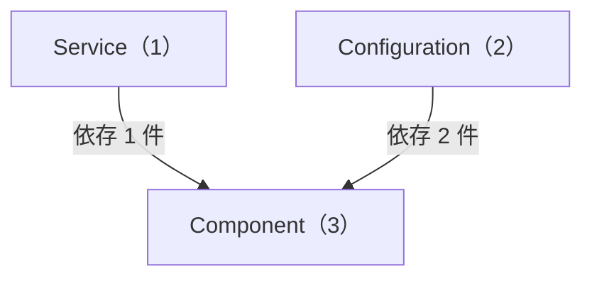
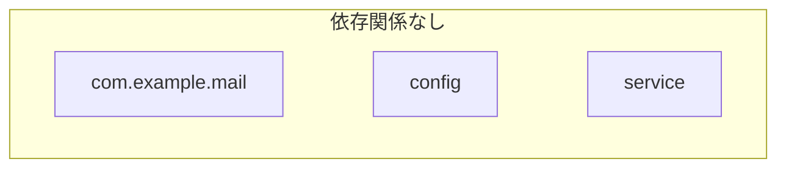
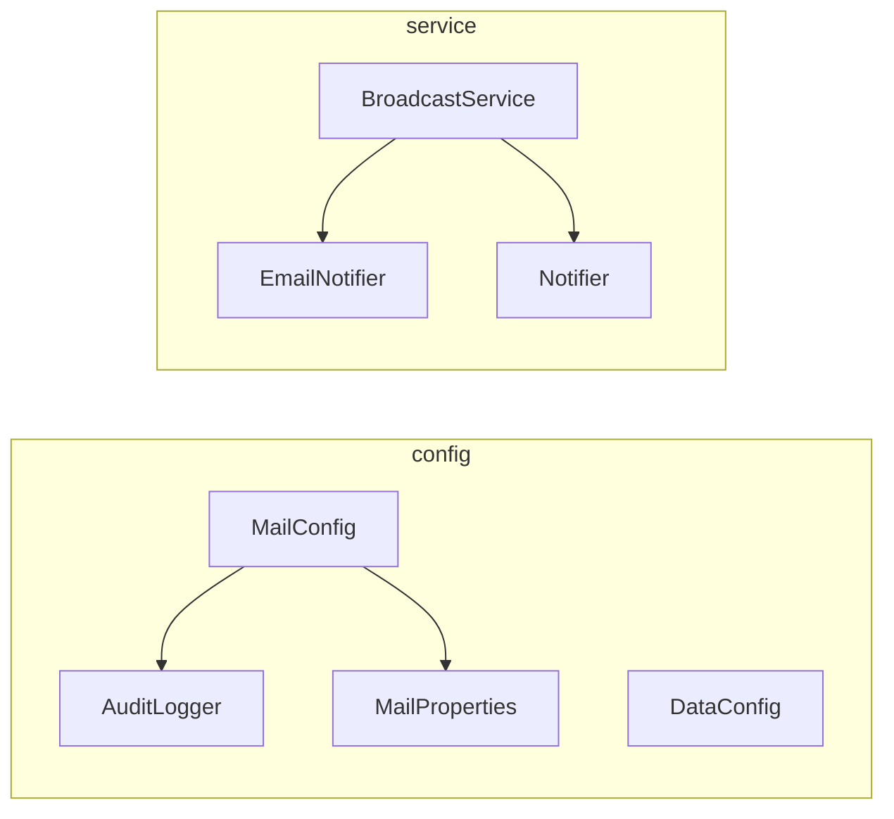

# 成果物一式（com.example.mail）

## 解析総覧

| 項目 | 内容 |
| --- | --- |
| ルートパッケージ | com.example.mail |
| Spring Boot | 3.2.5 |
| pom.xml | pom.xml |
| 文字コード | UTF-8 |

### プロジェクト統計

| 項目 | 件数 |
| --- | --- |
| パッケージ | 3 |
| クラス | 8 |
| インタフェース | 1 |
| Enum | 0 |
| Controller | 0 |
| Service | 1 |
| Repository | 0 |
| API | 0 |
| エンティティ | 0 |
| 依存関係 | 4 |
| 解析エラー（エラー / 警告） | 0 / 0 |

## アーキテクチャ・依存関係

### レイヤー構成

**レイヤー構成**

### パッケージ依存

**パッケージ依存**

### コンポーネント依存

**コンポーネント依存**

> 実線＝直接解決 / 点線＝単一実装から解決（@Bean や @Profile による別実装の可能性がある） / 赤枠＝循環依存

### 依存関係一覧

| 依存元 | メンバー | 注入方式 | 宣言型 | 解決先 | 解決方法 |
| --- | --- | --- | --- | --- | --- |
| MailConfig | auditLogger | フィールド | AuditLogger | AuditLogger | 直接解決 |
| MailConfig | mailProperties | コンストラクタ | MailProperties | MailProperties | 直接解決 |
| BroadcastService | notifiers | コンストラクタ | List<Notifier> | EmailNotifier | コレクションの要素 |
| BroadcastService | notifiers | コンストラクタ | List<Notifier> | Notifier | コレクションの要素 |

### 解決できなかった依存

検出されませんでした

## API一覧

検出されませんでした

## ER図

> 図はエンティティ（@Entity）のみ。親クラスのカラムは子エンティティに展開しない。テーブル名・カラム名の既定名は推測しない。

### エンティティ一覧

検出されませんでした

## クラス別概要

> 呼び出し関係（簡易）：既知の DI 依存先フィールドに対する呼び出しのみをヒューリスティックに検出したもので、オーバーロードと多態を解決しない。

> 呼び出し関係（簡易）：外部ライブラリの呼び出し、List<Foo>・Optional<Foo> のフィールドに対する呼び出し、コンストラクタ内の呼び出しは含まない。

| クラス名 | 種類 | 役割 | パッケージ | 概要 |
| --- | --- | --- | --- | --- |
| MailApplication | クラス | - | com.example.mail | - |
| AuditLogger | クラス | Component | com.example.mail.config | - |
| DataConfig | クラス | Configuration | com.example.mail.config | DataSource の定義。 |
| MailConfig | クラス | Configuration | com.example.mail.config | Lombok のコンストラクタ注入とフィールド注入の両方を持つ設定クラス。 |
| MailProperties | クラス | Component | com.example.mail.config | - |
| BroadcastService | クラス | Service | com.example.mail.service | - |
| EmailNotifier | クラス | Component | com.example.mail.service | - |
| Notifier | インタフェース | - | com.example.mail.service | - |
| SmsNotifier | クラス | - | com.example.mail.service | コンポーネントではなく、MailConfig の Bean メソッド経由で登録される。 |

### MailApplication（クラス）

MailApplication は com.example.mail パッケージのクラスです。

#### 基本情報

| 項目 | 内容 |
| --- | --- |
| 完全修飾名 | com.example.mail.MailApplication |
| 種類 | クラス |
| 役割 | - |
| パッケージ | com.example.mail |
| ソースファイル | src/main/java/com/example/mail/MailApplication.java |
| 修飾子 | public |
| アノテーション | @SpringBootApplication |
| 親クラス | - |
| インタフェース | - |
| Javadoc | - |
| コメント | - |

#### メソッド

| 名前 | 引数 | 戻り値 | 由来 |
| --- | --- | --- | --- |
| clock | - | Clock | ソース |

### AuditLogger（Component）

AuditLogger は com.example.mail.config パッケージの Component です。利用元：MailConfig。依存先：なし。

#### 基本情報

| 項目 | 内容 |
| --- | --- |
| 完全修飾名 | com.example.mail.config.AuditLogger |
| 種類 | クラス |
| 役割 | Component |
| パッケージ | com.example.mail.config |
| ソースファイル | src/main/java/com/example/mail/config/AuditLogger.java |
| 修飾子 | public |
| アノテーション | @Component |
| 親クラス | - |
| インタフェース | - |
| Javadoc | - |
| コメント | - |

#### 依存先

検出されませんでした

#### 被依存

| 依存元 | メンバー |
| --- | --- |
| MailConfig | auditLogger |

#### 呼び出し関係（簡易）

検出されませんでした

### DataConfig（Configuration）

DataConfig は com.example.mail.config パッケージの Configuration です。利用元：なし。依存先：なし。

#### 基本情報

| 項目 | 内容 |
| --- | --- |
| 完全修飾名 | com.example.mail.config.DataConfig |
| 種類 | クラス |
| 役割 | Configuration |
| パッケージ | com.example.mail.config |
| ソースファイル | src/main/java/com/example/mail/config/DataConfig.java |
| 修飾子 | public |
| アノテーション | @Configuration |
| 親クラス | - |
| インタフェース | - |
| Javadoc | DataSource の定義。 |
| コメント | - |

#### 依存先

検出されませんでした

#### 被依存

検出されませんでした

#### 呼び出し関係（簡易）

検出されませんでした

#### メソッド

| 名前 | 引数 | 戻り値 | 由来 |
| --- | --- | --- | --- |
| dataSource | - | DataSource | ソース |

### MailConfig（Configuration）

MailConfig は com.example.mail.config パッケージの Configuration です。利用元：なし。依存先：AuditLogger、MailProperties。

#### 基本情報

| 項目 | 内容 |
| --- | --- |
| 完全修飾名 | com.example.mail.config.MailConfig |
| 種類 | クラス |
| 役割 | Configuration |
| パッケージ | com.example.mail.config |
| ソースファイル | src/main/java/com/example/mail/config/MailConfig.java |
| 修飾子 | public |
| アノテーション | @Configuration, @RequiredArgsConstructor |
| 親クラス | - |
| インタフェース | - |
| Javadoc | Lombok のコンストラクタ注入とフィールド注入の両方を持つ設定クラス。 |
| コメント | - |

#### 依存先

| メンバー | 宣言型 | 解決先 | 解決方法 | 注入方式 | 由来 |
| --- | --- | --- | --- | --- | --- |
| auditLogger | AuditLogger | AuditLogger | 直接解決 | フィールド | ソース |
| mailProperties | MailProperties | MailProperties | 直接解決 | コンストラクタ | Lombok（@RequiredArgsConstructor） |

#### 被依存

検出されませんでした

#### 呼び出し関係（簡易）

| 呼び出し元メソッド | 依存先フィールド | 呼び出し先 | 実引数の数 | 行 |
| --- | --- | --- | --- | --- |
| smsNotifier() | mailProperties: MailProperties | MailProperties.getSender | 0 | 21 |

#### フィールド

| 名前 | 型 | 修飾子 | アノテーション |
| --- | --- | --- | --- |
| mailProperties | MailProperties | private, final | - |
| auditLogger | AuditLogger | private | @Autowired |

#### コンストラクタ

| 引数 | 修飾子 | 由来 |
| --- | --- | --- |
| MailProperties mailProperties | public | Lombok（@RequiredArgsConstructor） |

#### メソッド

| 名前 | 引数 | 戻り値 | 由来 |
| --- | --- | --- | --- |
| smsNotifier | - | Notifier | ソース |

### MailProperties（Component）

MailProperties は com.example.mail.config パッケージの Component です。利用元：MailConfig。依存先：なし。

#### 基本情報

| 項目 | 内容 |
| --- | --- |
| 完全修飾名 | com.example.mail.config.MailProperties |
| 種類 | クラス |
| 役割 | Component |
| パッケージ | com.example.mail.config |
| ソースファイル | src/main/java/com/example/mail/config/MailProperties.java |
| 修飾子 | public |
| アノテーション | @Component, @Data, @ConfigurationProperties |
| 親クラス | - |
| インタフェース | - |
| Javadoc | - |
| コメント | - |

#### 依存先

検出されませんでした

#### 被依存

| 依存元 | メンバー |
| --- | --- |
| MailConfig | mailProperties |

#### 呼び出し関係（簡易）

検出されませんでした

#### フィールド

| 名前 | 型 | 修飾子 | アノテーション |
| --- | --- | --- | --- |
| sender | String | private | - |

#### コンストラクタ

| 引数 | 修飾子 | 由来 |
| --- | --- | --- |
| - | public | Lombok（@Data） |

#### メソッド

| 名前 | 引数 | 戻り値 | 由来 |
| --- | --- | --- | --- |
| getSender | - | String | Lombok（@Data） |
| setSender | String sender | void | Lombok（@Data） |
| toString | - | String | Lombok（@Data） |
| equals | Object o | boolean | Lombok（@Data） |
| hashCode | - | int | Lombok（@Data） |

### BroadcastService（Service）

BroadcastService は com.example.mail.service パッケージの Service です。公開メソッド 0 件。利用元：なし。依存先：EmailNotifier、Notifier。

#### 基本情報

| 項目 | 内容 |
| --- | --- |
| 完全修飾名 | com.example.mail.service.BroadcastService |
| 種類 | クラス |
| 役割 | Service |
| パッケージ | com.example.mail.service |
| ソースファイル | src/main/java/com/example/mail/service/BroadcastService.java |
| 修飾子 | public |
| アノテーション | @Service, @RequiredArgsConstructor |
| 親クラス | - |
| インタフェース | - |
| Javadoc | - |
| コメント | - |

#### 公開メソッド

検出されませんでした

#### 依存先

| メンバー | 宣言型 | 解決先 | 解決方法 | 注入方式 | 由来 |
| --- | --- | --- | --- | --- | --- |
| notifiers | List<Notifier> | EmailNotifier | コレクションの要素 | コンストラクタ | Lombok（@RequiredArgsConstructor） |
| notifiers | List<Notifier> | Notifier | コレクションの要素 | コンストラクタ | Lombok（@RequiredArgsConstructor） |

#### 被依存

検出されませんでした

#### 呼び出し関係（簡易）

検出されませんでした

#### フィールド

| 名前 | 型 | 修飾子 | アノテーション |
| --- | --- | --- | --- |
| notifiers | List<Notifier> | private, final | - |

#### コンストラクタ

| 引数 | 修飾子 | 由来 |
| --- | --- | --- |
| List<Notifier> notifiers | public | Lombok（@RequiredArgsConstructor） |

### EmailNotifier（Component）

EmailNotifier は com.example.mail.service パッケージの Component です。利用元：BroadcastService。依存先：なし。

#### 基本情報

| 項目 | 内容 |
| --- | --- |
| 完全修飾名 | com.example.mail.service.EmailNotifier |
| 種類 | クラス |
| 役割 | Component |
| パッケージ | com.example.mail.service |
| ソースファイル | src/main/java/com/example/mail/service/EmailNotifier.java |
| 修飾子 | public |
| アノテーション | @Component |
| 親クラス | - |
| インタフェース | Notifier |
| Javadoc | - |
| コメント | - |

#### 依存先

検出されませんでした

#### 被依存

| 依存元 | メンバー |
| --- | --- |
| BroadcastService | notifiers |

#### 呼び出し関係（簡易）

検出されませんでした

#### メソッド

| 名前 | 引数 | 戻り値 | 由来 |
| --- | --- | --- | --- |
| send | String message | void | ソース |

### Notifier（インタフェース）

Notifier は com.example.mail.service パッケージのインタフェースです。

#### 基本情報

| 項目 | 内容 |
| --- | --- |
| 完全修飾名 | com.example.mail.service.Notifier |
| 種類 | インタフェース |
| 役割 | - |
| パッケージ | com.example.mail.service |
| ソースファイル | src/main/java/com/example/mail/service/Notifier.java |
| 修飾子 | public |
| アノテーション | - |
| 親クラス | - |
| インタフェース | - |
| Javadoc | - |
| コメント | - |

#### メソッド

| 名前 | 引数 | 戻り値 | 由来 |
| --- | --- | --- | --- |
| send | String message | void | ソース |

### SmsNotifier（クラス）

SmsNotifier は com.example.mail.service パッケージのクラスです。

#### 基本情報

| 項目 | 内容 |
| --- | --- |
| 完全修飾名 | com.example.mail.service.SmsNotifier |
| 種類 | クラス |
| 役割 | - |
| パッケージ | com.example.mail.service |
| ソースファイル | src/main/java/com/example/mail/service/SmsNotifier.java |
| 修飾子 | public |
| アノテーション | - |
| 親クラス | - |
| インタフェース | Notifier |
| Javadoc | コンポーネントではなく、MailConfig の Bean メソッド経由で登録される。 |
| コメント | - |

#### フィールド

| 名前 | 型 | 修飾子 | アノテーション |
| --- | --- | --- | --- |
| sender | String | private, final | - |

#### コンストラクタ

| 引数 | 修飾子 | 由来 |
| --- | --- | --- |
| String sender | public | ソース |

#### メソッド

| 名前 | 引数 | 戻り値 | 由来 |
| --- | --- | --- | --- |
| send | String message | void | ソース |

## 解析エラーレポート

検出されませんでした

> コンパイル失敗を完全には検出しない。

## MyBatis

> <include> は展開せず、記述どおりに表示する。SQL の意味解析はしない。

検出されませんでした

## Configuration

### @Bean 定義

| 定義元クラス | Bean メソッド | Bean 名 | 戻り値型 | 引数 |
| --- | --- | --- | --- | --- |
| MailApplication | clock | 未指定 | Clock | - |
| DataConfig | dataSource | mainDataSource | DataSource | - |
| MailConfig | smsNotifier | 未指定 | Notifier | - |

> Bean 名は明記されたもののみ表示し、既定名は推測しない。Bean の内容は解釈しない。

### @ConfigurationProperties

| クラス | Bean メソッド | prefix |
| --- | --- | --- |
| DataConfig | dataSource | app.datasource |
| MailProperties | - | app.mail |

### 設定クラス（@Configuration）

| クラス | 依存先 |
| --- | --- |
| DataConfig | - |
| MailConfig | AuditLogger, MailProperties |

## 画面一覧

### 画面

検出されませんでした

### 画面ごとの遷移先

検出されませんでした

### Controller と対応付けできなかった View 名

検出されませんでした

