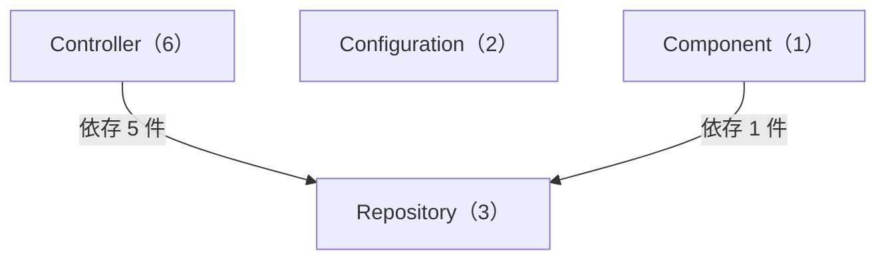
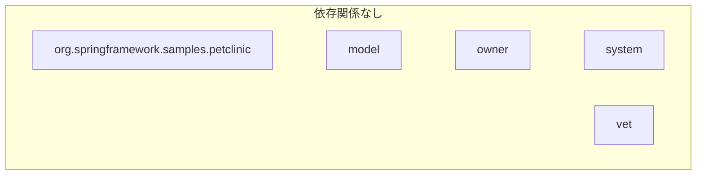
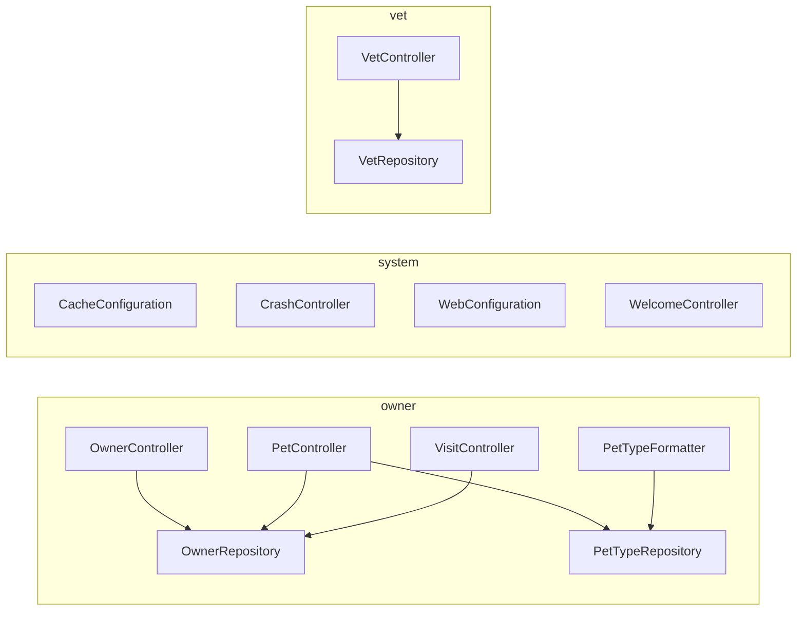
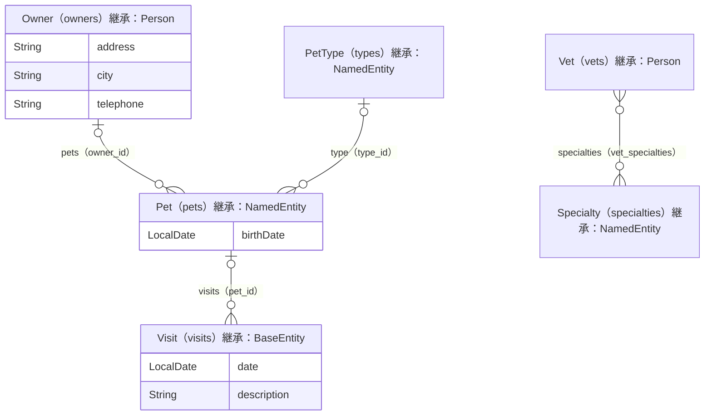
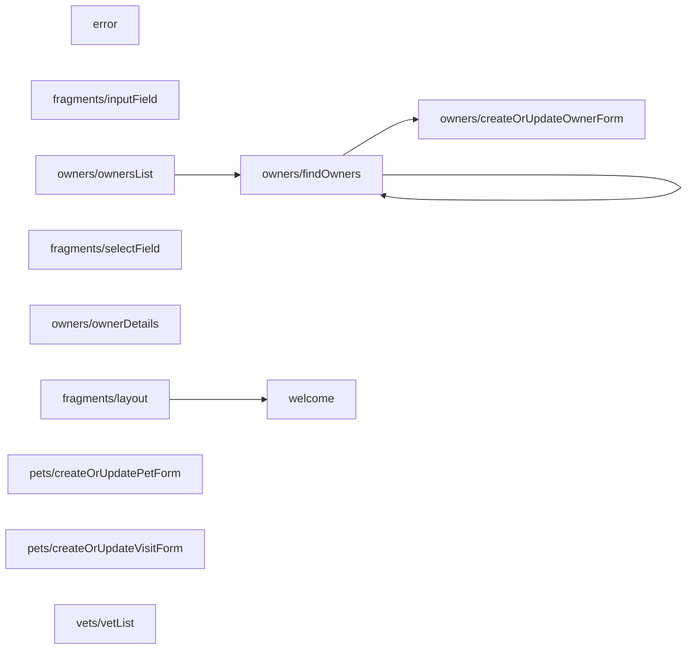

# 成果物一式（org.springframework.samples.petclinic）

## 解析総覧

| 項目 | 内容 |
| --- | --- |
| ルートパッケージ | org.springframework.samples.petclinic |
| Spring Boot | 4.1.0 |
| pom.xml | spring-petclinic-main/pom.xml |
| 文字コード | UTF-8 |

### プロジェクト統計

| 項目 | 件数 |
| --- | --- |
| パッケージ | 5 |
| クラス | 22 |
| インタフェース | 3 |
| Enum | 0 |
| Controller | 6 |
| Service | 0 |
| Repository | 3 |
| API | 17 |
| エンティティ | 9 |
| 依存関係 | 6 |
| 解析エラー（エラー / 警告） | 0 / 0 |

## アーキテクチャ・依存関係

### レイヤー構成

**レイヤー構成**

### パッケージ依存

**パッケージ依存**

### コンポーネント依存

**コンポーネント依存**

> 実線＝直接解決 / 点線＝単一実装から解決（@Bean や @Profile による別実装の可能性がある） / 赤枠＝循環依存

### 依存関係一覧

| 依存元 | メンバー | 注入方式 | 宣言型 | 解決先 | 解決方法 |
| --- | --- | --- | --- | --- | --- |
| OwnerController | owners | コンストラクタ | OwnerRepository | OwnerRepository | 直接解決 |
| PetController | owners | コンストラクタ | OwnerRepository | OwnerRepository | 直接解決 |
| PetController | types | コンストラクタ | PetTypeRepository | PetTypeRepository | 直接解決 |
| PetTypeFormatter | types | コンストラクタ | PetTypeRepository | PetTypeRepository | 直接解決 |
| VisitController | owners | コンストラクタ | OwnerRepository | OwnerRepository | 直接解決 |
| VetController | vetRepository | コンストラクタ | VetRepository | VetRepository | 直接解決 |

### 解決できなかった依存

検出されませんでした

## API一覧

| Controller | Method | HTTP | Path | Request DTO | Response DTO |
| --- | --- | --- | --- | --- | --- |
| OwnerController | processFindForm | GET | /owners | - | String |
| OwnerController | initFindForm | GET | /owners/find | - | String |
| OwnerController | initCreationForm | GET | /owners/new | - | String |
| OwnerController | processCreationForm | POST | /owners/new | - | String |
| OwnerController | showOwner | GET | /owners/{ownerId} | - | ModelAndView |
| OwnerController | initUpdateOwnerForm | GET | /owners/{ownerId}/edit | - | String |
| OwnerController | processUpdateOwnerForm | POST | /owners/{ownerId}/edit | - | String |
| PetController | initCreationForm | GET | /owners/{ownerId}/pets/new | - | String |
| PetController | processCreationForm | POST | /owners/{ownerId}/pets/new | - | String |
| PetController | initUpdateForm | GET | /owners/{ownerId}/pets/{petId}/edit | - | String |
| PetController | processUpdateForm | POST | /owners/{ownerId}/pets/{petId}/edit | - | String |
| VisitController | initNewVisitForm | GET | /owners/{ownerId}/pets/{petId}/visits/new | - | String |
| VisitController | processNewVisitForm | POST | /owners/{ownerId}/pets/{petId}/visits/new | - | String |
| CrashController | triggerException | GET | /oups | - | String |
| WelcomeController | welcome | GET | / | - | String |
| VetController | showResourcesVetList | GET | /vets | - | Vets |
| VetController | showVetList | GET | /vets.html | - | String |

## ER図

**ER図**

> 図はエンティティ（@Entity）のみ。親クラスのカラムは子エンティティに展開しない。テーブル名・カラム名の既定名は推測しない。

### エンティティ一覧

| エンティティ | 種類 | エンティティ名 | テーブル名 | スキーマ | 親クラス |
| --- | --- | --- | --- | --- | --- |
| BaseEntity | MappedSuperclass | - | - | - | - |
| NamedEntity | MappedSuperclass | - | - | - | BaseEntity |
| Person | MappedSuperclass | - | - | - | BaseEntity |
| Owner | エンティティ | 未指定 | owners | 未指定 | Person |
| Pet | エンティティ | 未指定 | pets | 未指定 | NamedEntity |
| PetType | エンティティ | 未指定 | types | 未指定 | NamedEntity |
| Visit | エンティティ | 未指定 | visits | 未指定 | BaseEntity |
| Specialty | エンティティ | 未指定 | specialties | 未指定 | NamedEntity |
| Vet | エンティティ | 未指定 | vets | 未指定 | Person |

### BaseEntity（MappedSuperclass）

カラム

| フィールド | 型 | カラム名 | PK | 生成戦略 | NULL可 | 長さ | 一意 | Enum型 | 埋め込み |
| --- | --- | --- | --- | --- | --- | --- | --- | --- | --- |
| id | Integer | 未指定 | ○ | IDENTITY | - | - | - | - | - |

関連

検出されませんでした

### NamedEntity（MappedSuperclass）

カラム

| フィールド | 型 | カラム名 | PK | 生成戦略 | NULL可 | 長さ | 一意 | Enum型 | 埋め込み |
| --- | --- | --- | --- | --- | --- | --- | --- | --- | --- |
| name | String | 未指定 | - | - | - | - | - | - | - |

関連

検出されませんでした

### Person（MappedSuperclass）

カラム

| フィールド | 型 | カラム名 | PK | 生成戦略 | NULL可 | 長さ | 一意 | Enum型 | 埋め込み |
| --- | --- | --- | --- | --- | --- | --- | --- | --- | --- |
| firstName | String | 未指定 | - | - | - | 30 | - | - | - |
| lastName | String | 未指定 | - | - | - | 30 | - | - | - |

関連

検出されませんでした

### Owner（エンティティ）

カラム

| フィールド | 型 | カラム名 | PK | 生成戦略 | NULL可 | 長さ | 一意 | Enum型 | 埋め込み |
| --- | --- | --- | --- | --- | --- | --- | --- | --- | --- |
| address | String | 未指定 | - | - | - | - | - | - | - |
| city | String | 未指定 | - | - | - | - | - | - | - |
| telephone | String | 未指定 | - | - | - | - | - | - | - |

関連

| フィールド | 種類 | 相手 | 所有側 | mappedBy | 結合カラム | 結合テーブル | optional | fetch | cascade |
| --- | --- | --- | --- | --- | --- | --- | --- | --- | --- |
| pets | OneToMany | Pet | ○ | - | owner_id | - | - | EAGER | ALL |

### Pet（エンティティ）

カラム

| フィールド | 型 | カラム名 | PK | 生成戦略 | NULL可 | 長さ | 一意 | Enum型 | 埋め込み |
| --- | --- | --- | --- | --- | --- | --- | --- | --- | --- |
| birthDate | LocalDate | 未指定 | - | - | - | - | - | - | - |

関連

| フィールド | 種類 | 相手 | 所有側 | mappedBy | 結合カラム | 結合テーブル | optional | fetch | cascade |
| --- | --- | --- | --- | --- | --- | --- | --- | --- | --- |
| type | ManyToOne | PetType | ○ | - | type_id | - | - | - | - |
| visits | OneToMany | Visit | ○ | - | pet_id | - | - | EAGER | ALL |

### PetType（エンティティ）

カラム

検出されませんでした

関連

検出されませんでした

### Visit（エンティティ）

カラム

| フィールド | 型 | カラム名 | PK | 生成戦略 | NULL可 | 長さ | 一意 | Enum型 | 埋め込み |
| --- | --- | --- | --- | --- | --- | --- | --- | --- | --- |
| date | LocalDate | visit_date | - | - | - | - | - | - | - |
| description | String | 未指定 | - | - | - | - | - | - | - |

関連

検出されませんでした

### Specialty（エンティティ）

カラム

検出されませんでした

関連

検出されませんでした

### Vet（エンティティ）

カラム

検出されませんでした

関連

| フィールド | 種類 | 相手 | 所有側 | mappedBy | 結合カラム | 結合テーブル | optional | fetch | cascade |
| --- | --- | --- | --- | --- | --- | --- | --- | --- | --- |
| specialties | ManyToMany | Specialty | ○ | - | - | vet_specialties（vet_id / 逆側 specialty_id） | - | EAGER | - |

## クラス別概要

> 呼び出し関係（簡易）：既知の DI 依存先フィールドに対する呼び出しのみをヒューリスティックに検出したもので、オーバーロードと多態を解決しない。

> 呼び出し関係（簡易）：外部ライブラリの呼び出し、List<Foo>・Optional<Foo> のフィールドに対する呼び出し、コンストラクタ内の呼び出しは含まない。

| クラス名 | 種類 | 役割 | パッケージ | 概要 |
| --- | --- | --- | --- | --- |
| PetClinicApplication | クラス | - | org.springframework.samples.petclinic | PetClinic Spring Boot Application. |
| PetClinicRuntimeHints | クラス | - | org.springframework.samples.petclinic | - |
| BaseEntity | クラス | Entity | org.springframework.samples.petclinic.model | Simple JavaBean domain object with an id property. Used as a base class for objects |
| NamedEntity | クラス | Entity | org.springframework.samples.petclinic.model | Simple JavaBean domain object adds a name property to <code>BaseEntity</code>. Used as |
| Person | クラス | Entity | org.springframework.samples.petclinic.model | Simple JavaBean domain object representing an person. |
| Owner | クラス | Entity | org.springframework.samples.petclinic.owner | Simple JavaBean domain object representing an owner. |
| OwnerController | クラス | Controller | org.springframework.samples.petclinic.owner | @author Juergen Hoeller |
| OwnerRepository | インタフェース | Repository | org.springframework.samples.petclinic.owner | Repository class for <code>Owner</code> domain objects. All method names are compliant |
| Pet | クラス | Entity | org.springframework.samples.petclinic.owner | Simple business object representing a pet. |
| PetController | クラス | Controller | org.springframework.samples.petclinic.owner | @author Juergen Hoeller |
| PetType | クラス | Entity | org.springframework.samples.petclinic.owner | @author Juergen Hoeller Can be Cat, Dog, Hamster... |
| PetTypeFormatter | クラス | Component | org.springframework.samples.petclinic.owner | Instructs Spring MVC on how to parse and print elements of type 'PetType'. Starting |
| PetTypeRepository | インタフェース | Repository | org.springframework.samples.petclinic.owner | - |
| PetValidator | クラス | - | org.springframework.samples.petclinic.owner | <code>Validator</code> for <code>Pet</code> forms. |
| Visit | クラス | Entity | org.springframework.samples.petclinic.owner | Simple JavaBean domain object representing a visit. |
| VisitController | クラス | Controller | org.springframework.samples.petclinic.owner | @author Juergen Hoeller |
| CacheConfiguration | クラス | Configuration | org.springframework.samples.petclinic.system | Cache configuration intended for caches providing the JCache API. This configuration |
| CrashController | クラス | Controller | org.springframework.samples.petclinic.system | Controller used to showcase what happens when an exception is thrown |
| WebConfiguration | クラス | Configuration | org.springframework.samples.petclinic.system | Configures internationalization (i18n) support for the application. |
| WelcomeController | クラス | Controller | org.springframework.samples.petclinic.system | - |
| Specialty | クラス | Entity | org.springframework.samples.petclinic.vet | Models a {@link Vet Vet's} specialty (for example, dentistry). |
| Vet | クラス | Entity | org.springframework.samples.petclinic.vet | Simple JavaBean domain object representing a veterinarian. |
| VetController | クラス | Controller | org.springframework.samples.petclinic.vet | @author Juergen Hoeller |
| VetRepository | インタフェース | Repository | org.springframework.samples.petclinic.vet | Repository class for <code>Vet</code> domain objects All method names are compliant |
| Vets | クラス | - | org.springframework.samples.petclinic.vet | Simple domain object representing a list of veterinarians. Mostly here to be used for |

### PetClinicApplication（クラス）

PetClinicApplication は org.springframework.samples.petclinic パッケージのクラスです。

#### 基本情報

| 項目 | 内容 |
| --- | --- |
| 完全修飾名 | org.springframework.samples.petclinic.PetClinicApplication |
| 種類 | クラス |
| 役割 | - |
| パッケージ | org.springframework.samples.petclinic |
| ソースファイル | src/main/java/org/springframework/samples/petclinic/PetClinicApplication.java |
| 修飾子 | public |
| アノテーション | @SpringBootApplication, @ImportRuntimeHints |
| 親クラス | - |
| インタフェース | - |
| Javadoc | PetClinic Spring Boot Application.  @author Dave Syer |
| コメント | - |

#### メソッド

| 名前 | 引数 | 戻り値 | 由来 |
| --- | --- | --- | --- |
| main | String[] args | void | ソース |

### PetClinicRuntimeHints（クラス）

PetClinicRuntimeHints は org.springframework.samples.petclinic パッケージのクラスです。

#### 基本情報

| 項目 | 内容 |
| --- | --- |
| 完全修飾名 | org.springframework.samples.petclinic.PetClinicRuntimeHints |
| 種類 | クラス |
| 役割 | - |
| パッケージ | org.springframework.samples.petclinic |
| ソースファイル | src/main/java/org/springframework/samples/petclinic/PetClinicRuntimeHints.java |
| 修飾子 | public |
| アノテーション | - |
| 親クラス | - |
| インタフェース | RuntimeHintsRegistrar |
| Javadoc | - |
| コメント | - |

#### メソッド

| 名前 | 引数 | 戻り値 | 由来 |
| --- | --- | --- | --- |
| registerHints | RuntimeHints hints, ClassLoader classLoader | void | ソース |

### BaseEntity（MappedSuperclass）

BaseEntity は org.springframework.samples.petclinic.model パッケージの MappedSuperclass です。カラム 1 件。関連：なし。

カラムと関連は「ER図」の章の BaseEntity（MappedSuperclass）を参照。

#### 基本情報

| 項目 | 内容 |
| --- | --- |
| 完全修飾名 | org.springframework.samples.petclinic.model.BaseEntity |
| 種類 | クラス |
| 役割 | Entity |
| パッケージ | org.springframework.samples.petclinic.model |
| ソースファイル | src/main/java/org/springframework/samples/petclinic/model/BaseEntity.java |
| 修飾子 | public |
| アノテーション | @MappedSuperclass |
| 親クラス | - |
| インタフェース | Serializable |
| Javadoc | Simple JavaBean domain object with an id property. Used as a base class for objects needing this property.  @author Ken Krebs @author Juergen Hoeller |
| コメント | - |

#### テーブル

| 項目 | 内容 |
| --- | --- |
| 種類 | MappedSuperclass |
| エンティティ名 | 未指定 |
| テーブル名 | 未指定 |
| スキーマ | 未指定 |

#### 対応するリポジトリ

検出されませんでした

#### フィールド

| 名前 | 型 | 修飾子 | アノテーション |
| --- | --- | --- | --- |
| id | Integer | private | @Id, @GeneratedValue |

#### メソッド

| 名前 | 引数 | 戻り値 | 由来 |
| --- | --- | --- | --- |
| getId | - | Integer | ソース |
| setId | Integer id | void | ソース |
| isNew | - | boolean | ソース |

### NamedEntity（MappedSuperclass）

NamedEntity は org.springframework.samples.petclinic.model パッケージの MappedSuperclass です。カラム 1 件。関連：なし。

カラムと関連は「ER図」の章の NamedEntity（MappedSuperclass）を参照。

#### 基本情報

| 項目 | 内容 |
| --- | --- |
| 完全修飾名 | org.springframework.samples.petclinic.model.NamedEntity |
| 種類 | クラス |
| 役割 | Entity |
| パッケージ | org.springframework.samples.petclinic.model |
| ソースファイル | src/main/java/org/springframework/samples/petclinic/model/NamedEntity.java |
| 修飾子 | public |
| アノテーション | @MappedSuperclass |
| 親クラス | BaseEntity |
| インタフェース | - |
| Javadoc | Simple JavaBean domain object adds a name property to <code>BaseEntity</code>. Used as a base class for objects needing these properties.  @author Ken Krebs @author Juergen Hoeller @author Wick Dynex |
| コメント | - |

#### テーブル

| 項目 | 内容 |
| --- | --- |
| 種類 | MappedSuperclass |
| エンティティ名 | 未指定 |
| テーブル名 | 未指定 |
| スキーマ | 未指定 |

#### 対応するリポジトリ

検出されませんでした

#### フィールド

| 名前 | 型 | 修飾子 | アノテーション |
| --- | --- | --- | --- |
| name | String | private | @Column, @NotBlank |

#### メソッド

| 名前 | 引数 | 戻り値 | 由来 |
| --- | --- | --- | --- |
| getName | - | String | ソース |
| setName | String name | void | ソース |
| toString | - | String | ソース |

### Person（MappedSuperclass）

Person は org.springframework.samples.petclinic.model パッケージの MappedSuperclass です。カラム 2 件。関連：なし。

カラムと関連は「ER図」の章の Person（MappedSuperclass）を参照。

#### 基本情報

| 項目 | 内容 |
| --- | --- |
| 完全修飾名 | org.springframework.samples.petclinic.model.Person |
| 種類 | クラス |
| 役割 | Entity |
| パッケージ | org.springframework.samples.petclinic.model |
| ソースファイル | src/main/java/org/springframework/samples/petclinic/model/Person.java |
| 修飾子 | public |
| アノテーション | @MappedSuperclass |
| 親クラス | BaseEntity |
| インタフェース | - |
| Javadoc | Simple JavaBean domain object representing an person.  @author Ken Krebs |
| コメント | - |

#### テーブル

| 項目 | 内容 |
| --- | --- |
| 種類 | MappedSuperclass |
| エンティティ名 | 未指定 |
| テーブル名 | 未指定 |
| スキーマ | 未指定 |

#### 対応するリポジトリ

検出されませんでした

#### フィールド

| 名前 | 型 | 修飾子 | アノテーション |
| --- | --- | --- | --- |
| firstName | String | private | @Column, @Size, @NotBlank |
| lastName | String | private | @Column, @Size, @NotBlank |

#### メソッド

| 名前 | 引数 | 戻り値 | 由来 |
| --- | --- | --- | --- |
| getFirstName | - | String | ソース |
| setFirstName | String firstName | void | ソース |
| getLastName | - | String | ソース |
| setLastName | String lastName | void | ソース |

### Owner（Entity）

Owner は org.springframework.samples.petclinic.owner パッケージのエンティティです（テーブル：owners）。カラム 3 件。関連：Pet（1 対多）。

カラムと関連は「ER図」の章の Owner（エンティティ）を参照。

#### 基本情報

| 項目 | 内容 |
| --- | --- |
| 完全修飾名 | org.springframework.samples.petclinic.owner.Owner |
| 種類 | クラス |
| 役割 | Entity |
| パッケージ | org.springframework.samples.petclinic.owner |
| ソースファイル | src/main/java/org/springframework/samples/petclinic/owner/Owner.java |
| 修飾子 | public |
| アノテーション | @Entity, @Table |
| 親クラス | Person |
| インタフェース | - |
| Javadoc | Simple JavaBean domain object representing an owner.  @author Ken Krebs @author Juergen Hoeller @author Sam Brannen @author Michael Isvy @author Oliver Drotbohm @author Wick Dynex |
| コメント | - |

#### テーブル

| 項目 | 内容 |
| --- | --- |
| 種類 | エンティティ |
| エンティティ名 | 未指定 |
| テーブル名 | owners |
| スキーマ | 未指定 |

#### 対応するリポジトリ

| リポジトリ | ID型 |
| --- | --- |
| OwnerRepository | Integer |

#### フィールド

| 名前 | 型 | 修飾子 | アノテーション |
| --- | --- | --- | --- |
| address | String | private | @Column, @NotBlank, @Size |
| city | String | private | @Column, @NotBlank, @Size |
| telephone | String | private | @Column, @NotBlank, @Pattern |
| pets | List<Pet> | private, final | @OneToMany, @JoinColumn, @OrderBy |

#### メソッド

| 名前 | 引数 | 戻り値 | 由来 |
| --- | --- | --- | --- |
| getAddress | - | String | ソース |
| setAddress | String address | void | ソース |
| getCity | - | String | ソース |
| setCity | String city | void | ソース |
| getTelephone | - | String | ソース |
| setTelephone | String telephone | void | ソース |
| getPets | - | List<Pet> | ソース |
| addPet | Pet pet | void | ソース |
| getPet | String name | Pet | ソース |
| getPet | Integer id | Pet | ソース |
| getPet | String name, boolean ignoreNew | Pet | ソース |
| toString | - | String | ソース |
| addVisit | Integer petId, Visit visit | void | ソース |

### OwnerController（Controller）

OwnerController は org.springframework.samples.petclinic.owner パッケージの Controller です。エンドポイント 7 件（GET 5・POST 2）を提供する。依存先：OwnerRepository。

#### 基本情報

| 項目 | 内容 |
| --- | --- |
| 完全修飾名 | org.springframework.samples.petclinic.owner.OwnerController |
| 種類 | クラス |
| 役割 | Controller |
| パッケージ | org.springframework.samples.petclinic.owner |
| ソースファイル | src/main/java/org/springframework/samples/petclinic/owner/OwnerController.java |
| 修飾子 | - |
| アノテーション | @Controller |
| 親クラス | - |
| インタフェース | - |
| Javadoc | @author Juergen Hoeller @author Ken Krebs @author Arjen Poutsma @author Michael Isvy @author Wick Dynex |
| コメント | - |

#### エンドポイント

| Method | HTTP | Path | Request DTO | Response DTO |
| --- | --- | --- | --- | --- |
| initCreationForm | GET | /owners/new | - | String |
| processCreationForm | POST | /owners/new | - | String |
| initFindForm | GET | /owners/find | - | String |
| processFindForm | GET | /owners | - | String |
| initUpdateOwnerForm | GET | /owners/{ownerId}/edit | - | String |
| processUpdateOwnerForm | POST | /owners/{ownerId}/edit | - | String |
| showOwner | GET | /owners/{ownerId} | - | ModelAndView |

#### 依存先

| メンバー | 宣言型 | 解決先 | 解決方法 | 注入方式 | 由来 |
| --- | --- | --- | --- | --- | --- |
| owners | OwnerRepository | OwnerRepository | 直接解決 | コンストラクタ | ソース |

#### 呼び出し関係（簡易）

| 呼び出し元メソッド | 依存先フィールド | 呼び出し先 | 実引数の数 | 行 |
| --- | --- | --- | --- | --- |
| findOwner(Integer) | owners: OwnerRepository | OwnerRepository.findById | 1 | 67 |
| processCreationForm(Owner, BindingResult, RedirectAttributes) | owners: OwnerRepository | OwnerRepository.save | 1 | 84 |
| findPaginatedForOwnersLastName(int, String) | owners: OwnerRepository | OwnerRepository.findByLastNameStartingWith | 2 | 145 |
| processUpdateOwnerForm(Owner, BindingResult, int, RedirectAttributes) | owners: OwnerRepository | OwnerRepository.save | 1 | 168 |
| showOwner(int) | owners: OwnerRepository | OwnerRepository.findById | 1 | 181 |

#### フィールド

| 名前 | 型 | 修飾子 | アノテーション |
| --- | --- | --- | --- |
| VIEWS_OWNER_CREATE_OR_UPDATE_FORM | String | private, static, final | - |
| owners | OwnerRepository | private, final | - |

#### コンストラクタ

| 引数 | 修飾子 | 由来 |
| --- | --- | --- |
| OwnerRepository owners | public | ソース |

#### メソッド

| 名前 | 引数 | 戻り値 | 由来 |
| --- | --- | --- | --- |
| setAllowedFields | WebDataBinder dataBinder | void | ソース |
| findOwner | Integer ownerId | Owner | ソース |
| initCreationForm | - | String | ソース |
| processCreationForm | Owner owner, BindingResult result, RedirectAttributes redirectAttributes | String | ソース |
| initFindForm | - | String | ソース |
| processFindForm | int page, Owner owner, BindingResult result, Model model, RedirectAttributes redirectAttributes | String | ソース |
| addPaginationModel | int page, Model model, Page<Owner> paginated | String | ソース |
| findPaginatedForOwnersLastName | int page, String lastname | Page<Owner> | ソース |
| initUpdateOwnerForm | - | String | ソース |
| processUpdateOwnerForm | Owner owner, BindingResult result, int ownerId, RedirectAttributes redirectAttributes | String | ソース |
| showOwner | int ownerId | ModelAndView | ソース |

### OwnerRepository（Repository）

OwnerRepository は org.springframework.samples.petclinic.owner パッケージの Repository です。エンティティ Owner（ID 型 Integer）を扱う。利用元：OwnerController、PetController、VisitController。

#### 基本情報

| 項目 | 内容 |
| --- | --- |
| 完全修飾名 | org.springframework.samples.petclinic.owner.OwnerRepository |
| 種類 | インタフェース |
| 役割 | Repository |
| パッケージ | org.springframework.samples.petclinic.owner |
| ソースファイル | src/main/java/org/springframework/samples/petclinic/owner/OwnerRepository.java |
| 修飾子 | public |
| アノテーション | - |
| 親クラス | - |
| インタフェース | JpaRepository<Owner, Integer> |
| Javadoc | Repository class for <code>Owner</code> domain objects. All method names are compliant with Spring Data naming conventions so this interface can easily be extended for Spring Data. See: https://docs.spring.io/spring-data/jpa/docs/current/reference/html/#repositories.query-methods.query-creation  @author Ken Krebs @author Juergen Hoeller @author Sam Brannen @author Michael Isvy @author Wick Dynex |
| コメント | - |

#### リポジトリ

| 項目 | 内容 |
| --- | --- |
| 対象エンティティ | Owner |
| ID型 | Integer |
| 基底型 | JpaRepository<Owner, Integer> |

#### 被依存

| 依存元 | メンバー |
| --- | --- |
| OwnerController | owners |
| PetController | owners |
| VisitController | owners |

#### 呼び出し関係（簡易）

検出されませんでした

#### 宣言メソッド

| 名前 | 引数 | 戻り値 | 由来 |
| --- | --- | --- | --- |
| findByLastNameStartingWith | String lastName, Pageable pageable | Page<Owner> | ソース |
| findById | Integer id | Optional<Owner> | ソース |

### Pet（Entity）

Pet は org.springframework.samples.petclinic.owner パッケージのエンティティです（テーブル：pets）。カラム 1 件。関連：PetType（多対 1）、Visit（1 対多）。

カラムと関連は「ER図」の章の Pet（エンティティ）を参照。

#### 基本情報

| 項目 | 内容 |
| --- | --- |
| 完全修飾名 | org.springframework.samples.petclinic.owner.Pet |
| 種類 | クラス |
| 役割 | Entity |
| パッケージ | org.springframework.samples.petclinic.owner |
| ソースファイル | src/main/java/org/springframework/samples/petclinic/owner/Pet.java |
| 修飾子 | public |
| アノテーション | @Entity, @Table |
| 親クラス | NamedEntity |
| インタフェース | - |
| Javadoc | Simple business object representing a pet.  @author Ken Krebs @author Juergen Hoeller @author Sam Brannen @author Wick Dynex |
| コメント | - |

#### テーブル

| 項目 | 内容 |
| --- | --- |
| 種類 | エンティティ |
| エンティティ名 | 未指定 |
| テーブル名 | pets |
| スキーマ | 未指定 |

#### 対応するリポジトリ

検出されませんでした

#### フィールド

| 名前 | 型 | 修飾子 | アノテーション |
| --- | --- | --- | --- |
| birthDate | LocalDate | private | @Column, @DateTimeFormat |
| type | PetType | private | @ManyToOne, @JoinColumn |
| visits | Set<Visit> | private, final | @OneToMany, @JoinColumn, @OrderBy |

#### メソッド

| 名前 | 引数 | 戻り値 | 由来 |
| --- | --- | --- | --- |
| setBirthDate | LocalDate birthDate | void | ソース |
| getBirthDate | - | LocalDate | ソース |
| getType | - | PetType | ソース |
| setType | PetType type | void | ソース |
| getVisits | - | Collection<Visit> | ソース |
| addVisit | Visit visit | void | ソース |

### PetController（Controller）

PetController は org.springframework.samples.petclinic.owner パッケージの Controller です。エンドポイント 4 件（GET 2・POST 2）を提供する。依存先：OwnerRepository、PetTypeRepository。

#### 基本情報

| 項目 | 内容 |
| --- | --- |
| 完全修飾名 | org.springframework.samples.petclinic.owner.PetController |
| 種類 | クラス |
| 役割 | Controller |
| パッケージ | org.springframework.samples.petclinic.owner |
| ソースファイル | src/main/java/org/springframework/samples/petclinic/owner/PetController.java |
| 修飾子 | - |
| アノテーション | @Controller, @RequestMapping |
| 親クラス | - |
| インタフェース | - |
| Javadoc | @author Juergen Hoeller @author Ken Krebs @author Arjen Poutsma @author Wick Dynex |
| コメント | - |

#### エンドポイント

| Method | HTTP | Path | Request DTO | Response DTO |
| --- | --- | --- | --- | --- |
| initCreationForm | GET | /owners/{ownerId}/pets/new | - | String |
| processCreationForm | POST | /owners/{ownerId}/pets/new | - | String |
| initUpdateForm | GET | /owners/{ownerId}/pets/{petId}/edit | - | String |
| processUpdateForm | POST | /owners/{ownerId}/pets/{petId}/edit | - | String |

#### 依存先

| メンバー | 宣言型 | 解決先 | 解決方法 | 注入方式 | 由来 |
| --- | --- | --- | --- | --- | --- |
| owners | OwnerRepository | OwnerRepository | 直接解決 | コンストラクタ | ソース |
| types | PetTypeRepository | PetTypeRepository | 直接解決 | コンストラクタ | ソース |

#### 呼び出し関係（簡易）

| 呼び出し元メソッド | 依存先フィールド | 呼び出し先 | 実引数の数 | 行 |
| --- | --- | --- | --- | --- |
| populatePetTypes() | types: PetTypeRepository | PetTypeRepository.findPetTypes | 0 | 64 |
| findOwner(int) | owners: OwnerRepository | OwnerRepository.findById | 1 | 69 |
| findPet(int, Integer) | owners: OwnerRepository | OwnerRepository.findById | 1 | 83 |
| processCreationForm(Owner, Pet, BindingResult, RedirectAttributes) | owners: OwnerRepository | OwnerRepository.saveAndFlush | 1 | 126 |
| updatePetDetails(Owner, Pet) | owners: OwnerRepository | OwnerRepository.saveAndFlush | 1 | 199 |

#### フィールド

| 名前 | 型 | 修飾子 | アノテーション |
| --- | --- | --- | --- |
| VIEWS_PETS_CREATE_OR_UPDATE_FORM | String | private, static, final | - |
| owners | OwnerRepository | private, final | - |
| types | PetTypeRepository | private, final | - |

#### コンストラクタ

| 引数 | 修飾子 | 由来 |
| --- | --- | --- |
| OwnerRepository owners, PetTypeRepository types | public | ソース |

#### メソッド

| 名前 | 引数 | 戻り値 | 由来 |
| --- | --- | --- | --- |
| populatePetTypes | - | Collection<PetType> | ソース |
| findOwner | int ownerId | Owner | ソース |
| findPet | int ownerId, Integer petId | Pet | ソース |
| initOwnerBinder | WebDataBinder dataBinder | void | ソース |
| initPetBinder | WebDataBinder dataBinder | void | ソース |
| initCreationForm | Owner owner, ModelMap model | String | ソース |
| processCreationForm | Owner owner, Pet pet, BindingResult result, RedirectAttributes redirectAttributes | String | ソース |
| initUpdateForm | - | String | ソース |
| processUpdateForm | Owner owner, Pet pet, BindingResult result, RedirectAttributes redirectAttributes | String | ソース |
| updatePetDetails | Owner owner, Pet pet | void | ソース |
| isDuplicatePetNameViolation | DataIntegrityViolationException ex | boolean | ソース |

### PetType（Entity）

PetType は org.springframework.samples.petclinic.owner パッケージのエンティティです（テーブル：types）。カラム 0 件。関連：なし。

カラムと関連は「ER図」の章の PetType（エンティティ）を参照。

#### 基本情報

| 項目 | 内容 |
| --- | --- |
| 完全修飾名 | org.springframework.samples.petclinic.owner.PetType |
| 種類 | クラス |
| 役割 | Entity |
| パッケージ | org.springframework.samples.petclinic.owner |
| ソースファイル | src/main/java/org/springframework/samples/petclinic/owner/PetType.java |
| 修飾子 | public |
| アノテーション | @Entity, @Table |
| 親クラス | NamedEntity |
| インタフェース | - |
| Javadoc | @author Juergen Hoeller Can be Cat, Dog, Hamster... |
| コメント | - |

#### テーブル

| 項目 | 内容 |
| --- | --- |
| 種類 | エンティティ |
| エンティティ名 | 未指定 |
| テーブル名 | types |
| スキーマ | 未指定 |

#### 対応するリポジトリ

| リポジトリ | ID型 |
| --- | --- |
| PetTypeRepository | Integer |

### PetTypeFormatter（Component）

PetTypeFormatter は org.springframework.samples.petclinic.owner パッケージの Component です。利用元：なし。依存先：PetTypeRepository。

#### 基本情報

| 項目 | 内容 |
| --- | --- |
| 完全修飾名 | org.springframework.samples.petclinic.owner.PetTypeFormatter |
| 種類 | クラス |
| 役割 | Component |
| パッケージ | org.springframework.samples.petclinic.owner |
| ソースファイル | src/main/java/org/springframework/samples/petclinic/owner/PetTypeFormatter.java |
| 修飾子 | public |
| アノテーション | @Component |
| 親クラス | - |
| インタフェース | Formatter<PetType> |
| Javadoc | Instructs Spring MVC on how to parse and print elements of type 'PetType'. Starting from Spring 3.0, Formatters have come as an improvement in comparison to legacy PropertyEditors. See the following links for more details: - The Spring ref doc: https://docs.spring.io/spring-framework/docs/current/spring-framework-reference/core.html#format  @author Mark Fisher @author Juergen Hoeller @author Michael Isvy |
| コメント | - |

#### 依存先

| メンバー | 宣言型 | 解決先 | 解決方法 | 注入方式 | 由来 |
| --- | --- | --- | --- | --- | --- |
| types | PetTypeRepository | PetTypeRepository | 直接解決 | コンストラクタ | ソース |

#### 被依存

検出されませんでした

#### 呼び出し関係（簡易）

| 呼び出し元メソッド | 依存先フィールド | 呼び出し先 | 実引数の数 | 行 |
| --- | --- | --- | --- | --- |
| parse(String, Locale) | types: PetTypeRepository | PetTypeRepository.findPetTypes | 0 | 53 |

#### フィールド

| 名前 | 型 | 修飾子 | アノテーション |
| --- | --- | --- | --- |
| types | PetTypeRepository | private, final | - |

#### コンストラクタ

| 引数 | 修飾子 | 由来 |
| --- | --- | --- |
| PetTypeRepository types | public | ソース |

#### メソッド

| 名前 | 引数 | 戻り値 | 由来 |
| --- | --- | --- | --- |
| print | PetType petType, Locale locale | String | ソース |
| parse | String text, Locale locale | PetType | ソース |

### PetTypeRepository（Repository）

PetTypeRepository は org.springframework.samples.petclinic.owner パッケージの Repository です。エンティティ PetType（ID 型 Integer）を扱う。利用元：PetController、PetTypeFormatter。

#### 基本情報

| 項目 | 内容 |
| --- | --- |
| 完全修飾名 | org.springframework.samples.petclinic.owner.PetTypeRepository |
| 種類 | インタフェース |
| 役割 | Repository |
| パッケージ | org.springframework.samples.petclinic.owner |
| ソースファイル | src/main/java/org/springframework/samples/petclinic/owner/PetTypeRepository.java |
| 修飾子 | public |
| アノテーション | - |
| 親クラス | - |
| インタフェース | JpaRepository<PetType, Integer> |
| Javadoc | - |
| コメント | - |

#### リポジトリ

| 項目 | 内容 |
| --- | --- |
| 対象エンティティ | PetType |
| ID型 | Integer |
| 基底型 | JpaRepository<PetType, Integer> |

#### 被依存

| 依存元 | メンバー |
| --- | --- |
| PetController | types |
| PetTypeFormatter | types |

#### 呼び出し関係（簡易）

検出されませんでした

#### 宣言メソッド

| 名前 | 引数 | 戻り値 | 由来 |
| --- | --- | --- | --- |
| findPetTypes | - | List<PetType> | ソース |

### PetValidator（クラス）

PetValidator は org.springframework.samples.petclinic.owner パッケージのクラスです。

#### 基本情報

| 項目 | 内容 |
| --- | --- |
| 完全修飾名 | org.springframework.samples.petclinic.owner.PetValidator |
| 種類 | クラス |
| 役割 | - |
| パッケージ | org.springframework.samples.petclinic.owner |
| ソースファイル | src/main/java/org/springframework/samples/petclinic/owner/PetValidator.java |
| 修飾子 | public |
| アノテーション | - |
| 親クラス | - |
| インタフェース | Validator |
| Javadoc | <code>Validator</code> for <code>Pet</code> forms. 
 We're not using Bean Validation annotations here because it is easier to define such validation rule in Java. 
  @author Ken Krebs @author Juergen Hoeller |
| コメント | - |

#### フィールド

| 名前 | 型 | 修飾子 | アノテーション |
| --- | --- | --- | --- |
| REQUIRED | String | private, static, final | - |
| MAX_NAME_LENGTH | int | private, static, final | - |

#### メソッド

| 名前 | 引数 | 戻り値 | 由来 |
| --- | --- | --- | --- |
| validate | Object obj, Errors errors | void | ソース |
| supports | Class<?> clazz | boolean | ソース |

### Visit（Entity）

Visit は org.springframework.samples.petclinic.owner パッケージのエンティティです（テーブル：visits）。カラム 2 件。関連：なし。

カラムと関連は「ER図」の章の Visit（エンティティ）を参照。

#### 基本情報

| 項目 | 内容 |
| --- | --- |
| 完全修飾名 | org.springframework.samples.petclinic.owner.Visit |
| 種類 | クラス |
| 役割 | Entity |
| パッケージ | org.springframework.samples.petclinic.owner |
| ソースファイル | src/main/java/org/springframework/samples/petclinic/owner/Visit.java |
| 修飾子 | public |
| アノテーション | @Entity, @Table |
| 親クラス | BaseEntity |
| インタフェース | - |
| Javadoc | Simple JavaBean domain object representing a visit.  @author Ken Krebs @author Dave Syer |
| コメント | - |

#### テーブル

| 項目 | 内容 |
| --- | --- |
| 種類 | エンティティ |
| エンティティ名 | 未指定 |
| テーブル名 | visits |
| スキーマ | 未指定 |

#### 対応するリポジトリ

検出されませんでした

#### フィールド

| 名前 | 型 | 修飾子 | アノテーション |
| --- | --- | --- | --- |
| date | LocalDate | private | @Column, @DateTimeFormat |
| description | String | private | @NotBlank, @Size |

#### コンストラクタ

| 引数 | 修飾子 | 由来 |
| --- | --- | --- |
| - | public | ソース |

#### メソッド

| 名前 | 引数 | 戻り値 | 由来 |
| --- | --- | --- | --- |
| getDate | - | LocalDate | ソース |
| setDate | LocalDate date | void | ソース |
| getDescription | - | String | ソース |
| setDescription | String description | void | ソース |

### VisitController（Controller）

VisitController は org.springframework.samples.petclinic.owner パッケージの Controller です。エンドポイント 2 件（GET 1・POST 1）を提供する。依存先：OwnerRepository。

#### 基本情報

| 項目 | 内容 |
| --- | --- |
| 完全修飾名 | org.springframework.samples.petclinic.owner.VisitController |
| 種類 | クラス |
| 役割 | Controller |
| パッケージ | org.springframework.samples.petclinic.owner |
| ソースファイル | src/main/java/org/springframework/samples/petclinic/owner/VisitController.java |
| 修飾子 | - |
| アノテーション | @Controller |
| 親クラス | - |
| インタフェース | - |
| Javadoc | @author Juergen Hoeller @author Ken Krebs @author Arjen Poutsma @author Michael Isvy @author Dave Syer @author Wick Dynex |
| コメント | - |

#### エンドポイント

| Method | HTTP | Path | Request DTO | Response DTO |
| --- | --- | --- | --- | --- |
| initNewVisitForm | GET | /owners/{ownerId}/pets/{petId}/visits/new | - | String |
| processNewVisitForm | POST | /owners/{ownerId}/pets/{petId}/visits/new | - | String |

#### 依存先

| メンバー | 宣言型 | 解決先 | 解決方法 | 注入方式 | 由来 |
| --- | --- | --- | --- | --- | --- |
| owners | OwnerRepository | OwnerRepository | 直接解決 | コンストラクタ | ソース |

#### 呼び出し関係（簡易）

| 呼び出し元メソッド | 依存先フィールド | 呼び出し先 | 実引数の数 | 行 |
| --- | --- | --- | --- | --- |
| loadPetWithVisit(int, int, Map<String, Object>) | owners: OwnerRepository | OwnerRepository.findById | 1 | 66 |
| processNewVisitForm(Owner, int, Visit, BindingResult, RedirectAttributes) | owners: OwnerRepository | OwnerRepository.save | 1 | 109 |

#### フィールド

| 名前 | 型 | 修飾子 | アノテーション |
| --- | --- | --- | --- |
| owners | OwnerRepository | private, final | - |

#### コンストラクタ

| 引数 | 修飾子 | 由来 |
| --- | --- | --- |
| OwnerRepository owners | public | ソース |

#### メソッド

| 名前 | 引数 | 戻り値 | 由来 |
| --- | --- | --- | --- |
| setAllowedFields | WebDataBinder dataBinder | void | ソース |
| loadPetWithVisit | int ownerId, int petId, Map<String, Object> model | Visit | ソース |
| minVisitDate | - | LocalDate | ソース |
| initNewVisitForm | - | String | ソース |
| processNewVisitForm | Owner owner, int petId, Visit visit, BindingResult result, RedirectAttributes redirectAttributes | String | ソース |

### CacheConfiguration（Configuration）

CacheConfiguration は org.springframework.samples.petclinic.system パッケージの Configuration です。利用元：なし。依存先：なし。

#### 基本情報

| 項目 | 内容 |
| --- | --- |
| 完全修飾名 | org.springframework.samples.petclinic.system.CacheConfiguration |
| 種類 | クラス |
| 役割 | Configuration |
| パッケージ | org.springframework.samples.petclinic.system |
| ソースファイル | src/main/java/org/springframework/samples/petclinic/system/CacheConfiguration.java |
| 修飾子 | - |
| アノテーション | @Configuration, @EnableCaching |
| 親クラス | - |
| インタフェース | - |
| Javadoc | Cache configuration intended for caches providing the JCache API. This configuration creates the used cache for the application and enables statistics that become accessible via JMX. |
| コメント | - |

#### 依存先

検出されませんでした

#### 被依存

検出されませんでした

#### 呼び出し関係（簡易）

検出されませんでした

#### メソッド

| 名前 | 引数 | 戻り値 | 由来 |
| --- | --- | --- | --- |
| petclinicCacheConfigurationCustomizer | - | JCacheManagerCustomizer | ソース |
| cacheConfiguration | - | javax.cache.configuration.Configuration<Object, Object> | ソース |

### CrashController（Controller）

CrashController は org.springframework.samples.petclinic.system パッケージの Controller です。エンドポイント 1 件（GET 1）を提供する。依存先：なし。

#### 基本情報

| 項目 | 内容 |
| --- | --- |
| 完全修飾名 | org.springframework.samples.petclinic.system.CrashController |
| 種類 | クラス |
| 役割 | Controller |
| パッケージ | org.springframework.samples.petclinic.system |
| ソースファイル | src/main/java/org/springframework/samples/petclinic/system/CrashController.java |
| 修飾子 | - |
| アノテーション | @Controller |
| 親クラス | - |
| インタフェース | - |
| Javadoc | Controller used to showcase what happens when an exception is thrown  @author Michael Isvy 
 Also see how a view that resolves to "error" has been added ("error.html"). |
| コメント | - |

#### エンドポイント

| Method | HTTP | Path | Request DTO | Response DTO |
| --- | --- | --- | --- | --- |
| triggerException | GET | /oups | - | String |

#### 依存先

検出されませんでした

#### 呼び出し関係（簡易）

検出されませんでした

#### メソッド

| 名前 | 引数 | 戻り値 | 由来 |
| --- | --- | --- | --- |
| triggerException | - | String | ソース |

### WebConfiguration（Configuration）

WebConfiguration は org.springframework.samples.petclinic.system パッケージの Configuration です。利用元：なし。依存先：なし。

#### 基本情報

| 項目 | 内容 |
| --- | --- |
| 完全修飾名 | org.springframework.samples.petclinic.system.WebConfiguration |
| 種類 | クラス |
| 役割 | Configuration |
| パッケージ | org.springframework.samples.petclinic.system |
| ソースファイル | src/main/java/org/springframework/samples/petclinic/system/WebConfiguration.java |
| 修飾子 | public |
| アノテーション | @Configuration, @SuppressWarnings |
| 親クラス | - |
| インタフェース | WebMvcConfigurer |
| Javadoc | Configures internationalization (i18n) support for the application.  
 Handles loading language-specific messages, tracking the user's language, and allowing language changes via the URL parameter (e.g., <code>?lang=de</code>). 
  @author Anuj Ashok Potdar |
| コメント | - |

#### 依存先

検出されませんでした

#### 被依存

検出されませんでした

#### 呼び出し関係（簡易）

検出されませんでした

#### メソッド

| 名前 | 引数 | 戻り値 | 由来 |
| --- | --- | --- | --- |
| localeResolver | - | LocaleResolver | ソース |
| localeChangeInterceptor | - | LocaleChangeInterceptor | ソース |
| addInterceptors | InterceptorRegistry registry | void | ソース |

### WelcomeController（Controller）

WelcomeController は org.springframework.samples.petclinic.system パッケージの Controller です。エンドポイント 1 件（GET 1）を提供する。依存先：なし。

#### 基本情報

| 項目 | 内容 |
| --- | --- |
| 完全修飾名 | org.springframework.samples.petclinic.system.WelcomeController |
| 種類 | クラス |
| 役割 | Controller |
| パッケージ | org.springframework.samples.petclinic.system |
| ソースファイル | src/main/java/org/springframework/samples/petclinic/system/WelcomeController.java |
| 修飾子 | - |
| アノテーション | @Controller |
| 親クラス | - |
| インタフェース | - |
| Javadoc | - |
| コメント | - |

#### エンドポイント

| Method | HTTP | Path | Request DTO | Response DTO |
| --- | --- | --- | --- | --- |
| welcome | GET | / | - | String |

#### 依存先

検出されませんでした

#### 呼び出し関係（簡易）

検出されませんでした

#### メソッド

| 名前 | 引数 | 戻り値 | 由来 |
| --- | --- | --- | --- |
| welcome | - | String | ソース |

### Specialty（Entity）

Specialty は org.springframework.samples.petclinic.vet パッケージのエンティティです（テーブル：specialties）。カラム 0 件。関連：なし。

カラムと関連は「ER図」の章の Specialty（エンティティ）を参照。

#### 基本情報

| 項目 | 内容 |
| --- | --- |
| 完全修飾名 | org.springframework.samples.petclinic.vet.Specialty |
| 種類 | クラス |
| 役割 | Entity |
| パッケージ | org.springframework.samples.petclinic.vet |
| ソースファイル | src/main/java/org/springframework/samples/petclinic/vet/Specialty.java |
| 修飾子 | public |
| アノテーション | @Entity, @Table |
| 親クラス | NamedEntity |
| インタフェース | - |
| Javadoc | Models a {@link Vet Vet's} specialty (for example, dentistry).  @author Juergen Hoeller |
| コメント | - |

#### テーブル

| 項目 | 内容 |
| --- | --- |
| 種類 | エンティティ |
| エンティティ名 | 未指定 |
| テーブル名 | specialties |
| スキーマ | 未指定 |

#### 対応するリポジトリ

検出されませんでした

### Vet（Entity）

Vet は org.springframework.samples.petclinic.vet パッケージのエンティティです（テーブル：vets）。カラム 0 件。関連：Specialty（多対多）。

カラムと関連は「ER図」の章の Vet（エンティティ）を参照。

#### 基本情報

| 項目 | 内容 |
| --- | --- |
| 完全修飾名 | org.springframework.samples.petclinic.vet.Vet |
| 種類 | クラス |
| 役割 | Entity |
| パッケージ | org.springframework.samples.petclinic.vet |
| ソースファイル | src/main/java/org/springframework/samples/petclinic/vet/Vet.java |
| 修飾子 | public |
| アノテーション | @Entity, @Table |
| 親クラス | Person |
| インタフェース | - |
| Javadoc | Simple JavaBean domain object representing a veterinarian.  @author Ken Krebs @author Juergen Hoeller @author Sam Brannen @author Arjen Poutsma |
| コメント | - |

#### テーブル

| 項目 | 内容 |
| --- | --- |
| 種類 | エンティティ |
| エンティティ名 | 未指定 |
| テーブル名 | vets |
| スキーマ | 未指定 |

#### 対応するリポジトリ

| リポジトリ | ID型 |
| --- | --- |
| VetRepository | Integer |

#### フィールド

| 名前 | 型 | 修飾子 | アノテーション |
| --- | --- | --- | --- |
| specialties | Set<Specialty> | private | @ManyToMany, @JoinTable |

#### メソッド

| 名前 | 引数 | 戻り値 | 由来 |
| --- | --- | --- | --- |
| getSpecialtiesInternal | - | Set<Specialty> | ソース |
| getSpecialties | - | List<Specialty> | ソース |
| getNrOfSpecialties | - | int | ソース |
| addSpecialty | Specialty specialty | void | ソース |

### VetController（Controller）

VetController は org.springframework.samples.petclinic.vet パッケージの Controller です。エンドポイント 2 件（GET 2）を提供する。依存先：VetRepository。

#### 基本情報

| 項目 | 内容 |
| --- | --- |
| 完全修飾名 | org.springframework.samples.petclinic.vet.VetController |
| 種類 | クラス |
| 役割 | Controller |
| パッケージ | org.springframework.samples.petclinic.vet |
| ソースファイル | src/main/java/org/springframework/samples/petclinic/vet/VetController.java |
| 修飾子 | - |
| アノテーション | @Controller |
| 親クラス | - |
| インタフェース | - |
| Javadoc | @author Juergen Hoeller @author Mark Fisher @author Ken Krebs @author Arjen Poutsma |
| コメント | - |

#### エンドポイント

| Method | HTTP | Path | Request DTO | Response DTO |
| --- | --- | --- | --- | --- |
| showVetList | GET | /vets.html | - | String |
| showResourcesVetList | GET | /vets | - | Vets |

#### 依存先

| メンバー | 宣言型 | 解決先 | 解決方法 | 注入方式 | 由来 |
| --- | --- | --- | --- | --- | --- |
| vetRepository | VetRepository | VetRepository | 直接解決 | コンストラクタ | ソース |

#### 呼び出し関係（簡易）

| 呼び出し元メソッド | 依存先フィールド | 呼び出し先 | 実引数の数 | 行 |
| --- | --- | --- | --- | --- |
| findPaginated(int) | vetRepository: VetRepository | VetRepository.findAll | 1 | 69 |
| showResourcesVetList() | vetRepository: VetRepository | VetRepository.findAll | 0 | 77 |

#### フィールド

| 名前 | 型 | 修飾子 | アノテーション |
| --- | --- | --- | --- |
| vetRepository | VetRepository | private, final | - |

#### コンストラクタ

| 引数 | 修飾子 | 由来 |
| --- | --- | --- |
| VetRepository vetRepository | public | ソース |

#### メソッド

| 名前 | 引数 | 戻り値 | 由来 |
| --- | --- | --- | --- |
| showVetList | int page, Model model, RedirectAttributes redirectAttributes | String | ソース |
| addPaginationModel | int page, Page<Vet> paginated, Model model | String | ソース |
| findPaginated | int page | Page<Vet> | ソース |
| showResourcesVetList | - | Vets | ソース |

### VetRepository（Repository）

VetRepository は org.springframework.samples.petclinic.vet パッケージの Repository です。エンティティ Vet（ID 型 Integer）を扱う。利用元：VetController。

#### 基本情報

| 項目 | 内容 |
| --- | --- |
| 完全修飾名 | org.springframework.samples.petclinic.vet.VetRepository |
| 種類 | インタフェース |
| 役割 | Repository |
| パッケージ | org.springframework.samples.petclinic.vet |
| ソースファイル | src/main/java/org/springframework/samples/petclinic/vet/VetRepository.java |
| 修飾子 | public |
| アノテーション | - |
| 親クラス | - |
| インタフェース | Repository<Vet, Integer> |
| Javadoc | Repository class for <code>Vet</code> domain objects All method names are compliant with Spring Data naming conventions so this interface can easily be extended for Spring Data. See: https://docs.spring.io/spring-data/jpa/docs/current/reference/html/#repositories.query-methods.query-creation  @author Ken Krebs @author Juergen Hoeller @author Sam Brannen @author Michael Isvy |
| コメント | - |

#### リポジトリ

| 項目 | 内容 |
| --- | --- |
| 対象エンティティ | Vet |
| ID型 | Integer |
| 基底型 | Repository<Vet, Integer> |

#### 被依存

| 依存元 | メンバー |
| --- | --- |
| VetController | vetRepository |

#### 呼び出し関係（簡易）

検出されませんでした

#### 宣言メソッド

| 名前 | 引数 | 戻り値 | 由来 |
| --- | --- | --- | --- |
| findAll | - | Collection<Vet> | ソース |
| findAll | Pageable pageable | Page<Vet> | ソース |

### Vets（クラス）

Vets は org.springframework.samples.petclinic.vet パッケージのクラスです。

#### 基本情報

| 項目 | 内容 |
| --- | --- |
| 完全修飾名 | org.springframework.samples.petclinic.vet.Vets |
| 種類 | クラス |
| 役割 | - |
| パッケージ | org.springframework.samples.petclinic.vet |
| ソースファイル | src/main/java/org/springframework/samples/petclinic/vet/Vets.java |
| 修飾子 | public |
| アノテーション | @XmlRootElement |
| 親クラス | - |
| インタフェース | - |
| Javadoc | Simple domain object representing a list of veterinarians. Mostly here to be used for the 'vets' {@link org.springframework.web.servlet.view.xml.MarshallingView}.  @author Arjen Poutsma |
| コメント | - |

#### フィールド

| 名前 | 型 | 修飾子 | アノテーション |
| --- | --- | --- | --- |
| vets | List<Vet> | private | - |

#### メソッド

| 名前 | 引数 | 戻り値 | 由来 |
| --- | --- | --- | --- |
| getVetList | - | List<Vet> | ソース |

## 解析エラーレポート

検出されませんでした

> コンパイル失敗を完全には検出しない。

## MyBatis

> <include> は展開せず、記述どおりに表示する。SQL の意味解析はしない。

検出されませんでした

## Configuration

### @Bean 定義

| 定義元クラス | Bean メソッド | Bean 名 | 戻り値型 | 引数 |
| --- | --- | --- | --- | --- |
| CacheConfiguration | petclinicCacheConfigurationCustomizer | 未指定 | JCacheManagerCustomizer | - |
| WebConfiguration | localeChangeInterceptor | 未指定 | LocaleChangeInterceptor | - |
| WebConfiguration | localeResolver | 未指定 | LocaleResolver | - |

> Bean 名は明記されたもののみ表示し、既定名は推測しない。Bean の内容は解釈しない。

### @ConfigurationProperties

検出されませんでした

### 設定クラス（@Configuration）

| クラス | 依存先 |
| --- | --- |
| CacheConfiguration | - |
| WebConfiguration | - |

## 画面一覧

### 画面

> テンプレートの場所：src/main/resources/templates/

| テンプレート | 種類 | View 名 | 表示する Controller メソッド | 部品（include） |
| --- | --- | --- | --- | --- |
| error.html | THYMELEAF | error | - | fragments/layout.html |
| fragments/inputField.html | THYMELEAF | fragments/inputField | - | - |
| fragments/layout.html | THYMELEAF | fragments/layout | - | ${template}（未解決） |
| fragments/selectField.html | THYMELEAF | fragments/selectField | - | - |
| owners/createOrUpdateOwnerForm.html | THYMELEAF | owners/createOrUpdateOwnerForm | OwnerController.initCreationForm OwnerController.initUpdateOwnerForm OwnerController.processCreationForm OwnerController.processUpdateOwnerForm | fragments/layout.html fragments/inputField.html fragments/inputField.html fragments/inputField.html fragments/inputField.html fragments/inputField.html |
| owners/findOwners.html | THYMELEAF | owners/findOwners | OwnerController.initFindForm OwnerController.processFindForm | fragments/layout.html |
| owners/ownerDetails.html | THYMELEAF | owners/ownerDetails | OwnerController.showOwner | fragments/layout.html |
| owners/ownersList.html | THYMELEAF | owners/ownersList | - | fragments/layout.html |
| pets/createOrUpdatePetForm.html | THYMELEAF | pets/createOrUpdatePetForm | PetController.initCreationForm PetController.initUpdateForm PetController.processCreationForm PetController.processUpdateForm | fragments/layout.html fragments/inputField.html fragments/inputField.html fragments/selectField.html |
| pets/createOrUpdateVisitForm.html | THYMELEAF | pets/createOrUpdateVisitForm | VisitController.initNewVisitForm VisitController.processNewVisitForm | fragments/layout.html fragments/inputField.html fragments/inputField.html |
| vets/vetList.html | THYMELEAF | vets/vetList | - | fragments/layout.html |
| welcome.html | THYMELEAF | welcome | WelcomeController.welcome | fragments/layout.html |

### 画面遷移図

**画面遷移**

> 実線＝遷移先メソッドが返す画面 / 点線＝redirect・forward を 1 段たどった画面。部品（include）は含めない。

### 画面ごとの遷移先

| 画面 | 要素 | 記述 | 遷移先 Controller メソッド | 遷移後の画面 |
| --- | --- | --- | --- | --- |
| fragments/layout.html | a（th:href） | GET @{/} | WelcomeController.welcome | welcome.html |
| fragments/layout.html | a（th:href） | GET @{__${link}__}（未解決） | - | - |
| owners/findOwners.html | form（th:action） | GET @{/owners} | OwnerController.processFindForm | owners/findOwners.html |
| owners/findOwners.html | a（th:href） | GET @{/owners/new} | OwnerController.initCreationForm | owners/createOrUpdateOwnerForm.html |
| owners/ownerDetails.html | a（th:href） | GET @{__${owner.id}__/edit}（未解決） | - | - |
| owners/ownerDetails.html | a（th:href） | GET @{__${owner.id}__/pets/new}（未解決） | - | - |
| owners/ownerDetails.html | a（th:href） | GET @{__${owner.id}__/pets/__${pet.id}__/edit}（未解決） | - | - |
| owners/ownerDetails.html | a（th:href） | GET @{__${owner.id}__/pets/__${pet.id}__/visits/new}（未解決） | - | - |
| owners/ownersList.html | a（th:href） | GET @{/owners/__${owner.id}__}（未解決） | - | - |
| owners/ownersList.html | a（th:href） | GET @{'/owners?page=' + ${i}}（未解決） | - | - |
| owners/ownersList.html | a（th:href） | GET @{'/owners?page=1'} | OwnerController.processFindForm | owners/findOwners.html |
| owners/ownersList.html | a（th:href） | GET @{'/owners?page=__${currentPage - 1}__'}（未解決） | - | - |
| owners/ownersList.html | a（th:href） | GET @{'/owners?page=__${currentPage + 1}__'}（未解決） | - | - |
| owners/ownersList.html | a（th:href） | GET @{'/owners?page=__${totalPages}__'}（未解決） | - | - |
| vets/vetList.html | a（th:href） | GET @{'/vets.html?page=__${i}__'}（未解決） | - | - |
| vets/vetList.html | a（th:href） | GET @{'/vets.html?page=1'} | VetController.showVetList | - |
| vets/vetList.html | a（th:href） | GET @{'/vets.html?page=__${currentPage - 1}__'}（未解決） | - | - |
| vets/vetList.html | a（th:href） | GET @{'/vets.html?page=__${currentPage + 1}__'}（未解決） | - | - |
| vets/vetList.html | a（th:href） | GET @{'/vets.html?page=__${totalPages}__'}（未解決） | - | - |

### Controller と対応付けできなかった View 名

| Controller メソッド | 種類 | 記述 | 理由 |
| --- | --- | --- | --- |
| OwnerController.processCreationForm | redirect | "redirect:/owners/" + owner.getId() | 式のため未解決 |
| OwnerController.processFindForm | redirect | "redirect:/owners/" + owner.getId() | 式のため未解決 |
| OwnerController.processFindForm | 不明 | addPaginationModel(page, model, ownersResults) | 式のため未解決 |
| VetController.showVetList | 不明 | addPaginationModel(page, paginated, model) | 式のため未解決 |

