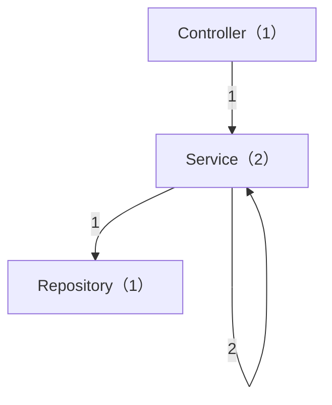
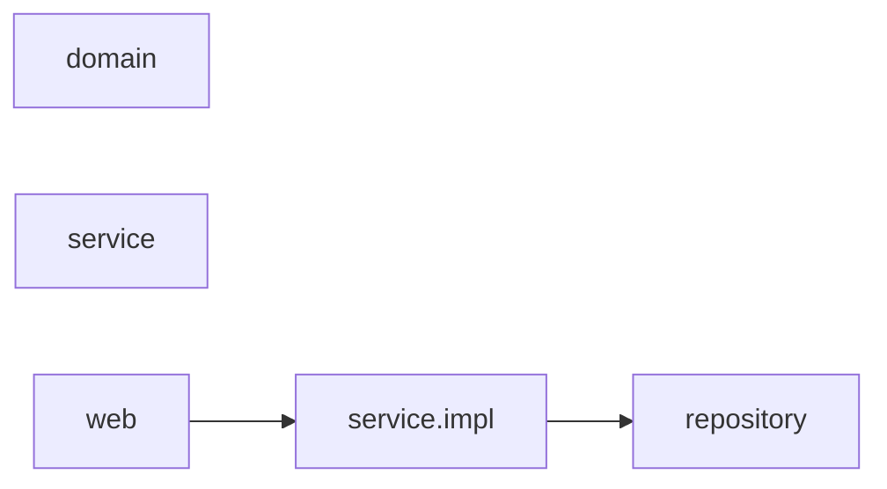
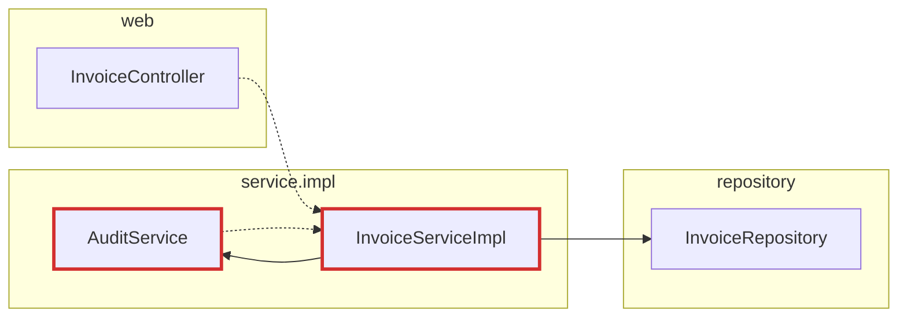
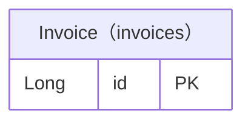

# 成果物一式（com.example.billing）

## 解析総覧

| 項目 | 内容 |
| --- | --- |
| ルートパッケージ | com.example.billing |
| Spring Boot | 3.2.5 |
| pom.xml | pom.xml |
| 文字コード | UTF-8 |

### プロジェクト統計

| 項目 | 件数 |
| --- | --- |
| パッケージ | 5 |
| クラス | 4 |
| インタフェース | 2 |
| Enum | 0 |
| Controller | 1 |
| Service | 2 |
| Repository | 1 |
| API | 1 |
| エンティティ | 1 |
| 依存関係 | 4 |
| 解析エラー（エラー / 警告） | 0 / 1 |

## アーキテクチャ・依存関係

### レイヤー構成

**レイヤー構成**

### パッケージ依存

**パッケージ依存**

### コンポーネント依存

**コンポーネント依存**

> 実線＝直接解決 / 点線＝単一実装から解決（@Bean や @Profile による別実装の可能性がある） / 赤枠＝循環依存

### 依存関係一覧

| 依存元 | メンバー | 注入方式 | 宣言型 | 解決先 | 解決方法 |
| --- | --- | --- | --- | --- | --- |
| AuditService | invoiceService | フィールド | InvoiceService | InvoiceServiceImpl | 単一実装から解決 |
| InvoiceServiceImpl | auditService | コンストラクタ | AuditService | AuditService | 直接解決 |
| InvoiceServiceImpl | invoiceRepository | コンストラクタ | InvoiceRepository | InvoiceRepository | 直接解決 |
| InvoiceController | invoiceService | コンストラクタ | InvoiceService | InvoiceServiceImpl | 単一実装から解決 |

### 解決できなかった依存

検出されませんでした

## API一覧

| Controller | Method | HTTP | Path | Request DTO | Response DTO |
| --- | --- | --- | --- | --- | --- |
| InvoiceController | count | GET | /invoices/count | - | long |

## ER図

**ER図**

> 図はエンティティ（@Entity）のみ。親クラスのカラムは子エンティティに展開しない。テーブル名・カラム名の既定名は推測しない。

### エンティティ一覧

| エンティティ | 種類 | エンティティ名 | テーブル名 | スキーマ | 親クラス |
| --- | --- | --- | --- | --- | --- |
| Invoice | エンティティ | 未指定 | invoices | 未指定 | - |

### Invoice（エンティティ）

カラム

| フィールド | 型 | カラム名 | PK | 生成戦略 | NULL可 | 長さ | 一意 | Enum型 | 埋め込み |
| --- | --- | --- | --- | --- | --- | --- | --- | --- | --- |
| id | Long | 未指定 | ○ | - | - | - | - | - | - |

関連

検出されませんでした

## クラス別概要

| クラス名 | 種類 | 役割 | パッケージ | 概要 |
| --- | --- | --- | --- | --- |
| Invoice | クラス | Entity | com.example.billing.domain | 請求書。 |
| InvoiceRepository | インタフェース | Repository | com.example.billing.repository | - |
| InvoiceService | インタフェース | - | com.example.billing.service | - |
| AuditService | クラス | Service | com.example.billing.service.impl | InvoiceServiceImpl と相互に依存する（循環依存の検証用）。 |
| InvoiceServiceImpl | クラス | Service | com.example.billing.service.impl | - |
| InvoiceController | クラス | Controller | com.example.billing.web | 請求書API。 |

### Invoice（Entity）

Invoice は com.example.billing.domain パッケージのエンティティです（テーブル：invoices）。カラム 1 件、関連 0 件。

#### 基本情報

| 項目 | 内容 |
| --- | --- |
| 完全修飾名 | com.example.billing.domain.Invoice |
| 種類 | クラス |
| 役割 | Entity |
| パッケージ | com.example.billing.domain |
| ソースファイル | src/main/java/com/example/billing/domain/Invoice.java |
| 修飾子 | public |
| アノテーション | @Entity, @Table |
| 親クラス | - |
| インタフェース | - |
| Javadoc | 請求書。 |
| コメント | - |

#### テーブル

| 項目 | 内容 |
| --- | --- |
| 種類 | エンティティ |
| エンティティ名 | 未指定 |
| テーブル名 | invoices |
| スキーマ | 未指定 |

#### カラム

| フィールド | 型 | カラム名 | PK | 生成戦略 | NULL可 | 長さ | 一意 | Enum型 | 埋め込み |
| --- | --- | --- | --- | --- | --- | --- | --- | --- | --- |
| id | Long | 未指定 | ○ | - | - | - | - | - | - |

#### 関連

検出されませんでした

#### 対応するリポジトリ

| リポジトリ | ID型 |
| --- | --- |
| InvoiceRepository | Long |

#### フィールド

| 名前 | 型 | 修飾子 | アノテーション |
| --- | --- | --- | --- |
| id | Long | private | @Id |

#### コンストラクタ

検出されませんでした

#### メソッド

検出されませんでした

### InvoiceRepository（Repository）

InvoiceRepository は com.example.billing.repository パッケージの Repository です。対象エンティティ Invoice、被依存 1 件。

#### 基本情報

| 項目 | 内容 |
| --- | --- |
| 完全修飾名 | com.example.billing.repository.InvoiceRepository |
| 種類 | インタフェース |
| 役割 | Repository |
| パッケージ | com.example.billing.repository |
| ソースファイル | src/main/java/com/example/billing/repository/InvoiceRepository.java |
| 修飾子 | public |
| アノテーション | - |
| 親クラス | - |
| インタフェース | JpaRepository<Invoice, Long> |
| Javadoc | - |
| コメント | - |

#### リポジトリ

| 項目 | 内容 |
| --- | --- |
| 対象エンティティ | Invoice |
| ID型 | Long |
| 基底型 | JpaRepository<Invoice, Long> |

#### 被依存

| 依存元 | メンバー |
| --- | --- |
| InvoiceServiceImpl | invoiceRepository |

#### 呼び出し関係（簡易）

検出されませんでした

> 既知の DI 依存先フィールドに対する呼び出しのみをヒューリスティックに検出したもので、オーバーロードと多態を解決しない。

> 外部ライブラリの呼び出し、List<Foo>・Optional<Foo> のフィールドに対する呼び出し、コンストラクタ内の呼び出しは含まない。

#### フィールド

検出されませんでした

#### コンストラクタ

検出されませんでした

#### 宣言メソッド

検出されませんでした

### InvoiceService（インタフェース）

InvoiceService は com.example.billing.service パッケージのインタフェースです。

#### 基本情報

| 項目 | 内容 |
| --- | --- |
| 完全修飾名 | com.example.billing.service.InvoiceService |
| 種類 | インタフェース |
| 役割 | - |
| パッケージ | com.example.billing.service |
| ソースファイル | src/main/java/com/example/billing/service/InvoiceService.java |
| 修飾子 | public |
| アノテーション | - |
| 親クラス | - |
| インタフェース | - |
| Javadoc | - |
| コメント | - |

#### フィールド

検出されませんでした

#### コンストラクタ

検出されませんでした

#### メソッド

| 名前 | 引数 | 戻り値 | 由来 |
| --- | --- | --- | --- |
| count | - | long | ソース |

### AuditService（Service）

AuditService は com.example.billing.service.impl パッケージの Service です。公開メソッド 1 件、依存先 1 件、被依存 1 件。

#### 基本情報

| 項目 | 内容 |
| --- | --- |
| 完全修飾名 | com.example.billing.service.impl.AuditService |
| 種類 | クラス |
| 役割 | Service |
| パッケージ | com.example.billing.service.impl |
| ソースファイル | src/main/java/com/example/billing/service/impl/AuditService.java |
| 修飾子 | public |
| アノテーション | @Service |
| 親クラス | - |
| インタフェース | - |
| Javadoc | InvoiceServiceImpl と相互に依存する（循環依存の検証用）。 |
| コメント | - |

#### 公開メソッド

| 名前 | 引数 | 戻り値 | 由来 |
| --- | --- | --- | --- |
| record | - | void | ソース |

#### 依存先

| メンバー | 宣言型 | 解決先 | 解決方法 | 注入方式 | 由来 |
| --- | --- | --- | --- | --- | --- |
| invoiceService | InvoiceService | InvoiceServiceImpl | 単一実装から解決 | フィールド | ソース |

#### 被依存

| 依存元 | メンバー |
| --- | --- |
| InvoiceServiceImpl | auditService |

#### 呼び出し関係（簡易）

| 呼び出し元メソッド | 依存先フィールド | 呼び出し先 | 実引数の数 | 行 |
| --- | --- | --- | --- | --- |
| record() | invoiceService: InvoiceService | InvoiceServiceImpl.count | 0 | 14 |

> 既知の DI 依存先フィールドに対する呼び出しのみをヒューリスティックに検出したもので、オーバーロードと多態を解決しない。

> 外部ライブラリの呼び出し、List<Foo>・Optional<Foo> のフィールドに対する呼び出し、コンストラクタ内の呼び出しは含まない。

#### フィールド

| 名前 | 型 | 修飾子 | アノテーション |
| --- | --- | --- | --- |
| invoiceService | InvoiceService | private | @Autowired |

#### コンストラクタ

検出されませんでした

#### メソッド

| 名前 | 引数 | 戻り値 | 由来 |
| --- | --- | --- | --- |
| record | - | void | ソース |

### InvoiceServiceImpl（Service）

InvoiceServiceImpl は com.example.billing.service.impl パッケージの Service です。公開メソッド 1 件、依存先 2 件、被依存 2 件。

#### 基本情報

| 項目 | 内容 |
| --- | --- |
| 完全修飾名 | com.example.billing.service.impl.InvoiceServiceImpl |
| 種類 | クラス |
| 役割 | Service |
| パッケージ | com.example.billing.service.impl |
| ソースファイル | src/main/java/com/example/billing/service/impl/InvoiceServiceImpl.java |
| 修飾子 | public |
| アノテーション | @Service, @RequiredArgsConstructor |
| 親クラス | - |
| インタフェース | InvoiceService |
| Javadoc | - |
| コメント | - |

#### 公開メソッド

| 名前 | 引数 | 戻り値 | 由来 |
| --- | --- | --- | --- |
| count | - | long | ソース |

#### 依存先

| メンバー | 宣言型 | 解決先 | 解決方法 | 注入方式 | 由来 |
| --- | --- | --- | --- | --- | --- |
| invoiceRepository | InvoiceRepository | InvoiceRepository | 直接解決 | コンストラクタ | Lombok（@RequiredArgsConstructor） |
| auditService | AuditService | AuditService | 直接解決 | コンストラクタ | Lombok（@RequiredArgsConstructor） |

#### 被依存

| 依存元 | メンバー |
| --- | --- |
| AuditService | invoiceService |
| InvoiceController | invoiceService |

#### 呼び出し関係（簡易）

| 呼び出し元メソッド | 依存先フィールド | 呼び出し先 | 実引数の数 | 行 |
| --- | --- | --- | --- | --- |
| count() | auditService: AuditService | AuditService.record | 0 | 17 |
| count() | invoiceRepository: InvoiceRepository | InvoiceRepository.count | 0 | 18 |

> 既知の DI 依存先フィールドに対する呼び出しのみをヒューリスティックに検出したもので、オーバーロードと多態を解決しない。

> 外部ライブラリの呼び出し、List<Foo>・Optional<Foo> のフィールドに対する呼び出し、コンストラクタ内の呼び出しは含まない。

#### フィールド

| 名前 | 型 | 修飾子 | アノテーション |
| --- | --- | --- | --- |
| invoiceRepository | InvoiceRepository | private, final | - |
| auditService | AuditService | private, final | - |

#### コンストラクタ

| 引数 | 修飾子 | 由来 |
| --- | --- | --- |
| InvoiceRepository invoiceRepository, AuditService auditService | public | Lombok（@RequiredArgsConstructor） |

#### メソッド

| 名前 | 引数 | 戻り値 | 由来 |
| --- | --- | --- | --- |
| count | - | long | ソース |

### InvoiceController（Controller）

InvoiceController は com.example.billing.web パッケージの Controller です。エンドポイント 1 件、依存先 1 件。

#### 基本情報

| 項目 | 内容 |
| --- | --- |
| 完全修飾名 | com.example.billing.web.InvoiceController |
| 種類 | クラス |
| 役割 | Controller |
| パッケージ | com.example.billing.web |
| ソースファイル | src/main/java/com/example/billing/web/InvoiceController.java |
| 修飾子 | public |
| アノテーション | @RestController, @RequiredArgsConstructor |
| 親クラス | - |
| インタフェース | - |
| Javadoc | 請求書API。 |
| コメント | - |

#### エンドポイント

| Method | HTTP | Path | Request DTO | Response DTO |
| --- | --- | --- | --- | --- |
| count | GET | /invoices/count | - | long |

#### 依存先

| メンバー | 宣言型 | 解決先 | 解決方法 | 注入方式 | 由来 |
| --- | --- | --- | --- | --- | --- |
| invoiceService | InvoiceService | InvoiceServiceImpl | 単一実装から解決 | コンストラクタ | Lombok（@RequiredArgsConstructor） |

#### 呼び出し関係（簡易）

| 呼び出し元メソッド | 依存先フィールド | 呼び出し先 | 実引数の数 | 行 |
| --- | --- | --- | --- | --- |
| count() | invoiceService: InvoiceService | InvoiceServiceImpl.count | 0 | 17 |

> 既知の DI 依存先フィールドに対する呼び出しのみをヒューリスティックに検出したもので、オーバーロードと多態を解決しない。

> 外部ライブラリの呼び出し、List<Foo>・Optional<Foo> のフィールドに対する呼び出し、コンストラクタ内の呼び出しは含まない。

#### フィールド

| 名前 | 型 | 修飾子 | アノテーション |
| --- | --- | --- | --- |
| invoiceService | InvoiceService | private, final | - |

#### コンストラクタ

| 引数 | 修飾子 | 由来 |
| --- | --- | --- |
| InvoiceService invoiceService | public | Lombok（@RequiredArgsConstructor） |

#### メソッド

| 名前 | 引数 | 戻り値 | 由来 |
| --- | --- | --- | --- |
| count | - | long | ソース |

## 解析エラーレポート

| 重要度 | 種類 | ファイル | 行 | メッセージ |
| --- | --- | --- | --- | --- |
| 警告 | 循環依存 | - | - | コンポーネント間の循環依存を検出しました: com.example.billing.service.impl.AuditService, com.example.billing.service.impl.InvoiceServiceImpl |

> コンパイル失敗を完全には検出しない。

## MyBatis

> <include> は展開せず、記述どおりに表示する。SQL の意味解析はしない。

検出されませんでした

## Configuration

### @Bean 定義

検出されませんでした

> Bean 名は明記されたもののみ表示し、既定名は推測しない。Bean の内容は解釈しない。

### @ConfigurationProperties

検出されませんでした

### 設定クラス（@Configuration）

検出されませんでした

## 画面一覧

### 画面

検出されませんでした

### 画面ごとの遷移先

検出されませんでした

### Controller と対応付けできなかった View 名

検出されませんでした

