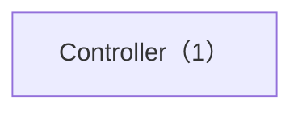
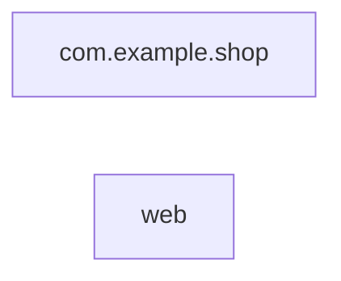
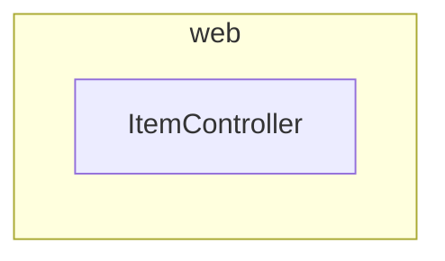
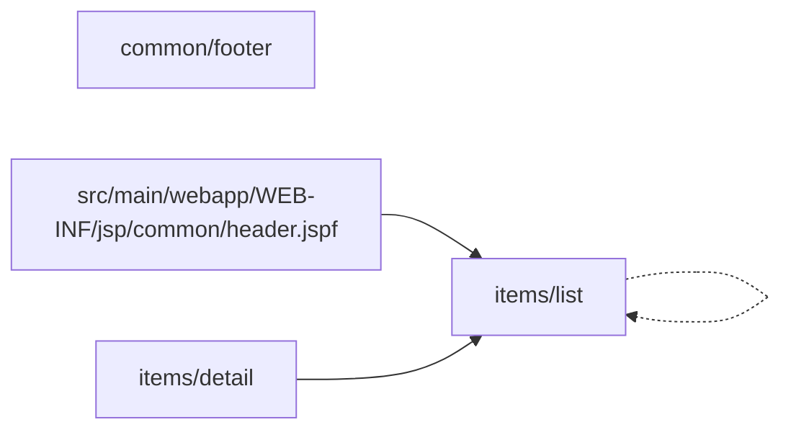

# 成果物一式（com.example.shop）

## 解析総覧

| 項目 | 内容 |
| --- | --- |
| ルートパッケージ | com.example.shop |
| Spring Boot | 3.3.5 |
| pom.xml | pom.xml |
| 文字コード | UTF-8 |

### プロジェクト統計

| 項目 | 件数 |
| --- | --- |
| パッケージ | 2 |
| クラス | 2 |
| インタフェース | 0 |
| Enum | 0 |
| Controller | 1 |
| Service | 0 |
| Repository | 0 |
| API | 5 |
| エンティティ | 0 |
| 依存関係 | 0 |
| 解析エラー（エラー / 警告） | 0 / 0 |

## アーキテクチャ・依存関係

### レイヤー構成

**レイヤー構成**

### パッケージ依存

**パッケージ依存**

### コンポーネント依存

**コンポーネント依存**

> 実線＝直接解決 / 点線＝単一実装から解決（@Bean や @Profile による別実装の可能性がある） / 赤枠＝循環依存

### 依存関係一覧

検出されませんでした

### 解決できなかった依存

検出されませんでした

## API一覧

| Controller | Method | HTTP | Path | Request DTO | Response DTO |
| --- | --- | --- | --- | --- | --- |
| ItemController | home | GET | / | - | String |
| ItemController | create | POST | /items | - | String |
| ItemController | list | GET | /items | - | String |
| ItemController | count | GET | /items/count | - | String |
| ItemController | detail | GET | /items/{id} | - | String |

## ER図

> 図はエンティティ（@Entity）のみ。親クラスのカラムは子エンティティに展開しない。テーブル名・カラム名の既定名は推測しない。

### エンティティ一覧

検出されませんでした

## クラス別概要

| クラス名 | 種類 | 役割 | パッケージ | 概要 |
| --- | --- | --- | --- | --- |
| ShopApplication | クラス | - | com.example.shop | - |
| ItemController | クラス | Controller | com.example.shop.web | Screens of items. |

### ShopApplication（クラス）

ShopApplication は com.example.shop パッケージのクラスです。

#### 基本情報

| 項目 | 内容 |
| --- | --- |
| 完全修飾名 | com.example.shop.ShopApplication |
| 種類 | クラス |
| 役割 | - |
| パッケージ | com.example.shop |
| ソースファイル | src/main/java/com/example/shop/ShopApplication.java |
| 修飾子 | public |
| アノテーション | @SpringBootApplication |
| 親クラス | - |
| インタフェース | - |
| Javadoc | - |
| コメント | - |

#### フィールド

検出されませんでした

#### コンストラクタ

検出されませんでした

#### メソッド

| 名前 | 引数 | 戻り値 | 由来 |
| --- | --- | --- | --- |
| main | String[] args | void | ソース |

### ItemController（Controller）

ItemController は com.example.shop.web パッケージの Controller です。エンドポイント 5 件、依存先 0 件。

#### 基本情報

| 項目 | 内容 |
| --- | --- |
| 完全修飾名 | com.example.shop.web.ItemController |
| 種類 | クラス |
| 役割 | Controller |
| パッケージ | com.example.shop.web |
| ソースファイル | src/main/java/com/example/shop/web/ItemController.java |
| 修飾子 | public |
| アノテーション | @Controller |
| 親クラス | - |
| インタフェース | - |
| Javadoc | Screens of items. |
| コメント | - |

#### エンドポイント

| Method | HTTP | Path | Request DTO | Response DTO |
| --- | --- | --- | --- | --- |
| home | GET | / | - | String |
| list | GET | /items | - | String |
| detail | GET | /items/{id} | - | String |
| create | POST | /items | - | String |
| count | GET | /items/count | - | String |

#### 依存先

検出されませんでした

#### 呼び出し関係（簡易）

検出されませんでした

> 既知の DI 依存先フィールドに対する呼び出しのみをヒューリスティックに検出したもので、オーバーロードと多態を解決しない。

> 外部ライブラリの呼び出し、List<Foo>・Optional<Foo> のフィールドに対する呼び出し、コンストラクタ内の呼び出しは含まない。

#### フィールド

検出されませんでした

#### コンストラクタ

検出されませんでした

#### メソッド

| 名前 | 引数 | 戻り値 | 由来 |
| --- | --- | --- | --- |
| home | - | String | ソース |
| list | - | String | ソース |
| detail | long id | String | ソース |
| create | - | String | ソース |
| count | - | String | ソース |

## 解析エラーレポート

検出されませんでした

> コンパイル失敗を完全には検出しない。

## MyBatis

> <include> は展開せず、記述どおりに表示する。SQL の意味解析はしない。

検出されませんでした

## Configuration

### @Bean 定義

検出されませんでした

> Bean 名は明記されたもののみ表示し、既定名は推測しない。Bean の内容は解釈しない。

### @ConfigurationProperties

検出されませんでした

### 設定クラス（@Configuration）

検出されませんでした

## 画面一覧

### 画面

| テンプレート | 種類 | View 名 | 表示する Controller メソッド | 部品（include） |
| --- | --- | --- | --- | --- |
| src/main/webapp/WEB-INF/jsp/common/footer.jsp | JSP | common/footer | - | - |
| src/main/webapp/WEB-INF/jsp/common/header.jspf | JSP | 未指定 | - | - |
| src/main/webapp/WEB-INF/jsp/items/detail.jsp | JSP | items/detail | ItemController.detail | src/main/webapp/WEB-INF/jsp/common/footer.jsp |
| src/main/webapp/WEB-INF/jsp/items/list.jsp | JSP | items/list | ItemController.list | src/main/webapp/WEB-INF/jsp/common/header.jspf, src/main/webapp/WEB-INF/jsp/common/footer.jsp |

### 画面遷移図

**画面遷移**

> 実線＝遷移先メソッドが返す画面 / 点線＝redirect・forward を 1 段たどった画面。部品（include）は含めない。

### 画面ごとの遷移先

| 画面 | 要素 | 記述 | 遷移先 Controller メソッド | 遷移後の画面 |
| --- | --- | --- | --- | --- |
| src/main/webapp/WEB-INF/jsp/common/header.jspf | a（href） | GET <c:url value='/items'/> | ItemController.list | src/main/webapp/WEB-INF/jsp/items/list.jsp |
| src/main/webapp/WEB-INF/jsp/items/detail.jsp | a（href） | GET ${pageContext.request.contextPath}/items | ItemController.list | src/main/webapp/WEB-INF/jsp/items/list.jsp |
| src/main/webapp/WEB-INF/jsp/items/list.jsp | a（href） | GET <c:url value='/items/${item.id}'/>（未解決） | - | - |
| src/main/webapp/WEB-INF/jsp/items/list.jsp | form:form（action） | POST ${pageContext.request.contextPath}/items | ItemController.create | src/main/webapp/WEB-INF/jsp/items/list.jsp |

### Controller と対応付けできなかった View 名

検出されませんでした

