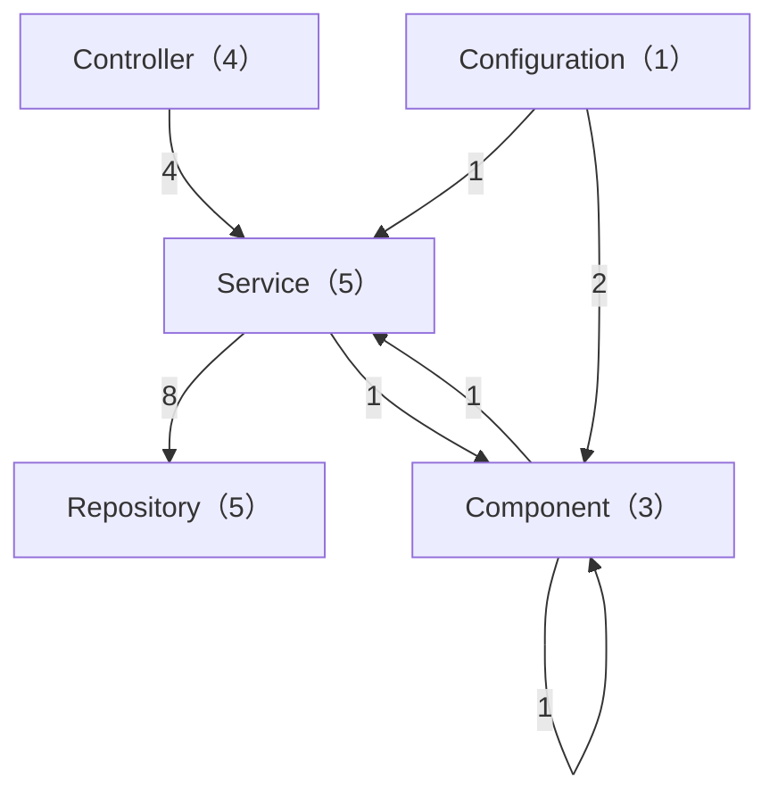
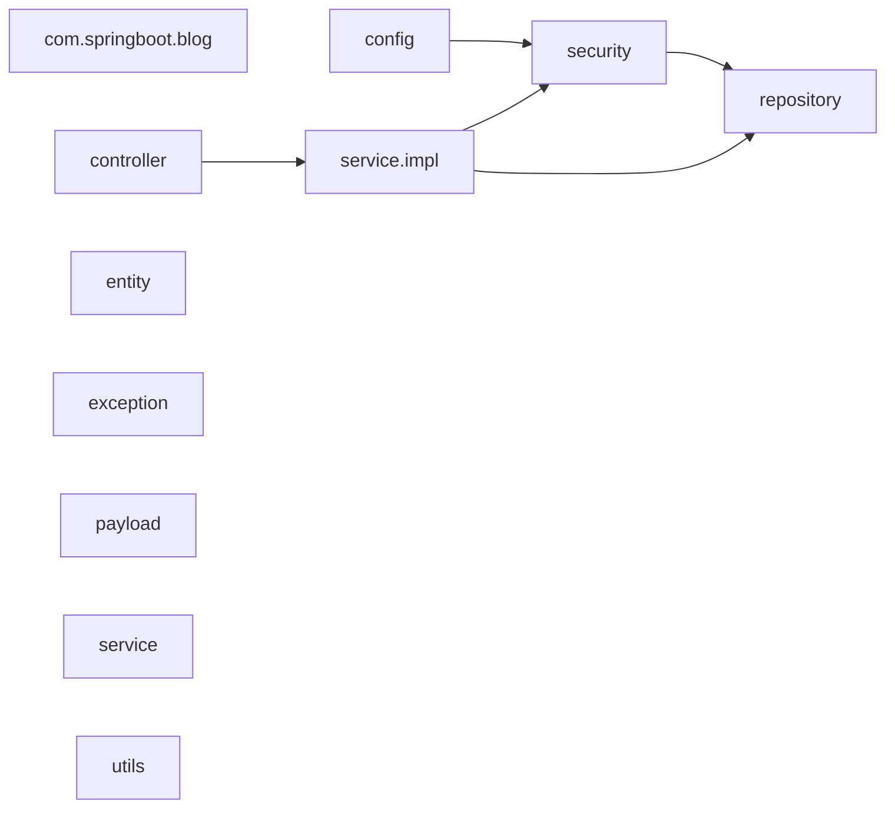
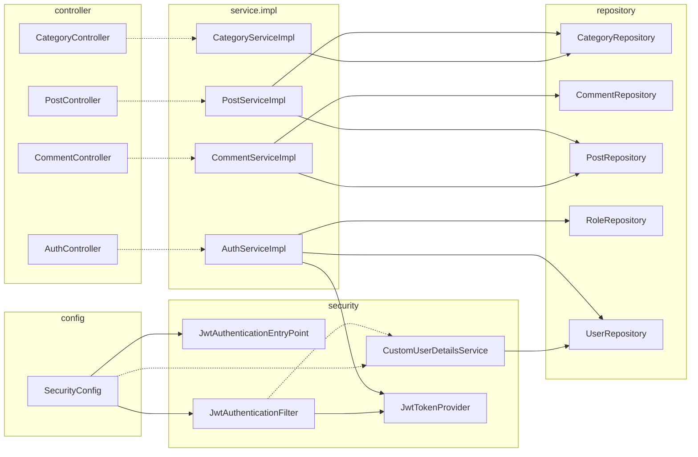
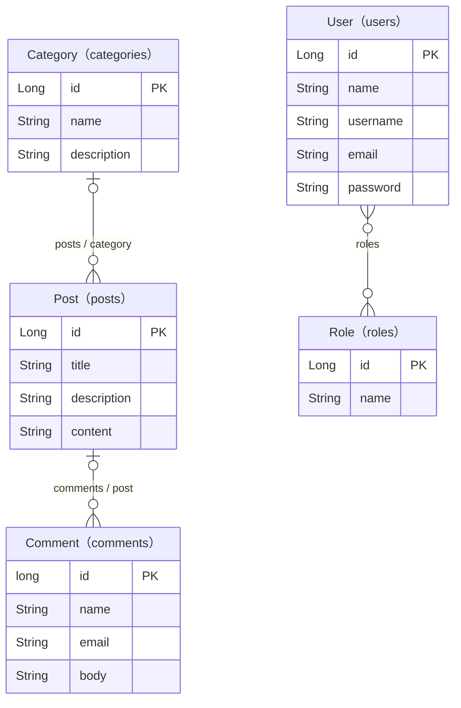

# 成果物一式（com.springboot.blog）

## 解析総覧

| 項目 | 内容 |
| --- | --- |
| ルートパッケージ | com.springboot.blog |
| Spring Boot | 3.2.1 |
| pom.xml | springboot-blog-rest-api-main/pom.xml |
| 文字コード | UTF-8 |

### プロジェクト統計

| 項目 | 件数 |
| --- | --- |
| パッケージ | 11 |
| クラス | 32 |
| インタフェース | 9 |
| Enum | 0 |
| Controller | 4 |
| Service | 5 |
| Repository | 5 |
| API | 18 |
| エンティティ | 5 |
| 依存関係 | 23 |
| 解析エラー（エラー / 警告） | 0 / 0 |

## アーキテクチャ・依存関係

### レイヤー構成

**レイヤー構成**

### パッケージ依存

**パッケージ依存**

### コンポーネント依存

**コンポーネント依存**

> 実線＝直接解決 / 点線＝単一実装から解決（@Bean や @Profile による別実装の可能性がある） / 赤枠＝循環依存

### 依存関係一覧

| 依存元 | メンバー | 注入方式 | 宣言型 | 解決先 | 解決方法 |
| --- | --- | --- | --- | --- | --- |
| SecurityConfig | authenticationEntryPoint | コンストラクタ | JwtAuthenticationEntryPoint | JwtAuthenticationEntryPoint | 直接解決 |
| SecurityConfig | authenticationFilter | コンストラクタ | JwtAuthenticationFilter | JwtAuthenticationFilter | 直接解決 |
| SecurityConfig | userDetailsService | コンストラクタ | UserDetailsService | CustomUserDetailsService | 単一実装から解決 |
| AuthController | authService | コンストラクタ | AuthService | AuthServiceImpl | 単一実装から解決 |
| CategoryController | categoryService | コンストラクタ | CategoryService | CategoryServiceImpl | 単一実装から解決 |
| CommentController | commentService | コンストラクタ | CommentService | CommentServiceImpl | 単一実装から解決 |
| PostController | postService | コンストラクタ | PostService | PostServiceImpl | 単一実装から解決 |
| CustomUserDetailsService | userRepository | コンストラクタ | UserRepository | UserRepository | 直接解決 |
| JwtAuthenticationFilter | jwtTokenProvider | コンストラクタ | JwtTokenProvider | JwtTokenProvider | 直接解決 |
| JwtAuthenticationFilter | userDetailsService | コンストラクタ | UserDetailsService | CustomUserDetailsService | 単一実装から解決 |
| AuthServiceImpl | authenticationManager | コンストラクタ | AuthenticationManager | - | 外部ライブラリ |
| AuthServiceImpl | jwtTokenProvider | コンストラクタ | JwtTokenProvider | JwtTokenProvider | 直接解決 |
| AuthServiceImpl | passwordEncoder | コンストラクタ | PasswordEncoder | - | 外部ライブラリ |
| AuthServiceImpl | roleRepository | コンストラクタ | RoleRepository | RoleRepository | 直接解決 |
| AuthServiceImpl | userRepository | コンストラクタ | UserRepository | UserRepository | 直接解決 |
| CategoryServiceImpl | categoryRepository | コンストラクタ | CategoryRepository | CategoryRepository | 直接解決 |
| CategoryServiceImpl | modelMapper | コンストラクタ | ModelMapper | - | 外部ライブラリ |
| CommentServiceImpl | commentRepository | コンストラクタ | CommentRepository | CommentRepository | 直接解決 |
| CommentServiceImpl | mapper | コンストラクタ | ModelMapper | - | 外部ライブラリ |
| CommentServiceImpl | postRepository | コンストラクタ | PostRepository | PostRepository | 直接解決 |
| PostServiceImpl | categoryRepository | コンストラクタ | CategoryRepository | CategoryRepository | 直接解決 |
| PostServiceImpl | mapper | コンストラクタ | ModelMapper | - | 外部ライブラリ |
| PostServiceImpl | postRepository | コンストラクタ | PostRepository | PostRepository | 直接解決 |

### 解決できなかった依存

| 依存元 | メンバー | 宣言型 | 理由 |
| --- | --- | --- | --- |
| AuthServiceImpl | authenticationManager | AuthenticationManager | 外部ライブラリ |
| AuthServiceImpl | passwordEncoder | PasswordEncoder | 外部ライブラリ |
| CategoryServiceImpl | modelMapper | ModelMapper | 外部ライブラリ |
| CommentServiceImpl | mapper | ModelMapper | 外部ライブラリ |
| PostServiceImpl | mapper | ModelMapper | 外部ライブラリ |

## API一覧

| Controller | Method | HTTP | Path | Request DTO | Response DTO |
| --- | --- | --- | --- | --- | --- |
| AuthController | login | POST | /api/auth/login | LoginDto | JWTAuthResponse |
| AuthController | register | POST | /api/auth/register | RegisterDto | String |
| AuthController | login | POST | /api/auth/signin | LoginDto | JWTAuthResponse |
| AuthController | register | POST | /api/auth/signup | RegisterDto | String |
| CategoryController | addCategory | POST | /api/v1/categories | CategoryDto | CategoryDto |
| CategoryController | getCategories | GET | /api/v1/categories | - | List<CategoryDto> |
| CategoryController | deleteCategory | DELETE | /api/v1/categories/{id} | - | String |
| CategoryController | getCategory | GET | /api/v1/categories/{id} | - | CategoryDto |
| CategoryController | updateCategory | PUT | /api/v1/categories/{id} | CategoryDto | CategoryDto |
| CommentController | createComment | POST | /api/v1/posts/{postId}/comments | CommentDto | CommentDto |
| CommentController | getCommentsByPostId | GET | /api/v1/posts/{postId}/comments | - | List<CommentDto> |
| CommentController | deleteComment | DELETE | /api/v1/posts/{postId}/comments/{id} | - | String |
| CommentController | getCommentById | GET | /api/v1/posts/{postId}/comments/{id} | - | CommentDto |
| CommentController | updateComment | PUT | /api/v1/posts/{postId}/comments/{id} | CommentDto | CommentDto |
| PostController | createPost | POST | /api/posts | PostDto | PostDto |
| PostController | getAllPosts | GET | /api/posts | - | PostResponse |
| PostController | getPostsByCategory | GET | /api/posts/category/{id} | - | List<PostDto> |
| PostController | deletePost | DELETE | /api/posts/{id} | - | String |
| PostController | getPostById | GET | /api/posts/{id} | - | PostDto |
| PostController | updatePost | PUT | /api/posts/{id} | PostDto | PostDto |

## ER図

**ER図**

> 図はエンティティ（@Entity）のみ。親クラスのカラムは子エンティティに展開しない。テーブル名・カラム名の既定名は推測しない。

### エンティティ一覧

| エンティティ | 種類 | エンティティ名 | テーブル名 | スキーマ | 親クラス |
| --- | --- | --- | --- | --- | --- |
| Category | エンティティ | 未指定 | categories | 未指定 | - |
| Comment | エンティティ | 未指定 | comments | 未指定 | - |
| Post | エンティティ | 未指定 | posts | 未指定 | - |
| Role | エンティティ | 未指定 | roles | 未指定 | - |
| User | エンティティ | 未指定 | users | 未指定 | - |

### Category（エンティティ）

カラム

| フィールド | 型 | カラム名 | PK | 生成戦略 | NULL可 | 長さ | 一意 | Enum型 | 埋め込み |
| --- | --- | --- | --- | --- | --- | --- | --- | --- | --- |
| id | Long | 未指定 | ○ | IDENTITY | - | - | - | - | - |
| name | String | 未指定 | - | - | - | - | - | - | - |
| description | String | 未指定 | - | - | - | - | - | - | - |

関連

| フィールド | 種類 | 相手 | 所有側 | mappedBy | 結合カラム | 結合テーブル | optional | fetch | cascade |
| --- | --- | --- | --- | --- | --- | --- | --- | --- | --- |
| posts | OneToMany | Post | × | category | - | - | - | - | ALL |

### Comment（エンティティ）

カラム

| フィールド | 型 | カラム名 | PK | 生成戦略 | NULL可 | 長さ | 一意 | Enum型 | 埋め込み |
| --- | --- | --- | --- | --- | --- | --- | --- | --- | --- |
| id | long | 未指定 | ○ | IDENTITY | - | - | - | - | - |
| name | String | 未指定 | - | - | - | - | - | - | - |
| email | String | 未指定 | - | - | - | - | - | - | - |
| body | String | 未指定 | - | - | - | - | - | - | - |

関連

| フィールド | 種類 | 相手 | 所有側 | mappedBy | 結合カラム | 結合テーブル | optional | fetch | cascade |
| --- | --- | --- | --- | --- | --- | --- | --- | --- | --- |
| post | ManyToOne | Post | ○ | - | post_id | - | - | LAZY | - |

### Post（エンティティ）

カラム

| フィールド | 型 | カラム名 | PK | 生成戦略 | NULL可 | 長さ | 一意 | Enum型 | 埋め込み |
| --- | --- | --- | --- | --- | --- | --- | --- | --- | --- |
| id | Long | 未指定 | ○ | IDENTITY | - | - | - | - | - |
| title | String | title | - | - | × | - | - | - | - |
| description | String | description | - | - | × | - | - | - | - |
| content | String | content | - | - | × | - | - | - | - |

関連

| フィールド | 種類 | 相手 | 所有側 | mappedBy | 結合カラム | 結合テーブル | optional | fetch | cascade |
| --- | --- | --- | --- | --- | --- | --- | --- | --- | --- |
| comments | OneToMany | Comment | × | post | - | - | - | - | ALL |
| category | ManyToOne | Category | ○ | - | category_id | - | - | LAZY | - |

### Role（エンティティ）

カラム

| フィールド | 型 | カラム名 | PK | 生成戦略 | NULL可 | 長さ | 一意 | Enum型 | 埋め込み |
| --- | --- | --- | --- | --- | --- | --- | --- | --- | --- |
| id | Long | 未指定 | ○ | IDENTITY | - | - | - | - | - |
| name | String | 未指定 | - | - | - | - | - | - | - |

関連

検出されませんでした

### User（エンティティ）

カラム

| フィールド | 型 | カラム名 | PK | 生成戦略 | NULL可 | 長さ | 一意 | Enum型 | 埋め込み |
| --- | --- | --- | --- | --- | --- | --- | --- | --- | --- |
| id | Long | 未指定 | ○ | IDENTITY | - | - | - | - | - |
| name | String | 未指定 | - | - | - | - | - | - | - |
| username | String | 未指定 | - | - | × | - | ○ | - | - |
| email | String | 未指定 | - | - | × | - | ○ | - | - |
| password | String | 未指定 | - | - | × | - | - | - | - |

関連

| フィールド | 種類 | 相手 | 所有側 | mappedBy | 結合カラム | 結合テーブル | optional | fetch | cascade |
| --- | --- | --- | --- | --- | --- | --- | --- | --- | --- |
| roles | ManyToMany | Role | ○ | - | - | users_roles（user_id / 逆側 role_id） | - | EAGER | ALL |

## クラス別概要

| クラス名 | 種類 | 役割 | パッケージ | 概要 |
| --- | --- | --- | --- | --- |
| SpringbootBlogRestApiApplication | クラス | - | com.springboot.blog | - |
| SecurityConfig | クラス | Configuration | com.springboot.blog.config | - |
| AuthController | クラス | Controller | com.springboot.blog.controller | - |
| CategoryController | クラス | Controller | com.springboot.blog.controller | - |
| CommentController | クラス | Controller | com.springboot.blog.controller | - |
| PostController | クラス | Controller | com.springboot.blog.controller | - |
| Category | クラス | Entity | com.springboot.blog.entity | - |
| Comment | クラス | Entity | com.springboot.blog.entity | - |
| Post | クラス | Entity | com.springboot.blog.entity | - |
| Role | クラス | Entity | com.springboot.blog.entity | - |
| User | クラス | Entity | com.springboot.blog.entity | - |
| BlogAPIException | クラス | - | com.springboot.blog.exception | - |
| GlobalExceptionHandler | クラス | - | com.springboot.blog.exception | - |
| ResourceNotFoundException | クラス | - | com.springboot.blog.exception | - |
| CategoryDto | クラス | - | com.springboot.blog.payload | - |
| CommentDto | クラス | - | com.springboot.blog.payload | - |
| ErrorDetails | クラス | - | com.springboot.blog.payload | - |
| JWTAuthResponse | クラス | - | com.springboot.blog.payload | - |
| LoginDto | クラス | - | com.springboot.blog.payload | - |
| PostDto | クラス | - | com.springboot.blog.payload | - |
| PostResponse | クラス | - | com.springboot.blog.payload | - |
| RegisterDto | クラス | - | com.springboot.blog.payload | - |
| CategoryRepository | インタフェース | Repository | com.springboot.blog.repository | - |
| CommentRepository | インタフェース | Repository | com.springboot.blog.repository | - |
| PostRepository | インタフェース | Repository | com.springboot.blog.repository | - |
| RoleRepository | インタフェース | Repository | com.springboot.blog.repository | - |
| UserRepository | インタフェース | Repository | com.springboot.blog.repository | - |
| CustomUserDetailsService | クラス | Service | com.springboot.blog.security | - |
| JwtAuthenticationEntryPoint | クラス | Component | com.springboot.blog.security | - |
| JwtAuthenticationFilter | クラス | Component | com.springboot.blog.security | - |
| JwtTokenProvider | クラス | Component | com.springboot.blog.security | - |
| AuthService | インタフェース | - | com.springboot.blog.service | - |
| CategoryService | インタフェース | - | com.springboot.blog.service | - |
| CommentService | インタフェース | - | com.springboot.blog.service | - |
| PostService | インタフェース | - | com.springboot.blog.service | - |
| AuthServiceImpl | クラス | Service | com.springboot.blog.service.impl | - |
| CategoryServiceImpl | クラス | Service | com.springboot.blog.service.impl | - |
| CommentServiceImpl | クラス | Service | com.springboot.blog.service.impl | - |
| PostServiceImpl | クラス | Service | com.springboot.blog.service.impl | - |
| AppConstants | クラス | - | com.springboot.blog.utils | - |
| PasswordGeneratorEncoder | クラス | - | com.springboot.blog.utils | - |

### SpringbootBlogRestApiApplication（クラス）

SpringbootBlogRestApiApplication は com.springboot.blog パッケージのクラスです。

#### 基本情報

| 項目 | 内容 |
| --- | --- |
| 完全修飾名 | com.springboot.blog.SpringbootBlogRestApiApplication |
| 種類 | クラス |
| 役割 | - |
| パッケージ | com.springboot.blog |
| ソースファイル | src/main/java/com/springboot/blog/SpringbootBlogRestApiApplication.java |
| 修飾子 | public |
| アノテーション | @SpringBootApplication |
| 親クラス | - |
| インタフェース | - |
| Javadoc | - |
| コメント | - |

#### フィールド

検出されませんでした

#### コンストラクタ

検出されませんでした

#### メソッド

| 名前 | 引数 | 戻り値 | 由来 |
| --- | --- | --- | --- |
| modelMapper | - | ModelMapper | ソース |
| main | String[] args | void | ソース |

### SecurityConfig（Configuration）

SecurityConfig は com.springboot.blog.config パッケージの Configuration です。依存先 3 件、被依存 0 件。

#### 基本情報

| 項目 | 内容 |
| --- | --- |
| 完全修飾名 | com.springboot.blog.config.SecurityConfig |
| 種類 | クラス |
| 役割 | Configuration |
| パッケージ | com.springboot.blog.config |
| ソースファイル | src/main/java/com/springboot/blog/config/SecurityConfig.java |
| 修飾子 | public |
| アノテーション | @Configuration, @EnableMethodSecurity, @SecurityScheme |
| 親クラス | - |
| インタフェース | - |
| Javadoc | - |
| コメント | - |

#### 依存先

| メンバー | 宣言型 | 解決先 | 解決方法 | 注入方式 | 由来 |
| --- | --- | --- | --- | --- | --- |
| userDetailsService | UserDetailsService | CustomUserDetailsService | 単一実装から解決 | コンストラクタ | ソース |
| authenticationEntryPoint | JwtAuthenticationEntryPoint | JwtAuthenticationEntryPoint | 直接解決 | コンストラクタ | ソース |
| authenticationFilter | JwtAuthenticationFilter | JwtAuthenticationFilter | 直接解決 | コンストラクタ | ソース |

#### 被依存

検出されませんでした

#### 呼び出し関係（簡易）

検出されませんでした

> 既知の DI 依存先フィールドに対する呼び出しのみをヒューリスティックに検出したもので、オーバーロードと多態を解決しない。

> 外部ライブラリの呼び出し、List<Foo>・Optional<Foo> のフィールドに対する呼び出し、コンストラクタ内の呼び出しは含まない。

#### フィールド

| 名前 | 型 | 修飾子 | アノテーション |
| --- | --- | --- | --- |
| userDetailsService | UserDetailsService | private | - |
| authenticationEntryPoint | JwtAuthenticationEntryPoint | private | - |
| authenticationFilter | JwtAuthenticationFilter | private | - |

#### コンストラクタ

| 引数 | 修飾子 | 由来 |
| --- | --- | --- |
| UserDetailsService userDetailsService, JwtAuthenticationEntryPoint authenticationEntryPoint, JwtAuthenticationFilter authenticationFilter | public | ソース |

#### メソッド

| 名前 | 引数 | 戻り値 | 由来 |
| --- | --- | --- | --- |
| passwordEncoder | - | PasswordEncoder | ソース |
| authenticationManager | AuthenticationConfiguration configuration | AuthenticationManager | ソース |
| securityFilterChain | HttpSecurity http | SecurityFilterChain | ソース |

### AuthController（Controller）

AuthController は com.springboot.blog.controller パッケージの Controller です。エンドポイント 2 件、依存先 1 件。

#### 基本情報

| 項目 | 内容 |
| --- | --- |
| 完全修飾名 | com.springboot.blog.controller.AuthController |
| 種類 | クラス |
| 役割 | Controller |
| パッケージ | com.springboot.blog.controller |
| ソースファイル | src/main/java/com/springboot/blog/controller/AuthController.java |
| 修飾子 | public |
| アノテーション | @RestController, @RequestMapping |
| 親クラス | - |
| インタフェース | - |
| Javadoc | - |
| コメント | - |

#### エンドポイント

| Method | HTTP | Path | Request DTO | Response DTO |
| --- | --- | --- | --- | --- |
| login | POST | /api/auth/login | LoginDto | JWTAuthResponse |
| login | POST | /api/auth/signin | LoginDto | JWTAuthResponse |
| register | POST | /api/auth/register | RegisterDto | String |
| register | POST | /api/auth/signup | RegisterDto | String |

#### 依存先

| メンバー | 宣言型 | 解決先 | 解決方法 | 注入方式 | 由来 |
| --- | --- | --- | --- | --- | --- |
| authService | AuthService | AuthServiceImpl | 単一実装から解決 | コンストラクタ | ソース |

#### 呼び出し関係（簡易）

| 呼び出し元メソッド | 依存先フィールド | 呼び出し先 | 実引数の数 | 行 |
| --- | --- | --- | --- | --- |
| login(LoginDto) | authService: AuthService | AuthServiceImpl.login | 1 | 27 |
| register(RegisterDto) | authService: AuthService | AuthServiceImpl.register | 1 | 38 |

> 既知の DI 依存先フィールドに対する呼び出しのみをヒューリスティックに検出したもので、オーバーロードと多態を解決しない。

> 外部ライブラリの呼び出し、List<Foo>・Optional<Foo> のフィールドに対する呼び出し、コンストラクタ内の呼び出しは含まない。

#### フィールド

| 名前 | 型 | 修飾子 | アノテーション |
| --- | --- | --- | --- |
| authService | AuthService | private | - |

#### コンストラクタ

| 引数 | 修飾子 | 由来 |
| --- | --- | --- |
| AuthService authService | public | ソース |

#### メソッド

| 名前 | 引数 | 戻り値 | 由来 |
| --- | --- | --- | --- |
| login | LoginDto loginDto | ResponseEntity<JWTAuthResponse> | ソース |
| register | RegisterDto registerDto | ResponseEntity<String> | ソース |

### CategoryController（Controller）

CategoryController は com.springboot.blog.controller パッケージの Controller です。エンドポイント 5 件、依存先 1 件。

#### 基本情報

| 項目 | 内容 |
| --- | --- |
| 完全修飾名 | com.springboot.blog.controller.CategoryController |
| 種類 | クラス |
| 役割 | Controller |
| パッケージ | com.springboot.blog.controller |
| ソースファイル | src/main/java/com/springboot/blog/controller/CategoryController.java |
| 修飾子 | public |
| アノテーション | @RestController, @RequestMapping |
| 親クラス | - |
| インタフェース | - |
| Javadoc | - |
| コメント | - |

#### エンドポイント

| Method | HTTP | Path | Request DTO | Response DTO |
| --- | --- | --- | --- | --- |
| addCategory | POST | /api/v1/categories | CategoryDto | CategoryDto |
| getCategory | GET | /api/v1/categories/{id} | - | CategoryDto |
| getCategories | GET | /api/v1/categories | - | List<CategoryDto> |
| updateCategory | PUT | /api/v1/categories/{id} | CategoryDto | CategoryDto |
| deleteCategory | DELETE | /api/v1/categories/{id} | - | String |

#### 依存先

| メンバー | 宣言型 | 解決先 | 解決方法 | 注入方式 | 由来 |
| --- | --- | --- | --- | --- | --- |
| categoryService | CategoryService | CategoryServiceImpl | 単一実装から解決 | コンストラクタ | ソース |

#### 呼び出し関係（簡易）

| 呼び出し元メソッド | 依存先フィールド | 呼び出し先 | 実引数の数 | 行 |
| --- | --- | --- | --- | --- |
| addCategory(CategoryDto) | categoryService: CategoryService | CategoryServiceImpl.addCategory | 1 | 27 |
| getCategory(Long) | categoryService: CategoryService | CategoryServiceImpl.getCategory | 1 | 34 |
| getCategories() | categoryService: CategoryService | CategoryServiceImpl.getAllCategories | 0 | 41 |
| updateCategory(CategoryDto, Long) | categoryService: CategoryService | CategoryServiceImpl.updateCategory | 2 | 49 |
| deleteCategory(Long) | categoryService: CategoryService | CategoryServiceImpl.deleteCategory | 1 | 56 |

> 既知の DI 依存先フィールドに対する呼び出しのみをヒューリスティックに検出したもので、オーバーロードと多態を解決しない。

> 外部ライブラリの呼び出し、List<Foo>・Optional<Foo> のフィールドに対する呼び出し、コンストラクタ内の呼び出しは含まない。

#### フィールド

| 名前 | 型 | 修飾子 | アノテーション |
| --- | --- | --- | --- |
| categoryService | CategoryService | private | - |

#### コンストラクタ

| 引数 | 修飾子 | 由来 |
| --- | --- | --- |
| CategoryService categoryService | public | ソース |

#### メソッド

| 名前 | 引数 | 戻り値 | 由来 |
| --- | --- | --- | --- |
| addCategory | CategoryDto categoryDto | ResponseEntity<CategoryDto> | ソース |
| getCategory | Long categoryId | ResponseEntity<CategoryDto> | ソース |
| getCategories | - | ResponseEntity<List<CategoryDto>> | ソース |
| updateCategory | CategoryDto categoryDto, Long categoryId | ResponseEntity<CategoryDto> | ソース |
| deleteCategory | Long categoryId | ResponseEntity<String> | ソース |

### CommentController（Controller）

CommentController は com.springboot.blog.controller パッケージの Controller です。エンドポイント 5 件、依存先 1 件。

#### 基本情報

| 項目 | 内容 |
| --- | --- |
| 完全修飾名 | com.springboot.blog.controller.CommentController |
| 種類 | クラス |
| 役割 | Controller |
| パッケージ | com.springboot.blog.controller |
| ソースファイル | src/main/java/com/springboot/blog/controller/CommentController.java |
| 修飾子 | public |
| アノテーション | @RestController, @RequestMapping |
| 親クラス | - |
| インタフェース | - |
| Javadoc | - |
| コメント | - |

#### エンドポイント

| Method | HTTP | Path | Request DTO | Response DTO |
| --- | --- | --- | --- | --- |
| createComment | POST | /api/v1/posts/{postId}/comments | CommentDto | CommentDto |
| getCommentsByPostId | GET | /api/v1/posts/{postId}/comments | - | List<CommentDto> |
| getCommentById | GET | /api/v1/posts/{postId}/comments/{id} | - | CommentDto |
| updateComment | PUT | /api/v1/posts/{postId}/comments/{id} | CommentDto | CommentDto |
| deleteComment | DELETE | /api/v1/posts/{postId}/comments/{id} | - | String |

#### 依存先

| メンバー | 宣言型 | 解決先 | 解決方法 | 注入方式 | 由来 |
| --- | --- | --- | --- | --- | --- |
| commentService | CommentService | CommentServiceImpl | 単一実装から解決 | コンストラクタ | ソース |

#### 呼び出し関係（簡易）

| 呼び出し元メソッド | 依存先フィールド | 呼び出し先 | 実引数の数 | 行 |
| --- | --- | --- | --- | --- |
| createComment(long, CommentDto) | commentService: CommentService | CommentServiceImpl.createComment | 2 | 25 |
| getCommentsByPostId(Long) | commentService: CommentService | CommentServiceImpl.getCommentsByPostId | 1 | 30 |
| getCommentById(Long, Long) | commentService: CommentService | CommentServiceImpl.getCommentById | 2 | 36 |
| updateComment(Long, Long, CommentDto) | commentService: CommentService | CommentServiceImpl.updateComment | 3 | 44 |
| deleteComment(Long, Long) | commentService: CommentService | CommentServiceImpl.deleteComment | 2 | 51 |

> 既知の DI 依存先フィールドに対する呼び出しのみをヒューリスティックに検出したもので、オーバーロードと多態を解決しない。

> 外部ライブラリの呼び出し、List<Foo>・Optional<Foo> のフィールドに対する呼び出し、コンストラクタ内の呼び出しは含まない。

#### フィールド

| 名前 | 型 | 修飾子 | アノテーション |
| --- | --- | --- | --- |
| commentService | CommentService | private | - |

#### コンストラクタ

| 引数 | 修飾子 | 由来 |
| --- | --- | --- |
| CommentService commentService | public | ソース |

#### メソッド

| 名前 | 引数 | 戻り値 | 由来 |
| --- | --- | --- | --- |
| createComment | long postId, CommentDto commentDto | ResponseEntity<CommentDto> | ソース |
| getCommentsByPostId | Long postId | List<CommentDto> | ソース |
| getCommentById | Long postId, Long commentId | ResponseEntity<CommentDto> | ソース |
| updateComment | Long postId, Long commentId, CommentDto commentDto | ResponseEntity<CommentDto> | ソース |
| deleteComment | Long postId, Long commentId | ResponseEntity<String> | ソース |

### PostController（Controller）

PostController は com.springboot.blog.controller パッケージの Controller です。エンドポイント 6 件、依存先 1 件。

#### 基本情報

| 項目 | 内容 |
| --- | --- |
| 完全修飾名 | com.springboot.blog.controller.PostController |
| 種類 | クラス |
| 役割 | Controller |
| パッケージ | com.springboot.blog.controller |
| ソースファイル | src/main/java/com/springboot/blog/controller/PostController.java |
| 修飾子 | public |
| アノテーション | @RestController, @RequestMapping, @Tag |
| 親クラス | - |
| インタフェース | - |
| Javadoc | - |
| コメント | - |

#### エンドポイント

| Method | HTTP | Path | Request DTO | Response DTO |
| --- | --- | --- | --- | --- |
| createPost | POST | /api/posts | PostDto | PostDto |
| getAllPosts | GET | /api/posts | - | PostResponse |
| getPostById | GET | /api/posts/{id} | - | PostDto |
| updatePost | PUT | /api/posts/{id} | PostDto | PostDto |
| deletePost | DELETE | /api/posts/{id} | - | String |
| getPostsByCategory | GET | /api/posts/category/{id} | - | List<PostDto> |

#### 依存先

| メンバー | 宣言型 | 解決先 | 解決方法 | 注入方式 | 由来 |
| --- | --- | --- | --- | --- | --- |
| postService | PostService | PostServiceImpl | 単一実装から解決 | コンストラクタ | ソース |

#### 呼び出し関係（簡易）

| 呼び出し元メソッド | 依存先フィールド | 呼び出し先 | 実引数の数 | 行 |
| --- | --- | --- | --- | --- |
| createPost(PostDto) | postService: PostService | PostServiceImpl.createPost | 1 | 47 |
| getAllPosts(int, int, String, String) | postService: PostService | PostServiceImpl.getAllPosts | 4 | 66 |
| getPostById(long) | postService: PostService | PostServiceImpl.getPostById | 1 | 80 |
| updatePost(PostDto, long) | postService: PostService | PostServiceImpl.updatePost | 2 | 99 |
| deletePost(long) | postService: PostService | PostServiceImpl.deletePostById | 1 | 120 |
| getPostsByCategory(Long) | postService: PostService | PostServiceImpl.getPostsByCategory | 1 | 129 |

> 既知の DI 依存先フィールドに対する呼び出しのみをヒューリスティックに検出したもので、オーバーロードと多態を解決しない。

> 外部ライブラリの呼び出し、List<Foo>・Optional<Foo> のフィールドに対する呼び出し、コンストラクタ内の呼び出しは含まない。

#### フィールド

| 名前 | 型 | 修飾子 | アノテーション |
| --- | --- | --- | --- |
| postService | PostService | private | - |

#### コンストラクタ

| 引数 | 修飾子 | 由来 |
| --- | --- | --- |
| PostService postService | public | ソース |

#### メソッド

| 名前 | 引数 | 戻り値 | 由来 |
| --- | --- | --- | --- |
| createPost | PostDto postDto | ResponseEntity<PostDto> | ソース |
| getAllPosts | int pageNo, int pageSize, String sortBy, String sortDir | PostResponse | ソース |
| getPostById | long id | ResponseEntity<PostDto> | ソース |
| updatePost | PostDto postDto, long id | ResponseEntity<PostDto> | ソース |
| deletePost | long id | ResponseEntity<String> | ソース |
| getPostsByCategory | Long categoryId | ResponseEntity<List<PostDto>> | ソース |

### Category（Entity）

Category は com.springboot.blog.entity パッケージのエンティティです（テーブル：categories）。カラム 3 件、関連 1 件。

#### 基本情報

| 項目 | 内容 |
| --- | --- |
| 完全修飾名 | com.springboot.blog.entity.Category |
| 種類 | クラス |
| 役割 | Entity |
| パッケージ | com.springboot.blog.entity |
| ソースファイル | src/main/java/com/springboot/blog/entity/Category.java |
| 修飾子 | public |
| アノテーション | @Getter, @Setter, @NoArgsConstructor, @AllArgsConstructor, @Entity, @Table |
| 親クラス | - |
| インタフェース | - |
| Javadoc | - |
| コメント | - |

#### テーブル

| 項目 | 内容 |
| --- | --- |
| 種類 | エンティティ |
| エンティティ名 | 未指定 |
| テーブル名 | categories |
| スキーマ | 未指定 |

#### カラム

| フィールド | 型 | カラム名 | PK | 生成戦略 | NULL可 | 長さ | 一意 | Enum型 | 埋め込み |
| --- | --- | --- | --- | --- | --- | --- | --- | --- | --- |
| id | Long | 未指定 | ○ | IDENTITY | - | - | - | - | - |
| name | String | 未指定 | - | - | - | - | - | - | - |
| description | String | 未指定 | - | - | - | - | - | - | - |

#### 関連

| フィールド | 種類 | 相手 | 所有側 | mappedBy | 結合カラム | 結合テーブル | optional | fetch | cascade |
| --- | --- | --- | --- | --- | --- | --- | --- | --- | --- |
| posts | OneToMany | Post | × | category | - | - | - | - | ALL |

#### 対応するリポジトリ

| リポジトリ | ID型 |
| --- | --- |
| CategoryRepository | Long |

#### フィールド

| 名前 | 型 | 修飾子 | アノテーション |
| --- | --- | --- | --- |
| id | Long | private | @Id, @GeneratedValue |
| name | String | private | - |
| description | String | private | - |
| posts | List<Post> | private | @OneToMany |

#### コンストラクタ

| 引数 | 修飾子 | 由来 |
| --- | --- | --- |
| - | public | Lombok（@NoArgsConstructor） |
| Long id, String name, String description, List<Post> posts | public | Lombok（@AllArgsConstructor） |

#### メソッド

| 名前 | 引数 | 戻り値 | 由来 |
| --- | --- | --- | --- |
| getId | - | Long | Lombok（@Getter） |
| setId | Long id | void | Lombok（@Setter） |
| getName | - | String | Lombok（@Getter） |
| setName | String name | void | Lombok（@Setter） |
| getDescription | - | String | Lombok（@Getter） |
| setDescription | String description | void | Lombok（@Setter） |
| getPosts | - | List<Post> | Lombok（@Getter） |
| setPosts | List<Post> posts | void | Lombok（@Setter） |

### Comment（Entity）

Comment は com.springboot.blog.entity パッケージのエンティティです（テーブル：comments）。カラム 4 件、関連 1 件。

#### 基本情報

| 項目 | 内容 |
| --- | --- |
| 完全修飾名 | com.springboot.blog.entity.Comment |
| 種類 | クラス |
| 役割 | Entity |
| パッケージ | com.springboot.blog.entity |
| ソースファイル | src/main/java/com/springboot/blog/entity/Comment.java |
| 修飾子 | public |
| アノテーション | @Data, @AllArgsConstructor, @NoArgsConstructor, @Entity, @Table |
| 親クラス | - |
| インタフェース | - |
| Javadoc | - |
| コメント | - |

#### テーブル

| 項目 | 内容 |
| --- | --- |
| 種類 | エンティティ |
| エンティティ名 | 未指定 |
| テーブル名 | comments |
| スキーマ | 未指定 |

#### カラム

| フィールド | 型 | カラム名 | PK | 生成戦略 | NULL可 | 長さ | 一意 | Enum型 | 埋め込み |
| --- | --- | --- | --- | --- | --- | --- | --- | --- | --- |
| id | long | 未指定 | ○ | IDENTITY | - | - | - | - | - |
| name | String | 未指定 | - | - | - | - | - | - | - |
| email | String | 未指定 | - | - | - | - | - | - | - |
| body | String | 未指定 | - | - | - | - | - | - | - |

#### 関連

| フィールド | 種類 | 相手 | 所有側 | mappedBy | 結合カラム | 結合テーブル | optional | fetch | cascade |
| --- | --- | --- | --- | --- | --- | --- | --- | --- | --- |
| post | ManyToOne | Post | ○ | - | post_id | - | - | LAZY | - |

#### 対応するリポジトリ

| リポジトリ | ID型 |
| --- | --- |
| CommentRepository | Long |

#### フィールド

| 名前 | 型 | 修飾子 | アノテーション |
| --- | --- | --- | --- |
| id | long | private | @Id, @GeneratedValue |
| name | String | private | - |
| email | String | private | - |
| body | String | private | - |
| post | Post | private | @ManyToOne, @JoinColumn |

#### コンストラクタ

| 引数 | 修飾子 | 由来 |
| --- | --- | --- |
| - | public | Lombok（@NoArgsConstructor） |
| long id, String name, String email, String body, Post post | public | Lombok（@AllArgsConstructor） |

#### メソッド

| 名前 | 引数 | 戻り値 | 由来 |
| --- | --- | --- | --- |
| getId | - | long | Lombok（@Data） |
| setId | long id | void | Lombok（@Data） |
| getName | - | String | Lombok（@Data） |
| setName | String name | void | Lombok（@Data） |
| getEmail | - | String | Lombok（@Data） |
| setEmail | String email | void | Lombok（@Data） |
| getBody | - | String | Lombok（@Data） |
| setBody | String body | void | Lombok（@Data） |
| getPost | - | Post | Lombok（@Data） |
| setPost | Post post | void | Lombok（@Data） |
| toString | - | String | Lombok（@Data） |
| equals | Object o | boolean | Lombok（@Data） |
| hashCode | - | int | Lombok（@Data） |

### Post（Entity）

Post は com.springboot.blog.entity パッケージのエンティティです（テーブル：posts）。カラム 4 件、関連 2 件。

#### 基本情報

| 項目 | 内容 |
| --- | --- |
| 完全修飾名 | com.springboot.blog.entity.Post |
| 種類 | クラス |
| 役割 | Entity |
| パッケージ | com.springboot.blog.entity |
| ソースファイル | src/main/java/com/springboot/blog/entity/Post.java |
| 修飾子 | public |
| アノテーション | @Getter, @Setter, @AllArgsConstructor, @NoArgsConstructor, @Entity, @Table |
| 親クラス | - |
| インタフェース | - |
| Javadoc | - |
| コメント | - |

#### テーブル

| 項目 | 内容 |
| --- | --- |
| 種類 | エンティティ |
| エンティティ名 | 未指定 |
| テーブル名 | posts |
| スキーマ | 未指定 |

#### カラム

| フィールド | 型 | カラム名 | PK | 生成戦略 | NULL可 | 長さ | 一意 | Enum型 | 埋め込み |
| --- | --- | --- | --- | --- | --- | --- | --- | --- | --- |
| id | Long | 未指定 | ○ | IDENTITY | - | - | - | - | - |
| title | String | title | - | - | × | - | - | - | - |
| description | String | description | - | - | × | - | - | - | - |
| content | String | content | - | - | × | - | - | - | - |

#### 関連

| フィールド | 種類 | 相手 | 所有側 | mappedBy | 結合カラム | 結合テーブル | optional | fetch | cascade |
| --- | --- | --- | --- | --- | --- | --- | --- | --- | --- |
| comments | OneToMany | Comment | × | post | - | - | - | - | ALL |
| category | ManyToOne | Category | ○ | - | category_id | - | - | LAZY | - |

#### 対応するリポジトリ

| リポジトリ | ID型 |
| --- | --- |
| PostRepository | Long |

#### フィールド

| 名前 | 型 | 修飾子 | アノテーション |
| --- | --- | --- | --- |
| id | Long | private | @Id, @GeneratedValue |
| title | String | private | @Column |
| description | String | private | @Column |
| content | String | private | @Column |
| comments | Set<Comment> | private | @OneToMany |
| category | Category | private | @ManyToOne, @JoinColumn |

#### コンストラクタ

| 引数 | 修飾子 | 由来 |
| --- | --- | --- |
| - | public | Lombok（@NoArgsConstructor） |
| Long id, String title, String description, String content, Set<Comment> comments, Category category | public | Lombok（@AllArgsConstructor） |

#### メソッド

| 名前 | 引数 | 戻り値 | 由来 |
| --- | --- | --- | --- |
| getId | - | Long | Lombok（@Getter） |
| setId | Long id | void | Lombok（@Setter） |
| getTitle | - | String | Lombok（@Getter） |
| setTitle | String title | void | Lombok（@Setter） |
| getDescription | - | String | Lombok（@Getter） |
| setDescription | String description | void | Lombok（@Setter） |
| getContent | - | String | Lombok（@Getter） |
| setContent | String content | void | Lombok（@Setter） |
| getComments | - | Set<Comment> | Lombok（@Getter） |
| setComments | Set<Comment> comments | void | Lombok（@Setter） |
| getCategory | - | Category | Lombok（@Getter） |
| setCategory | Category category | void | Lombok（@Setter） |

### Role（Entity）

Role は com.springboot.blog.entity パッケージのエンティティです（テーブル：roles）。カラム 2 件、関連 0 件。

#### 基本情報

| 項目 | 内容 |
| --- | --- |
| 完全修飾名 | com.springboot.blog.entity.Role |
| 種類 | クラス |
| 役割 | Entity |
| パッケージ | com.springboot.blog.entity |
| ソースファイル | src/main/java/com/springboot/blog/entity/Role.java |
| 修飾子 | public |
| アノテーション | @Getter, @Setter, @NoArgsConstructor, @AllArgsConstructor, @Entity, @Table |
| 親クラス | - |
| インタフェース | - |
| Javadoc | - |
| コメント | - |

#### テーブル

| 項目 | 内容 |
| --- | --- |
| 種類 | エンティティ |
| エンティティ名 | 未指定 |
| テーブル名 | roles |
| スキーマ | 未指定 |

#### カラム

| フィールド | 型 | カラム名 | PK | 生成戦略 | NULL可 | 長さ | 一意 | Enum型 | 埋め込み |
| --- | --- | --- | --- | --- | --- | --- | --- | --- | --- |
| id | Long | 未指定 | ○ | IDENTITY | - | - | - | - | - |
| name | String | 未指定 | - | - | - | - | - | - | - |

#### 関連

検出されませんでした

#### 対応するリポジトリ

| リポジトリ | ID型 |
| --- | --- |
| RoleRepository | Long |

#### フィールド

| 名前 | 型 | 修飾子 | アノテーション |
| --- | --- | --- | --- |
| id | Long | private | @Id, @GeneratedValue |
| name | String | private | - |

#### コンストラクタ

| 引数 | 修飾子 | 由来 |
| --- | --- | --- |
| - | public | Lombok（@NoArgsConstructor） |
| Long id, String name | public | Lombok（@AllArgsConstructor） |

#### メソッド

| 名前 | 引数 | 戻り値 | 由来 |
| --- | --- | --- | --- |
| getId | - | Long | Lombok（@Getter） |
| setId | Long id | void | Lombok（@Setter） |
| getName | - | String | Lombok（@Getter） |
| setName | String name | void | Lombok（@Setter） |

### User（Entity）

User は com.springboot.blog.entity パッケージのエンティティです（テーブル：users）。カラム 5 件、関連 1 件。

#### 基本情報

| 項目 | 内容 |
| --- | --- |
| 完全修飾名 | com.springboot.blog.entity.User |
| 種類 | クラス |
| 役割 | Entity |
| パッケージ | com.springboot.blog.entity |
| ソースファイル | src/main/java/com/springboot/blog/entity/User.java |
| 修飾子 | public |
| アノテーション | @Setter, @Getter, @NoArgsConstructor, @AllArgsConstructor, @Entity, @Table |
| 親クラス | - |
| インタフェース | - |
| Javadoc | - |
| コメント | - |

#### テーブル

| 項目 | 内容 |
| --- | --- |
| 種類 | エンティティ |
| エンティティ名 | 未指定 |
| テーブル名 | users |
| スキーマ | 未指定 |

#### カラム

| フィールド | 型 | カラム名 | PK | 生成戦略 | NULL可 | 長さ | 一意 | Enum型 | 埋め込み |
| --- | --- | --- | --- | --- | --- | --- | --- | --- | --- |
| id | Long | 未指定 | ○ | IDENTITY | - | - | - | - | - |
| name | String | 未指定 | - | - | - | - | - | - | - |
| username | String | 未指定 | - | - | × | - | ○ | - | - |
| email | String | 未指定 | - | - | × | - | ○ | - | - |
| password | String | 未指定 | - | - | × | - | - | - | - |

#### 関連

| フィールド | 種類 | 相手 | 所有側 | mappedBy | 結合カラム | 結合テーブル | optional | fetch | cascade |
| --- | --- | --- | --- | --- | --- | --- | --- | --- | --- |
| roles | ManyToMany | Role | ○ | - | - | users_roles（user_id / 逆側 role_id） | - | EAGER | ALL |

#### 対応するリポジトリ

| リポジトリ | ID型 |
| --- | --- |
| UserRepository | Long |

#### フィールド

| 名前 | 型 | 修飾子 | アノテーション |
| --- | --- | --- | --- |
| id | Long | private | @Id, @GeneratedValue |
| name | String | private | - |
| username | String | private | @Column |
| email | String | private | @Column |
| password | String | private | @Column |
| roles | Set<Role> | private | @ManyToMany, @JoinTable |

#### コンストラクタ

| 引数 | 修飾子 | 由来 |
| --- | --- | --- |
| - | public | Lombok（@NoArgsConstructor） |
| Long id, String name, String username, String email, String password, Set<Role> roles | public | Lombok（@AllArgsConstructor） |

#### メソッド

| 名前 | 引数 | 戻り値 | 由来 |
| --- | --- | --- | --- |
| getId | - | Long | Lombok（@Getter） |
| setId | Long id | void | Lombok（@Setter） |
| getName | - | String | Lombok（@Getter） |
| setName | String name | void | Lombok（@Setter） |
| getUsername | - | String | Lombok（@Getter） |
| setUsername | String username | void | Lombok（@Setter） |
| getEmail | - | String | Lombok（@Getter） |
| setEmail | String email | void | Lombok（@Setter） |
| getPassword | - | String | Lombok（@Getter） |
| setPassword | String password | void | Lombok（@Setter） |
| getRoles | - | Set<Role> | Lombok（@Getter） |
| setRoles | Set<Role> roles | void | Lombok（@Setter） |

### BlogAPIException（クラス）

BlogAPIException は com.springboot.blog.exception パッケージのクラスです。

#### 基本情報

| 項目 | 内容 |
| --- | --- |
| 完全修飾名 | com.springboot.blog.exception.BlogAPIException |
| 種類 | クラス |
| 役割 | - |
| パッケージ | com.springboot.blog.exception |
| ソースファイル | src/main/java/com/springboot/blog/exception/BlogAPIException.java |
| 修飾子 | public |
| アノテーション | - |
| 親クラス | RuntimeException |
| インタフェース | - |
| Javadoc | - |
| コメント | - |

#### フィールド

| 名前 | 型 | 修飾子 | アノテーション |
| --- | --- | --- | --- |
| status | HttpStatus | private | - |
| message | String | private | - |

#### コンストラクタ

| 引数 | 修飾子 | 由来 |
| --- | --- | --- |
| HttpStatus status, String message | public | ソース |
| String message, HttpStatus status, String message1 | public | ソース |

#### メソッド

| 名前 | 引数 | 戻り値 | 由来 |
| --- | --- | --- | --- |
| getStatus | - | HttpStatus | ソース |
| getMessage | - | String | ソース |

### GlobalExceptionHandler（クラス）

GlobalExceptionHandler は com.springboot.blog.exception パッケージのクラスです。

#### 基本情報

| 項目 | 内容 |
| --- | --- |
| 完全修飾名 | com.springboot.blog.exception.GlobalExceptionHandler |
| 種類 | クラス |
| 役割 | - |
| パッケージ | com.springboot.blog.exception |
| ソースファイル | src/main/java/com/springboot/blog/exception/GlobalExceptionHandler.java |
| 修飾子 | public |
| アノテーション | @ControllerAdvice |
| 親クラス | ResponseEntityExceptionHandler |
| インタフェース | - |
| Javadoc | - |
| コメント | - |

#### フィールド

検出されませんでした

#### コンストラクタ

検出されませんでした

#### メソッド

| 名前 | 引数 | 戻り値 | 由来 |
| --- | --- | --- | --- |
| handleResourceNotFoundException | ResourceNotFoundException exception, WebRequest webRequest | ResponseEntity<ErrorDetails> | ソース |
| handleBlogAPIException | BlogAPIException exception, WebRequest webRequest | ResponseEntity<ErrorDetails> | ソース |
| handleGlobalException | Exception exception, WebRequest webRequest | ResponseEntity<ErrorDetails> | ソース |
| handleMethodArgumentNotValid | MethodArgumentNotValidException ex, HttpHeaders headers, HttpStatusCode status, WebRequest request | ResponseEntity<Object> | ソース |
| handleAccessDeniedException | AccessDeniedException exception, WebRequest webRequest | ResponseEntity<ErrorDetails> | ソース |

### ResourceNotFoundException（クラス）

ResourceNotFoundException は com.springboot.blog.exception パッケージのクラスです。

#### 基本情報

| 項目 | 内容 |
| --- | --- |
| 完全修飾名 | com.springboot.blog.exception.ResourceNotFoundException |
| 種類 | クラス |
| 役割 | - |
| パッケージ | com.springboot.blog.exception |
| ソースファイル | src/main/java/com/springboot/blog/exception/ResourceNotFoundException.java |
| 修飾子 | public |
| アノテーション | @ResponseStatus |
| 親クラス | RuntimeException |
| インタフェース | - |
| Javadoc | - |
| コメント | - |

#### フィールド

| 名前 | 型 | 修飾子 | アノテーション |
| --- | --- | --- | --- |
| resourceName | String | private | - |
| fieldName | String | private | - |
| fieldValue | long | private | - |

#### コンストラクタ

| 引数 | 修飾子 | 由来 |
| --- | --- | --- |
| String resourceName, String fieldName, long fieldValue | public | ソース |

#### メソッド

| 名前 | 引数 | 戻り値 | 由来 |
| --- | --- | --- | --- |
| getResourceName | - | String | ソース |
| getFieldName | - | String | ソース |
| getFieldValue | - | long | ソース |

### CategoryDto（クラス）

CategoryDto は com.springboot.blog.payload パッケージのクラスです。

#### 基本情報

| 項目 | 内容 |
| --- | --- |
| 完全修飾名 | com.springboot.blog.payload.CategoryDto |
| 種類 | クラス |
| 役割 | - |
| パッケージ | com.springboot.blog.payload |
| ソースファイル | src/main/java/com/springboot/blog/payload/CategoryDto.java |
| 修飾子 | public |
| アノテーション | @Getter, @Setter, @NoArgsConstructor, @AllArgsConstructor |
| 親クラス | - |
| インタフェース | - |
| Javadoc | - |
| コメント | - |

#### フィールド

| 名前 | 型 | 修飾子 | アノテーション |
| --- | --- | --- | --- |
| id | Long | private | - |
| name | String | private | - |
| description | String | private | - |

#### コンストラクタ

| 引数 | 修飾子 | 由来 |
| --- | --- | --- |
| - | public | Lombok（@NoArgsConstructor） |
| Long id, String name, String description | public | Lombok（@AllArgsConstructor） |

#### メソッド

| 名前 | 引数 | 戻り値 | 由来 |
| --- | --- | --- | --- |
| getId | - | Long | Lombok（@Getter） |
| setId | Long id | void | Lombok（@Setter） |
| getName | - | String | Lombok（@Getter） |
| setName | String name | void | Lombok（@Setter） |
| getDescription | - | String | Lombok（@Getter） |
| setDescription | String description | void | Lombok（@Setter） |

### CommentDto（クラス）

CommentDto は com.springboot.blog.payload パッケージのクラスです。

#### 基本情報

| 項目 | 内容 |
| --- | --- |
| 完全修飾名 | com.springboot.blog.payload.CommentDto |
| 種類 | クラス |
| 役割 | - |
| パッケージ | com.springboot.blog.payload |
| ソースファイル | src/main/java/com/springboot/blog/payload/CommentDto.java |
| 修飾子 | public |
| アノテーション | @Data |
| 親クラス | - |
| インタフェース | - |
| Javadoc | - |
| コメント | - |

#### フィールド

| 名前 | 型 | 修飾子 | アノテーション |
| --- | --- | --- | --- |
| id | long | private | - |
| name | String | private | @NotEmpty |
| email | String | private | @NotEmpty, @Email |
| body | String | private | @NotEmpty, @Size |

#### コンストラクタ

| 引数 | 修飾子 | 由来 |
| --- | --- | --- |
| - | public | Lombok（@Data） |

#### メソッド

| 名前 | 引数 | 戻り値 | 由来 |
| --- | --- | --- | --- |
| getId | - | long | Lombok（@Data） |
| setId | long id | void | Lombok（@Data） |
| getName | - | String | Lombok（@Data） |
| setName | String name | void | Lombok（@Data） |
| getEmail | - | String | Lombok（@Data） |
| setEmail | String email | void | Lombok（@Data） |
| getBody | - | String | Lombok（@Data） |
| setBody | String body | void | Lombok（@Data） |
| toString | - | String | Lombok（@Data） |
| equals | Object o | boolean | Lombok（@Data） |
| hashCode | - | int | Lombok（@Data） |

### ErrorDetails（クラス）

ErrorDetails は com.springboot.blog.payload パッケージのクラスです。

#### 基本情報

| 項目 | 内容 |
| --- | --- |
| 完全修飾名 | com.springboot.blog.payload.ErrorDetails |
| 種類 | クラス |
| 役割 | - |
| パッケージ | com.springboot.blog.payload |
| ソースファイル | src/main/java/com/springboot/blog/payload/ErrorDetails.java |
| 修飾子 | public |
| アノテーション | - |
| 親クラス | - |
| インタフェース | - |
| Javadoc | - |
| コメント | - |

#### フィールド

| 名前 | 型 | 修飾子 | アノテーション |
| --- | --- | --- | --- |
| timestamp | Date | private | - |
| message | String | private | - |
| details | String | private | - |

#### コンストラクタ

| 引数 | 修飾子 | 由来 |
| --- | --- | --- |
| Date timestamp, String message, String details | public | ソース |

#### メソッド

| 名前 | 引数 | 戻り値 | 由来 |
| --- | --- | --- | --- |
| getTimestamp | - | Date | ソース |
| getMessage | - | String | ソース |
| getDetails | - | String | ソース |

### JWTAuthResponse（クラス）

JWTAuthResponse は com.springboot.blog.payload パッケージのクラスです。

#### 基本情報

| 項目 | 内容 |
| --- | --- |
| 完全修飾名 | com.springboot.blog.payload.JWTAuthResponse |
| 種類 | クラス |
| 役割 | - |
| パッケージ | com.springboot.blog.payload |
| ソースファイル | src/main/java/com/springboot/blog/payload/JWTAuthResponse.java |
| 修飾子 | public |
| アノテーション | @Setter, @Getter, @NoArgsConstructor, @AllArgsConstructor |
| 親クラス | - |
| インタフェース | - |
| Javadoc | - |
| コメント | - |

#### フィールド

| 名前 | 型 | 修飾子 | アノテーション |
| --- | --- | --- | --- |
| accessToken | String | private | - |
| tokenType | String | private | - |

#### コンストラクタ

| 引数 | 修飾子 | 由来 |
| --- | --- | --- |
| - | public | Lombok（@NoArgsConstructor） |
| String accessToken, String tokenType | public | Lombok（@AllArgsConstructor） |

#### メソッド

| 名前 | 引数 | 戻り値 | 由来 |
| --- | --- | --- | --- |
| getAccessToken | - | String | Lombok（@Getter） |
| setAccessToken | String accessToken | void | Lombok（@Setter） |
| getTokenType | - | String | Lombok（@Getter） |
| setTokenType | String tokenType | void | Lombok（@Setter） |

### LoginDto（クラス）

LoginDto は com.springboot.blog.payload パッケージのクラスです。

#### 基本情報

| 項目 | 内容 |
| --- | --- |
| 完全修飾名 | com.springboot.blog.payload.LoginDto |
| 種類 | クラス |
| 役割 | - |
| パッケージ | com.springboot.blog.payload |
| ソースファイル | src/main/java/com/springboot/blog/payload/LoginDto.java |
| 修飾子 | public |
| アノテーション | @Setter, @Getter, @NoArgsConstructor, @AllArgsConstructor |
| 親クラス | - |
| インタフェース | - |
| Javadoc | - |
| コメント | - |

#### フィールド

| 名前 | 型 | 修飾子 | アノテーション |
| --- | --- | --- | --- |
| usernameOrEmail | String | private | - |
| password | String | private | - |

#### コンストラクタ

| 引数 | 修飾子 | 由来 |
| --- | --- | --- |
| - | public | Lombok（@NoArgsConstructor） |
| String usernameOrEmail, String password | public | Lombok（@AllArgsConstructor） |

#### メソッド

| 名前 | 引数 | 戻り値 | 由来 |
| --- | --- | --- | --- |
| getUsernameOrEmail | - | String | Lombok（@Getter） |
| setUsernameOrEmail | String usernameOrEmail | void | Lombok（@Setter） |
| getPassword | - | String | Lombok（@Getter） |
| setPassword | String password | void | Lombok（@Setter） |

### PostDto（クラス）

PostDto は com.springboot.blog.payload パッケージのクラスです。

#### 基本情報

| 項目 | 内容 |
| --- | --- |
| 完全修飾名 | com.springboot.blog.payload.PostDto |
| 種類 | クラス |
| 役割 | - |
| パッケージ | com.springboot.blog.payload |
| ソースファイル | src/main/java/com/springboot/blog/payload/PostDto.java |
| 修飾子 | public |
| アノテーション | @Data, @Schema |
| 親クラス | - |
| インタフェース | - |
| Javadoc | - |
| コメント | - |

#### フィールド

| 名前 | 型 | 修飾子 | アノテーション |
| --- | --- | --- | --- |
| id | long | private | - |
| title | String | private | @Schema, @NotEmpty, @Size |
| description | String | private | @Schema, @NotEmpty, @Size |
| content | String | private | @Schema, @NotEmpty |
| comments | Set<CommentDto> | private | - |
| categoryId | Long | private | @Schema |

#### コンストラクタ

| 引数 | 修飾子 | 由来 |
| --- | --- | --- |
| - | public | Lombok（@Data） |

#### メソッド

| 名前 | 引数 | 戻り値 | 由来 |
| --- | --- | --- | --- |
| getId | - | long | Lombok（@Data） |
| setId | long id | void | Lombok（@Data） |
| getTitle | - | String | Lombok（@Data） |
| setTitle | String title | void | Lombok（@Data） |
| getDescription | - | String | Lombok（@Data） |
| setDescription | String description | void | Lombok（@Data） |
| getContent | - | String | Lombok（@Data） |
| setContent | String content | void | Lombok（@Data） |
| getComments | - | Set<CommentDto> | Lombok（@Data） |
| setComments | Set<CommentDto> comments | void | Lombok（@Data） |
| getCategoryId | - | Long | Lombok（@Data） |
| setCategoryId | Long categoryId | void | Lombok（@Data） |
| toString | - | String | Lombok（@Data） |
| equals | Object o | boolean | Lombok（@Data） |
| hashCode | - | int | Lombok（@Data） |

### PostResponse（クラス）

PostResponse は com.springboot.blog.payload パッケージのクラスです。

#### 基本情報

| 項目 | 内容 |
| --- | --- |
| 完全修飾名 | com.springboot.blog.payload.PostResponse |
| 種類 | クラス |
| 役割 | - |
| パッケージ | com.springboot.blog.payload |
| ソースファイル | src/main/java/com/springboot/blog/payload/PostResponse.java |
| 修飾子 | public |
| アノテーション | @Data, @AllArgsConstructor, @NoArgsConstructor |
| 親クラス | - |
| インタフェース | - |
| Javadoc | - |
| コメント | - |

#### フィールド

| 名前 | 型 | 修飾子 | アノテーション |
| --- | --- | --- | --- |
| content | List<PostDto> | private | - |
| pageNo | int | private | - |
| pageSize | int | private | - |
| totalElements | long | private | - |
| totalPages | int | private | - |
| last | boolean | private | - |

#### コンストラクタ

| 引数 | 修飾子 | 由来 |
| --- | --- | --- |
| - | public | Lombok（@NoArgsConstructor） |
| List<PostDto> content, int pageNo, int pageSize, long totalElements, int totalPages, boolean last | public | Lombok（@AllArgsConstructor） |

#### メソッド

| 名前 | 引数 | 戻り値 | 由来 |
| --- | --- | --- | --- |
| getContent | - | List<PostDto> | Lombok（@Data） |
| setContent | List<PostDto> content | void | Lombok（@Data） |
| getPageNo | - | int | Lombok（@Data） |
| setPageNo | int pageNo | void | Lombok（@Data） |
| getPageSize | - | int | Lombok（@Data） |
| setPageSize | int pageSize | void | Lombok（@Data） |
| getTotalElements | - | long | Lombok（@Data） |
| setTotalElements | long totalElements | void | Lombok（@Data） |
| getTotalPages | - | int | Lombok（@Data） |
| setTotalPages | int totalPages | void | Lombok（@Data） |
| isLast | - | boolean | Lombok（@Data） |
| setLast | boolean last | void | Lombok（@Data） |
| toString | - | String | Lombok（@Data） |
| equals | Object o | boolean | Lombok（@Data） |
| hashCode | - | int | Lombok（@Data） |

### RegisterDto（クラス）

RegisterDto は com.springboot.blog.payload パッケージのクラスです。

#### 基本情報

| 項目 | 内容 |
| --- | --- |
| 完全修飾名 | com.springboot.blog.payload.RegisterDto |
| 種類 | クラス |
| 役割 | - |
| パッケージ | com.springboot.blog.payload |
| ソースファイル | src/main/java/com/springboot/blog/payload/RegisterDto.java |
| 修飾子 | public |
| アノテーション | @Setter, @Getter, @NoArgsConstructor, @AllArgsConstructor |
| 親クラス | - |
| インタフェース | - |
| Javadoc | - |
| コメント | - |

#### フィールド

| 名前 | 型 | 修飾子 | アノテーション |
| --- | --- | --- | --- |
| name | String | private | - |
| username | String | private | - |
| email | String | private | - |
| password | String | private | - |

#### コンストラクタ

| 引数 | 修飾子 | 由来 |
| --- | --- | --- |
| - | public | Lombok（@NoArgsConstructor） |
| String name, String username, String email, String password | public | Lombok（@AllArgsConstructor） |

#### メソッド

| 名前 | 引数 | 戻り値 | 由来 |
| --- | --- | --- | --- |
| getName | - | String | Lombok（@Getter） |
| setName | String name | void | Lombok（@Setter） |
| getUsername | - | String | Lombok（@Getter） |
| setUsername | String username | void | Lombok（@Setter） |
| getEmail | - | String | Lombok（@Getter） |
| setEmail | String email | void | Lombok（@Setter） |
| getPassword | - | String | Lombok（@Getter） |
| setPassword | String password | void | Lombok（@Setter） |

### CategoryRepository（Repository）

CategoryRepository は com.springboot.blog.repository パッケージの Repository です。対象エンティティ Category、被依存 2 件。

#### 基本情報

| 項目 | 内容 |
| --- | --- |
| 完全修飾名 | com.springboot.blog.repository.CategoryRepository |
| 種類 | インタフェース |
| 役割 | Repository |
| パッケージ | com.springboot.blog.repository |
| ソースファイル | src/main/java/com/springboot/blog/repository/CategoryRepository.java |
| 修飾子 | public |
| アノテーション | - |
| 親クラス | - |
| インタフェース | JpaRepository<Category, Long> |
| Javadoc | - |
| コメント | - |

#### リポジトリ

| 項目 | 内容 |
| --- | --- |
| 対象エンティティ | Category |
| ID型 | Long |
| 基底型 | JpaRepository<Category, Long> |

#### 被依存

| 依存元 | メンバー |
| --- | --- |
| CategoryServiceImpl | categoryRepository |
| PostServiceImpl | categoryRepository |

#### 呼び出し関係（簡易）

検出されませんでした

> 既知の DI 依存先フィールドに対する呼び出しのみをヒューリスティックに検出したもので、オーバーロードと多態を解決しない。

> 外部ライブラリの呼び出し、List<Foo>・Optional<Foo> のフィールドに対する呼び出し、コンストラクタ内の呼び出しは含まない。

#### フィールド

検出されませんでした

#### コンストラクタ

検出されませんでした

#### 宣言メソッド

検出されませんでした

### CommentRepository（Repository）

CommentRepository は com.springboot.blog.repository パッケージの Repository です。対象エンティティ Comment、被依存 1 件。

#### 基本情報

| 項目 | 内容 |
| --- | --- |
| 完全修飾名 | com.springboot.blog.repository.CommentRepository |
| 種類 | インタフェース |
| 役割 | Repository |
| パッケージ | com.springboot.blog.repository |
| ソースファイル | src/main/java/com/springboot/blog/repository/CommentRepository.java |
| 修飾子 | public |
| アノテーション | - |
| 親クラス | - |
| インタフェース | JpaRepository<Comment, Long> |
| Javadoc | - |
| コメント | - |

#### リポジトリ

| 項目 | 内容 |
| --- | --- |
| 対象エンティティ | Comment |
| ID型 | Long |
| 基底型 | JpaRepository<Comment, Long> |

#### 被依存

| 依存元 | メンバー |
| --- | --- |
| CommentServiceImpl | commentRepository |

#### 呼び出し関係（簡易）

検出されませんでした

> 既知の DI 依存先フィールドに対する呼び出しのみをヒューリスティックに検出したもので、オーバーロードと多態を解決しない。

> 外部ライブラリの呼び出し、List<Foo>・Optional<Foo> のフィールドに対する呼び出し、コンストラクタ内の呼び出しは含まない。

#### フィールド

検出されませんでした

#### コンストラクタ

検出されませんでした

#### 宣言メソッド

| 名前 | 引数 | 戻り値 | 由来 |
| --- | --- | --- | --- |
| findByPostId | long postId | List<Comment> | ソース |

### PostRepository（Repository）

PostRepository は com.springboot.blog.repository パッケージの Repository です。対象エンティティ Post、被依存 2 件。

#### 基本情報

| 項目 | 内容 |
| --- | --- |
| 完全修飾名 | com.springboot.blog.repository.PostRepository |
| 種類 | インタフェース |
| 役割 | Repository |
| パッケージ | com.springboot.blog.repository |
| ソースファイル | src/main/java/com/springboot/blog/repository/PostRepository.java |
| 修飾子 | public |
| アノテーション | - |
| 親クラス | - |
| インタフェース | JpaRepository<Post, Long> |
| Javadoc | - |
| コメント | - |

#### リポジトリ

| 項目 | 内容 |
| --- | --- |
| 対象エンティティ | Post |
| ID型 | Long |
| 基底型 | JpaRepository<Post, Long> |

#### 被依存

| 依存元 | メンバー |
| --- | --- |
| CommentServiceImpl | postRepository |
| PostServiceImpl | postRepository |

#### 呼び出し関係（簡易）

検出されませんでした

> 既知の DI 依存先フィールドに対する呼び出しのみをヒューリスティックに検出したもので、オーバーロードと多態を解決しない。

> 外部ライブラリの呼び出し、List<Foo>・Optional<Foo> のフィールドに対する呼び出し、コンストラクタ内の呼び出しは含まない。

#### フィールド

検出されませんでした

#### コンストラクタ

検出されませんでした

#### 宣言メソッド

| 名前 | 引数 | 戻り値 | 由来 |
| --- | --- | --- | --- |
| findByCategoryId | Long categoryId | List<Post> | ソース |

### RoleRepository（Repository）

RoleRepository は com.springboot.blog.repository パッケージの Repository です。対象エンティティ Role、被依存 1 件。

#### 基本情報

| 項目 | 内容 |
| --- | --- |
| 完全修飾名 | com.springboot.blog.repository.RoleRepository |
| 種類 | インタフェース |
| 役割 | Repository |
| パッケージ | com.springboot.blog.repository |
| ソースファイル | src/main/java/com/springboot/blog/repository/RoleRepository.java |
| 修飾子 | public |
| アノテーション | - |
| 親クラス | - |
| インタフェース | JpaRepository<Role, Long> |
| Javadoc | - |
| コメント | - |

#### リポジトリ

| 項目 | 内容 |
| --- | --- |
| 対象エンティティ | Role |
| ID型 | Long |
| 基底型 | JpaRepository<Role, Long> |

#### 被依存

| 依存元 | メンバー |
| --- | --- |
| AuthServiceImpl | roleRepository |

#### 呼び出し関係（簡易）

検出されませんでした

> 既知の DI 依存先フィールドに対する呼び出しのみをヒューリスティックに検出したもので、オーバーロードと多態を解決しない。

> 外部ライブラリの呼び出し、List<Foo>・Optional<Foo> のフィールドに対する呼び出し、コンストラクタ内の呼び出しは含まない。

#### フィールド

検出されませんでした

#### コンストラクタ

検出されませんでした

#### 宣言メソッド

| 名前 | 引数 | 戻り値 | 由来 |
| --- | --- | --- | --- |
| findByName | String name | Optional<Role> | ソース |

### UserRepository（Repository）

UserRepository は com.springboot.blog.repository パッケージの Repository です。対象エンティティ User、被依存 2 件。

#### 基本情報

| 項目 | 内容 |
| --- | --- |
| 完全修飾名 | com.springboot.blog.repository.UserRepository |
| 種類 | インタフェース |
| 役割 | Repository |
| パッケージ | com.springboot.blog.repository |
| ソースファイル | src/main/java/com/springboot/blog/repository/UserRepository.java |
| 修飾子 | public |
| アノテーション | - |
| 親クラス | - |
| インタフェース | JpaRepository<User, Long> |
| Javadoc | - |
| コメント | - |

#### リポジトリ

| 項目 | 内容 |
| --- | --- |
| 対象エンティティ | User |
| ID型 | Long |
| 基底型 | JpaRepository<User, Long> |

#### 被依存

| 依存元 | メンバー |
| --- | --- |
| CustomUserDetailsService | userRepository |
| AuthServiceImpl | userRepository |

#### 呼び出し関係（簡易）

検出されませんでした

> 既知の DI 依存先フィールドに対する呼び出しのみをヒューリスティックに検出したもので、オーバーロードと多態を解決しない。

> 外部ライブラリの呼び出し、List<Foo>・Optional<Foo> のフィールドに対する呼び出し、コンストラクタ内の呼び出しは含まない。

#### フィールド

検出されませんでした

#### コンストラクタ

検出されませんでした

#### 宣言メソッド

| 名前 | 引数 | 戻り値 | 由来 |
| --- | --- | --- | --- |
| findByEmail | String email | Optional<User> | ソース |
| findByUsernameOrEmail | String username, String email | Optional<User> | ソース |
| findByUsername | String username | Optional<User> | ソース |
| existsByUsername | String username | Boolean | ソース |
| existsByEmail | String email | Boolean | ソース |

### CustomUserDetailsService（Service）

CustomUserDetailsService は com.springboot.blog.security パッケージの Service です。公開メソッド 1 件、依存先 1 件、被依存 2 件。

#### 基本情報

| 項目 | 内容 |
| --- | --- |
| 完全修飾名 | com.springboot.blog.security.CustomUserDetailsService |
| 種類 | クラス |
| 役割 | Service |
| パッケージ | com.springboot.blog.security |
| ソースファイル | src/main/java/com/springboot/blog/security/CustomUserDetailsService.java |
| 修飾子 | public |
| アノテーション | @Service |
| 親クラス | - |
| インタフェース | UserDetailsService |
| Javadoc | - |
| コメント | - |

#### 公開メソッド

| 名前 | 引数 | 戻り値 | 由来 |
| --- | --- | --- | --- |
| loadUserByUsername | String usernameOrEmail | UserDetails | ソース |

#### 依存先

| メンバー | 宣言型 | 解決先 | 解決方法 | 注入方式 | 由来 |
| --- | --- | --- | --- | --- | --- |
| userRepository | UserRepository | UserRepository | 直接解決 | コンストラクタ | ソース |

#### 被依存

| 依存元 | メンバー |
| --- | --- |
| SecurityConfig | userDetailsService |
| JwtAuthenticationFilter | userDetailsService |

#### 呼び出し関係（簡易）

| 呼び出し元メソッド | 依存先フィールド | 呼び出し先 | 実引数の数 | 行 |
| --- | --- | --- | --- | --- |
| loadUserByUsername(String) | userRepository: UserRepository | UserRepository.findByUsernameOrEmail | 2 | 26 |

> 既知の DI 依存先フィールドに対する呼び出しのみをヒューリスティックに検出したもので、オーバーロードと多態を解決しない。

> 外部ライブラリの呼び出し、List<Foo>・Optional<Foo> のフィールドに対する呼び出し、コンストラクタ内の呼び出しは含まない。

#### フィールド

| 名前 | 型 | 修飾子 | アノテーション |
| --- | --- | --- | --- |
| userRepository | UserRepository | private | - |

#### コンストラクタ

| 引数 | 修飾子 | 由来 |
| --- | --- | --- |
| UserRepository userRepository | public | ソース |

#### メソッド

| 名前 | 引数 | 戻り値 | 由来 |
| --- | --- | --- | --- |
| loadUserByUsername | String usernameOrEmail | UserDetails | ソース |

### JwtAuthenticationEntryPoint（Component）

JwtAuthenticationEntryPoint は com.springboot.blog.security パッケージの Component です。依存先 0 件、被依存 1 件。

#### 基本情報

| 項目 | 内容 |
| --- | --- |
| 完全修飾名 | com.springboot.blog.security.JwtAuthenticationEntryPoint |
| 種類 | クラス |
| 役割 | Component |
| パッケージ | com.springboot.blog.security |
| ソースファイル | src/main/java/com/springboot/blog/security/JwtAuthenticationEntryPoint.java |
| 修飾子 | public |
| アノテーション | @Component |
| 親クラス | - |
| インタフェース | AuthenticationEntryPoint |
| Javadoc | - |
| コメント | - |

#### 依存先

検出されませんでした

#### 被依存

| 依存元 | メンバー |
| --- | --- |
| SecurityConfig | authenticationEntryPoint |

#### 呼び出し関係（簡易）

検出されませんでした

> 既知の DI 依存先フィールドに対する呼び出しのみをヒューリスティックに検出したもので、オーバーロードと多態を解決しない。

> 外部ライブラリの呼び出し、List<Foo>・Optional<Foo> のフィールドに対する呼び出し、コンストラクタ内の呼び出しは含まない。

#### フィールド

検出されませんでした

#### コンストラクタ

検出されませんでした

#### メソッド

| 名前 | 引数 | 戻り値 | 由来 |
| --- | --- | --- | --- |
| commence | HttpServletRequest request, HttpServletResponse response, AuthenticationException authException | void | ソース |

### JwtAuthenticationFilter（Component）

JwtAuthenticationFilter は com.springboot.blog.security パッケージの Component です。依存先 2 件、被依存 1 件。

#### 基本情報

| 項目 | 内容 |
| --- | --- |
| 完全修飾名 | com.springboot.blog.security.JwtAuthenticationFilter |
| 種類 | クラス |
| 役割 | Component |
| パッケージ | com.springboot.blog.security |
| ソースファイル | src/main/java/com/springboot/blog/security/JwtAuthenticationFilter.java |
| 修飾子 | public |
| アノテーション | @Component |
| 親クラス | OncePerRequestFilter |
| インタフェース | - |
| Javadoc | - |
| コメント | - |

#### 依存先

| メンバー | 宣言型 | 解決先 | 解決方法 | 注入方式 | 由来 |
| --- | --- | --- | --- | --- | --- |
| jwtTokenProvider | JwtTokenProvider | JwtTokenProvider | 直接解決 | コンストラクタ | ソース |
| userDetailsService | UserDetailsService | CustomUserDetailsService | 単一実装から解決 | コンストラクタ | ソース |

#### 被依存

| 依存元 | メンバー |
| --- | --- |
| SecurityConfig | authenticationFilter |

#### 呼び出し関係（簡易）

| 呼び出し元メソッド | 依存先フィールド | 呼び出し先 | 実引数の数 | 行 |
| --- | --- | --- | --- | --- |
| doFilterInternal(HttpServletRequest, HttpServletResponse, FilterChain) | jwtTokenProvider: JwtTokenProvider | JwtTokenProvider.validateToken | 1 | 39 |
| doFilterInternal(HttpServletRequest, HttpServletResponse, FilterChain) | jwtTokenProvider: JwtTokenProvider | JwtTokenProvider.getUsername | 1 | 42 |
| doFilterInternal(HttpServletRequest, HttpServletResponse, FilterChain) | userDetailsService: UserDetailsService | CustomUserDetailsService.loadUserByUsername | 1 | 45 |

> 既知の DI 依存先フィールドに対する呼び出しのみをヒューリスティックに検出したもので、オーバーロードと多態を解決しない。

> 外部ライブラリの呼び出し、List<Foo>・Optional<Foo> のフィールドに対する呼び出し、コンストラクタ内の呼び出しは含まない。

#### フィールド

| 名前 | 型 | 修飾子 | アノテーション |
| --- | --- | --- | --- |
| jwtTokenProvider | JwtTokenProvider | private | - |
| userDetailsService | UserDetailsService | private | - |

#### コンストラクタ

| 引数 | 修飾子 | 由来 |
| --- | --- | --- |
| JwtTokenProvider jwtTokenProvider, UserDetailsService userDetailsService | public | ソース |

#### メソッド

| 名前 | 引数 | 戻り値 | 由来 |
| --- | --- | --- | --- |
| doFilterInternal | HttpServletRequest request, HttpServletResponse response, FilterChain filterChain | void | ソース |
| getTokenFromRequest | HttpServletRequest request | String | ソース |

### JwtTokenProvider（Component）

JwtTokenProvider は com.springboot.blog.security パッケージの Component です。依存先 0 件、被依存 2 件。

#### 基本情報

| 項目 | 内容 |
| --- | --- |
| 完全修飾名 | com.springboot.blog.security.JwtTokenProvider |
| 種類 | クラス |
| 役割 | Component |
| パッケージ | com.springboot.blog.security |
| ソースファイル | src/main/java/com/springboot/blog/security/JwtTokenProvider.java |
| 修飾子 | public |
| アノテーション | @Component |
| 親クラス | - |
| インタフェース | - |
| Javadoc | - |
| コメント | - |

#### 依存先

検出されませんでした

#### 被依存

| 依存元 | メンバー |
| --- | --- |
| JwtAuthenticationFilter | jwtTokenProvider |
| AuthServiceImpl | jwtTokenProvider |

#### 呼び出し関係（簡易）

検出されませんでした

> 既知の DI 依存先フィールドに対する呼び出しのみをヒューリスティックに検出したもので、オーバーロードと多態を解決しない。

> 外部ライブラリの呼び出し、List<Foo>・Optional<Foo> のフィールドに対する呼び出し、コンストラクタ内の呼び出しは含まない。

#### フィールド

| 名前 | 型 | 修飾子 | アノテーション |
| --- | --- | --- | --- |
| jwtSecret | String | private | @Value |
| jwtExpirationDate | long | private | @Value |

#### コンストラクタ

検出されませんでした

#### メソッド

| 名前 | 引数 | 戻り値 | 由来 |
| --- | --- | --- | --- |
| generateToken | Authentication authentication | String | ソース |
| key | - | Key | ソース |
| getUsername | String token | String | ソース |
| validateToken | String token | boolean | ソース |

### AuthService（インタフェース）

AuthService は com.springboot.blog.service パッケージのインタフェースです。

#### 基本情報

| 項目 | 内容 |
| --- | --- |
| 完全修飾名 | com.springboot.blog.service.AuthService |
| 種類 | インタフェース |
| 役割 | - |
| パッケージ | com.springboot.blog.service |
| ソースファイル | src/main/java/com/springboot/blog/service/AuthService.java |
| 修飾子 | public |
| アノテーション | - |
| 親クラス | - |
| インタフェース | - |
| Javadoc | - |
| コメント | - |

#### フィールド

検出されませんでした

#### コンストラクタ

検出されませんでした

#### メソッド

| 名前 | 引数 | 戻り値 | 由来 |
| --- | --- | --- | --- |
| login | LoginDto loginDto | String | ソース |
| register | RegisterDto registerDto | String | ソース |

### CategoryService（インタフェース）

CategoryService は com.springboot.blog.service パッケージのインタフェースです。

#### 基本情報

| 項目 | 内容 |
| --- | --- |
| 完全修飾名 | com.springboot.blog.service.CategoryService |
| 種類 | インタフェース |
| 役割 | - |
| パッケージ | com.springboot.blog.service |
| ソースファイル | src/main/java/com/springboot/blog/service/CategoryService.java |
| 修飾子 | public |
| アノテーション | - |
| 親クラス | - |
| インタフェース | - |
| Javadoc | - |
| コメント | - |

#### フィールド

検出されませんでした

#### コンストラクタ

検出されませんでした

#### メソッド

| 名前 | 引数 | 戻り値 | 由来 |
| --- | --- | --- | --- |
| addCategory | CategoryDto categoryDto | CategoryDto | ソース |
| getCategory | Long categoryId | CategoryDto | ソース |
| getAllCategories | - | List<CategoryDto> | ソース |
| updateCategory | CategoryDto categoryDto, Long categoryId | CategoryDto | ソース |
| deleteCategory | Long categoryId | void | ソース |

### CommentService（インタフェース）

CommentService は com.springboot.blog.service パッケージのインタフェースです。

#### 基本情報

| 項目 | 内容 |
| --- | --- |
| 完全修飾名 | com.springboot.blog.service.CommentService |
| 種類 | インタフェース |
| 役割 | - |
| パッケージ | com.springboot.blog.service |
| ソースファイル | src/main/java/com/springboot/blog/service/CommentService.java |
| 修飾子 | public |
| アノテーション | - |
| 親クラス | - |
| インタフェース | - |
| Javadoc | - |
| コメント | - |

#### フィールド

検出されませんでした

#### コンストラクタ

検出されませんでした

#### メソッド

| 名前 | 引数 | 戻り値 | 由来 |
| --- | --- | --- | --- |
| createComment | long postId, CommentDto commentDto | CommentDto | ソース |
| getCommentsByPostId | long postId | List<CommentDto> | ソース |
| getCommentById | Long postId, Long commentId | CommentDto | ソース |
| updateComment | Long postId, long commentId, CommentDto commentRequest | CommentDto | ソース |
| deleteComment | Long postId, Long commentId | void | ソース |

### PostService（インタフェース）

PostService は com.springboot.blog.service パッケージのインタフェースです。

#### 基本情報

| 項目 | 内容 |
| --- | --- |
| 完全修飾名 | com.springboot.blog.service.PostService |
| 種類 | インタフェース |
| 役割 | - |
| パッケージ | com.springboot.blog.service |
| ソースファイル | src/main/java/com/springboot/blog/service/PostService.java |
| 修飾子 | public |
| アノテーション | - |
| 親クラス | - |
| インタフェース | - |
| Javadoc | - |
| コメント | - |

#### フィールド

検出されませんでした

#### コンストラクタ

検出されませんでした

#### メソッド

| 名前 | 引数 | 戻り値 | 由来 |
| --- | --- | --- | --- |
| createPost | PostDto postDto | PostDto | ソース |
| getAllPosts | int pageNo, int pageSize, String sortBy, String sortDir | PostResponse | ソース |
| getPostById | long id | PostDto | ソース |
| updatePost | PostDto postDto, long id | PostDto | ソース |
| deletePostById | long id | void | ソース |
| getPostsByCategory | Long categoryId | List<PostDto> | ソース |

### AuthServiceImpl（Service）

AuthServiceImpl は com.springboot.blog.service.impl パッケージの Service です。公開メソッド 2 件、依存先 5 件、被依存 1 件。

#### 基本情報

| 項目 | 内容 |
| --- | --- |
| 完全修飾名 | com.springboot.blog.service.impl.AuthServiceImpl |
| 種類 | クラス |
| 役割 | Service |
| パッケージ | com.springboot.blog.service.impl |
| ソースファイル | src/main/java/com/springboot/blog/service/impl/AuthServiceImpl.java |
| 修飾子 | public |
| アノテーション | @Service |
| 親クラス | - |
| インタフェース | AuthService |
| Javadoc | - |
| コメント | - |

#### 公開メソッド

| 名前 | 引数 | 戻り値 | 由来 |
| --- | --- | --- | --- |
| login | LoginDto loginDto | String | ソース |
| register | RegisterDto registerDto | String | ソース |

#### 依存先

| メンバー | 宣言型 | 解決先 | 解決方法 | 注入方式 | 由来 |
| --- | --- | --- | --- | --- | --- |
| authenticationManager | AuthenticationManager | - | 外部ライブラリ | コンストラクタ | ソース |
| userRepository | UserRepository | UserRepository | 直接解決 | コンストラクタ | ソース |
| roleRepository | RoleRepository | RoleRepository | 直接解決 | コンストラクタ | ソース |
| passwordEncoder | PasswordEncoder | - | 外部ライブラリ | コンストラクタ | ソース |
| jwtTokenProvider | JwtTokenProvider | JwtTokenProvider | 直接解決 | コンストラクタ | ソース |

#### 被依存

| 依存元 | メンバー |
| --- | --- |
| AuthController | authService |

#### 呼び出し関係（簡易）

| 呼び出し元メソッド | 依存先フィールド | 呼び出し先 | 実引数の数 | 行 |
| --- | --- | --- | --- | --- |
| login(LoginDto) | jwtTokenProvider: JwtTokenProvider | JwtTokenProvider.generateToken | 1 | 53 |
| register(RegisterDto) | userRepository: UserRepository | UserRepository.existsByUsername | 1 | 62 |
| register(RegisterDto) | userRepository: UserRepository | UserRepository.existsByEmail | 1 | 67 |
| register(RegisterDto) | roleRepository: RoleRepository | RoleRepository.findByName | 1 | 78 |
| register(RegisterDto) | userRepository: UserRepository | UserRepository.save | 1 | 82 |

> 既知の DI 依存先フィールドに対する呼び出しのみをヒューリスティックに検出したもので、オーバーロードと多態を解決しない。

> 外部ライブラリの呼び出し、List<Foo>・Optional<Foo> のフィールドに対する呼び出し、コンストラクタ内の呼び出しは含まない。

#### フィールド

| 名前 | 型 | 修飾子 | アノテーション |
| --- | --- | --- | --- |
| authenticationManager | AuthenticationManager | private | - |
| userRepository | UserRepository | private | - |
| roleRepository | RoleRepository | private | - |
| passwordEncoder | PasswordEncoder | private | - |
| jwtTokenProvider | JwtTokenProvider | private | - |

#### コンストラクタ

| 引数 | 修飾子 | 由来 |
| --- | --- | --- |
| AuthenticationManager authenticationManager, UserRepository userRepository, RoleRepository roleRepository, PasswordEncoder passwordEncoder, JwtTokenProvider jwtTokenProvider | public | ソース |

#### メソッド

| 名前 | 引数 | 戻り値 | 由来 |
| --- | --- | --- | --- |
| login | LoginDto loginDto | String | ソース |
| register | RegisterDto registerDto | String | ソース |

### CategoryServiceImpl（Service）

CategoryServiceImpl は com.springboot.blog.service.impl パッケージの Service です。公開メソッド 5 件、依存先 2 件、被依存 1 件。

#### 基本情報

| 項目 | 内容 |
| --- | --- |
| 完全修飾名 | com.springboot.blog.service.impl.CategoryServiceImpl |
| 種類 | クラス |
| 役割 | Service |
| パッケージ | com.springboot.blog.service.impl |
| ソースファイル | src/main/java/com/springboot/blog/service/impl/CategoryServiceImpl.java |
| 修飾子 | public |
| アノテーション | @Service |
| 親クラス | - |
| インタフェース | CategoryService |
| Javadoc | - |
| コメント | - |

#### 公開メソッド

| 名前 | 引数 | 戻り値 | 由来 |
| --- | --- | --- | --- |
| addCategory | CategoryDto categoryDto | CategoryDto | ソース |
| getCategory | Long categoryId | CategoryDto | ソース |
| getAllCategories | - | List<CategoryDto> | ソース |
| updateCategory | CategoryDto categoryDto, Long categoryId | CategoryDto | ソース |
| deleteCategory | Long categoryId | void | ソース |

#### 依存先

| メンバー | 宣言型 | 解決先 | 解決方法 | 注入方式 | 由来 |
| --- | --- | --- | --- | --- | --- |
| categoryRepository | CategoryRepository | CategoryRepository | 直接解決 | コンストラクタ | ソース |
| modelMapper | ModelMapper | - | 外部ライブラリ | コンストラクタ | ソース |

#### 被依存

| 依存元 | メンバー |
| --- | --- |
| CategoryController | categoryService |

#### 呼び出し関係（簡易）

| 呼び出し元メソッド | 依存先フィールド | 呼び出し先 | 実引数の数 | 行 |
| --- | --- | --- | --- | --- |
| addCategory(CategoryDto) | categoryRepository: CategoryRepository | CategoryRepository.save | 1 | 28 |
| getCategory(Long) | categoryRepository: CategoryRepository | CategoryRepository.findById | 1 | 35 |
| getAllCategories() | categoryRepository: CategoryRepository | CategoryRepository.findAll | 0 | 44 |
| updateCategory(CategoryDto, Long) | categoryRepository: CategoryRepository | CategoryRepository.findById | 1 | 53 |
| updateCategory(CategoryDto, Long) | categoryRepository: CategoryRepository | CategoryRepository.save | 1 | 60 |
| deleteCategory(Long) | categoryRepository: CategoryRepository | CategoryRepository.findById | 1 | 68 |
| deleteCategory(Long) | categoryRepository: CategoryRepository | CategoryRepository.delete | 1 | 71 |

> 既知の DI 依存先フィールドに対する呼び出しのみをヒューリスティックに検出したもので、オーバーロードと多態を解決しない。

> 外部ライブラリの呼び出し、List<Foo>・Optional<Foo> のフィールドに対する呼び出し、コンストラクタ内の呼び出しは含まない。

#### フィールド

| 名前 | 型 | 修飾子 | アノテーション |
| --- | --- | --- | --- |
| categoryRepository | CategoryRepository | private | - |
| modelMapper | ModelMapper | private | - |

#### コンストラクタ

| 引数 | 修飾子 | 由来 |
| --- | --- | --- |
| CategoryRepository categoryRepository, ModelMapper modelMapper | public | ソース |

#### メソッド

| 名前 | 引数 | 戻り値 | 由来 |
| --- | --- | --- | --- |
| addCategory | CategoryDto categoryDto | CategoryDto | ソース |
| getCategory | Long categoryId | CategoryDto | ソース |
| getAllCategories | - | List<CategoryDto> | ソース |
| updateCategory | CategoryDto categoryDto, Long categoryId | CategoryDto | ソース |
| deleteCategory | Long categoryId | void | ソース |

### CommentServiceImpl（Service）

CommentServiceImpl は com.springboot.blog.service.impl パッケージの Service です。公開メソッド 5 件、依存先 3 件、被依存 1 件。

#### 基本情報

| 項目 | 内容 |
| --- | --- |
| 完全修飾名 | com.springboot.blog.service.impl.CommentServiceImpl |
| 種類 | クラス |
| 役割 | Service |
| パッケージ | com.springboot.blog.service.impl |
| ソースファイル | src/main/java/com/springboot/blog/service/impl/CommentServiceImpl.java |
| 修飾子 | public |
| アノテーション | @Service |
| 親クラス | - |
| インタフェース | CommentService |
| Javadoc | - |
| コメント | - |

#### 公開メソッド

| 名前 | 引数 | 戻り値 | 由来 |
| --- | --- | --- | --- |
| createComment | long postId, CommentDto commentDto | CommentDto | ソース |
| getCommentsByPostId | long postId | List<CommentDto> | ソース |
| getCommentById | Long postId, Long commentId | CommentDto | ソース |
| updateComment | Long postId, long commentId, CommentDto commentRequest | CommentDto | ソース |
| deleteComment | Long postId, Long commentId | void | ソース |

#### 依存先

| メンバー | 宣言型 | 解決先 | 解決方法 | 注入方式 | 由来 |
| --- | --- | --- | --- | --- | --- |
| commentRepository | CommentRepository | CommentRepository | 直接解決 | コンストラクタ | ソース |
| postRepository | PostRepository | PostRepository | 直接解決 | コンストラクタ | ソース |
| mapper | ModelMapper | - | 外部ライブラリ | コンストラクタ | ソース |

#### 被依存

| 依存元 | メンバー |
| --- | --- |
| CommentController | commentService |

#### 呼び出し関係（簡易）

| 呼び出し元メソッド | 依存先フィールド | 呼び出し先 | 実引数の数 | 行 |
| --- | --- | --- | --- | --- |
| createComment(long, CommentDto) | postRepository: PostRepository | PostRepository.findById | 1 | 36 |
| createComment(long, CommentDto) | commentRepository: CommentRepository | CommentRepository.save | 1 | 43 |
| getCommentsByPostId(long) | commentRepository: CommentRepository | CommentRepository.findByPostId | 1 | 51 |
| getCommentById(Long, Long) | postRepository: PostRepository | PostRepository.findById | 1 | 60 |
| getCommentById(Long, Long) | commentRepository: CommentRepository | CommentRepository.findById | 1 | 64 |
| updateComment(Long, long, CommentDto) | postRepository: PostRepository | PostRepository.findById | 1 | 77 |
| updateComment(Long, long, CommentDto) | commentRepository: CommentRepository | CommentRepository.findById | 1 | 81 |
| updateComment(Long, long, CommentDto) | commentRepository: CommentRepository | CommentRepository.save | 1 | 92 |
| deleteComment(Long, Long) | postRepository: PostRepository | PostRepository.findById | 1 | 99 |
| deleteComment(Long, Long) | commentRepository: CommentRepository | CommentRepository.findById | 1 | 103 |
| deleteComment(Long, Long) | commentRepository: CommentRepository | CommentRepository.delete | 1 | 110 |

> 既知の DI 依存先フィールドに対する呼び出しのみをヒューリスティックに検出したもので、オーバーロードと多態を解決しない。

> 外部ライブラリの呼び出し、List<Foo>・Optional<Foo> のフィールドに対する呼び出し、コンストラクタ内の呼び出しは含まない。

#### フィールド

| 名前 | 型 | 修飾子 | アノテーション |
| --- | --- | --- | --- |
| commentRepository | CommentRepository | private | - |
| postRepository | PostRepository | private | - |
| mapper | ModelMapper | private | - |

#### コンストラクタ

| 引数 | 修飾子 | 由来 |
| --- | --- | --- |
| CommentRepository commentRepository, PostRepository postRepository, ModelMapper mapper | public | ソース |

#### メソッド

| 名前 | 引数 | 戻り値 | 由来 |
| --- | --- | --- | --- |
| createComment | long postId, CommentDto commentDto | CommentDto | ソース |
| getCommentsByPostId | long postId | List<CommentDto> | ソース |
| getCommentById | Long postId, Long commentId | CommentDto | ソース |
| updateComment | Long postId, long commentId, CommentDto commentRequest | CommentDto | ソース |
| deleteComment | Long postId, Long commentId | void | ソース |
| mapToDTO | Comment comment | CommentDto | ソース |
| mapToEntity | CommentDto commentDto | Comment | ソース |

### PostServiceImpl（Service）

PostServiceImpl は com.springboot.blog.service.impl パッケージの Service です。公開メソッド 6 件、依存先 3 件、被依存 1 件。

#### 基本情報

| 項目 | 内容 |
| --- | --- |
| 完全修飾名 | com.springboot.blog.service.impl.PostServiceImpl |
| 種類 | クラス |
| 役割 | Service |
| パッケージ | com.springboot.blog.service.impl |
| ソースファイル | src/main/java/com/springboot/blog/service/impl/PostServiceImpl.java |
| 修飾子 | public |
| アノテーション | @Service |
| 親クラス | - |
| インタフェース | PostService |
| Javadoc | - |
| コメント | - |

#### 公開メソッド

| 名前 | 引数 | 戻り値 | 由来 |
| --- | --- | --- | --- |
| createPost | PostDto postDto | PostDto | ソース |
| getAllPosts | int pageNo, int pageSize, String sortBy, String sortDir | PostResponse | ソース |
| getPostById | long id | PostDto | ソース |
| updatePost | PostDto postDto, long id | PostDto | ソース |
| deletePostById | long id | void | ソース |
| getPostsByCategory | Long categoryId | List<PostDto> | ソース |

#### 依存先

| メンバー | 宣言型 | 解決先 | 解決方法 | 注入方式 | 由来 |
| --- | --- | --- | --- | --- | --- |
| postRepository | PostRepository | PostRepository | 直接解決 | コンストラクタ | ソース |
| mapper | ModelMapper | - | 外部ライブラリ | コンストラクタ | ソース |
| categoryRepository | CategoryRepository | CategoryRepository | 直接解決 | コンストラクタ | ソース |

#### 被依存

| 依存元 | メンバー |
| --- | --- |
| PostController | postService |

#### 呼び出し関係（簡易）

| 呼び出し元メソッド | 依存先フィールド | 呼び出し先 | 実引数の数 | 行 |
| --- | --- | --- | --- | --- |
| createPost(PostDto) | categoryRepository: CategoryRepository | CategoryRepository.findById | 1 | 40 |
| createPost(PostDto) | postRepository: PostRepository | PostRepository.save | 1 | 46 |
| getAllPosts(int, int, String, String) | postRepository: PostRepository | PostRepository.findAll | 1 | 62 |
| getPostById(long) | postRepository: PostRepository | PostRepository.findById | 1 | 82 |
| updatePost(PostDto, long) | postRepository: PostRepository | PostRepository.findById | 1 | 89 |
| updatePost(PostDto, long) | categoryRepository: CategoryRepository | CategoryRepository.findById | 1 | 91 |
| updatePost(PostDto, long) | postRepository: PostRepository | PostRepository.save | 1 | 98 |
| deletePostById(long) | postRepository: PostRepository | PostRepository.findById | 1 | 105 |
| deletePostById(long) | postRepository: PostRepository | PostRepository.delete | 1 | 106 |
| getPostsByCategory(Long) | categoryRepository: CategoryRepository | CategoryRepository.findById | 1 | 112 |
| getPostsByCategory(Long) | postRepository: PostRepository | PostRepository.findByCategoryId | 1 | 115 |

> 既知の DI 依存先フィールドに対する呼び出しのみをヒューリスティックに検出したもので、オーバーロードと多態を解決しない。

> 外部ライブラリの呼び出し、List<Foo>・Optional<Foo> のフィールドに対する呼び出し、コンストラクタ内の呼び出しは含まない。

#### フィールド

| 名前 | 型 | 修飾子 | アノテーション |
| --- | --- | --- | --- |
| postRepository | PostRepository | private | - |
| mapper | ModelMapper | private | - |
| categoryRepository | CategoryRepository | private | - |

#### コンストラクタ

| 引数 | 修飾子 | 由来 |
| --- | --- | --- |
| PostRepository postRepository, ModelMapper mapper, CategoryRepository categoryRepository | public | ソース |

#### メソッド

| 名前 | 引数 | 戻り値 | 由来 |
| --- | --- | --- | --- |
| createPost | PostDto postDto | PostDto | ソース |
| getAllPosts | int pageNo, int pageSize, String sortBy, String sortDir | PostResponse | ソース |
| getPostById | long id | PostDto | ソース |
| updatePost | PostDto postDto, long id | PostDto | ソース |
| deletePostById | long id | void | ソース |
| getPostsByCategory | Long categoryId | List<PostDto> | ソース |
| mapToDTO | Post post | PostDto | ソース |
| mapToEntity | PostDto postDto | Post | ソース |

### AppConstants（クラス）

AppConstants は com.springboot.blog.utils パッケージのクラスです。

#### 基本情報

| 項目 | 内容 |
| --- | --- |
| 完全修飾名 | com.springboot.blog.utils.AppConstants |
| 種類 | クラス |
| 役割 | - |
| パッケージ | com.springboot.blog.utils |
| ソースファイル | src/main/java/com/springboot/blog/utils/AppConstants.java |
| 修飾子 | public |
| アノテーション | - |
| 親クラス | - |
| インタフェース | - |
| Javadoc | - |
| コメント | - |

#### フィールド

| 名前 | 型 | 修飾子 | アノテーション |
| --- | --- | --- | --- |
| DEFAULT_PAGE_NUMBER | String | public, static, final | - |
| DEFAULT_PAGE_SIZE | String | public, static, final | - |
| DEFAULT_SORT_BY | String | public, static, final | - |
| DEFAULT_SORT_DIRECTION | String | public, static, final | - |

#### コンストラクタ

検出されませんでした

#### メソッド

検出されませんでした

### PasswordGeneratorEncoder（クラス）

PasswordGeneratorEncoder は com.springboot.blog.utils パッケージのクラスです。

#### 基本情報

| 項目 | 内容 |
| --- | --- |
| 完全修飾名 | com.springboot.blog.utils.PasswordGeneratorEncoder |
| 種類 | クラス |
| 役割 | - |
| パッケージ | com.springboot.blog.utils |
| ソースファイル | src/main/java/com/springboot/blog/utils/PasswordGeneratorEncoder.java |
| 修飾子 | public |
| アノテーション | - |
| 親クラス | - |
| インタフェース | - |
| Javadoc | - |
| コメント | - |

#### フィールド

検出されませんでした

#### コンストラクタ

検出されませんでした

#### メソッド

| 名前 | 引数 | 戻り値 | 由来 |
| --- | --- | --- | --- |
| main | String[] args | void | ソース |

## 解析エラーレポート

検出されませんでした

> コンパイル失敗を完全には検出しない。

## MyBatis

> <include> は展開せず、記述どおりに表示する。SQL の意味解析はしない。

検出されませんでした

## Configuration

### @Bean 定義

| 定義元クラス | Bean メソッド | Bean 名 | 戻り値型 | 引数 |
| --- | --- | --- | --- | --- |
| SpringbootBlogRestApiApplication | modelMapper | 未指定 | ModelMapper | - |
| SecurityConfig | authenticationManager | 未指定 | AuthenticationManager | AuthenticationConfiguration configuration |
| SecurityConfig | passwordEncoder | 未指定 | PasswordEncoder | - |
| SecurityConfig | securityFilterChain | 未指定 | SecurityFilterChain | HttpSecurity http |

> Bean 名は明記されたもののみ表示し、既定名は推測しない。Bean の内容は解釈しない。

### @ConfigurationProperties

検出されませんでした

### 設定クラス（@Configuration）

| クラス | 依存先 |
| --- | --- |
| SecurityConfig | JwtAuthenticationEntryPoint, JwtAuthenticationFilter, CustomUserDetailsService |

## 画面一覧

### 画面

検出されませんでした

### 画面ごとの遷移先

検出されませんでした

### Controller と対応付けできなかった View 名

検出されませんでした

