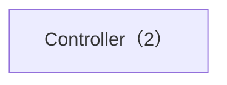
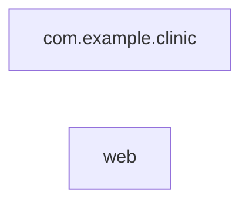
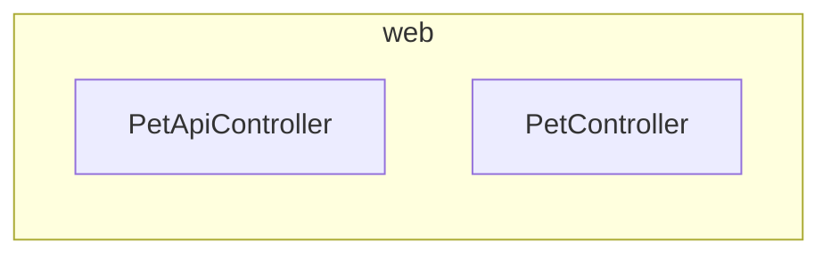
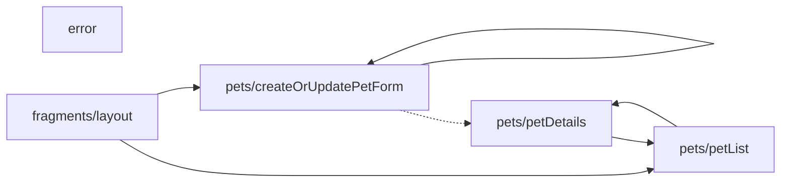

# 成果物一式（com.example.clinic）

## 解析総覧

| 項目 | 内容 |
| --- | --- |
| ルートパッケージ | com.example.clinic |
| Spring Boot | 3.3.5 |
| pom.xml | pom.xml |
| 文字コード | UTF-8 |

### プロジェクト統計

| 項目 | 件数 |
| --- | --- |
| パッケージ | 2 |
| クラス | 3 |
| インタフェース | 0 |
| Enum | 0 |
| Controller | 2 |
| Service | 0 |
| Repository | 0 |
| API | 5 |
| エンティティ | 0 |
| 依存関係 | 0 |
| 解析エラー（エラー / 警告） | 0 / 0 |

## アーキテクチャ・依存関係

### レイヤー構成

**レイヤー構成**

### パッケージ依存

**パッケージ依存**

### コンポーネント依存

**コンポーネント依存**

> 実線＝直接解決 / 点線＝単一実装から解決（@Bean や @Profile による別実装の可能性がある） / 赤枠＝循環依存

### 依存関係一覧

検出されませんでした

### 解決できなかった依存

検出されませんでした

## API一覧

| Controller | Method | HTTP | Path | Request DTO | Response DTO |
| --- | --- | --- | --- | --- | --- |
| PetApiController | names | GET | /api/pets | - | List<String> |
| PetController | list | GET | /pets | - | String |
| PetController | initCreationForm | GET | /pets/new | - | String |
| PetController | processCreationForm | POST | /pets/new | - | String |
| PetController | showPet | GET | /pets/{petId} | - | ModelAndView |

## ER図

> 図はエンティティ（@Entity）のみ。親クラスのカラムは子エンティティに展開しない。テーブル名・カラム名の既定名は推測しない。

### エンティティ一覧

検出されませんでした

## クラス別概要

| クラス名 | 種類 | 役割 | パッケージ | 概要 |
| --- | --- | --- | --- | --- |
| ClinicApplication | クラス | - | com.example.clinic | - |
| PetApiController | クラス | Controller | com.example.clinic.web | JSON API; its return values are response bodies, not views. |
| PetController | クラス | Controller | com.example.clinic.web | Screens of pets. |

### ClinicApplication（クラス）

ClinicApplication は com.example.clinic パッケージのクラスです。

#### 基本情報

| 項目 | 内容 |
| --- | --- |
| 完全修飾名 | com.example.clinic.ClinicApplication |
| 種類 | クラス |
| 役割 | - |
| パッケージ | com.example.clinic |
| ソースファイル | src/main/java/com/example/clinic/ClinicApplication.java |
| 修飾子 | public |
| アノテーション | @SpringBootApplication |
| 親クラス | - |
| インタフェース | - |
| Javadoc | - |
| コメント | - |

#### フィールド

検出されませんでした

#### コンストラクタ

検出されませんでした

#### メソッド

| 名前 | 引数 | 戻り値 | 由来 |
| --- | --- | --- | --- |
| main | String[] args | void | ソース |

### PetApiController（Controller）

PetApiController は com.example.clinic.web パッケージの Controller です。エンドポイント 1 件、依存先 0 件。

#### 基本情報

| 項目 | 内容 |
| --- | --- |
| 完全修飾名 | com.example.clinic.web.PetApiController |
| 種類 | クラス |
| 役割 | Controller |
| パッケージ | com.example.clinic.web |
| ソースファイル | src/main/java/com/example/clinic/web/PetApiController.java |
| 修飾子 | public |
| アノテーション | @RestController |
| 親クラス | - |
| インタフェース | - |
| Javadoc | JSON API; its return values are response bodies, not views. |
| コメント | - |

#### エンドポイント

| Method | HTTP | Path | Request DTO | Response DTO |
| --- | --- | --- | --- | --- |
| names | GET | /api/pets | - | List<String> |

#### 依存先

検出されませんでした

#### 呼び出し関係（簡易）

検出されませんでした

> 既知の DI 依存先フィールドに対する呼び出しのみをヒューリスティックに検出したもので、オーバーロードと多態を解決しない。

> 外部ライブラリの呼び出し、List<Foo>・Optional<Foo> のフィールドに対する呼び出し、コンストラクタ内の呼び出しは含まない。

#### フィールド

検出されませんでした

#### コンストラクタ

検出されませんでした

#### メソッド

| 名前 | 引数 | 戻り値 | 由来 |
| --- | --- | --- | --- |
| names | - | List<String> | ソース |

### PetController（Controller）

PetController は com.example.clinic.web パッケージの Controller です。エンドポイント 4 件、依存先 0 件。

#### 基本情報

| 項目 | 内容 |
| --- | --- |
| 完全修飾名 | com.example.clinic.web.PetController |
| 種類 | クラス |
| 役割 | Controller |
| パッケージ | com.example.clinic.web |
| ソースファイル | src/main/java/com/example/clinic/web/PetController.java |
| 修飾子 | public |
| アノテーション | @Controller, @RequestMapping |
| 親クラス | - |
| インタフェース | - |
| Javadoc | Screens of pets. |
| コメント | - |

#### エンドポイント

| Method | HTTP | Path | Request DTO | Response DTO |
| --- | --- | --- | --- | --- |
| list | GET | /pets | - | String |
| initCreationForm | GET | /pets/new | - | String |
| processCreationForm | POST | /pets/new | - | String |
| showPet | GET | /pets/{petId} | - | ModelAndView |

#### 依存先

検出されませんでした

#### 呼び出し関係（簡易）

検出されませんでした

> 既知の DI 依存先フィールドに対する呼び出しのみをヒューリスティックに検出したもので、オーバーロードと多態を解決しない。

> 外部ライブラリの呼び出し、List<Foo>・Optional<Foo> のフィールドに対する呼び出し、コンストラクタ内の呼び出しは含まない。

#### フィールド

| 名前 | 型 | 修飾子 | アノテーション |
| --- | --- | --- | --- |
| VIEWS_PET_FORM | String | private, static, final | - |

#### コンストラクタ

検出されませんでした

#### メソッド

| 名前 | 引数 | 戻り値 | 由来 |
| --- | --- | --- | --- |
| list | - | String | ソース |
| initCreationForm | - | String | ソース |
| processCreationForm | boolean hasErrors | String | ソース |
| showPet | int petId | ModelAndView | ソース |

## 解析エラーレポート

検出されませんでした

> コンパイル失敗を完全には検出しない。

## MyBatis

> <include> は展開せず、記述どおりに表示する。SQL の意味解析はしない。

検出されませんでした

## Configuration

### @Bean 定義

検出されませんでした

> Bean 名は明記されたもののみ表示し、既定名は推測しない。Bean の内容は解釈しない。

### @ConfigurationProperties

検出されませんでした

### 設定クラス（@Configuration）

検出されませんでした

## 画面一覧

### 画面

| テンプレート | 種類 | View 名 | 表示する Controller メソッド | 部品（include） |
| --- | --- | --- | --- | --- |
| src/main/resources/templates/error.html | THYMELEAF | error | - | - |
| src/main/resources/templates/fragments/layout.html | THYMELEAF | fragments/layout | - | - |
| src/main/resources/templates/pets/createOrUpdatePetForm.html | THYMELEAF | pets/createOrUpdatePetForm | PetController.initCreationForm, PetController.processCreationForm | src/main/resources/templates/fragments/layout.html |
| src/main/resources/templates/pets/petDetails.html | THYMELEAF | pets/petDetails | PetController.showPet | src/main/resources/templates/fragments/layout.html |
| src/main/resources/templates/pets/petList.html | THYMELEAF | pets/petList | PetController.list | src/main/resources/templates/fragments/layout.html, src/main/resources/templates/fragments/layout.html |

### 画面遷移図

**画面遷移**

> 実線＝遷移先メソッドが返す画面 / 点線＝redirect・forward を 1 段たどった画面。部品（include）は含めない。

### 画面ごとの遷移先

| 画面 | 要素 | 記述 | 遷移先 Controller メソッド | 遷移後の画面 |
| --- | --- | --- | --- | --- |
| src/main/resources/templates/error.html | a（th:href） | GET @{/} | - | - |
| src/main/resources/templates/fragments/layout.html | a（th:href） | GET @{/pets} | PetController.list | src/main/resources/templates/pets/petList.html |
| src/main/resources/templates/fragments/layout.html | a（th:href） | GET @{/pets/new} | PetController.initCreationForm | src/main/resources/templates/pets/createOrUpdatePetForm.html |
| src/main/resources/templates/pets/createOrUpdatePetForm.html | form（th:action） | POST @{/pets/new} | PetController.processCreationForm | src/main/resources/templates/pets/createOrUpdatePetForm.html, src/main/resources/templates/pets/petDetails.html |
| src/main/resources/templates/pets/createOrUpdatePetForm.html | a（th:href） | GET @{${backUrl}}（未解決） | - | - |
| src/main/resources/templates/pets/petDetails.html | a（th:href） | GET @{/pets} | PetController.list | src/main/resources/templates/pets/petList.html |
| src/main/resources/templates/pets/petList.html | a（th:href） | GET @{/pets/{petId}(petId=${pet.id})} | PetController.showPet | src/main/resources/templates/pets/petDetails.html |

### Controller と対応付けできなかった View 名

検出されませんでした

