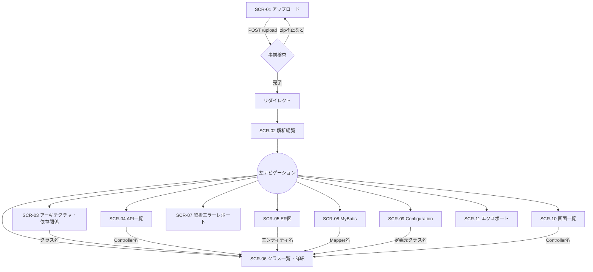

# 画面設計書（WBS No.5）

Javaシステム解析支援ツール V1 の画面一覧・画面遷移・表示項目を定義する。
本書は設計のみを扱い、実装は No.12（文書・図表生成機能）で行う。

## 1. 前提

- **対象機能**：FR-10（結果表示）、FR-11（エクスポート）を中心に、各成果物（FR-05〜FR-09、FR-12〜FR-19）の表示先を定義する
- **データの取得元**：解析結果の画面はすべて IR（`ProjectModel`）のみを参照する。ソースコードや AST を直接参照しない
- **表示する情報**：ソースコードから抽出した事実のみとする。未指定の値を推測で補わない（例：テーブル名が未指定なら既定名を推測せず「未指定」と表示する）
- **V1 の範囲外**：詳細設計書、テスト書、Authorization Matrix、プロジェクト履歴一覧は画面に含めない

### 項目の確定状況

| 区分 | 対象画面 | 状況 |
|---|---|---|
| 確定 | SCR-01〜SCR-11 | No.10、No.20〜No.23 までの IR に基づく |

## 2. 共通仕様

### 2.1 画面構成

SCR-02 以降は、左ナビゲーションと本文領域で構成する複数ページ形式とする。
Mermaid の図を画面ごとに分けて描画することで、大きなプロジェクトでも表示を重くしないため。

```
+----------------------------------------------------------------+
| Javaシステム解析支援ツール V1              [別のプロジェクトを解析] |
+------------------+---------------------------------------------+
| 解析総覧         |                                             |
| アーキテクチャ・依存 |                                             |
| API一覧 (12)     |                  本文領域                    |
| ER図 (5)         |                                             |
| クラス一覧 (48)  |                                             |
| 解析エラー (3)   |                                             |
| MyBatis (0)      |                                             |
| Configuration (2)|                                             |
| 画面一覧 (0)     |                                             |
| エクスポート     |                                             |
+------------------+---------------------------------------------+
```

- ナビゲーションの括弧内は件数を示す。0 件の画面もナビゲーションから隠さず、本文に「検出されませんでした」と表示する（対象外なのか未検出なのかを区別できるようにするため）
- 検査で対応不可、または解析に失敗したプロジェクトでは SCR-02 のみ表示し、左ナビゲーションは表示しない

### 2.2 表示の共通ルール

| 対象 | 表示 |
|---|---|
| 未指定の値（IR の `null`） | 「未指定」または「-」。既定値を推測しない |
| 解決できなかった型（`qualifiedName = null`） | ソース上の表記（`text`）をそのまま表示する |
| Lombok が生成したメンバー | 「Lombok（@Data）」のように `generatedBy` を併記する |
| 型名 | 画面上は単純名で表示し、完全修飾名をツールチップで示す |
| 長い一覧 | V1 ではページングせず、パッケージ等の絞り込みで対応する（数百ファイル規模が対象のため） |
| 長いセル・複数の値 | 約 32 文字を超えるセルのみ折り返し、短い値は 1 行のまま。複数のメソッド・部品・画面は 1 行に 1 件（No.14 で変更） |
| 図 | 画面では原寸で表示し、枠に収まらない分は枠内で横スクロールする（No.14 で変更） |

### 2.3 依存関係の表示ルール

`DependencyModel.resolution` ごとに次のとおり表示する。図の線になるのは上の 3 種類のみとし、残りは「解決できなかった依存」の表に必ず掲載して欠落させない。

| resolution | 図 | 表示 |
|---|---|---|
| `PROJECT_TYPE` | 実線 | そのまま表示する |
| `SINGLE_IMPLEMENTATION` | 点線 | 「単一実装から解決」と注記する（`@Bean` や `@Profile` による別実装の可能性があるため） |
| `COLLECTION_ELEMENT` | 実線 | `List<Foo>` などで注入される Bean ごとに 1 本とする |
| `AMBIGUOUS` | なし | 「実装が複数」として表に掲載する |
| `EXTERNAL` | なし | 「外部ライブラリ」として表に掲載する |
| `UNRESOLVED` | なし | 「型を特定できない」として表に掲載する |

### 2.4 階層表示（アーキテクチャ原則 4）

図は「システム → パッケージ → クラス」の順に掘り下げる。既定ではパッケージ単位で表示し、パッケージを選ぶとそのパッケージのコンポーネントを表示する。絞り込みは `?package=<パッケージ名>` のクエリで指定し、URL で同じ表示を再現できるようにする。

### 2.5 セキュリティ

アップロードされたソースの内容（Javadoc、SQL 原文、アノテーション値など）は信頼できない入力として扱う。

- Thymeleaf では `th:text` を使用し、`th:utext` は使用しない
- Mermaid は `securityLevel: 'strict'` で描画し、図に埋め込む名前はエスケープする
- URL の `{id}` は UUID 形式のみ受け付け、それ以外は 404 とする（IR ファイルの配信で実装済み）

### 2.6 エラー表示

| 状況 | HTTP | 表示 |
|---|---|---|
| zip でない・サイズ超過・展開失敗 | 400 / 413 | SCR-01 にメッセージを表示する |
| 検査で対応不可 | 200 | SCR-02 に理由を表示する |
| 解析の失敗 | 500 | SCR-02 に検査結果と固定メッセージを表示する。詳細はログのみに出力する |
| 存在しないプロジェクト ID | 404 | SCR-01 への導線を持つエラー画面を表示する |

## 3. 画面一覧

パスはすべて `/projects/{id}` からの相対パスで示す（SCR-01 を除く）。

| ID | 画面名 | URL | 対応 FR | 確定状況 |
|---|---|---|---|---|
| SCR-01 | アップロード | `/` | FR-01 | 確定（実装済み） |
| SCR-02 | 解析総覧 | （`/projects/{id}`） | FR-02、FR-13 | 確定 |
| SCR-03 | アーキテクチャ・依存関係 | `/architecture` | FR-05、FR-08、FR-12 | 確定 |
| SCR-04 | API 一覧 | `/apis` | FR-06 | 確定 |
| SCR-05 | ER 図 | `/er` | FR-07 | 確定 |
| SCR-06 | クラス一覧・詳細 | `/classes`、`/classes/{qualifiedName}` | FR-09、FR-18 | 確定 |
| SCR-07 | 解析エラーレポート | `/issues` | FR-14 | 確定 |
| SCR-08 | MyBatis | `/mybatis` | FR-15 | 確定 |
| SCR-09 | Configuration | `/configuration` | FR-16 | 確定 |
| SCR-10 | 画面（View）一覧 | `/views` | FR-17 | 確定 |
| SCR-11 | エクスポート | `/export` | FR-11、FR-19 | 確定 |

## 4. 画面遷移



アップロード後は `/projects/{id}` へリダイレクトする（PRG パターン）。再読み込みで再アップロードされず、URL から結果を再度開ける。

## 5. 画面詳細

### SCR-01 アップロード

```
Javaシステム解析支援ツール V1
Spring Bootプロジェクト（Maven・単一モジュール）のzipをアップロードして解析します。

[エラーメッセージ（ある場合のみ）]
[ファイルを選択] [アップロード]
```

| 項目 | 内容 |
|---|---|
| ファイル選択 | `.zip` のみ。必須 |
| エラーメッセージ | zip でない、サイズ上限超過、展開失敗など |

### SCR-02 解析総覧

```
解析総覧
+-- 事前検査 ---------------------------------+
| 判定：対応可能     Spring Boot：3.2.5        |
| pom.xml：demo/pom.xml  文字コード：UTF-8     |
+---------------------------------------------+
+-- プロジェクト統計 --------------------------+
| パッケージ 5 | クラス 36 | インタフェース 8 | Enum 4 |
| Controller 6 | Service 9 | Repository 7     |
| API 24 | エンティティ 7 | 依存関係 31        |
+---------------------------------------------+
+-- 解析エラー --------------------------------+
| エラー 1 件 / 警告 2 件   [レポートを見る]    |
+---------------------------------------------+
ルートパッケージ：com.example  [IR（JSON）を表示]
```

| 区分 | 項目 | 取得元 |
|---|---|---|
| 事前検査 | 判定、Spring Boot バージョン、pom.xml の位置、文字コード、検査の警告・エラー | `InspectionResult` |
| 統計 | パッケージ数 | `packages` の件数 |
| 統計 | クラス数、インタフェース数、Enum 数 | `types` を `kind` で集計。クラスは CLASS / RECORD、インタフェースは INTERFACE / ANNOTATION（Java では注釈型はインタフェース）、Enum は ENUM とし、3 つの和が型の総数になる（2026/11/11 ユーザー確認済み） |
| 統計 | Controller 数、Service 数 | `components` を `role` で集計 |
| 統計 | Repository 数 | `repositories` と `role = REPOSITORY` の和集合 |
| 統計 | API 数、エンティティ数、依存関係数 | `endpoints`、`entities`、`dependencies` の件数（エンティティ数は `MAPPED_SUPERCLASS`・`EMBEDDABLE` を含む） |
| 解析エラー | 重要度ごとの件数、SCR-07 への導線 | `issues` |
| その他 | ルートパッケージ、IR へのリンク | `rootPackage`、`/ir/project.json` |

対応不可の場合は事前検査のみ、解析失敗の場合は事前検査と固定メッセージのみを表示する。

### SCR-03 アーキテクチャ・依存関係

```
アーキテクチャ・依存関係
[レイヤー構成] [パッケージ依存] [コンポーネント依存]     パッケージ：[すべて v]
+----------------------------------------------------------+
|                   Mermaid の図                            |
+----------------------------------------------------------+
凡例：実線＝直接解決 / 点線＝単一実装から解決

解決できなかった依存
| 依存元 | メンバー | 宣言型 | 理由 |
```

| タブ | 対応 FR | 内容 | 取得元 |
|---|---|---|---|
| レイヤー構成 | FR-05 | 役割ごとのコンポーネント数とレイヤー間の依存 | `components.role`、`dependencies` |
| パッケージ依存（既定） | FR-12 | パッケージ間の依存 | `packages.dependsOn` |
| コンポーネント依存 | FR-08 | コンポーネント間の依存。Lombok の暗黙コンストラクタ注入を含む | `dependencies` |

- コンポーネント依存はパッケージで絞り込める。ノードが **50** を超える場合は絞り込みを必須とし、パッケージ未選択時は図の代わりにパッケージの選択を促す（No.12 で決定）
- 循環依存に含まれるノードは強調表示する
- 「解決できなかった依存」の表には依存元、メンバー名、宣言型（`declaredType.text`）、理由（2.3 の表示）を掲載する

### SCR-04 API 一覧

```
API一覧（24件）                          Controller：[すべて v]
| Controller      | Method | HTTP | Path        | Request DTO | Response DTO |
| OrderController | find   | GET  | /orders/{id}| -           | OrderResponse|
```

FR-06 の 6 項目を次のとおり表示する。

| 項目 | 取得元 | 補足 |
|---|---|---|
| Controller 名 | `controllerType` | SCR-06 へのリンク |
| Method 名 | `methodName` | |
| HTTP メソッド | `httpMethods` | 空の場合は「全メソッド」 |
| Path | `paths` | `pathsResolved = false` の場合は定数式のまま表示し、「未解決」と注記する |
| Request DTO | `requestBodyType` | なければ「-」 |
| Response DTO | `responseType` | ラッパーを除いた型 |

1 つのメソッドに複数の Path がある場合は Path ごとに 1 行とする。

### SCR-05 ER 図

```
ER図
+----------------------------------------------------------+
|              Mermaid の erDiagram（多重度あり）            |
+----------------------------------------------------------+
エンティティ：Order（テーブル：orders）
  カラム | フィールド | 型 | カラム名 | PK | NULL可 | 長さ | 一意 |
  関連   | フィールド | 種類 | 相手 | 所有側 | 結合カラム | fetch | cascade |
```

| 区分 | 項目 | 取得元 |
|---|---|---|
| 図 | エンティティ | `entities` のうち `kind = ENTITY` |
| 図 | 関連と多重度 | `relations.kind`、`targetType` |
| エンティティ | 型名、種類、テーブル名、スキーマ、親クラス | `typeName`、`kind`、`tableName`、`schema`、`superType` |
| カラム | フィールド、型、カラム名、PK、生成戦略、NULL 可否、長さ、一意、Enum 型、埋め込み | `columns` |
| 関連 | フィールド、種類、相手、所有側、`mappedBy`、結合カラム、結合テーブル、`optional`、`fetch`、`cascade` | `relations` |

- 図は双方向の関連を 1 本にまとめる。`mappedBy` を持つ側と、相手エンティティでその名前のフィールドを持つ所有側を対にする。対にできない関連はまとめず、それぞれ 1 本の線とする（推測で対にしない。No.12 で決定）
- テーブル名、カラム名が `null` の場合は「未指定」と表示する。命名戦略による既定名は推測しない
- `MAPPED_SUPERCLASS` と `EMBEDDABLE` は図に含めず、表で種類を示す。エンティティの表には「親クラス」を表示する。親クラスのカラムを子エンティティに展開しない（継承の扱いを推測しないため。No.12 で決定）。代わりに図の箱の見出しに直接の親クラスを「継承：NamedEntity」のように記載する（No.14 で追加）

### SCR-06 クラス一覧・詳細

**一覧**

```
クラス一覧                パッケージ：[すべて v]  役割：[すべて v]
| クラス名 | 種類 | 役割 | パッケージ | 概要（Javadoc の 1 行目） |
```

**詳細**

FR-09 の 4 種類のテンプレートで、構造的な説明を表示する（AI 不使用）。どのテンプレートにも該当しないクラスは共通項目のみを表示する。

```
OrderService（SERVICE）
パッケージ：com.example.service   ソース：src/main/java/.../OrderService.java
説明：<Javadoc>

依存先 | メンバー | 宣言型 | 解決先 | 注入方式 | 由来
被依存 | 依存元 | メンバー
メソッド | 名前 | 引数 | 戻り値 | 由来（ソース / Lombok）
呼び出し関係（簡易） | メソッド | 呼び出し先
```

| テンプレート | 対象 | 固有の表示項目 |
|---|---|---|
| 共通 | すべて | 単純名、完全修飾名、種類、パッケージ、ソースファイル、修飾子、アノテーション、Javadoc、コメント、親クラス、インタフェース、フィールド、コンストラクタ、メソッド |
| Controller | `role = CONTROLLER` | エンドポイント、依存先 |
| Service | `role = SERVICE` | 公開メソッド、依存先、被依存。共通項目のメソッドは「その他のメソッド」とし、非公開メソッドのみ表示する（No.14 で変更） |
| Repository | `role = REPOSITORY` または `repositories` に存在 | 対象エンティティ、ID 型、基底型、宣言メソッド、被依存 |
| Entity | `entities` に存在 | テーブル、カラム、関連、対応するリポジトリ |

- 被依存は `dependencies` のうち `resolvedType` が当該クラスのものから求める
- **簡易 Call Graph（No.23）**：`calls` のうち `fromType` が当該クラスのものを、次の表のとおり表示する。ヒューリスティックによる検出であり、オーバーロードと多態を解決しない旨を常に注記する

| 項目 | 取得元 | 補足 |
|---|---|---|
| 呼び出し元メソッド | `fromMethod`、`fromParameterTypes` | 引数の型を併記してオーバーロードを区別する |
| 依存先フィールド | `fieldName`、`declaredType` | |
| 呼び出し先 | `targetType`、`methodName` | `targetType` は SCR-06 へのリンク。`null` の場合は `resolution` に応じて「実装が複数」「型を特定できない」と表示する |
| 実引数の数 | `argumentCount` | `methodReference = true` の場合は「メソッド参照」と表示する |
| 行 | `line` | |

外部ライブラリの呼び出し、`List<Foo>` や `Optional<Foo>` のフィールドに対する呼び出し、コンストラクタ内の呼び出しは含まない旨を注記する。

### SCR-07 解析エラーレポート

```
解析エラーレポート               種類：[すべて v]  重要度：[すべて v]
| 重要度 | 種類 | ファイル | 行 | メッセージ |
```

| 項目 | 取得元 | 補足 |
|---|---|---|
| 重要度 | `severity` | エラー / 警告 |
| 種類 | `kind` | 次の表の名称で表示する |
| ファイル、行 | `file`、`line` | `null` の場合は「-」 |
| メッセージ | `message` | |

| `kind` | 表示名 |
|---|---|
| `SYNTAX_ERROR` | 構文エラー |
| `UNRESOLVED_IMPORT` | 未解決 import |
| `ENCODING_FALLBACK` | 文字コード |
| `XML_PARSE_ERROR` | XML 解析エラー |
| `VIEW_SETTING_UNRESOLVED` | View 設定 |
| `CIRCULAR_DEPENDENCY` | 循環依存 |
| `DUPLICATE_TYPE` | 型の重複 |

コンパイル失敗を完全には検出しない旨を画面に注記する。

### SCR-08 MyBatis

```
MyBatis                                  Mapper：[すべて v]
OrderMapper（継承：BaseMapper<Order> / mapper/OrderMapper.xml）
  | メソッド | 引数 | 戻り値 | SQL の有無 |
  文：select findById（XML）
  SQL 原文：<pre>...</pre>
インタフェースのない namespace
  com.example.RemovedMapper（mapper/Removed.xml）
```

| 区分 | 項目 | 取得元 | 補足 |
|---|---|---|---|
| Mapper | インタフェース名 | `mappers.interfaceType` | SCR-06 へのリンク。`null` は「インタフェースのない namespace」に分けて表示する |
| Mapper | namespace、XML ファイル | `namespace`、`xmlFiles` | |
| Mapper | 基底インタフェース | `baseType` | 「自動生成メソッドは表示しない」旨を注記する |
| メソッド | メソッド名、引数、戻り値 | `types` の `methods` | 対応する文がなければ「SQL なし」と表示する |
| 文 | タグ名、id、種別 | `statements.tag`、`id`、`source` | 種別は XML / 注解。`methodName = null` の文は「対応メソッドなし」と注記する |
| 文 | SQL 原文 | `statements.sql` | `<pre>` で `th:text` により表示する。意味解析はしない。`sqlResolved = false` は式のまま表示し「未解決」と注記する |

`<include>` は展開せず、記述どおりに表示する。

### SCR-09 Configuration

```
Configuration
@Bean 定義
| 定義元クラス | Bean メソッド | Bean 名 | 戻り値型 | 引数 |
@ConfigurationProperties
| クラス | Bean メソッド | prefix |
設定クラス（@Configuration）
| クラス | 依存先 |
```

| 区分 | 項目 | 取得元 | 補足 |
|---|---|---|---|
| @Bean | 定義元クラス、メソッド名、戻り値型、引数 | `beanDefinitions` | 定義元クラスは SCR-06 へのリンク |
| @Bean | Bean 名 | `beanDefinitions.beanNames` | 空の場合は「未指定」。既定名を推測しない |
| @ConfigurationProperties | クラス、Bean メソッド | `configurationProperties` | クラスに付与した場合、Bean メソッドは「-」 |
| @ConfigurationProperties | prefix | `prefix`、`prefixResolved` | `prefixResolved = false` は定数式のまま表示し「未解決」と注記する。フィールドは SCR-06 で確認する |
| 設定クラス | クラス、依存先 | `components` のうち `role = CONFIGURATION`、`dependencies` | |

`@SpringBootApplication` クラスはコンポーネントとして扱わないが、その `@Bean` は一覧に含める。`SecurityFilterChain` なども通常の `@Bean` として表示し、内容は解釈しない。

### SCR-10 画面（View）一覧

```
画面一覧
| テンプレート | 種類 | View 名 | 表示する Controller メソッド | 部品（include） |
画面遷移図（Mermaid）
画面ごとの遷移先
| 画面 | 要素 | 記述 | 遷移先 Controller メソッド | 遷移後の画面 |
Controller と対応付けできなかった View 名
| Controller メソッド | 種類 | 記述 | 理由 |
```

| 区分 | 項目 | 取得元 | 補足 |
|---|---|---|---|
| 画面一覧 | テンプレート、種類 | `views.path`、`views.kind` | JSP / THYMELEAF |
| 画面一覧 | View 名 | `views.viewName` | `null` は「未指定」。JSP で `spring.mvc.view.prefix` が無い場合や `.jspf` が該当する。推測しない |
| 画面一覧 | 表示する Controller メソッド | `endpoints.viewReturns` のうち `templatePaths` にそのテンプレートを含むもの | Controller 名は SCR-06 へのリンク。無ければ「-」（部品や `error` 等） |
| 画面一覧 | 部品 | `views.includes` | `templatePaths` が空なら記述（`value`）のまま表示し「未解決」と注記する |
| 画面遷移 | 要素、記述 | `views.links` の `element`、`attribute`、`value`、`httpMethod` | `path = null` は式・相対パスのため「未解決」と注記する |
| 画面遷移 | 遷移先 | `views.links.targets` | 該当なしは「-」 |
| 画面遷移 | 遷移後の画面 | 遷移先 `endpoints` の `viewReturns`（VIEW は `templatePaths`、REDIRECT/FORWARD は `targets` をたどる） | 1 段のみたどる。条件分岐で複数ある場合はすべて表示する |
| 未対応 | Controller メソッド、種類、記述 | `viewReturns` のうち `resolved = false`、または VIEW で `templatePaths` が空のもの | 種類 `null` は「不明」と表示する |

テンプレートのパスは、全テンプレートに共通するディレクトリを画面上部（文書では表の直前、Excel ではシートの見出し）に「テンプレートの場所：…」と 1 回だけ示し、表には相対パスで表示する（No.14 で変更）。

画面遷移図は、画面（テンプレート）をノード、`links.targets` と遷移先の `viewReturns` から得た「画面 → 画面」を辺とする。`redirect:`/`forward:` は破線で区別する。部品（`includes`）は遷移ではないため図に含めず、一覧にのみ表示する。リンクの記述が式の場合（`path = null`）は辺を作らない。

テンプレートの検出・View 名の決定方法・対応付けの規則は `ViewTemplatePlugin`、`ViewReturnExtractor`、`ViewLinker` の Javadoc を参照。

### SCR-11 エクスポート

```
エクスポート
基本設計書
  [Word（.docx）をダウンロード]
個別の成果物
  [Markdown] [Word（.docx）] [Excel（.xlsx）]
IR
  [JSON を表示]
```

| 出力 | 形式 | 内容 | URL |
|---|---|---|---|
| 基本設計書（FR-19） | Word | FR-05〜FR-18 の成果物をテンプレートで統合したもの | `/export/basic-design.docx` |
| 成果物一式 | Markdown | 全成果物。図は Mermaid のコードブロック | `/export/documents.md` |
| 成果物一式 | Word | 全成果物 | `/export/documents.docx` |
| 一覧 | Excel | シート構成は下記 | `/export/documents.xlsx` |
| IR | JSON | 保存済みの IR | `/ir/project.json` |

**Excel のシート構成**：統計 / API 一覧 / エンティティ / カラム / 関連 / クラス一覧 / 依存関係 / 解析エラー / MyBatis / Configuration / 画面一覧 / 図

#### 図の埋め込み方式（Word / Excel）

Mermaid.js はブラウザ上で描画するため、図はブラウザで PNG に変換してサーバーへ送り、Apache POI で埋め込む（未決事項 1 の (a)。ユーザー確認済み）。

1. ダウンロードボタンを押すと、ブラウザが対象の図をすべて `mermaid.render()` で SVG にし、canvas に描いて PNG に変換する（印刷用に 2 倍の解像度）
2. PNG を図の ID とともに multipart で POST する。このため Word/Excel のダウンロードは GET ではなく POST とする（URL は上表のまま）
3. サーバーは図の ID で PNG を受け取り、Word は `XWPFRun.addPicture`、Excel は `XSSFDrawing`（「図」シート）で、A4 の幅に収まるよう縮小して埋め込む

| 事項 | 方針 |
|---|---|
| ラベルの文字欠け | Mermaid の既定（`htmlLabels`）は `foreignObject` を使い、canvas に描くと文字が消えるため、変換用の描画は `htmlLabels: false` とする |
| 大きな図 | A4 で読めない規模の図は、システム→パッケージの階層で分割して出力する（アーキテクチャ設計方針 4）。基準は SCR-03 と同じノード数 50 とし、超える場合はパッケージ依存図 1 枚と、パッケージごとのコンポーネント依存図に分ける。ER 図もエンティティが 50 を超える場合はパッケージごとに分け、他パッケージのエンティティは「他パッケージ」の節点として残す（No.12 で決定） |
| 図の安全網 | Mermaid は上限を超えると例外ではなく「Maximum text size in diagram exceeded」の代替図を描く。代替図・描画失敗・canvas の上限超過は、すべての種類の図で変換失敗として扱い、誤った画像を埋め込まない。画面でも同じ判定で「図が大きすぎる…」と表示する（No.12 P5 で追加、ユーザー確認済み） |
| 変換に失敗した図 | エクスポート全体を失敗させず、その位置に表と Mermaid のコードを載せ「図を生成できませんでした」と注記する（方式 (b) を代替として残す） |
| 図の内容 | サーバーは受け取った PNG を IR から作った図の ID に対応付けるのみとし、画像の内容は解釈しない。不明な ID・画像形式でないデータ・上限を超えるサイズは破棄する |
| 外部サービス | 使わない（Kroki 等は解析対象の構造を外部へ送るため不可。mermaid-cli は Node.js とヘッドレスブラウザが必要で技術スタック外） |

Markdown 出力は従来どおり Mermaid のコードブロックとする（画像にしない）。

#### 基本設計書（FR-19）の構成

成果物一式（`documents.docx`）が各成果物をそのまま並べるのに対し、基本設計書は次の章構成に再編し、表紙・改訂履歴・目次・章番号・図表番号を付ける（No.12 で決定）。

| 章 | 内容 | 元の成果物 |
|---|---|---|
| 表紙 / 改訂履歴 / 目次 | システム名（ルートパッケージ）、作成日。改訂履歴の作成者等は手動記入欄 | - |
| 1. システム概要 | 目的・業務概要（手動記入欄）、技術構成（Spring Boot 版・文字コード）、プロジェクト統計 | FR-02、FR-13 |
| 2. アーキテクチャ | レイヤー構成図、パッケージ依存図、コンポーネント依存図、解決できなかった依存 | FR-05、FR-08、FR-12 |
| 3. 画面設計 | 画面一覧、画面遷移図、画面ごとの遷移先 | FR-17 |
| 4. API 設計 | API 一覧（6 項目） | FR-06 |
| 5. データ設計 | ER 図、エンティティ定義、カラム定義、関連定義、MyBatis の SQL 一覧 | FR-07、FR-15 |
| 6. コンポーネント設計 | クラス別概要（4 種テンプレート）、簡易呼び出し関係 | FR-09、FR-18 |
| 7. 設定 | @Bean 定義、@ConfigurationProperties、設定クラス | FR-16 |
| 8. 解析上の制約 | 解析エラー、静的解析で検出しない事項 | FR-14 |

コードから抽出できない事項（業務目的、改訂履歴の作成者・承認者等）は見出しを残し「（手動記入欄）」と記載する。推測で埋めない（NFR-06）。

## 6. 現状の実装との差分（No.12 への申し送り）

| 項目 | 現状 | No.12 での対応 |
|---|---|---|
| 結果の表示 | POST `/upload` の応答に直接表示（`upload-result.html`） | **対応済み**：`/projects/{id}` へリダイレクトし、SCR-02 に置き換えた |
| 検査結果の保存 | IR のみを保存し、`InspectionResult` は保存していない | **対応済み**：`workspace/{id}/result.json` に検査結果と解析の成否を保存する（ローカルのパスは保存しない） |
| 保存済み IR の版違い | `schemaVersion` が異なると読み込みを拒否するが、No.20〜22 で版を上げていないため旧版は原因不明の失敗になる | **対応済み**：版を 2 に上げ、版が異なる場合は「解析結果の版が古いため再アップロードしてください」と表示する |
| 解析失敗の記録 | 応答に表示するのみ | **対応済み**：`result.json` に保存し、SCR-02 を 500 で表示する |
| 共通レイアウト | なし | **対応済み**：`fragments/layout.html` |
| Mermaid.js | 未導入 | **対応済み**：11.4.1 を `static/js/mermaid/` に同梱（MIT ライセンス） |
| 図の規模 | 未検証 | **対応済み**：約 500 ファイルの合成プロジェクトで既定の上限（50,000 文字・500 本）を超えることを確認し、上限を 300,000 文字・3,000 本に引き上げ、ER 図の分割と図の安全網を追加した |

## 7. 未決事項

| No. | 事項 | 内容 | 決定時期 |
|---|---|---|---|
| 1 | Word への図の埋め込み | **解決済み**：(a) エクスポート時にブラウザで PNG に変換してサーバーへ送信し、Apache POI で Word/Excel に埋め込む。(b) 表と Mermaid のコードのみを載せる方式は、変換に失敗した図の代替として残す。詳細は SCR-11 の「図の埋め込み方式」 | No.12 着手前 |
| 2 | コンポーネント依存図の絞り込み閾値 | **解決済み**：50 ノード。SCR-03 参照 | No.12 |
| 3 | `MAPPED_SUPERCLASS` / `EMBEDDABLE` の ER 図での表現 | **解決済み**：図に含めず表で示す。SCR-05 参照 | No.12 |
| 4 | ワークスペースの保持期間 | 履歴一覧や削除の画面を設けないため、解析結果は残り続ける。削除の方法を別途検討する | No.18 まで |
| 5 | SCR-10 の項目 | **解決済み**：No.22 の IR に合わせて確定した | No.22 の完了時 |
